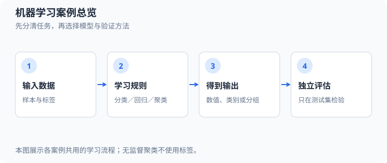
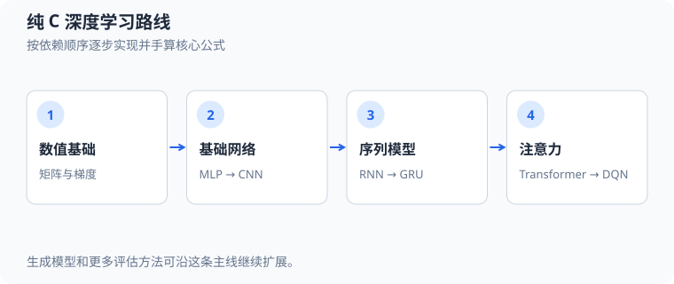

# 仓库学习总览

> 本文合并仓库阅读索引、机器学习案例入口、深度学习阶段计划、机器学习到 Agent 的路线及补充专题。具体算法教程仍按主题独立存放。

## 目录

- [1. 仓库文档阅读顺序](#chapter-reading-order)
- [2. 机器学习案例总览](#chapter-ml-overview)
- [3. 深度学习学习计划](#chapter-deep-learning-plan)
- [4. 机器学习到智能体学习路线](#chapter-llm-agent-roadmap)
- [5. 补充专题](#chapter-supplemental-topics)
- [6. 从底层数学到 AI 的 Agent 执行清单](#chapter-agent-tasks)

当前以“从数学、公式和代码理解 AI”为目标的新增工作，统一按第 6 章执行；第 3～5 章保留已有案例说明与专题背景，不另行维护实施顺序。

<a id="chapter-reading-order"></a>
## 1. 仓库文档阅读顺序


`docs/` 中的两位数前缀表示建议阅读顺序，并按主题留有编号间隔，方便后续插入教程。文档和配图文件名使用中文主题，专业术语在首次出现时同时标注中文、英文和常用缩写；正文标题按层级编号。各主题路线可以独立学习；第一次接触项目时，建议先读 C 基础与 Python 项目约定，再按兴趣选择图形、机器学习或深度学习路线。

### 1.1 C 与 Python 语言及工程基础

从 C 与 Python 语言基础和开发环境开始，再逐步接触标准库、工程约束和完整小项目。

| 顺序 | 文档 | 学习重点 |
| --- | --- | --- |
| 01 | [C 语言基础](c/01_C语言基础.md) | 类型、控制流、函数、数组、指针、存储期、链接与 `static`。 |
| 02 | [VS Code 开发配置](c/02_VSCode开发配置.md) | 编译、代码提示、格式化与调试。 |
| 03 | [C 常用标准库](c/03_C常用标准库.md) | 常见头文件、API 契约和标准库示例。 |
| 04 | [深入 C 语言](c/04_C语言进阶.md) | 所有权、错误处理、二进制协议、回调和原子操作。 |
| 05 | [哈希表与词频统计](c/05_哈希表与词频统计.md) | 哈希、冲突处理、扩容和流式解析。 |
| 06 | [固定块内存池](c/06_固定块内存池.md) | 对齐、指针、对象生命周期和分配失败。 |
| 07 | [教学 CPU 模拟器](c/07_CPU模拟器.md) | 指令、寄存器、取指、解码和执行循环。 |
| 08 | [终端贪吃蛇](c/08_终端贪吃蛇.md) | 状态更新、输入处理、终端控制和游戏循环。 |
| 09 | [转义字符、整数后缀与输出格式](c/09_C转义字符与格式化输出.md) | 字符串转义、无符号整数、`puts`、格式说明符与类型匹配。 |
| 23 | [Python 入门与项目约定](python/23_Python入门与项目约定.md) | Python 示例结构、运行方式、虚拟环境与 C/Python 分工。 |

### 1.2 图形、算法与模拟

先理解软件绘图和图像保存，再通过可视化示例学习算法与模拟。窗口案例需要 SDL2；对应纯 C 核心测试通常不需要窗口依赖。

| 顺序 | 文档 | 学习重点 |
| --- | --- | --- |
| 10 | [最小二维图形引擎](c/10_二维图形引擎.md) | 像素、图元、坐标变换和动画循环。 |
| 11 | [BMP 图片导出](c/11_BMP图片导出.md) | 图像缓冲区、像素通道和 BMP 文件格式。 |
| 12 | [排序算法](c/12_排序算法.md) | 冒泡、插入、选择和快速排序的过程对比。 |
| 13 | [康威生命游戏](c/13_康威生命游戏.md) | 网格状态、邻居规则和双缓冲更新。 |
| 14 | [迷宫生成与寻路](c/14_迷宫生成与寻路.md) | DFS、栈、BFS、队列和路径回溯。 |
| 15 | [寻路算法](c/15_寻路算法.md) | BFS、Dijkstra、A* 与移动代价。 |
| 16 | [贝塞尔曲线编辑器](c/16_贝塞尔曲线编辑器.md) | 控制点、插值和曲线采样。 |
| 17 | [粒子喷泉](c/17_粒子喷泉.md) | 粒子池、速度、重力和固定时间步。 |
| 18 | [波纹模拟](c/18_波纹模拟.md) | 有限差分、双缓冲、阻尼和边界。 |
| 19 | [落沙模拟](c/19_落沙模拟.md) | 网格局部规则、更新顺序和物质守恒。 |
| 20 | [图像滤镜实验室](c/20_图像滤镜.md) | 卷积核、灰度、边界采样和图像处理。 |
| 21 | [曼德勃罗分形](c/21_曼德勃罗分形.md) | 复数迭代、逃逸判断和颜色映射。 |
| 22 | [三维粒子玫瑰](c/22_三维粒子玫瑰.md) | 三维旋转、透视投影和粒子绘制。 |

### 1.3 经典机器学习

先看案例总览和公式读法，再从线性模型开始。分类、聚类、降维和模型评估逐步增加算法复杂度。

| 顺序 | 文档 | 学习重点 |
| --- | --- | --- |
| 30 | [机器学习案例总览](#chapter-ml-overview) | 案例入口、运行命令和实现范围。 |
| 31 | [数学公式与符号读法](ai/31_数学公式与符号读法.md) | 上下标、常见变量、希腊字母和运算符。 |
| 32 | [线性回归](ai/32_线性回归分析.md) | 预测、均方误差和梯度下降。 |
| 33 | [逻辑回归](ai/33_逻辑回归分析.md) | Sigmoid、交叉熵、多特征决策边界、系数解释、分类阈值与模型诊断。 |
| 34 | [K 近邻](ai/34_K近邻分析.md) | 距离度量、特征尺度、分类与回归、复杂度和应用边界。 |
| 35 | [K-means](ai/35_K均值聚类分析.md) | 目标函数、K-means++ 初始化、簇数与轮廓评估、数据形状限制和算法选择。 |
| 36 | [朴素贝叶斯](ai/36_朴素贝叶斯.md) | 生成式分类、词语证据、平滑、模型变体与概率解释。 |
| 37 | [决策树](ai/37_决策树.md) | 基尼不纯度（Gini）、熵、贪心切分、过拟合、剪枝和特征解释。 |
| 38 | [随机森林](ai/38_随机森林.md) | 自助采样（bootstrap）、树间相关性、集成投票、袋外评估（OOB）与参数选择。 |
| 39 | [主成分分析 PCA](ai/39_主成分分析.md) | 最大方差与最小重建误差、中心化、标准化、白化、SVD 和维数选择。 |
| 40 | [线性支持向量机](ai/40_线性支持向量机.md) | 软间隔、hinge 损失、对偶与支持向量、核技巧和概率校准边界。 |
| 41 | [交叉验证](ai/41_交叉验证.md) | 折外预测、折数与重复分折、分组/时间序列验证、嵌套选参与泄漏防范。 |
| 42 | [神经网络正则化](ai/42_神经网络正则化.md) | L2 梯度、MAP 高斯先验、权重衰减、L1 对比和验证选参。 |
| 43 | [CSV、标准化与独立测试评估](ai/43_CSV标准化与独立测试评估.md) | CSV 解析、训练集统计量、验证选轮次与独立测试。 |
| 44 | [类别不平衡与概率校准](ai/44_类别不平衡与概率校准.md) | 混淆矩阵、阈值、Brier 分数与可靠性图。 |
| 45 | [Softmax 多分类](ai/45_Softmax多分类回归.md) | 稳定 Softmax、多类交叉熵和梯度下降。 |
| 46 | [DBSCAN 密度聚类](ai/46_DBSCAN密度聚类.md) | 邻域半径、核心点、边界点和噪声扩展。 |
| 47 | [梯度提升树](ai/47_梯度提升树.md) | 伪残差与函数空间梯度下降、学习率/树复杂度、损失变体及与随机森林比较。 |
| 48 | [公平模型比较](ai/48_公平模型比较.md) | 固定测试集、共同预处理、验证选参和多种子结果。 |
| 49 | [高斯混合模型与期望最大化](ai/49_高斯混合模型与期望最大化.md) | 数学手算、C/Python 对照实现、责任度、E 步、M 步与 K-means 对比。 |

### 1.4 深度学习与强化学习

先阅读路线计划和数值基础，再从单神经元推进到多层网络、卷积、序列模型和生成模型，最后学习残差网络与 DQN。

| 顺序 | 文档 | 学习重点 |
| --- | --- | --- |
| 50 | [纯 C 深度学习计划](#chapter-deep-learning-plan) | 阶段目标、前置知识和练习路线。 |
| 51 | [数值基础与梯度](ai/51_数值计算与梯度.md) | 矩阵布局、链式法则和梯度检查；[第 10 节](ai/51_数值计算与梯度.md#10-m06数值稳定性与梯度检查实验室)补充 M06 实验。 |
| 52 | [XOR 小型 MLP](ai/52_XOR多层感知机.md) | 网络层与张量形状、前向/反向传播、损失匹配、批次/优化器、梯度诊断和架构选择。 |
| 53 | [二维 MLP](ai/53_二维多层感知机.md) | He 初始化、ReLU 分段边界、梯度诊断、小批量优化器和独立评估。 |
| 54 | [CNN 图形分类](ai/54_CNN图像分类.md) | 单/多通道卷积、步长/填充/空洞率、感受野、反向传播与经典结构。 |
| 55 | [去噪自编码器](ai/55_去噪自编码器.md) | 瓶颈表示、重建损失和去噪。 |
| 56 | [字符 RNN](ai/56_字符循环神经网络.md) | 循环状态、BPTT 和字符生成。 |
| 57 | [GRU 记忆网络](ai/57_GRU门控网络.md) | 更新门、重置门和长程梯度。 |
| 58 | [小型 Transformer](ai/58_小型Transformer.md) | 注意力、残差、LayerNorm 和因果掩码。 |
| 59 | [VAE](ai/59_变分自编码器.md) | 潜在变量、重参数化和 KL 散度。 |
| 60 | [GAN](ai/60_生成对抗网络.md) | 生成器、判别器和对抗训练。 |
| 61 | [ResNet](ai/61_残差网络.md) | 残差块、恒等捷径和梯度传播。 |
| 62 | [Snake DQN](ai/62_深度强化学习贪吃蛇.md) | 奖励、经验回放、目标网络和策略评估。 |

### 1.5 从机器学习走向大模型与 Agent

| 顺序 | 文档 | 学习重点 |
| --- | --- | --- |
| 70 | [从零到大模型 Agent 的学习路线](#chapter-llm-agent-roadmap) | 盘点已有案例，按数学手算、纯 C 实现与验收标准推进到分词、语言模型、检索及工具调用。 |
| 71 | [机器学习、深度学习与大模型补充学习框架](#chapter-supplemental-topics) | 列出模型持久化、训练稳定性与归一化、数据增强与可靠性、现代 Transformer 组件，以及对比学习、策略梯度和扩散模型等后续专题。 |
| 72 | [训练稳定性与归一化](ai/72_训练稳定性与归一化.md) | 学习率、梯度裁剪与累积，以及输入标准化、BatchNorm、LayerNorm 和 RMSNorm 的区别。 |
| 73 | [数据增强与可靠性](ai/73_数据增强与可靠性.md) | D02：推导随机增强风险、手算平移/噪声，比较固定预算消融并避免数据泄漏。 |
| 74 | [现代变换器（Transformer）组件对照](ai/74_现代Transformer组件对照.md) | 从现有小型 Transformer 出发，认识 RoPE、RMSNorm、SwiGLU、GQA 与 KV 缓存。 |
| 75 | [二维矩阵变换实验室](ai/75_二维矩阵变换实验室.md) | M01：从基向量到矩阵列，再手算缩放、旋转、错切、投影和复合顺序。 |
| 76 | [批量全连接层与矩阵求导](ai/76_批量全连接层与矩阵求导.md) | M02：两条样本的预测、平均损失、三类梯度和一次更新。 |
| 77 | [标量计算图与自动求导](ai/77_标量计算图与自动求导.md) | M03：局部链式法则、共享梯度累加、XOR 训练及中心差分验证。 |
| 78 | [概率、似然与贝叶斯估计](ai/78_概率似然与贝叶斯估计.md) | M04：硬币 MLE、Beta 更新、MAP、高斯方差及独立测试。 |
| 79 | [信息论与损失函数的来源](ai/79_信息论与损失函数.md) | M05：信息量、熵、交叉熵、KL 及二类/三类损失梯度。 |
| 81 | [正交投影、最小二乘与矩阵分解](ai/81_正交投影最小二乘与矩阵分解.md) | M07：从投影与残差手算 QR 解，再观察二维 SVD 与病态误差。 |
| 82 | [张量计算图与反向传播](ai/82_张量计算图与反向传播.md) | M08：从标量图扩展到小矩阵，手算广播梯度并复现 M02 一轮。 |
| 83 | [优化器、曲率与训练诊断](ai/83_优化器与训练诊断.md) | M09：推导下降方向和步长限制，手算 SGD/动量/Adam，并观察 MLP 训练状态。 |
| 84 | [泛化、偏差方差与统计可靠性](ai/84_泛化与统计可靠性.md) | M10：比较不同多项式容量、训练波动、成对测试损失区间和分布偏移。 |
| 85 | [模型持久化与独立推理](ai/85_模型持久化与独立推理.md) | M11：保存训练集标准化参数和权重，以版本化文件在新进程中复现预测。 |
| 86 | [归一化、初始化与残差梯度实验](ai/72_训练稳定性与归一化.md) | D01：手算 LayerNorm、BatchNorm、RMSNorm、初始化方差与恒等残差梯度。 |
| 87 | [数据增强与可靠性](ai/73_数据增强与可靠性.md) | D02：手算平移/噪声变换，比较同预算消融与固定受扰测试视图。 |

### 1.6 推荐起步路线

零基础可以按 `01 → 02 → 03 → 04` 熟悉语言和工具，再阅读 `30 → 31 → 32 → 33` 进入机器学习。想深入神经网络时继续 `50 → 51 → 52 → 53 → 54`；以大模型与 Agent 为目标时，再读 `56 → 57 → 58 → 70`。每篇教程也会链接必要的前置内容和对应源码。

<a id="chapter-ml-overview"></a>
## 2. 机器学习案例总览


这里的案例使用标准 C 与 Python 标准库，不依赖机器学习框架。C 案例位于 `src/ml/`，对应 Python 脚本位于 `src/python/ml/`；编号 01–28、30–42 一一对应，编号 29 GMM 对应 `src/python/gmm_em.py`。运行 `make ml` 或 `make python` 可分别运行两种语言版本。Python 版本用于对照算法主线；部分高级示例会缩小模型、数据或训练范围，或只突出关键计算，不是 C 代码的逐行翻译。案例采用固定、小型合成数据，目的是看清算法步骤，并练习数组、结构体、循环、函数和数值计算。

阅读各专题的公式时，可先查阅[数学公式与符号读法参考](ai/31_数学公式与符号读法.md)，了解常见字母、上下标、运算符和公式的读法；每篇教程会再定义本例中的具体含义。

```sh
make ml                              # 运行全部机器学习案例
make build/ml/01_linear_regression    # 只编译一个案例
./build/ml/01_linear_regression
```

数学库通过 `-lm` 链接；更换编译器或参数前先 `make clean`。全部案例也参与 `make test` 与 `make lint`。



这张总览图把后续案例放到同一条学习线上：明确输入与任务、理解模型输出，再用独立数据检查效果。聚类没有训练标签。

### 2.1 先理解几个词

- **样本**：一条观测数据，例如一个二维点。
- **特征**：用于预测的输入，例如点的横纵坐标。
- **标签**：已知答案，例如类别 0 或 1。
- **训练**：用数据确定参数或保存用于预测的数据。
- **预测**：把新输入交给已确定的模型或规则。
- **损失**：衡量当前预测偏离训练目标的程度。

回归输出数值，分类输出类别，聚类在没有标签时寻找分组。线性回归、逻辑回归和 K-means 的基本推导可参考 [Stanford CS229 课程资料](https://cs229.stanford.edu/materials.html-full)。

<a id="ml-linear-regression-overview"></a>
### 2.2 线性回归：学习一条直线

源码：`src/ml/01_linear_regression.c`。

#### 2.2.1 查看完整训练日志

示例使用 `src/common/logger.h` 中的单线程日志记录器，同时向屏幕和文件输出全部训练过程。默认文件为 `logs/linear_regression.log`，采用追加模式。每行格式为 `2026-10-06 02:31:58,019 | 01_linear_regression.c:48 | 内容`，时间使用本地时区，文件名和行号来自日志调用处。每次写入都会刷新；打开、写入、刷新或关闭失败会使程序返回失败状态。

```sh
./build/ml/01_linear_regression
less logs/linear_regression.log                  # 分页查看全部过程，按 q 退出
./build/ml/01_linear_regression logs/training.log # 自定义文件路径
```

日志路径须使用 `logs/` 下的相对路径，父目录自动创建，拒绝 `..` 等目录回退。消息只格式化一次，多行逐行添加相同前缀；两个目标内容一致，没有末尾换行时自动补齐。`logger_write` 宏通过 `__FILE__` 和 `__LINE__` 捕获调用位置。日志记录器不关闭借用的标准输出流；每次刷新适合教学演示，大量生产日志可改用缓冲策略。旧日志原样保留。

数据遵循 `y = 2x + 1`，但程序从权重和偏置均为零开始。模型为 `prediction = weight * x + bias`，损失为平均平方误差：

```text
error = prediction - y
loss = sum(error²) / count
d_weight = 2 * sum(error * x) / count
d_bias = 2 * sum(error) / count
parameter -= learning_rate * gradient
```

每轮使用全部训练数据更新一次参数，属于批量梯度下降。示例迭代 500 轮，学习率为 0.05，最终参数接近 `weight=2`、`bias=1`；输入 3 得到约 7。

验证：损失下降、最终损失接近零、训练数据之外的两个输入预测正确。

逐步推导和源码走读见[线性回归分析](ai/32_线性回归分析.md)。

练习：把关系改为 `y = -3x + 2`，添加小噪声，观察损失不能降到零。增大学习率，观察发散风险。输入尺度增大时，重新考虑标准化与学习率。

<a id="ml-logistic-regression-overview"></a>
### 2.3 逻辑回归：输出二分类概率

源码：`src/ml/02_logistic_regression.c`。

训练数据中负数标为 0，正数标为 1。先计算 `z = weight * x + bias`，再用 sigmoid 将结果映射到 0 到 1：

```text
probability = 1 / (1 + exp(-z))
error = probability - label
d_weight = sum(error * x) / count
d_bias = sum(error) / count
```

损失使用二元交叉熵；预测概率达到 0.5 时可判为类别 1。示例使用分支实现 sigmoid，并用 `max(z,0) - label*z + log1p(exp(-abs(z)))` 计算损失，避免直接计算极端指数及 `log(0)`。

验证：交叉熵下降、未训练的正负输入分类正确、极端 sigmoid 输入不溢出。

完整公式推导、数值算例和源码走读见[逻辑回归分析](ai/33_逻辑回归分析.md)。

练习：改变分界线，例如以 1 为阈值生成标签；添加冲突样本观察结果。数据完全线性可分时，无正则化的参数可能不断增长，有限迭代的结果不代表存在有限的最优参数。

### 2.4 K 近邻：用周围样本投票

源码：`src/ml/03_knn.c`。

六个二维样本分成两类。预测时计算新点到每个样本的欧氏距离平方，排序后选最近的 k 个样本，用多数投票决定类别。无需迭代拟合权重，但预测需要访问训练样本。

示例使用结构体存放样本和距离，通过 `qsort` 排序。距离相同时按原始索引排序；票数相同时选类别 0，保证规则明确。k 必须在 1 到样本数之间；坐标及距离计算假设为有限值且不会溢出。

验证：两组新点分类、票数平局、无效 k 及失败时输出不变。

从距离公式开始的完整推导、手算过程和源码走读见[K 近邻分析](ai/34_K近邻分析.md)。

练习：比较 k=1、3、5 的结果。给一个特征乘以 100，观察距离被该维主导，再用训练集的统计量做标准化。此实现固定六个样本，扩展时可改为动态数组及显式样本数。

### 2.5 K-means：无标签地寻找分组

源码：`src/ml/04_kmeans.c`。

两组二维点没有标签。算法固定两个初始中心，然后交替执行：

1. 分配：每个点加入最近中心对应的簇。
2. 更新：每个中心变成所在簇内点的均值。
3. 判断：中心变化足够小则停止，否则继续，最多 100 次。

目标是降低点到所属中心的距离平方和。空簇保留原中心，避免除以零；距离平局选择编号小的簇。示例得到约 `(0.333,0.333)` 与 `(8.333,8.333)` 两个中心。

验证：每轮目标不增加、中心位置和分组正确、相同点造成空簇时保持有限值。

完整的分配距离、均值推导、目标函数和迭代过程见[K-means 分析](ai/35_K均值聚类分析.md)。

练习：改变初始中心，观察收敛结果；增加第三个簇并修改相关循环。簇编号没有类别意义，换初始化后编号可能互换。迭代上限到达时，工程接口应显式报告未收敛。

### 2.6 深度学习数值基础

`src/ml/05_numeric_foundations.c` 对应 [学习计划](#chapter-deep-learning-plan) 的阶段 0。运行 `make numeric-foundations`，观察矩阵乘法、转置、逐元素相加，以及两输入线性模型的前向、链式法则和一次参数更新。固定小数据配套手算答案、数值梯度检查、容量与分配失败验证；详见 [数值基础教程](ai/51_数值计算与梯度.md)。

### 2.7 XOR 小网络

阶段 1 的 `src/ml/06_xor_mlp.c` 从单个 sigmoid 神经元推进到 `2→4→1` 的 XOR 小网络，手写 tanh、稳定交叉熵、反向传播与逐样本 SGD。运行 `make xor-mlp`，配合 [XOR 小网络教程](ai/52_XOR多层感知机.md) 学习；内置测试覆盖全部 17 个参数的数值梯度、一次更新、零初始化和四组预测。

### 2.8 二维分类与小批量训练

阶段 2 的 `src/ml/07_mlp_2d.c` 使用 `2→16→16→1` ReLU 网络区分内圆盘和外圆环。它实现打乱下标、小批量平均梯度、SGD/Adam 对比、验证集选模和独立测试评估；`make mlp-2d` 导出训练前、中途及最佳模型的决策边界 BMP，默认测试不生成图片。详见 [二维 MLP 教程](ai/53_二维多层感知机.md)。

### 2.9 卷积网络识别图形

阶段 3 的 `src/ml/08_cnn_shapes.c` 手写四通道卷积、ReLU、最大池化、展平和 softmax 分类，识别随机位置、尺寸及噪声的灰度图形。`make cnn-shapes` 导出样本与训练前后特征图；内置检查覆盖 631 个参数和 256 个输入像素的梯度及池化平局。详见 [CNN 图形教程](ai/54_CNN图像分类.md)。

D02 在 [数据增强与可靠性](ai/73_数据增强与可靠性.md) 中配套编号案例 `42_data_augmentation.c`，固定原始样本划分后比较无增强、平移、噪声、组合和错误旋转，所有条件保持相同训练更新预算；该缩小实验使用像素线性分类器隔离数据变换，不修改或替代上述 CNN。

### 2.10 去噪自编码器

阶段 4 的 `src/ml/09_denoising_autoencoder.c` 实现 `256→32→8→32→256` 去噪网络，训练噪声每轮更新、评估噪声固定，以 MSE 学习干净目标。`make autoencoder` 导出带噪/重建/目标拼图；测试检查全部参数和输入梯度、三图拟合及独立去噪效果，并对照带噪输入与训练集平均图基线。详见 [自编码器教程](ai/55_去噪自编码器.md)。

### 2.11 字符 RNN

阶段 5 的 `src/ml/10_char_rnn.c` 实现 one-hot→16 维 tanh 状态→softmax 下一字符预测，手写完整 BPTT、时间共享参数梯度和全局梯度裁剪。先拟合 `abcabc…`，再用完整独立序列划分的微型字符语料训练、验证和测试，对照只依赖当前字符的 bigram 基线。

运行 `make char-rnn`，`make test-char-rnn` 验证全部参数及初始状态梯度、数值边界和训练效果；可用 `--log` 同时追加到 `logs/ml/10_char_rnn.log`。详见 [字符 RNN 教程](ai/56_字符循环神经网络.md)，其中解释 teacher forcing、生成、验证检查点和过拟合。

### 2.12 GRU 记忆比特

阶段 6 的 `src/ml/11_gru_memory.c` 用开始比特、无关噪声和结束标记学习序列记忆，只在终点监督。实现 reset-before GRU 的更新门、重置门、候选状态及完整 BPTT，并与同宽 RNN 在相同300轮数据预算下比较三种间隔和两个初始化种子。

运行 `make gru-memory`，`make test-gru-memory` 和 `make sanitize-gru-memory` 验证梯度、边界与训练；`--log` 追加双输出日志至 `logs/ml/11_gru_memory.log`。详见 [GRU 记忆比特教程](ai/57_GRU门控网络.md)，包括门控公式、种子敏感性和公平比较的边界。LSTM 尚未实现，保留为选做。

### 2.13 小型 Transformer

阶段 7 的 `src/ml/12_tiny_transformer.c` 实现16维、双头、上下文16的单层decoder-only模型，包含因果掩码、可学习位置、pre-LayerNorm、残差和GELU。手写全部反向传播，先微型拟合，再复用字符语料的完整训练/验证/测试分组，并展示两头注意力矩阵。

运行 `make tiny-transformer`，用 `make test-tiny-transformer` 和 `make sanitize-tiny-transformer` 验证全部参数、局部梯度、因果性和训练；`--log` 双输出至 `logs/ml/12_tiny_transformer.log`。详见 [小型 Transformer 教程](ai/58_小型Transformer.md)，包括数据分块、过拟合、贪心生成和上下文限制。

### 2.14 VAE 图形生成

`src/ml/13_vae_shapes.c` 将16×16图形编码成二维均值/对数方差，用重参数化采样后解码。优化每图Bernoulli重建负对数似然加标准正态KL，固定噪声验证全部参数及输入/epsilon导数，按独立验证负ELBO选择检查点。

运行 `make vae` 将重建对照、潜在网格、潜在插值和先验样本导出到 `exports/`；`make test-vae` 不写文件。`--log` 双输出至 `logs/ml/13_vae_shapes.log`。详见 [VAE 教程](ai/59_变分自编码器.md)，其中区分随机重建、解码均值、先验采样及生成质量的评估边界。

### 2.15 GAN 八簇二维点

`src/ml/14_gan_2d.c` 用两个独立的两层tanh网络学习八个高斯簇。判别器优化真实/生成BCE，生成器优化非饱和损失；生成器更新时冻结判别器参数，但保留其输入导数。没有重建配对或VAE编码器。

运行 `make gan` 导出前后散点、判别器热图与潜在网格；`make test-gan` 和 `make sanitize-gan` 检查完整梯度链、每步冻结与数值边界。`--log` 双输出至 `logs/ml/14_gan_2d.log`。详见 [GAN 教程](ai/60_生成对抗网络.md)，通过最近簇距离、有效点比例和每簇计数识别模式崩塌，不以D接近0.5作为生成成功的唯一证据。

### 2.16 从教学案例走向真实数据

阶段 9.1 的 `src/ml/15_naive_bayes.c` 在固定英文短句上演示多项式朴素贝叶斯。运行 `make naive-bayes` 查看两类未归一化对数分数、独立测试结果及多数类基线；`make test-naive-bayes` 核对手算概率、平滑和未登录词。详见 [朴素贝叶斯教程](ai/36_朴素贝叶斯.md)。

阶段 9.2 的 `src/ml/16_decision_tree.c` 用二维网格演示基尼增益、深度与最小叶节点限制。运行 `make decision-tree` 导出树桩和深度 2 决策边界对照图；`make test-decision-tree` 核对手算增益、平局、重复值与失败保留。详见 [决策树教程](ai/37_决策树.md)。

阶段 9.3 的 `src/ml/17_random_forest.c` 在带少量训练标签噪声的二维圆形分类任务上实现 bootstrap、有放回抽样、节点随机特征选择、多数投票和袋外评估。运行 `make random-forest` 比较单棵 CART 与多个种子的 31 棵树森林；`make sanitize-random-forest` 检查内存和未定义行为。详见 [随机森林教程](ai/38_随机森林.md)。

阶段 9.4 的 `src/ml/18_pca.c` 使用固定种子的相关四维数据，仅从训练集拟合均值、协方差和两个主方向，再将训练与独立测试样本投影到二维并重建。运行 `make pca` 导出投影散点图；直接运行 `./build/ml/18_pca` 查看方差解释比例及两组重建误差。详见 [PCA 教程](ai/39_主成分分析.md)。

阶段 9.5 的 `src/ml/19_linear_svm.c` 用固定种子的二维数据手写带 L2 正则的软间隔线性 SVM，以小批量次梯度下降优化 hinge 损失，并在相同训练集上拟合逻辑回归作对照。运行 `make linear-svm` 查看训练/测试错误、几何间隔和两种决策边界；直接运行 `./build/ml/19_linear_svm` 只输出数值。详见 [线性 SVM 教程](ai/40_线性支持向量机.md)。

阶段 10.1 的 `src/ml/20_cross_validation.c` 用分层 4 折交叉验证选择逻辑回归的 L2 系数。每折只从折内训练数据拟合标准化参数；选参后在完整开发集重训，最终测试集只评估一次。运行 `make cross-validation` 查看每折和平均 log-loss、所选系数与最终测试指标。详见 [交叉验证教程](ai/41_交叉验证.md)。

阶段 10.2 的 `src/ml/21_regularization.c` 用 $24$ 条训练样本拟合 $2\to24\to1$ MLP，每条训练标签以 $20\%$ 概率翻转，对照无正则与五种非零 L2 强度。运行 `make regularization` 观察训练 BCE、含惩罚项的优化目标、验证 BCE 和权重范数；验证集选择系数，三个种子的独立测试集只用于最终报告。网络共有 $97$ 个参数；`make test-regularization` 对全部参数做中心差分检查，并验证偏置不受惩罚；`make sanitize-regularization` 运行消毒器。详见 [正则化教程](ai/42_神经网络正则化.md)。

进一步学习神经网络和强化学习，可阅读 [纯 C 深度强化学习贪吃蛇](ai/62_深度强化学习贪吃蛇.md)。它包含两层隐藏层、反向传播、Adam、经验回放、目标网络以及独立评估，实现自动玩本项目的贪吃蛇。

前几个案例主要验证算法实现与已知小数据上的行为；二维分类、CNN 和自编码器案例已拆分训练、验证和测试集，但一次固定种子的合成任务评估仍不足以证明真实数据上的表现。调参使用验证集，最终评价使用未参与调参的测试集；需要进一步比较多个种子和真实数据。标准化参数只从训练集计算，避免数据泄漏。

回归可报告测试集 MSE，分类可报告准确率与混淆矩阵。聚类可比较目标值、不同初始化和数据分布。CSV、可靠性评估、经典算法扩展和公平模型比较已有独立案例；模型与预处理参数持久化对应[第 6 章任务 M11](#chapter-agent-tasks)。

### 2.17 CSV、标准化与独立测试评估

`src/ml/23_csv_standardization.c` 从 `data/ml/study_outcomes.csv` 读取两个数值特征、二分类标签和明确的数据划分。运行 `make csv-standardization` 查看训练集拟合的均值/标准差、验证集选择的训练轮次，以及只在训练结束后计算的测试集 BCE、准确率和混淆矩阵。`make test-csv-standardization` 检查 CSV 错误处理、训练集统计量隔离与测试集计数；`make sanitize-csv-standardization` 检查内存和未定义行为。

示例只接受固定表头、四个未加引号字段的教学用 CSV 子集，不是完整 RFC 4180 解析器。数据是手工构造的小型示例，不代表真实考试或任何真实人群的表现。逐函数源码地图、标准化和梯度推导、首条测试样本计算见 [CSV 标准化技术分析](ai/43_CSV标准化与独立测试评估.md)。

### 2.18 类别不平衡与概率校准

`src/ml/24_reliability_assessment.c` 用固定种子的合成数据演示正类稀少时准确率为何会误导，并比较多数类基线、普通损失和类别加权损失。运行 `make reliability-assessment` 查看混淆矩阵、精确率、召回率、F1、平衡准确率、验证集选择阈值、Brier 分数、交叉熵、ECE 和 ASCII 可靠性图。阈值及 Platt 映射只使用验证集，测试集只在最后评估。运行 `make test-reliability-assessment` 检查指标边界、确定性与数据隔离；`make sanitize-reliability-assessment` 运行地址和未定义行为消毒器。

可靠性图使用 $10$ 个等宽概率区间，比较每箱平均预测概率与实际正例率。数据集刻意保持正类占比为 $10\%$，每个划分中的正例数较少，因此分箱指标会有明显波动；这是固定教学实验，不是效果保证。完整源码地图、权重/指标/校准推导及测试集实例见 [可靠性评估技术分析](ai/44_类别不平衡与概率校准.md)。

### 2.19 扩展经典算法

补充路线第 3 步增加了三种互补算法，均使用固定小数据和纯 C 实现。`make softmax-regression` 运行三分类线性模型，观察稳定 Softmax 与多类交叉熵；`make dbscan` 运行密度聚类，观察核心点扩展、边界点和噪声；`make gradient-boosting` 运行平方误差回归，观察树桩逐轮拟合残差，并用验证集选择轮数。

分别运行 `make test-softmax-regression`、`make test-dbscan` 和 `make test-gradient-boosting` 核对手算结果与边界；对应消毒器目标为 `make sanitize-softmax-regression`、`make sanitize-dbscan` 和 `make sanitize-gradient-boosting`。源码走读见 [Softmax 多分类分析](ai/45_Softmax多分类回归.md)、[DBSCAN 分析](ai/46_DBSCAN密度聚类.md)和[梯度提升分析](ai/47_梯度提升树.md)。这些固定样本上的结果用于验证实现和理解步骤，不作为现实数据上的效果保证。

### 2.20 公平模型比较

`src/ml/28_model_comparison.c` 使用同一 CSV 比较多数类基线、逻辑回归、K 近邻和决策树桩。每个固定种子将原训练与验证行合并为开发集，再按类别分层拆分训练/验证；测试行固定不变。每轮只用训练子集拟合标准化参数，所有模型复用同一组统计量和拆分。逻辑回归学习率及 KNN 的邻居数只按验证平衡准确率选择，树桩阈值仅从训练数据学习。

运行 `make model-comparison` 查看五个种子的单轮预测指标和测试集均值 ± 总体标准差；程序也对第一轮逻辑回归与 K 近邻在相同测试行上的 0/1 损失差计算成对自助区间。`make test-model-comparison` 验证共同划分、手算指标、配对重采样、树桩切分与测试集隔离，`make sanitize-model-comparison` 检查内存和未定义行为。逐函数源码地图和数据流程见[公平模型比较技术分析](ai/48_公平模型比较.md)；区间假设与手算见[M10 教程](ai/84_泛化与统计可靠性.md)。测试集只有 $8$ 条且五轮重复使用同一测试行，因此重复划分的标准差反映开发集划分变化，不是置信区间，也不证明真实泛化效果。

### 2.21 高斯混合模型与期望最大化

`src/ml/29_gmm_em.c` 和 `src/python/gmm_em.py` 使用相同的六个二维点、初始权重、均值和协方差，手写完整协方差高斯混合模型与 EM。运行 `make gmm` 和 `make gmm-python`，逐轮比较责任度更新后的似然、权重、均值和协方差；两份程序只使用 C 数学库和 Python 标准库。

阅读[高斯混合模型与期望最大化教程](ai/49_高斯混合模型与期望最大化.md)，从一维手算推进到二维实现，学习软分配、log-sum-exp、空成分和协方差正则化。此例固定两个成分，适合观察算法步骤，不提供成分数自动选择或通用数据读取。

### 2.22 泛化、偏差方差与统计可靠性

`src/ml/39_generalization_bootstrap.c` 与 Python 对照使用不同次数的多项式拟合已知二次函数，在重复训练数据上估计偏差平方与方差，并分别报告同分布测试误差及输入区间偏移后的误差。两个预先固定的模型在同一测试记录上逐条计算平方损失，再用相同测试下标做成对 bootstrap。运行 `make generalization-bootstrap`；使用 `make test-generalization-bootstrap` 检查手算拟合、秩亏边界、重采样配对和跨语言结果。完整推导与逐步计算见[泛化、偏差方差与统计可靠性](ai/84_泛化与统计可靠性.md)。

### 2.23 模型持久化与独立推理

`src/ml/40_model_persistence.c` 和 `src/python/ml/40_model_persistence.py` 复用 CSV 数据与训练集标准化参数，训练小型逻辑回归并保存版本化模型文件。文件包括输入维度、均值、标准差、权重、偏置和 CRC-32；新进程只加载模型并处理原始特征，不重新读取训练集或拟合标准化器。运行 `make model-persistence` 看内存演示，再分别执行 `make model-persistence-train MODEL_PATH=sessions/ml-models/study-v1.bin` 与 `make model-persistence-predict MODEL_PATH=sessions/ml-models/study-v1.bin FEATURE_0=5.2 FEATURE_1=64`。`make test-model-persistence` 检查 C/Python 共用夹具、独立进程预测、损坏文件拒绝与已有模型保护；详细手算和字节布局见[模型持久化与独立推理](ai/85_模型持久化与独立推理.md)。

### 2.24 归一化、初始化与残差梯度实验

`src/ml/41_normalization_residual.c` 和 `src/python/ml/41_normalization_residual.py` 使用相同的固定 `2×3` 批次，分别计算 LayerNorm、训练态/推理态 BatchNorm 和 RMSNorm 的输出与反向梯度，并对照 He/Glorot 初始化目标方差和恒等捷径梯度。运行 `make normalization-residual`；`make test-normalization-residual` 对三种归一化的输入与缩放/平移梯度做中心差分，并验证 BN 运行统计、单样本和零方差边界以及 C/Python 数值一致；`make sanitize-normalization-residual` 检查 C 内存和未定义行为。该程序是固定运算的数值实验，不训练预测模型；留出的单样本只检查 BN 推理时复用训练统计，不代表泛化评估。完整推导、手算与示意图见[训练稳定性与归一化](ai/72_训练稳定性与归一化.md)。

<a id="chapter-deep-learning-plan"></a>
## 3. 深度学习学习计划


若目标是从经典机器学习逐步学到语言模型与 Agent，可先看[从零到大模型 Agent 的学习路线](#chapter-llm-agent-roadmap)；本文件继续保留各深度学习阶段的详细练习和实现状态。



按图中的先后顺序学习矩阵与梯度、基础网络、序列模型和注意力机制；生成模型与评估专题可穿插复习。

### 3.1 学习目标与边界

目标是能解释并亲手实现神经网络的前向计算、反向传播、参数更新和评估过程。以 C23、C 标准库和 `<math.h>` 为基础，在 CPU 上运行小模型，不依赖 PyTorch、TensorFlow、BLAS 或自动求导库。

先使用内置或程序生成的小数据集，便于手算和重复实验。可视化优先复用仓库的二维绘制与 BMP 导出；SDL2 窗口仅作为可选展示，不参与模型计算。MNIST 等外部数据集留到核心计算验证完成之后。

本文件是逐项实施的路线。阶段 0～7、VAE、GAN、阶段 9.1～9.5、阶段 10.1～10.4、阶段 11.1 和补充路线第 1～4 步已实现，阶段 8 使用已有 DQN；阶段 11.2～14 仍待补。CSV 读取、训练集标准化、独立测试评估及模型与预处理参数持久化已有教学实现。训练稳定性与归一化、数据增强与可靠性、现代 Transformer 组件已有[简要入门文档](#chapter-supplemental-topics)，按[建议顺序](#chapter-reading-order)阅读第 72～74 篇，再完成相应代码练习。学习按完成标准推进，不规定每阶段的天数。下方复选框记录个人学习完成情况，不由代码实现状态自动勾选。

### 3.2 已有基础与推荐顺序

已有内容：

- `src/ml/01_linear_regression.c`：损失函数、梯度下降、训练日志。
- `src/ml/02_logistic_regression.c`：sigmoid、二分类交叉熵和数值稳定性。
- `src/ml/03_knn.c`、`04_kmeans.c`：了解不依赖神经网络的学习方法。
- `src/games/snake_ai_network.h`：针对贪吃蛇的全连接网络、反向传播和 Adam。
- `src/games/snake_ai.c`：DQN 训练、经验回放、评估与自动游戏。

先读 [机器学习入门说明](#chapter-ml-overview)，运行 `make ml`。DQN 可以先观察行为，完成全连接网络阶段后再深入阅读 [贪吃蛇 AI 教程](ai/62_深度强化学习贪吃蛇.md)。

推荐主线：**数值基础 → XOR → 二维 MLP → CNN → 自编码器 → RNN → GRU → 小型 Transformer → 回看 DQN → 经典机器学习 → 评估方法 → 新网络结构 → 表示学习 → 生成模型 → 策略梯度**。VAE、GAN 已有独立案例，可在自编码器和 MLP 阶段之后穿插学习。

### 3.3 每阶段的学习方法

1. **手算**：用极小输入算一次前向和梯度，画出数据形状。
2. **实现**：先写可直接阅读的循环，明确缓冲区长度、所有权和失败行为。
3. **验证**：检查中间结果和数值梯度，再尝试让模型拟合少量样本。
4. **实验**：每次只改变一个因素，记录结果，并用自己的话解释变化。

每阶段产出一个小案例、一份中文教程和必要的行为测试。先完成独立例子，再提取确实重复的计算模块，避免提前搭建复杂框架。

### 3.4 阶段 0：补齐数学和数值计算基础

**实现状态**：已提供 `src/ml/05_numeric_foundations.c`，运行 `make numeric-foundations`；阅读 [数值基础与梯度教程](ai/51_数值计算与梯度.md)，逐项完成下方学习检查。

- [ ] 理解向量、矩阵、点积、转置、偏导数与链式法则。
- [ ] 手写矩阵乘法和逐元素运算，统一采用行优先存储。
- [ ] 阅读已有回归代码，区分参数、激活值、梯度和学习率。

**最小案例**：计算一个两输入线性模型的预测、均方误差和一次参数更新；另用小矩阵验证乘法结果。

**验证与完成标准**：能标注每个数组的形状，手算结果与程序一致；维度不匹配、容量不足和分配失败有明确处理。理解为何训练需要保存部分前向结果，以及为何更新前要完成梯度计算。

**练习**：改变学习率观察收敛、震荡和发散；不要把每一步损失都下降作为普遍要求。

### 3.5 阶段 1：从单个神经元到 XOR 网络

**实现状态**：已提供 `src/ml/06_xor_mlp.c`，运行 `make xor-mlp`；阅读 [XOR 小网络教程](ai/52_XOR多层感知机.md)。固定种子 42、学习率 0.1、5000 轮 SGD，验证四组预测和全部参数梯度。

- [ ] 实现单个神经元：`z = w·x + b`、激活函数、损失和梯度。
- [ ] 实现 `2 → 4 → 1` 的小型 MLP，隐藏层使用 tanh，输出使用 sigmoid。
- [ ] 手写反向传播和 SGD，使用基于 logits 的稳定二分类交叉熵。

**最小案例**：学习 XOR 的四个输入与标签，打印每个输入的预测概率。这是浅层网络入门，用于理解非线性表达能力。

**验证与完成标准**：用固定种子验证四个真值表结果；所有参数通过数值梯度检查；能说明没有隐藏层的线性分类器为什么不能分开 XOR。测试阈值在实现时结合固定初始化和训练预算确定。

**练习**：先将隐藏层去掉，再增加神经元；比较零初始化与随机初始化，解释对称性问题。

### 3.6 阶段 2：二维分类与多层感知机

**实现状态**：已提供 `src/ml/07_mlp_2d.c`，运行 `make mlp-2d` 导出 BMP，`make test-mlp-2d` 进行无文件输出的验证；阅读 [二维 MLP 教程](ai/53_二维多层感知机.md)。使用独立训练/验证/测试数据，比较小批量 SGD 与 Adam。

- [ ] 实现 `2 → 16 → 16 → 1` 网络，加入 ReLU、小批量训练和数据打乱。
- [ ] 生成圆环或双月形数据，明确训练、验证、测试集的用途。
- [ ] 在 SGD 验证正确后加入 Adam，对比优化器的行为。

**最小案例**：画出样本点与模型的二维决策边界，观察边界随训练变化；无窗口时导出 BMP。

**验证与完成标准**：分别记录训练与验证损失，检查未参与训练的数据；ReLU 的梯度检查避开零点。修改网络宽度或深度时，数组形状及梯度累加仍正确。

**练习**：减少训练样本、加入噪声、扩大网络，观察过拟合；用验证集选择配置，最终测试集只用于最终评估。

### 3.7 阶段 3：卷积神经网络 CNN

**实现状态**：已提供 `src/ml/08_cnn_shapes.c`，运行 `make cnn-shapes` 导出样本与特征图，`make test-cnn-shapes` 进行无文件输出的验证；阅读 [CNN 图形教程](ai/54_CNN图像分类.md)。已检查卷积核、分类参数及输入像素梯度，并明确池化平局规则。

- [ ] 先用固定卷积核理解局部感受野、权重共享、步长和填充。
- [ ] 实现卷积、ReLU、最大池化、展平和分类层的前向与反向计算。
- [ ] 理解卷积核梯度来自所有使用该权重的位置，池化反向需要保存最大值位置。

**最小案例**：识别程序生成的 `16×16` 灰度圆形、方形与三角形。起步结构为 `3×3` 卷积（4 个输出通道）→ ReLU → 池化 → 全连接三分类；使用稳定 softmax 交叉熵。

**验证与完成标准**：用小图手算边界卷积；检查卷积核和输入梯度；明确池化平局规则。训练与测试分别生成，并改变位置、尺寸、噪声，避免只识别固定模板。

**练习**：显示特征图，比较卷积网络与输入展平后的 MLP；掌握后再尝试读取 MNIST。

### 3.8 阶段 4：自编码器与去噪

**实现状态**：已提供 `src/ml/09_denoising_autoencoder.c`，运行 `make autoencoder` 导出重建对照图，`make test-autoencoder` 进行无文件输出的验证；阅读 [自编码器与去噪教程](ai/55_去噪自编码器.md)。包括完整梯度检查、三图拟合、独立评估与两种基线。

- [ ] 理解编码器、瓶颈表示、解码器和重建损失。
- [ ] 实现 `256 → 32 → 8 → 32 → 256` 的全连接自编码器。
- [ ] 对归一化灰度图使用合适的输出范围，以均方误差训练重建。

**最小案例**：对 `16×16` 合成图形加噪，以带噪图为输入、干净图为目标，展示输入、重建和目标。

**验证与完成标准**：先拟合少量样本验证计算，再检查独立样本的重建误差；训练和评估使用可重复但独立的噪声。能解释瓶颈维度对细节保留的影响。

**练习**：比较不同瓶颈大小和噪声强度。潜在表示是一种学习到的编码；仅有自编码器并不等于完成了图片压缩文件格式。

### 3.9 阶段 5：循环神经网络 RNN

**实现状态**：已提供 `src/ml/10_char_rnn.c`，运行 `make char-rnn`；阅读 [字符 RNN 与 BPTT 教程](ai/56_字符循环神经网络.md)。已实现 16 维状态、完整 BPTT、全局梯度裁剪、全部参数/初始状态梯度检查，以及周期拟合和独立微型语料评估。截断 BPTT 保留为练习。

- [ ] 实现 `h_t = tanh(W_x x_t + W_h h_(t-1) + b)` 和输出分类层。
- [ ] 理解时间步之间共享参数，以及沿时间反向传播（BPTT）。
- [ ] 加入梯度裁剪，区分完整与截断 BPTT。

**最小案例**：先预测重复的 `abcabc…` 序列，再对小型内置字符语料预测下一个字符。采用 one-hot 输入、16 维隐藏状态和短序列，先限定字符表。

**验证与完成标准**：用两三个时间步验证共享权重的梯度累加；明确独立序列何时重置隐藏状态。按独立序列或不重叠文本段划分数据，避免滑动窗口跨训练、测试边界。

**练习**：增加需要记忆的间隔，观察梯度消失；生成看似合理的文本并不能单独证明模型泛化良好。

### 3.10 阶段 6：门控网络 GRU / LSTM

**实现状态**：已提供 `src/ml/11_gru_memory.c`，运行 `make gru-memory`；阅读 [GRU 记忆比特教程](ai/57_GRU门控网络.md)。已实现 reset-before GRU、全部参数及初始状态梯度检查，并在三种间隔、两个初始化种子下以相同数据预算对照 RNN；不预设 GRU 胜出。LSTM 保留为选做。

- [ ] 优先实现 GRU 的更新门、重置门与候选状态。
- [ ] 再选做 LSTM，区分细胞状态、隐藏状态和各个门。
- [ ] 理解门控如何调节信息保留与梯度传播。

**最小案例**：序列开始给出一个比特，中间加入无关输入，在结束标记处预测最初的比特。

**验证与完成标准**：门控及时间展开的梯度检查通过；在相同数据和训练预算下比较 RNN、GRU，不预设某种结构必然胜出。

**练习**：逐步延长记忆间隔，记录不同随机种子的结果，区分模型能力和单次训练运气。

### 3.11 阶段 7：小型 Transformer

**实现状态**：已提供 `src/ml/12_tiny_transformer.c`，运行 `make tiny-transformer`；阅读 [小型 Transformer 教程](ai/58_小型Transformer.md)。已实现16维、双头、16步上下文的单层decoder，包含学习位置、因果注意力、残差、LayerNorm和GELU；全部2644个参数及注意力/归一化局部梯度、因果性和独立语料评估已验证。

- [ ] 先实现单头注意力：`softmax(QK^T / sqrt(d_k))V`，显示注意力矩阵。
- [ ] 加入因果掩码、多头注意力、位置表示、残差连接与 LayerNorm。
- [ ] 最后实现完整反向传播和下一字符预测。

**最小案例**：单层 decoder-only 模型，嵌入维度 16、2 个注意力头、上下文长度 16，复用 RNN 的小字符语料。

**验证与完成标准**：修改未来位置的输入不会影响此前位置的预测；检查 softmax、归一化和注意力梯度；先拟合极小语料，再使用独立数据评估。能解释注意力权重、位置表示和生成时上下文的作用。

**练习**：移除位置表示，改变上下文长度，比较与 RNN 的差异。本阶段学习注意力原理，不以训练实用大语言模型为目标。

### 3.12 阶段 8：回看已有 DQN 贪吃蛇

- [ ] 对照自己的 MLP，阅读 `snake_ai_network.h` 的前向、Huber 损失、反向与 Adam。
- [ ] 阅读 `snake_ai.c`，区分 Q 网络结构与 DQN 训练方法。
- [ ] 理解 Bellman 目标、折扣、终止状态、探索、经验回放和目标网络。

**最小实验**：使用独立运行目录，比较随机策略与训练策略；随后一次只改变一个训练因素。

**验证与完成标准**：运行 `make test-snake-ai` 和 `make sanitize-snake-ai`；在多个固定评估种子下统计平均分、最高分和失败情况。评估关闭探索，训练结果不覆盖历史实验。

**练习**：分析 11 维特征遗漏了哪些棋盘信息。追求高分是优化目标，不能承诺学到保证满分的策略。

### 3.13 已实现的生成模型扩展

- **VAE**：完成阶段 4 后运行 `make vae`，阅读 [二维潜在空间教程](ai/59_变分自编码器.md)。先手算重参数化与 KL 项，再改变潜在维度，观察重建和先验采样；用 `make test-vae` 检查导数。
- **GAN**：完成阶段 2 后运行 `make gan`，阅读 [八簇点教程](ai/60_生成对抗网络.md)。先区分生成器与判别器的目标，再观察交替更新和八簇覆盖；用 `make test-gan` 检查梯度链。

以下阶段 9～14 中，9.1～9.5、10.1、10.2 和 11.1 已有实现，其余为**待实现学习计划**。案例从小型内置数据开始；待实现条目列出的训练、测试和可视化步骤是实施目标，不表示仓库已有相应命令。每项先完成步骤，再按完成标准检查。阶段 9、10 侧重非神经网络方法和可信评估，为后面的结构实验提供对照。

### 3.14 阶段 9：经典机器学习

#### 3.14.1 朴素贝叶斯文本分类

**实现状态**：已提供 `src/ml/15_naive_bayes.c`，运行 `make naive-bayes`；阅读 [朴素贝叶斯教程](ai/36_朴素贝叶斯.md)，用 `make test-naive-bayes` 验证手算概率与边界。

**前置**：概率、对数及 `src/advanced/07_word_frequency.c` 的词频统计。

1. 用少量自编短句建立两类训练集和独立测试集，完成分词、词表与每类词频统计。
2. 手算先验概率、拉普拉斯平滑后的词条件概率；在 C 中累加对数概率完成分类。
3. 比较多数类基线，测试未登录词、空文本和两类样本数不等的情况。

**完成标准**：能解释条件独立假设；训练集词表及概率不使用测试文本，固定数据下预测可复现。

#### 3.14.2 决策树

**实现状态**：已提供 `src/ml/16_decision_tree.c`，运行 `make decision-tree` 导出左右对照 BMP；阅读 [决策树教程](ai/37_决策树.md)，用 `make test-decision-tree` 验证手算增益与停止条件。

**前置**：二维分类、熵或基尼不纯度。

1. 在小型二维数据上枚举特征及相邻数值的中点，手算一次基尼增益。
2. 实现递归分裂、最大深度、最小叶节点样本数和停止条件，绘制决策边界。
3. 比较决策树桩与较深的树，记录训练和测试误差。

**完成标准**：相同数据和并列规则得到相同树；空分支、纯节点及重复特征值均有明确处理。

#### 3.14.3 随机森林

**实现状态**：已提供 `src/ml/17_random_forest.c`，运行 `make random-forest` 比较单棵 CART 与多个种子的森林；阅读 [随机森林教程](ai/38_随机森林.md)，观察袋外覆盖和测试结果。

**前置**：完成决策树。

1. 实现有放回抽样，为每棵树保存独立随机种子；每次分裂只考虑随机选取的部分特征。
2. 用多棵树多数投票，比较单树与森林在同一训练、测试划分上的结果。
3. 改变树数和特征采样数，记录多个种子的均值与波动。

**完成标准**：验证抽样确实允许重复、各树并非完全相同；解释集成降低方差的条件，不预设每次都胜过单树。

#### 3.14.4 主成分分析 PCA

**实现状态**：已提供 `src/ml/18_pca.c`，运行 `make pca` 导出二维投影图；阅读 [PCA 教程](ai/39_主成分分析.md)，比较训练集与独立测试集的重建误差。

**前置**：矩阵乘法、特征向量与方差。

1. 生成相关的多维数据，只用训练集均值中心化，并计算协方差矩阵。
2. 用幂迭代求主方向，再求与其正交的第二方向；在小矩阵上核对结果。
3. 将训练和测试样本投影到二维，绘图并比较投影后的重建误差。

**完成标准**：投影方向近似正交；测试集只使用训练得到的均值和方向，能说明 PCA 不利用类别标签。

#### 3.14.5 线性支持向量机 SVM

**实现状态**：已提供 `src/ml/19_linear_svm.c`，运行 `make linear-svm` 对比线性 SVM 与逻辑回归的测试错误和分类边界；阅读 [线性 SVM 教程](ai/40_线性支持向量机.md)，观察间隔与软间隔损失。

**前置**：线性分类、梯度下降与正则化。

1. 画出二维线性可分数据的分类线与间隔，手算一例 hinge 损失。
2. 实现带 L2 项的线性 SVM 原始问题，用小批量 SGD 优化。
3. 在可分与有噪声数据上对照逻辑回归，展示分类边界和间隔。

**完成标准**：检查非折点处的梯度；能解释间隔、正则化强度和 hinge 损失的关系。

### 3.15 阶段 10：模型评估与可靠性

**共用规则**：先留出最终测试集。选参、阈值与校准只在剩余数据中完成；测试集仅在配置确定后用于最终报告，不能根据测试结果继续调整。

#### 3.15.1 交叉验证

**实现状态**：已提供 `src/ml/20_cross_validation.c`，运行 `make cross-validation` 比较正则强度并在独立测试集上评估；阅读 [交叉验证教程](ai/41_交叉验证.md)，观察分层折分和每折独立标准化。

1. 将训练开发数据划为固定种子的 K 折，分类任务尽量按类别分层。
2. 每折只用该折训练部分拟合标准化等预处理，再评估留出折。
3. 汇总每折指标，用交叉验证选择模型配置，最后在完整训练开发集重训。

**完成标准**：每个样本恰好作一次验证样本；测试集未参与折分、预处理拟合或选参。

#### 3.15.2 正则化

**实现状态**：已提供 `src/ml/21_regularization.c`，运行 `make regularization` 比较多个 L2 系数和三个随机种子；阅读 [正则化教程](ai/42_神经网络正则化.md)，用 `make test-regularization` 和 `make sanitize-regularization` 验证梯度及边界。

1. 先检查平均二元交叉熵，再加入 `lambda/2 * sum(W²)`；对比解析梯度和中心差分，并确认偏置不参与惩罚。
2. 用 24 条训练样本训练 `2→24→1` MLP，每条标签以 20% 概率翻转；在干净验证集比较数据损失、总目标与权重范数。
3. 只按验证损失选择 L2 强度；以独立固定种子测试集评估选中模型，重复三个种子并报告结果。

**完成标准**：能区分优化目标中的正则项与数据损失；说明抑制过拟合并不保证每次提高测试分数。

#### 3.15.3 类别不平衡

**实现状态**：已提供 `src/ml/24_reliability_assessment.c`，运行 `make reliability-assessment`；阅读 [类别不平衡与概率校准技术分析](ai/44_类别不平衡与概率校准.md)，使用 `make test-reliability-assessment` 和 `make sanitize-reliability-assessment` 验证指标、数据隔离与数值边界。

1. 生成正类稀少的二分类数据，计算多数类基线和混淆矩阵。
2. 实现精确率、召回率、F1 与平衡准确率，观察单看准确率的误导。
3. 对比类别加权损失和验证集上选择阈值，再在测试集报告指标。

**完成标准**：各指标处理分母为零的情况；不根据测试集结果反复调整阈值。

#### 3.15.4 概率校准

**实现状态**：同由 `src/ml/24_reliability_assessment.c` 演示。验证集拟合 Platt 映射，报告分箱可靠性图、Brier 分数、交叉熵和 ECE；测试集不参与校准参数拟合。

1. 在独立验证集上按预测概率分箱，绘制可靠性图并计算 Brier 分数。
2. 为已有分类器尝试温度缩放或简单校准映射，只用验证集拟合参数。
3. 在测试集上对比校准前后的概率质量与分类指标。

**完成标准**：能解释“分类正确”与“概率可信”的区别；验证集、测试集数据不回流到分类器训练。

### 3.16 阶段 11：新网络结构

<a id="dl-resnet-stage"></a>
#### 3.16.1 残差网络 ResNet

**实现状态**：已提供 `src/ml/22_resnet.c`，运行 `make resnet` 对比普通 CNN 与 ResNet；阅读
[ResNet 教程](ai/61_残差网络.md)，使用 `make test-resnet` 检查梯度，使用 `make sanitize-resnet`
验证内存与未定义行为。

1. 在同尺寸特征图上实现 `y = ReLU(x + F(x))`；主分支为两层卷积，捷径为恒等映射。
2. 手算加法两侧的梯度，并对两种网络全部参数及输入梯度执行中心差分检查。
3. 用相同数据、105 个参数和 50 轮训练预算，比较普通 CNN 与 ResNet 的验证及独立测试表现。

**完成标准**：梯度检查覆盖主分支、恒等分支和网络输入；记录三个种子，不用单次胜负推断结构一定更好。

#### 3.16.2 小型 U-Net

1. 生成含圆形、方形的 `16×16` 图像及逐像素目标掩码，按图像划分数据。
2. 实现下采样、上采样和同尺度跳跃连接，逐层标注张量形状。
3. 训练像素分类，展示输入、目标和预测掩码，并计算 IoU。

**完成标准**：跳跃连接两端尺寸匹配，反向梯度正确；用未见过的位置和尺寸验证，不只报告背景占优的像素准确率。

#### 3.16.3 图卷积网络 GCN

1. 建立小型带节点特征的手工图，加入自环，手算归一化邻接矩阵。
2. 实现两层邻居聚合与节点分类，逐层核对形状和数值梯度。
3. 与不使用邻接关系的 MLP 比较，并改变图的边观察预测。

**完成标准**：仅用训练节点标签更新参数；解释共享图结构的节点划分属于传导式评估，不等同于对新图的泛化。

### 3.17 阶段 12：表示学习

#### 3.17.1 对比学习

1. 为合成图形生成两种保持类别的扰动视图，区分正样本对和批内负样本。
2. 实现归一化表示、温度参数与对比损失，先用极小批次手算和检查梯度。
3. 冻结编码器，在训练集表示上训练线性分类器，用独立图形测试。

**完成标准**：数据增强不改变目标语义；测试样本不参与编码器训练或线性探针选参。

#### 3.17.2 知识蒸馏

1. 以已有 CNN 为教师，设计参数更少的学生网络，固定教师参数。
2. 实现温度 softmax、软目标损失及真实标签损失；检查温度和梯度系数。
3. 同预算比较蒸馏学生与仅用硬标签训练的学生，记录精度和参数量。

**完成标准**：教师与学生评估使用同一独立测试集；能解释软目标传递了哪些类别关系。

### 3.18 阶段 13：二维点扩散模型

**前置**：阶段 2 的 MLP、概率基础和已有的 [八簇点 GAN](ai/60_生成对抗网络.md)。

1. 在八簇点数据上定义短时噪声日程，手算前向加噪分布和每一步张量形状。
2. 训练带时间输入的小型 MLP 预测噪声，检查损失、梯度和有限数。
3. 从高斯噪声逐步反推点坐标，导出生成散点图。
4. 以相同样本数比较扩散模型与 GAN 的簇覆盖、离群点和不同种子表现。

**完成标准**：固定种子可复现前向加噪与采样；能区分训练中的随机时间步和生成时的逆序步骤。此案例仅展示核心过程，不追求图片级扩散模型。

### 3.19 阶段 14：策略梯度与 Actor-Critic

**前置**：阶段 8 的 DQN。先用小型格子世界学习，再考虑接入贪吃蛇。

#### 3.19.1 REINFORCE

1. 设定有限状态、动作、奖励及终止条件，实现随机策略基线。
2. 用 softmax 策略采样完整轨迹，计算折扣回报与 `log π(a|s)` 的梯度。
3. 实现策略更新，再尝试移动平均基线降低方差；固定评估种子比较表现。

**完成标准**：检查策略梯度的符号和终止回报；在多个训练种子上报告回报均值及波动。

#### 3.19.2 Actor-Critic

1. 在同一环境加入价值网络，计算 TD 目标与优势；终止状态的后继价值为零。
2. 分别更新 actor 和 critic，检查目标值不被误作需要反传的参数。
3. 在相同交互步数下比较随机策略、REINFORCE、Actor-Critic 与 DQN。

**完成标准**：说明策略梯度与 Q 值学习的更新差别；用多种子评估样本效率，不要求每个种子都胜出。

### 3.20 通用验证与工程约定

- **数值梯度**：用双精度中心差分 `(L(w+ε)-L(w-ε))/(2ε)` 对照反向梯度；可从 `ε=1e-5` 开始，结合绝对与相对误差调整。避开 ReLU 零点和池化平局等不可微位置。
- **训练验证**：先检查单步更新和微型数据拟合，再评估独立数据；损失及参数应保持有限，不要求所有训练步单调下降。
- **可重复性**：记录初始化、数据生成、打乱和评估种子，以及配置、损失和指标。单个固定种子便于调试，多个种子用于比较训练效果。
- **内存安全**：检查元素数量乘法溢出、缓冲区容量及资源释放；不要用关闭 `assert` 的构建验证示例。
- **组织方式**：未来新增案例接在 `src/ml/` 的编号之后；确有复用需求时再建立 `src/ml/nn/`。已有游戏网络先保持独立，避免教学抽象影响游戏。
- **日志与产物**：复用 `src/common/logger.h`；日志只写入 `logs/`，例如 `logs/ml/xor/<运行编号>/train.log`，保留已有文件。可视化图片放在 `exports/`，模型按案例使用独立目录。
- **构建与文档**：新增案例时接入构建、严格警告检查及短测试，长训练单独运行；更新 README、教程和调试说明。提交代码前运行 `make test`、`make lint` 及适用的消毒器检查。

### 3.21 补充路线：从合成案例走向真实数据

这条横向路线补上数据处理、评估和模型比较的完整实践，不替代阶段 9～14。按以下顺序逐步实现；所有案例继续使用纯 C，先用小型、可检查的数据，不依赖机器学习框架。

1. **数据读取与预处理（核心已实现）**：`src/ml/23_csv_standardization.c` 从 `data/ml/study_outcomes.csv` 检查固定表头、列数、标签、空字段、非有限数和数据划分；标准化参数只从训练集拟合，验证集选择训练轮次，独立测试集最后评估。运行 `make csv-standardization`，阅读 [CSV 标准化技术分析](ai/43_CSV标准化与独立测试评估.md)，并用 `make test-csv-standardization` 检查无数据泄漏的手算例子。后续再将预处理参数与模型用简单、有版本标记的格式保存，并验证加载后的推理。
2. **可靠性评估（已实现）**：运行 `make reliability-assessment`，阅读 [阶段 10.3/10.4 技术分析](ai/44_类别不平衡与概率校准.md)，并执行 `make test-reliability-assessment`。案例实现混淆矩阵、精确率、召回率、F1、平衡准确率、类别加权损失、验证集阈值选择、Platt 映射、Brier 分数和可靠性图；阈值与校准参数只用验证集选择，测试集只作最终评估。
3. **扩展经典算法（已实现）**：先运行 `make softmax-regression` 学习多分类 Softmax 和交叉熵梯度，再运行 `make dbscan` 学习核心点扩展与噪声识别，最后运行 `make gradient-boosting` 学习平方损失下的残差树桩和逐轮更新。对应源码为 `src/ml/25_softmax_regression.c`、`26_dbscan.c`、`27_gradient_boosting.c`；分别阅读 [Softmax 分析](ai/45_Softmax多分类回归.md)、[DBSCAN 分析](ai/46_DBSCAN密度聚类.md)和[梯度提升分析](ai/47_梯度提升树.md)。运行 `make test-softmax-regression test-dbscan test-gradient-boosting` 检查手算步骤与边界，按需执行对应 `sanitize-*` 目标。
4. **建立公平比较流程（已实现）**：运行 `make model-comparison`，阅读 [公平模型比较技术分析](ai/48_公平模型比较.md)，并执行 `make test-model-comparison` 与 `make sanitize-model-comparison`。案例将 CSV 中原始训练/验证行合并为开发集，按五个固定种子分别分层拆成训练与验证；每轮的多数类基线、逻辑回归、K 近邻和决策树桩共用同一拆分、训练集标准化参数及准确率、平衡准确率、精确率、召回率和 F1。逻辑回归学习率与 KNN 的 $k$ 只按验证集选择，固定测试集在配置确定后评估；保留逐种子结果，并报告五轮均值和总体标准差。

**路线完成标准**：能从原始 CSV 重复完成训练、保存预处理与模型、加载后预测，并在未参与调参的测试集上报告合适指标；能解释每个比较条件为何一致，以及测试集为何不能用于选模型。

### 3.22 下一步实施范围

阶段 0～7、VAE、GAN、阶段 9.1～9.5、阶段 10.1～10.4、阶段 11.1 及经典算法扩展均已提供。已有内容继续按本章阅读；新增实现统一按[第 6 章任务清单](#chapter-agent-tasks)推进，共同基础 M01～M11、D01 归一化实验和 D02 数据增强消融均已完成，下一项主线任务是 L01 二元语言模型。教学自动求导用于理解链式法则和梯度累加，不扩展为工业级通用框架；GPU、多格式转换和分布式训练仍不作为本路线要求。

当你能解释“每个参数为什么这样更新”，再推进下一个模型。

<a id="chapter-llm-agent-roadmap"></a>
## 4. 机器学习到智能体学习路线


这是一条**数学、C 核心实现与 Python 实验同步推进**的教学路线。目标是能手算小例子、解释源码中的关键步骤、运行可重复实验，最后实现一个可评估的小型检索与工具调用 Agent。阶段编号表示学习顺序，不表示模型性能等级；完成标准比学习时长更重要。建议每周投入 4～6 小时，每个阶段用 2～4 次学习完成；难点可以多花时间。

已有案例之后的补充专题背景见[第 5 章](#chapter-supplemental-topics)；逐项实施时使用[第 6 章任务清单](#chapter-agent-tasks)，其中规定前置条件、范围、交付物和验收标准。


每阶段同时完成数学手算、算法实现与验收：编号机器学习案例按仓库规范提供 C 核心与同编号 Python 对照；数据准备、绘图和 Agent 编排按需使用 Python。图中的语言模型和 Agent 是后续计划，不代表当前仓库已实现。

### 4.1 先看仓库现状与缺口

| 范围 | 已有内容 | 还需补充 |
| --- | --- | --- |
| C、Python 与数学入门 | [C 基础](c/01_C语言基础.md)、[Python 项目约定](python/23_Python入门与项目约定.md)、[公式读法](ai/31_数学公式与符号读法.md)、[数值基础](ai/51_数值计算与梯度.md) | 将代数、概率、微积分的手算题与 C 核心实现及 Python 实验配对。 |
| 经典机器学习与可信评估 | `src/ml/01_*.c`～`04_*.c`、`15_*.c`～`28_*.c`；[机器学习总览](#chapter-ml-overview) | 模型与预处理参数的保存、加载及推理一致性。 |
| 深度学习 | `src/ml/05_*.c`～`14_*.c`、`21_regularization.c`、`22_resnet.c`；[原有计划](#chapter-deep-learning-plan) | 面向语言模型的分词、数据管线、生成、训练与推理。 |
| 强化学习 | [Snake DQN](ai/62_深度强化学习贪吃蛇.md) 已实现；策略梯度在原计划中 | 把状态、动作、奖励和 Agent 工具调用的状态机区别讲清。 |
| 大模型与 Agent | [小型 Transformer](ai/58_小型Transformer.md) 已展示因果注意力 | 指令学习、参数高效适配、检索、工具调用、任务评测与安全边界。 |

这里的“大模型”指学习大语言模型的核心机制；仓库以 CPU 上可运行的小模型验证原理，**不把参数量、外部框架或真实产品 API 当成学习门槛**。小模型不会自然获得通用对话或可靠工具使用能力。Agent 可以先用确定性模拟模型学习控制流程，再接入训练过的小模型；两部分分别评估。

### 4.2 每个阶段固定交付物

每阶段用同一节奏，做到“看公式—手算—找代码—运行—解释失败”。完成一阶段后再进入下一阶段。

1. **数学笔记**：从定义推到目标公式；用 LaTeX 书写每个符号及下标的含义、形状、取值范围和单位；至少完整手算一个含具体数字的例子。
2. **源码练习**：标出公式对应的 C 函数、数组索引和循环，编号案例提供 Python 对照。新增案例先用小数组及固定种子，遇到非有限数、维度错误和文件失败要有明确行为。
3. **验证**：手算值与程序比较；有梯度时做中心差分检查；区分训练、验证、最终测试数据，按数据来源去重和隔离。
4. **实验记录**：记录配置、随机种子、数据划分、基线、指标和一次失败案例。日志文件一律放 `logs/`，图片放 `exports/`；长训练不接入默认 `make test`。
5. **教学文档**：至少包含问题、公式推导、逐数计算、源码映射、运行命令、边界、练习题与参考答案。新案例按仓库约定接入 Makefile、短测试、README 和[阅读顺序](#chapter-reading-order)。

下面“拟新增”是将来的实施目标，**目前没有对应源码或 Make 命令**；“已有”才可直接运行。每阶段的验收门槛是学习目标，不承诺某个随机种子取得特定精度。

### 4.3 第一段：基础数学与经典机器学习

#### 4.3.1 阶段 0｜C、数组、浮点数与数学语言（已有主教材）

- **数学**：标量、向量、矩阵与形状；函数和复合函数；导数、偏导数、链式法则；条件概率、对数、期望与方差。手算 $[1,2]\cdot[3,4]=11$、$\frac{d}{dw}(wx-y)^2=2(wx-y)x$，并解释各符号。
- **代码**：按 [C 基础](c/01_C语言基础.md) → [公式读法](ai/31_数学公式与符号读法.md) → [数值基础](ai/51_数值计算与梯度.md) 阅读，运行 `make numeric-foundations`。用 `double` 和小数组复现点积及中心差分。
- **过关**：能说清行优先矩阵下 `(row, col)` 的索引、浮点误差为何影响比较、链式法则为何与反向传播有关。

#### 4.3.2 阶段 1｜线性模型、概率与优化（已有）

- **数学**：从 $\hat y=wx+b$ 推出均方误差梯度与梯度下降；从伯努利似然推到二分类交叉熵；手算 sigmoid、对数概率、学习率的作用。
- **代码**：阅读 [线性回归](ai/32_线性回归分析.md)、[逻辑回归](ai/33_逻辑回归分析.md)；运行 `make build/ml/01_linear_regression build/ml/02_logistic_regression` 编译，再分别执行 `./build/ml/01_linear_regression` 和 `./build/ml/02_logistic_regression`。对照同名源码中的预测、损失与更新。
- **过关**：用一条样本完整计算预测、损失、梯度及一次更新；指出训练集误差不等于泛化误差。

#### 4.3.3 阶段 2｜其他学习方式与公平评估（已有）

- **数学**：欧氏距离、条件概率、信息量、方差、协方差、交叉验证的均值与标准差；手算一次 KNN 投票或决策树分裂，再手算混淆矩阵及精确率/召回率。
- **代码**：按 [机器学习总览](#chapter-ml-overview) 学习 KNN、K-means、朴素贝叶斯、树、随机森林、PCA、SVM；再读 [CSV 标准化](ai/43_CSV标准化与独立测试评估.md) → [可靠性评估](ai/44_类别不平衡与概率校准.md) → [公平比较](ai/48_公平模型比较.md)。运行 `make model-comparison test-model-comparison`。
- **模型闭环**：在 [M11 模型持久化](ai/85_模型持久化与独立推理.md)中保存标准化统计量和逻辑回归权重，再由新进程加载并复现预测。
- **过关**：能指出数据泄漏的具体位置；能解释为何模型比较须共用划分、预算与指标。

### 4.4 第二段：神经网络与序列模型

#### 4.4.1 阶段 3｜反向传播和优化器（已有）

- **数学**：把计算图拆成局部导数；推出 $\partial L/\partial w$、$\partial L/\partial b$；理解小批量梯度、SGD、Adam 和 L2 正则化。手算两层网络的一条反向路径。
- **代码**：`make xor-mlp mlp-2d regularization`；阅读 [XOR 网络](ai/52_XOR多层感知机.md)、[二维 MLP](ai/53_二维多层感知机.md)、[正则化](ai/42_神经网络正则化.md)。对每类参数做中心差分检查。
- **过关**：解释为什么输出误差要沿权重传回隐藏层，以及为什么测试集不能用于选训练轮次。

#### 4.4.2 阶段 4｜卷积、表示学习与生成（已有；原计划有后续选做）

- **数学**：二维卷积输出尺寸、卷积核的共享梯度；重建损失、VAE 的 KL 项、GAN 的交替目标。每次只手算 $2\times2$ 或更小的局部例子。
- **代码**：依次运行 `make cnn-shapes autoencoder vae gan resnet`，阅读 [CNN](ai/54_CNN图像分类.md)、[自编码器](ai/55_去噪自编码器.md)、[VAE](ai/59_变分自编码器.md)、[GAN](ai/60_生成对抗网络.md)、[ResNet](ai/61_残差网络.md)。
- **过关**：分清判别式与生成式目标、重建与采样；说明卷积的权重共享和残差连接的梯度路径。原计划的 U-Net、GCN、对比学习和扩散模型作为选修，进入语言主线无需先完成。

#### 4.4.3 阶段 5｜序列、状态与注意力（已有）

- **数学**：RNN 的时间展开和共享参数梯度；GRU 门控；$QK^{\mathsf T}/\sqrt{d_k}$、因果掩码、softmax、残差与 LayerNorm。对两个 token 手算一次注意力。
- **代码**：`make char-rnn gru-memory tiny-transformer`；阅读 [RNN](ai/56_字符循环神经网络.md) → [GRU](ai/57_GRU门控网络.md) → [Transformer](ai/58_小型Transformer.md)。观察 `src/ml/12_tiny_transformer.c` 的注意力矩阵和下一字符预测。
- **过关**：修改未来 token 后，较早位置的预测保持不变；能标注 $Q,K,V$ 的形状和掩码发生的位置。

#### 4.4.4 阶段 6｜强化学习的两条线（DQN 已有，策略梯度待做）

- **数学**：从有限状态马尔可夫决策过程到 $G_t=\sum_{k=0}^{T-t}\gamma^k r_{t+k}$；区分 $Q(s,a)$、策略 $\pi(a\mid s)$ 与价值 $V(s)$。用两步轨迹算折扣回报。
- **代码**：阅读 [Snake DQN](ai/62_深度强化学习贪吃蛇.md)，运行 `make test-snake-ai`。原计划 [阶段 14](#chapter-deep-learning-plan) 的 REINFORCE、Actor-Critic 留作进阶实现。
- **过关**：能解释经验回放、目标网络、探索，以及为什么后面的工具型 Agent 不等于已经使用强化学习训练。

### 4.5 第三段：从小型 Transformer 到语言模型

#### 4.5.1 阶段 7｜文本、token 与数据管线（拟新增，优先）

- **数学**：字符/字节/子词 token 的差异；统计词频和相邻对频次；用 $H=-\sum_i p_i\log_2 p_i$ 理解信息量，不把压缩率直接当模型质量。
- **代码目标**：拟新增分词示例（任务 L02，源码编号实施时分配）：从 UTF-8 字节读取短语料，先实现字节级词表，再实现简化 BPE 合并；保存词表并验证编码—解码往返。训练/验证/测试按**原文档或完整序列**拆分，再生成上下文窗口，禁止重叠窗口跨集合。中文字符的 UTF-8 多字节行为需写明。
- **过关**：手算一轮最频繁相邻对合并；相同输入和词表可重现 token 序列；空语料、非法字节策略、词表容量上限都有测试。

#### 4.5.2 阶段 8｜自回归预训练与生成（拟新增，主线核心）

- **数学**：概率链式分解 $p(x_1,\ldots,x_T)=\prod_{t=1}^{T}p(x_t\mid x_{<t})$；从最大似然推出平均负对数似然 $L=-\frac1N\sum_t\log p(x_t\mid x_{<t})$；困惑度 $\mathrm{PPL}=e^L$。推导温度采样、top-$k$ 与 top-$p$ 的归一化概率。
- **代码目标**：拟新增语言模型示例（任务 L03，源码编号实施时分配）：复用已有小型 Transformer 的可验证数学核心，明确 token 嵌入、参数布局、因果掩码、训练循环和自回归生成。先字节级小语料，再接阶段 7 的词表；记录训练/验证损失及固定提示的生成样例。长训练单独命令运行。
- **过关**：与 unigram、bigram 基线在同一留出集比较 NLL；小语料可过拟合用于调试，独立文本才用于报告泛化；固定种子采样可复现，概率总和约为 1。

#### 4.5.3 阶段 9｜推理系统与上下文限制（拟新增）

- **数学**：注意力矩阵的存储随上下文长度 $T$ 约为 $O(T^2)$；KV 缓存以额外内存避免对旧 token 的重复投影与注意力输入重算。手算两步生成时缓存新增的 K/V 形状，比较全量重算与增量推理的结果。
- **代码目标**：拟新增推理示例（任务 L04，源码编号实施时分配）：实现贪心、温度、top-$k$、top-$p$，再实现单层 KV 缓存；加输入长度检查、停止 token 和最大生成步数。
- **过关**：贪心模式缓存与全量重算逐步 logits 一致（浮点容差内）；采样在固定种子下可复现；对越界上下文有明确截断或报错策略。

#### 4.5.4 阶段 10｜指令学习与偏好优化（拟新增，进阶）

- **数学**：监督微调 SFT 只对目标回复 token 计算交叉熵；LoRA 将权重增量写成 $\Delta W=BA$；偏好对 $(y^+,y^-)$ 用 Bradley–Terry 概率理解“更喜欢”的监督信号，再阅读 DPO 损失。先手算两条短回复的 token 对数概率差。
- **代码目标**：分任务 L05～L07 实现指令学习和偏好优化：固定小型预训练模型，演示“提示部分不计损失、答案部分计损失”的 SFT；先全参数训练，再在小矩阵上验证 LoRA 前向与梯度。DPO 可先实现**损失及梯度的教学测试**，不要求小模型获得可靠对话能力。完整 RLHF/PPO 放在选修。
- **过关**：更改提示 token 的损失掩码不会让它们直接贡献目标损失；LoRA 冻结的底座权重不变；偏好优化的符号和参考模型固定状态可用极小数值例子验证。

### 4.6 第四段：检索、工具调用与 Agent

#### 4.6.1 阶段 11｜检索增强生成 RAG（拟新增）

- **数学**：向量余弦相似度 $s(q,d)=\frac{q\cdot d}{\lVert q\rVert_2\lVert d\rVert_2}$；理解 top-$k$ 召回率与“检索正确”和“回答正确”两层评估。先用手写二维向量算排序，再比较词频/TF-IDF 与可选的学习式嵌入。
- **代码目标**：拟新增本地检索示例（任务 A01，源码编号实施时分配）：读取仓库内的少量**允许使用的本地文档**，分块、建索引、检索、返回出处和片段；先用词频/TF-IDF 保证 C 实现可读，不要求外部向量库。将检索结果放入阶段 8 的提示中，独立报告检索命中率、答案正确率和出处正确率。
- **过关**：未知问题允许回答“证据不足”；更换测试问题不重新拟合其答案；文档片段不能被当作控制指令。分块大小、重叠和索引版本可重现。

#### 4.6.2 阶段 12｜工具调用与最小 Agent（拟新增）

- **数学/算法**：将 Agent 写成有界状态转移 $s_{t+1}=F(s_t,a_t,o_t)$，其中 $s_t$ 为当前状态、$a_t$ 为工具动作、$o_t$ 为观察结果；终止于完成、失败或达到步数上限。用三步任务画状态表并手算成功率 $\text{成功任务数}/\text{总任务数}$。
- **代码目标**：拟新增 `src/agent/`：先用确定性“模拟模型”输出结构化动作，注册只读计算器与本地检索工具；实现参数校验、执行、观察结果回填和最终回答。再用阶段 8～10 的小模型替换动作选择器，比较两者；模型输出只能提出动作，执行权由宿主程序掌握。可借鉴 ReAct 的交替思考与行动，但不要求把内部思维文本暴露为产品输出。
- **过关**：测试无效工具名、错误参数、工具失败、重复调用、死循环、超时/步数限制与终止状态；完成任务的答案能追溯到具体工具结果。

#### 4.6.3 阶段 13｜记忆、任务分解与评测（拟新增，毕业项目）

- **数学/评估**：把正确率拆为任务成功率、工具选择准确率、检索命中率、引用正确率和平均步骤数；多种子或固定任务集合报告均值与失败类型。对于有成本的调用，使用 $C=\sum_t c(a_t)$ 记录工具次数/耗时预算，而不是只看答案。
- **代码目标**：拟新增 `src/agent/` 的任务队列、短期状态摘要、长期本地记忆与回放器；建立 20～30 道小任务的固定训练开发/最终测试集，覆盖计算、查文档、多步查证、证据不足和恶意文档指令。先跑规则基线，再跑模型 Agent；按任务 ID 保存轨迹到 `logs/agent/`，报告成功率、工具成本与失败分析。
- **过关**：同一任务可重放；外部文档不能覆盖系统规则或触发未授权写入；每次实验固定工具版本、任务集和预算。最后写一篇“模型能力、编排能力、检索质量各贡献什么”的复盘。

### 4.7 五个从手算到代码的示范

这些计算展示每篇后续教程应达到的细度，数值仅为教学例子。

1. **一次梯度下降**：样本 $x=2$、$y=5$，初始 $w=1$、$b=0$，模型 $\hat y=wx+b=2$，损失 $L=\frac12(\hat y-y)^2=4.5$。由链式法则，$\frac{\partial L}{\partial w}=(\hat y-y)x=-6$，$\frac{\partial L}{\partial b}=\hat y-y=-3$。学习率 $\eta=0.1$ 时，$w'=w-\eta\partial L/\partial w=1.6$，$b'=0.3$，新预测 $3.5$，新损失 $1.125$。$x$ 是输入，$y$ 是标签，$w,b$ 是参数，$L$ 是损失；可对照 `src/ml/01_linear_regression.c` 的预测、梯度与更新循环。
2. **一次 token 预测**：正确 token 的模型概率为 $p=0.25$，单 token 交叉熵 $\ell=-\ln p\approx1.3863$，该 token 对应的困惑度 $e^\ell=4$。若两个 token 的正确类概率依次为 $0.25$ 和 $0.5$，平均损失 $L=-(\ln0.25+\ln0.5)/2\approx1.0397$，$\mathrm{PPL}=e^L\approx2.8284$。$p$ 是正确 token 的条件概率，$L$ 是该段的平均损失；程序应在 softmax 后按正确索引取对数，并检查概率非零。
3. **一次因果注意力**：在单维示例中令第二个位置的查询 $q_2=1$，两个历史键 $k_1=0,k_2=\ln2$，对应值 $v_1=2,v_2=4$，键维度 $d_k=1$。分数 $z_{21}=q_2k_1/\sqrt{d_k}=0$、$z_{22}=\ln2$，所以权重 $\alpha_{21}=1/(1+2)=1/3$、$\alpha_{22}=2/3$，输出 $o_2=\alpha_{21}v_1+\alpha_{22}v_2=10/3$。$q,k,v$ 分别为查询、键和值，$z$ 为注意力分数，$\alpha$ 为归一化权重；第三个位置若存在，应被因果掩码排除。对照 `src/ml/12_tiny_transformer.c` 的分数、掩码、softmax 和加权求和循环。
4. **一次检索排序**：查询向量 $q=(1,0)$，文档向量 $d_1=(3,4)$、$d_2=(0,2)$。余弦相似度 $s(q,d_1)=3/5=0.6$、$s(q,d_2)=0$，所以 $d_1$ 排在前面。$q$ 是查询，$d_i$ 是第 $i$ 个文档，$s$ 是相似度；零向量必须单独处理，不能除零。
5. **一次 Agent 评测**：固定 10 道任务中成功 7 道，共调用工具 18 次，则成功率 $7/10=0.7$，每题平均工具调用 $18/10=1.8$。若 3 道失败中 2 道检索未命中、1 道工具参数错误，应分别修复检索和动作校验，不能把单个成功率当作全部结论。
6. **一次 BPE 合并**：假设当前 token 序列为 `a b a b a`，相邻对 `(a,b)` 出现 2 次，`(b,a)` 也出现 2 次。若约定并列时按字典序选择 `(a,b)`，新增 token `ab`，从左到右不重叠合并后得到 `ab ab a`。词频统计和并列规则都必须写入测试；这是教学版序列示例，真正分词还需定义单词边界与字节处理。
7. **一次偏好损失**：令偏好回复为 $y^+$、不偏好回复为 $y^-$，当前策略 $\pi_\theta$ 给它们的概率分别是 $0.6,0.4$，固定参考策略 $\pi_{\mathrm{ref}}$ 各给 $0.5$，强度 $\beta=1$。DPO 的对数优势差 $m$ 由策略相对参考策略的概率比计算，具体代入见下方。

本例中，先计算偏好回复与不偏好回复相对于参考策略的概率比 $\rho^+$、$\rho^-$，再代入对数优势差：

$$
\begin{aligned}
\rho^+&=\frac{\pi_\theta(y^+)}{\pi_{\mathrm{ref}}(y^+)}=\frac{0.6}{0.5}=1.2,\\
\rho^-&=\frac{\pi_\theta(y^-)}{\pi_{\mathrm{ref}}(y^-)}=\frac{0.4}{0.5}=0.8,\\
m&=\beta\left(\ln\rho^+-\ln\rho^-\right)=\ln(1.2)-\ln(0.8)=\ln(1.5)\approx0.4055.
\end{aligned}
\tag{1}
$$

因此偏好概率和对应的负对数似然损失为：

$$
\begin{aligned}
p_{\mathrm{pref}}&=\sigma(m)=\frac{1}{1+e^{-m}}=0.6,\\
\ell_{\mathrm{DPO}}&=-\ln p_{\mathrm{pref}}\approx0.5108.
\end{aligned}
\tag{2}
$$

$\theta$ 是待训练参数；实际实现中 $\pi(y\mid x)$ 是给定提示 $x$ 的**整段回复条件概率**，由回复 token 的对数概率求和得到，不能把这里的两个教学数字当成单 token 的通用情形。

### 4.8 推荐实施顺序与下一项任务

先通过[阅读顺序](#chapter-reading-order)复习基础与现有案例，再按[第 6 章](#chapter-agent-tasks)补齐数学和计算机制。任务编号是稳定标识，源码编号在实施时分配；已有 `src/ml/29_gmm_em.c`，不能再将编号 29 分配给分词器。

**共同基础进度**：M01 [二维矩阵变换](ai/75_二维矩阵变换实验室.md)、M02 [批量全连接层求导](ai/76_批量全连接层与矩阵求导.md)、M03 [标量计算图与自动求导](ai/77_标量计算图与自动求导.md)、M04 [概率、似然与贝叶斯估计](ai/78_概率似然与贝叶斯估计.md)、M05 [信息论与损失函数](ai/79_信息论与损失函数.md)、M06 [数值稳定性与梯度检查](ai/51_数值计算与梯度.md#10-m06数值稳定性与梯度检查实验室)、M07 [投影与矩阵分解](ai/81_正交投影最小二乘与矩阵分解.md)、M08 [张量计算图与反向传播](ai/82_张量计算图与反向传播.md)、M09 [优化器与训练诊断](ai/83_优化器与训练诊断.md)、M10 [泛化、偏差方差与统计可靠性](ai/84_泛化与统计可靠性.md)和 M11 [模型持久化与独立推理](ai/85_模型持久化与独立推理.md)已完成；D01 [归一化、初始化与残差梯度](ai/72_训练稳定性与归一化.md)和 D02 [数据增强与消融](ai/73_数据增强与可靠性.md)也已完成。下一项主线任务是 L01，随后进入字节分词与语言模型；分词器的具体任务为 L02。

### 4.9 原始资料与延伸阅读

- [BPE 子词方法原论文](https://arxiv.org/abs/1508.07909)：阶段 7 的分词思想。
- [Attention Is All You Need](https://arxiv.org/abs/1706.03762)：阶段 5、8 的注意力和 Transformer 基础。
- [InstructGPT 原论文](https://arxiv.org/abs/2203.02155)：阶段 10 的指令数据、偏好与人类反馈路线。
- [LoRA 原论文](https://arxiv.org/abs/2106.09685)、[DPO 原论文](https://arxiv.org/abs/2305.18290)：阶段 10 的两种后训练方向。
- [RAG 原论文](https://arxiv.org/abs/2005.11401)、[ReAct 原论文](https://arxiv.org/abs/2210.03629)：阶段 11～12 的检索与行动交替。
- [GAIA 基准论文](https://arxiv.org/abs/2311.12983)：阶段 13 的综合任务评测参考；本仓库先用可控小任务集教学。

<a id="chapter-supplemental-topics"></a>
## 5. 机器学习、深度学习与大模型补充专题


> **文档状态：框架与补充路线。** 训练稳定性、数据增强和现代 Transformer 组件已有简要入门文档；其余主题的公式推导、逐步手算、代码和验收标准仍待补充。已有主路线见[从零到大模型智能体（agent）的学习路线](#chapter-llm-agent-roadmap)。

### 5.1 学习目标

补齐现有案例之间的知识连接，重点理解模型训练、评估、保存、推理和部署的完整过程。优先用 C 实现小型核心机制，再按需要用 Python 处理数据、绘制结果或连接成熟工具；每个专题采用“数学推导、手算示例、代码映射、实验验证、边界讨论”的学习方式。

### 5.2 经典机器学习补充

#### 5.2.1 高斯混合模型（Gaussian Mixture Model，GMM）与期望最大化（Expectation-Maximization，EM）

- **目标**：理解软聚类、似然和潜在类别。
- **数学与手算**：高斯密度、观测似然、责任度、E 步与 M 步见[高斯混合模型与期望最大化教程](ai/49_高斯混合模型与期望最大化.md)。
- **C 与 Python 实践**：已提供相同二维数据和初始化的完整协方差实现；运行 `make gmm` 与 `make gmm-python` 对照 E 步、M 步和每轮参数，源码入口见[专题教程](ai/49_高斯混合模型与期望最大化.md)。
- **后续练习**：扩展可配置成分数、可视化协方差椭圆，并比较多种初始化；现有示例会检查空成分、无效权重和非正定协方差。

#### 5.2.2 统计可靠性与分布外（Out-of-Distribution，OOD）评估

- **目标**：区分单次分数与可重复的泛化结论。
- **已覆盖**：[M10 教程](ai/84_泛化与统计可靠性.md)推导偏差—方差、成对 bootstrap 置信区间和输入分布偏移；`24` 保留类别不平衡指标点估计，`28` 在同一测试集上对两个分类器做配对重采样。
- **后续待补**：真实数据上的置信区间覆盖率模拟、类别分层/群组 bootstrap、失败样本报告与更复杂的标签/协变量偏移；小型合成示例不能替代这些检查。
- **过关**：区分固定模型的测试样本不确定性和重新训练导致的随机性；区间重叠不当作显著性检验，测试集不用于预处理拟合或选参。

#### 5.2.3 模型与预处理参数持久化（model persistence）

- **目标**：确保训练结束后可以独立加载模型并复现推理。
- **已覆盖**：[M11 教程](ai/85_模型持久化与独立推理.md)使用固定二进制布局保存格式版本、输入维度、训练集均值/标准差、权重、偏置和 CRC-32；C/Python 读取同一夹具，拒绝损坏文件并在新进程中推理。
- **后续待补**：模型签名、跨架构版本迁移、断电级原子提交，以及包含优化器状态的训练检查点。
- **过关**：能解释预处理参数为何是模型状态；保存文件只包含推理所需参数，不冒充可恢复训练的完整检查点。

### 5.3 深度学习补充

#### 5.3.1 [训练稳定性（training stability）与归一化（normalization）](ai/72_训练稳定性与归一化.md)

- **学习内容**：学习率调度（learning-rate schedule）、预热（warmup）、梯度裁剪（gradient clipping）和梯度累积（gradient accumulation）；比较输入标准化、批归一化（batch normalization，BatchNorm）、层归一化（layer normalization，LayerNorm）与均方根归一化（root mean square normalization，RMSNorm）。
- **小案例**：在现有 MLP 或小型 Transformer 上逐项改变设置，记录梯度范数、训练/验证损失及数值稳定性。
- **完成标准**：能说清各类归一化使用哪些统计量、训练与推理时有何区别；每次实验只改变一个因素。

#### 5.3.2 [数据增强（data augmentation）与深度学习可靠性（deep-learning reliability）](ai/73_数据增强与可靠性.md)

- **学习内容**：增强变换如何表达标签保持不变的假设；划分训练/验证/测试后只增强训练数据，并检查轻微分布变化下的表现。
- **小案例**：给合成图形加入平移、噪声或尺寸变化，对比原始测试集与扰动测试集；复用[类别不平衡与概率校准](ai/44_类别不平衡与概率校准.md)和[公平模型比较](ai/48_公平模型比较.md)中的指标与多种子思路。
- **完成标准**：增强不会改变类别语义；报告干净与受扰数据结果，说明测试数据没有参与增强参数或模型选择。

#### 5.3.3 [现代变换器（Transformer）组件对照](ai/74_现代Transformer组件对照.md)

- **学习内容**：以现有小型 Transformer 为基线，比较学习式位置表示与旋转位置编码（rotary positional embedding，RoPE）、LayerNorm 与 RMSNorm、高斯误差线性单元（Gaussian Error Linear Unit，GELU）与 Swish 门控线性单元（Swish-Gated Linear Unit，SwiGLU），以及多头注意力（multi-head attention，MHA）与分组查询注意力（grouped-query attention，GQA）。
- **小案例**：一次只替换一个组件，先检查张量形状、参数量和前向数值，再观察小语料验证损失；把键值缓存（key-value cache，KV cache）与[大模型学习路线](#chapter-llm-agent-roadmap)中的增量推理练习衔接起来。
- **完成标准**：能解释每个组件改变了什么计算或资源开销；不把某个组件在极小语料上的单次胜出当成普遍结论。

#### 5.3.4 自监督学习（self-supervised learning）与对比学习（contrastive learning）

- **数学待补**：正负样本、相似度、温度参数和 InfoNCE（Noise-Contrastive Estimation）损失。
- **C 实践待补**：二维合成数据上的表示学习与嵌入可视化。

#### 5.3.5 策略梯度（policy gradient）与行动者-评论家（Actor-Critic）

- **数学待补**：策略梯度、回报、优势函数，以及近端策略优化（Proximal Policy Optimization，PPO）裁剪目标。
- **C 实践待补**：从 REINFORCE 到 Actor-Critic；与已有贪吃蛇深度 Q 网络（Deep Q-Network，DQN）对照。

#### 5.3.6 扩散模型（diffusion model）

- **数学待补**：前向加噪、反向去噪和噪声预测损失。
- **C 实践待补**：先在二维点分布上演示逐步加噪与采样，再考虑小型图像。

### 5.4 大语言模型与智能体（agent）补充

#### 5.4.1 预训练数据与规模规律（scaling laws）

- **内容待补**：数据清洗、去重、数据泄漏、训练规模与验证方法。
- **C 实践待补**：构建可复现的小语料管线，记录数据来源、划分与训练预算。

#### 5.4.2 推理效率（inference optimization）

- **内容待补**：键值缓存（key-value cache，KV cache）、权重量化（weight quantization）、批处理、推测解码（speculative decoding）及其成本权衡。
- **C 实践待补**：比较全量重算与缓存推理；测量精度误差、内存和运行时间。

#### 5.4.3 指令微调与偏好对齐

- **内容待补**：监督微调（supervised fine-tuning，SFT）、低秩适配（Low-Rank Adaptation，LoRA）、奖励模型（reward model）、直接偏好优化（Direct Preference Optimization，DPO）与基于策略优化的对齐方法。
- **C 实践待补**：从目标 token 掩码开始，在极小模型或数值例子上逐项验证。

#### 5.4.4 智能体（agent）可靠性与安全

- **内容待补**：工具权限、参数校验、预算、超时、循环限制、提示注入（prompt injection）和轨迹评测。
- **C 实践待补**：构建固定任务集与失败回放，分别统计任务成功率、工具选择和检索质量。

### 5.5 选修专题

根据兴趣补充图神经网络（Graph Neural Network，GNN）、时间序列预测（time-series forecasting）、目标检测（object detection）与图像分割（image segmentation）、多模态模型（multimodal model）和可解释性（interpretability）。完成标准与详细案例待定。

### 5.6 建议学习顺序

执行顺序与完成状态统一维护在[第 6 章](#chapter-agent-tasks)。先补共同数学基础，再选择语言模型主线、表示与生成分支或强化学习分支；模型持久化、可靠性评估及训练诊断都有独立任务。第 5.5 节选修专题不阻塞主线。

### 5.7 单个专题的详细文档模板

后续为每个专题补充以下部分：

1. 问题定义、适用场景与前置知识。
2. 符号表、数学推导与关键公式。
3. 带具体数字的完整手算过程。
4. 数学步骤与 C 源码的逐项映射。
5. 实验设置、基线、指标与结果解释。
6. 边界情况、常见错误、练习题与参考答案。

<a id="chapter-agent-tasks"></a>
## 6. 从底层数学到 AI 的 Agent 执行清单

### 6.1 目标、现状与使用方法

本章把“从数学定义、公式推导、具体计算到 C/Python 实现”的分析转成可逐项执行的任务。当前已有 42 个编号 C 机器学习案例及 Python 对照，覆盖经典算法、神经网络、生成模型、统计可靠性、模型持久化、归一化诊断与数据增强，另有 DQN 贪吃蛇。M01～M11 已补二维矩阵变换、批量矩阵求导、标量自动求导、概率估计、信息论损失、数值稳定性、投影与矩阵分解、张量反向传播、优化器诊断、泛化评估以及独立推理闭环；D01 补充归一化、初始化和残差梯度，D02 补充同预算数据增强消融。

本章是实施计划与状态记录；状态以第 6.8 节为准。现有教程涉及某个概念，也不代表已经满足该任务的手算、代码对照和验证要求。优先扩展已有实现与教程，避免重复创建同主题内容。

- **共同基础**：按 M01～M11 顺序完成。前三项优先建立矩阵、手动梯度和程序求导之间的联系；M03 只需初等导数，不依赖后面的概率课程。
- **通向语言模型与 Agent 的主线**：共同基础 → D01 → D02 → L01～L04 → A01～A03。L05～L07 用于进一步学习后训练，不是规则 Agent 的前置条件。
- **表示与生成分支**：共同基础 → D01 → D02 → D03 → D04 → D05；已有 VAE/GAN 用来对照与复习。
- **强化学习分支**：共同基础 → R01 → R02 → R03，再回看已有 DQN；这一分支不阻塞语言模型。
- 每次只实施一张任务卡。若任务仍过大，在卡内追加子任务和状态，不把基础实验、完整训练与所有扩展一次做完。

任务号与源码编号互相独立，保持任务号稳定。实现前扫描 `src/ml/`、`src/python/ml/` 和 `docs/ai/`，为新案例分配未使用的序号；不改动已有编号，不提前创建占位代码。文档优先扩展已有中文专题，没有合适文档才新增“序号_中文主题.md”。

### 6.2 每个任务的统一交付标准

下列 AC 编号是通用验收标准；各任务卡的专属验收与这些标准共同生效。不适用的项目要说明原因，例如无训练参数的检索案例无需反向传播。

| 编号 | 必须交付的内容 | 验收方式 |
| --- | --- | --- |
| AC-01 问题与假设 | 明确输入、输出、要解决的问题、适用条件与限制；列出前置概念。 | 学习者能说明模型为什么适合该问题，以及何时不适用。 |
| AC-02 数学推导 | 从定义逐步推导关键公式；解释每个符号、下标、维度、范围和求导变量，注明成立条件。 | 不以“显然”“可得”跳过关键步骤；区分标量、向量、矩阵与逐元素运算。 |
| AC-03 手算示例 | 每组关键公式配小数值例子；训练类任务至少完整算一次前向、损失、反向和更新。 | 手算中间结果能与程序逐项比较；每一步说明代入了什么。 |
| AC-04 源码对应 | 提供公式—函数—数组形状—循环/索引的对应表和关键代码片段，解释内存布局与梯度累加。 | 不只贴整段源码；读者能定位每个关键数学步骤。 |
| AC-05 对照实现 | 编号案例提供 C 与 Python 对照，默认不用外部机器学习或自动求导框架。 | 使用相同的显式小数组和初始参数比较中间值；不能只依赖相同随机种子，因为两种语言的随机序列未必相同。 |
| AC-06 正确性与边界 | 检查手算值、非有限数、形状/容量错误和适用失败路径；有梯度时做中心差分验证。 | 记录误差定义、步长和容差依据；避开不可导点，并检查不应更新的参数。 |
| AC-07 实验与评估 | 提供基线、固定配置、一次失败实验及解释；学习任务保留独立评估数据。 | 将实现正确性、训练拟合和泛化评估分开；不宣称小样本实验证明普遍结论。 |
| AC-08 文档与入口 | 同步教程、README、学习总览、运行命令及相关 Make 入口。 | 短测试无交互、不打开窗口；长训练显式启动。保留原教程公式及推导，修正时说明原因。 |

数学内容统一用 LaTeX；独立变量的等式分别排版，同一变量的短等式链可以保留。独立公式按仓库规则编号。文档配少量直接解释概念的图，例如变换前后坐标、计算图、损失曲面或数据流，不以装饰图代替推导。

优先使用标准库、CPU 和小数据。C 函数写清参数、所有权及失败行为；Python docstring 遵循仓库 reStructuredText 格式。图形实验可复用二维引擎，但算法与显示分离，无窗口验证必须可运行。日志进入 `logs/`，运行生成的图片进入 `exports/`；教学配图进入 `docs/ai/images/`。模型使用独立实验目录保存，保留已有产物。

### 6.3 共同基础任务卡

#### 6.3.1 M01｜二维矩阵变换实验室

- **前置与复用**：复习 `src/ml/05_numeric_foundations.c` 的矩阵运算及[数值计算与梯度](ai/51_数值计算与梯度.md)。
- **数学与手算**：从向量、基、线性组合讲到线性变换（linear transformation）、秩和行列式；以点 $(1,2)$ 演示缩放、旋转、错切及复合顺序，解释矩阵列向量的几何含义。
- **实现范围**：C/Python 计算同一组点的变换；显示原坐标轴、变换后的基和点。先提供确定性数据及静态图，再按需接二维窗口；平移须解释为何不是二维线性变换。
- **专属验收**：单位矩阵保持点不变，旋转保持长度，奇异矩阵压缩维度；两个非交换变换的先后顺序产生不同结果，并与手算一致。

#### 6.3.2 M02｜批量全连接层与矩阵求导

- **前置与复用**：M01；复习 `06_xor_mlp.c`、`07_mlp_2d.c` 的手写反向传播。
- **数学与手算**：从偏导、梯度、方向导数、雅可比矩阵（Jacobian matrix）与链式法则出发，推导批量线性层对输入、权重和偏置的导数；说明向量—雅可比积，不强制显式构造大雅可比矩阵。
- **实现范围**：用两条样本、两个输入和两个输出，手算平方损失、三类梯度与一次更新；显式约定损失按哪些维度取平均，并提供 C/Python 前向和反向函数。
- **专属验收**：输入、权重、偏置的每个梯度都通过中心差分；改变批大小可检查均值缩放；偏置梯度确实累加全部样本贡献。

#### 6.3.3 M03｜标量计算图与自动求导

- **前置与复用**：M02；复用 XOR 数据，不替换原有手写反向传播。
- **数学与手算**：说明计算图（computational graph）、局部导数、前向模式与反向模式自动微分（automatic differentiation）。以同一变量参与乘法和加法的分支图演示梯度为何累加。
- **实现范围**：实现加法、乘法、指数、对数及一个教学激活函数；记录父节点、拓扑次序和梯度，支持清零与释放。先对一个表达式求导，再训练最小 XOR 网络，不设计通用框架。
- **专属验收**：共享节点、同一节点作为两个输入、连续两次反向、非法对数输入和容量失败均有验证；梯度与手算及中心差分一致，XOR 与手写版本在相同参数下可对照。

#### 6.3.4 M04｜概率、似然与贝叶斯估计

- **前置与复用**：M02；复习逻辑回归、朴素贝叶斯及 GMM。
- **数学与手算**：条件概率、独立性、期望、方差、大数定律的含义；区分概率与似然，推导最大似然估计（maximum likelihood estimation，MLE）和最大后验估计（maximum a posteriori estimation，MAP）。
- **实现范围**：硬币计数估计、Beta 先验更新及一维高斯均值/方差估计；手算 10 次投掷中 7 次正面的例子，区分后验均值与 MAP，解释方差的不同分母。
- **专属验收**：与闭式结果一致；空样本、全同值样本和边界计数有明确行为；不能把退化高斯的零方差直接代入概率密度。

#### 6.3.5 M05｜信息论与损失函数的来源

- **前置与复用**：M04；复习 `25_softmax_regression.c`。
- **数学与手算**：信息量、熵（entropy）、交叉熵（cross-entropy）、KL 散度（Kullback–Leibler divergence）；解释对数底数与单位。由高斯噪声推导平方损失，由伯努利与分类分布推导二分类/多分类交叉熵。
- **实现范围**：两类和三类概率数组的损失实验；同一目标下比较正确自信、错误自信和不确定预测，逐项计算对数概率及梯度。
- **专属验收**：相同分布的 KL 为零（容差内）；明确零概率与无穷大损失的数学含义和数值策略；不能用静默裁剪掩盖不合法概率。

#### 6.3.6 M06｜数值稳定性与梯度检查实验室

- **前置与复用**：M02、M05；扩展数值基础教程，复用稳定 sigmoid/softmax 实现。
- **数学与手算**：浮点舍入、消减误差、条件数（condition number）、截断误差；推导稳定 softmax 和对数求和指数（log-sum-exp），说明海森矩阵（Hessian matrix）与局部曲率。
- **实现范围**：比较朴素/稳定 softmax，扫描中心差分步长，观察近奇异矩阵的小扰动放大；输出误差表与曲线。
- **专属验收**：大幅值输入下稳定版本保持有限且概率和约为 1；说明步长过大和过小各自误差来源；不能把有限差分当作任意输入上的绝对真值。

#### 6.3.7 M07｜正交投影、最小二乘与矩阵分解

- **前置与复用**：M01、M06；关联线性回归和 PCA 教程。
- **数学与手算**：向量空间、正交基、投影、秩、特征值，以及 QR 分解和奇异值分解（singular value decomposition，SVD）的联系；用小矩阵说明最小二乘的几何意义。
- **实现范围**：实现小型 QR 最小二乘求解；用二维矩阵演示 SVD 的旋转、缩放和重建。选择可讲清的低维方法，不实现通用高性能分解库。
- **专属验收**：检查正交性、重建误差和残差；满秩输入与已知解一致，秩亏输入给出明确状态；比较病态样本上正规方程与 QR 的误差而不声称 QR 消除病态性。

#### 6.3.8 M08｜从标量求导到张量反向传播

- **前置与复用**：M03、M06；保留标量引擎作为独立教学步骤。
- **数学与手算**：张量（tensor）、形状、矩阵乘法、逐元素运算、归约与广播（broadcasting）；推导广播操作反向时为什么要沿扩展维度求和。
- **实现范围**：支持向量和二维矩阵的加法、乘法、矩阵乘法、求和/均值与一种激活；固定少量广播规则，不扩展到任意维度。复现 M02 的一轮计算。
- **专属验收**：形状不匹配拒绝执行；广播偏置、共享参数和归约梯度与手写实现一致；检查图释放、重复反向与累计梯度的约定。

#### 6.3.9 M09｜优化器、曲率与训练诊断

- **前置与复用**：M06、M08；复用现有 SGD/Adam 代码，统一同一组实验条件。
- **数学与手算**：梯度反方向的局部下降理由、步长限制、随机梯度噪声、动量（momentum）、Adam 偏差修正；区分 L2 正则化与解耦权重衰减（decoupled weight decay）。
- **实现范围**：在同一二维二次函数上比较优化轨迹，再在小 MLP 记录损失、激活分布、梯度范数和更新量；完整手算前两步更新。
- **专属验收**：更新值与手算一致；展示过大学习率的振荡/发散并检测非有限数；比较使用相同初值和预算，不能据单次结果宣称某优化器始终更好。

#### 6.3.10 M10｜泛化、偏差方差与统计可靠性

- **前置与复用**：M04、M09；扩展 `24_reliability_assessment.c`、`28_model_comparison.c` 及相应教程。
- **数学与手算**：经验风险与总体风险、模型容量、偏差—方差权衡（bias–variance trade-off）、自助采样（bootstrap）置信区间、成对比较和分布偏移。
- **实现范围**：不同复杂度的多项式拟合；重复生成数据观察拟合变化；对固定测试集上两个模型的成对预测做 bootstrap，手算一个极小重采样例子。
- **专属验收**：预处理与调参不使用测试集；成对重采样共用样本索引；记录区间方法与适用假设，区分测试样本不确定性和训练随机性，不将区间重叠当作显著性检验。

#### 6.3.11 M11｜模型、预处理与独立推理闭环

- **前置与复用**：M10；扩展 CSV 标准化与公平比较示例。
- **数学与手算**：解释训练集均值/标准差如何成为模型状态，以及推理时重新拟合预处理为何改变预测；逐步算一个新样本的标准化和预测。
- **实现范围**：保存格式版本、维度、预处理参数和模型权重；提供单独加载推理入口，加载失败不得部分覆盖有效状态。明确参数文件与包含优化器状态的训练检查点的差别。
- **专属验收**：独立进程加载前后预测一致；覆盖截断文件、错误版本/维度和非有限参数；C/Python 使用共同夹具验证预测，保留已有用户模型。

### 6.4 深度学习与生成模型任务卡

#### 6.4.1 D01｜归一化、初始化与残差的梯度实验

- **前置与复用**：M09；扩展[训练稳定性与归一化](ai/72_训练稳定性与归一化.md)和已有 ResNet。
- **数学与手算**：推导批归一化（Batch Normalization，BN）、层归一化（Layer Normalization，LN）和均方根归一化（RMS Normalization，RMSNorm）的前向/反向；说明统计轴、稳定项、初始化方差和残差恒等路径。
- **实现范围**：先 LN，再 BN 与 RMSNorm；同一小批量手算均值、方差、输出和梯度，比较有无归一化/残差的梯度统计。
- **专属验收**：平滑输入通过梯度检查；BN 训练与推理状态分离，单元素/零方差输入保持有限；明确 BN 对批大小和运行统计的依赖。

#### 6.4.2 D02｜数据增强、消融与可重复实验

- **前置与复用**：D01、M10；扩展 CNN 图形数据与[数据增强与可靠性](ai/73_数据增强与可靠性.md)。
- **数学与手算**：经验风险中的随机变换、标签不变性假设和蒙特卡洛（Monte Carlo）估计；以小网格逐格计算一次平移/噪声变换。
- **实现范围**：逐项加入保持标签含义的变换；做无增强、单项增强和组合增强的消融实验（ablation study），固定预算和数据划分。
- **专属验收**：先按原始样本分组划分，再增强；验证/测试变换固定；展示一种会改变标签含义的错误增强，不把更多训练步数误归因于增强收益。

#### 6.4.3 D03｜嵌入与对比学习

- **前置与复用**：D02、M05；关联现有 MLP、词频与距离计算。
- **数学与手算**：嵌入（embedding）、余弦相似度、度量学习（metric learning）及对比损失；解释温度、正样本、负样本和表示坍塌。
- **实现范围**：先做小词表共现表示，再对二维样本训练投影；用一个正样本和两个负样本手算相似度、归一化概率、损失和梯度。
- **专属验收**：梯度检查通过；归一化处理零向量；比较不同温度和负样本选择，独立评估检索结果，不能仅凭训练损失判断表示质量。

#### 6.4.4 D04｜潜变量、变分推断与重参数化

- **前置与复用**：M04、M05、M08；扩展现有 GMM 和 VAE 教程，而非重新创建相同模型。
- **数学与手算**：潜变量、边缘化、后验、变分推断（variational inference）、证据下界（evidence lower bound，ELBO）和重参数化（reparameterization）；写清期望分布与 KL 方向。
- **实现范围**：一维高斯后验例子，固定噪声计算一次重参数化前向与梯度；比较解析量和 Monte Carlo 估计，并映射回现有 VAE 的重建项/KL 项。
- **专属验收**：固定噪声进行梯度检查；多次重复观察采样误差而不要求误差随样本数单调下降；说明后验坍塌和损失权重改变的影响。

#### 6.4.5 D05｜二维点扩散模型

- **前置与复用**：D04、M09；使用与现有 GAN 相近的二维点数据便于对照。
- **数学与手算**：扩散模型（diffusion model）的前向加噪、噪声调度、噪声预测目标与反向采样；说明所采用参数化和采样方差，手算一个时间步。
- **实现范围**：小 MLP 接收带噪点及时间条件，先完成单步验证，再实现短噪声链训练与采样；不扩展到图像大模型。
- **专属验收**：边界时间步和调度值合法，采样保持有限；固定种子复现；同时观察点云覆盖与分布统计，不只展示最好看的一次结果。

### 6.5 强化学习任务卡

#### 6.5.1 R01｜贝尔曼方程与网格价值迭代

- **前置与复用**：M04；参考贪吃蛇环境的状态/动作接口，不从复杂游戏训练开始。
- **数学与手算**：马尔可夫决策过程（Markov decision process，MDP）、回报、状态价值、动作价值、贝尔曼期望/最优方程；在小网格手算两轮更新。
- **实现范围**：固定转移与奖励的网格世界、价值迭代、策略提取和可选网格配色图，区分模型已知的规划与采样学习。
- **专属验收**：终止状态不继续自举；折扣范围明确；简单网格的最优策略与解析结果一致，算法迭代有收敛阈值和最大步数。

#### 6.5.2 R02｜从轨迹概率到 REINFORCE

- **前置与复用**：R01、M05、M09。
- **数学与手算**：从轨迹概率推导策略梯度（policy gradient）与对数导数技巧；解释回报、折扣、基线与方差，手算短轨迹的一次策略更新。
- **实现范围**：在同一网格或小型多臂老虎机实现 REINFORCE，比较带/不带状态基线；采样、回报计算和参数更新分离。
- **专属验收**：对固定轨迹核对损失符号与梯度；策略概率合法，终止/截断有明确处理；多种子报告收益分布，不能用单次最高分证明收敛。

#### 6.5.3 R03｜优势函数与 Actor-Critic

- **前置与复用**：R02；完成后回看已有 DQN 的目标值与经验回放。
- **数学与手算**：行动者-评论家（Actor-Critic）、优势函数（advantage function）、时序差分（temporal difference，TD）误差与自举；手算价值目标和策略更新。
- **实现范围**：同一小环境实现价值网络和策略网络；明确策略损失中优势是否停止梯度，以及终止与时间截断的不同自举规则。
- **专属验收**：两类参数各按预期梯度更新；终止屏蔽正确；与 R02 共用预算、环境和评价流程，解释偏差与方差的取舍。

### 6.6 语言模型与后训练任务卡

#### 6.6.1 L01｜从计数到二元语言模型

- **前置与复用**：M05、M11；参考现有字符 RNN 的文本处理。
- **数学与手算**：概率链式分解、条件概率、加性平滑、负对数似然（negative log-likelihood，NLL）和困惑度（perplexity，PPL）；手算短语料的计数表及句子概率。
- **实现范围**：实现一元/二元模型、评估和采样；先用固定小词表，明确开始/结束符及未知项策略，作为后续神经语言模型基线。
- **专属验收**：每行条件概率归一；未见组合不发生非法对数；按原文档划分数据；固定词表与计分单位后才比较困惑度。

#### 6.6.2 L02｜字节分词、BPE 与文本数据管线

- **前置与复用**：L01；对应第 4.5.1 节。
- **数学与手算**：字节、字符、子词的区别；字节对编码（byte pair encoding，BPE）的相邻对统计与合并，手算多轮合并并规定并列顺序。
- **实现范围**：先字节级编码/解码，再训练小 BPE；词表只从训练文本拟合，之后生成窗口、目标及批次；版本化保存词表和合并规则。
- **专属验收**：中文 UTF-8 字节往返一致；空输入、容量上限与特殊符号策略明确；来自同一原文档的重叠窗口不能跨训练/验证/测试集。

#### 6.6.3 L03｜小型因果 Transformer 语言模型

- **前置与复用**：L02、D01、M08；复用 `12_tiny_transformer.c`，先核对现有任务与语言模型任务的差异。
- **数学与手算**：嵌入、位置表示、多头注意力、因果掩码、前馈层、残差及归一化；推导下一 token 损失与反向，手算两三个 token 的单头例子。
- **实现范围**：小词表、单层或极少层模型，完整训练—验证—保存—加载—生成；分步检查嵌入、注意力、前馈和输出层，不引入外部训练框架。
- **专属验收**：改变未来 token 不影响前面位置输出；各模块通过小规模梯度检查；可过拟合微型数据用于调试，与 L01 在同一词表/留出集报告 NLL，不保证任意配置都胜过基线。

#### 6.6.4 L04｜采样、位置与 KV 缓存

- **前置与复用**：L03；扩展[现代 Transformer 组件对照](ai/74_现代Transformer组件对照.md)。
- **数学与手算**：贪心、温度、top-k/top-p 的概率重归一化；键值缓存（key-value cache，KV cache）的张量形状、计算量和内存；手算两步增量注意力。
- **实现范围**：先实现采样与停止条件，再实现缓存；新增旋转位置编码（rotary position embedding，RoPE）时单独验证旋转与位置索引，其他现代组件作为后续选做。
- **专属验收**：缓存/全量重算的每步 logits 在容差内一致；上下文上限、清空缓存和开始新序列正确；固定随机数验证采样，报告时间和内存时注明测量条件。

#### 6.6.5 L05｜监督微调与损失掩码

- **前置与复用**：L03、L04；小模型仅演示机制。
- **数学与手算**：监督微调（supervised fine-tuning，SFT）的条件似然与回复区间损失；手算提示、回复和填充位置的掩码及有效 token 平均值。
- **实现范围**：少量自制指令样本、消息边界、仅回复计分和独立验证；与预训练共用可检查的前向/反向。
- **专属验收**：被屏蔽位置不直接贡献损失，但提示仍可通过注意力影响回复梯度；全屏蔽批次不除零；不以训练问答背诵证明通用指令能力。

#### 6.6.6 L06｜低秩适配与冻结参数

- **前置与复用**：L05、M07。
- **数学与手算**：低秩适配（low-rank adaptation，LoRA）的矩阵增量、秩、缩放和梯度；用小矩阵计算一次前向、两因子梯度及合并结果。
- **实现范围**：先在单个线性层验证，再接入 L03 的一个投影；保存适配参数与底座标识，说明初始化中两因子梯度的差异。
- **专属验收**：底座权重逐项保持不变；适配参数通过梯度检查；合并前后预测一致，加载错误底座时明确失败；比较可训练参数量和固定预算下的结果。

#### 6.6.7 L07｜偏好概率与 DPO 最小实验

- **前置与复用**：L05、M05；不要求先完成 LoRA。
- **数学与手算**：Bradley–Terry 偏好概率、对数概率比、参考模型及直接偏好优化（direct preference optimization，DPO）损失；手算一对短回复的序列对数概率、损失和梯度方向。
- **实现范围**：先做损失/梯度教学测试，再可选接小模型；明确长度、结束符和掩码口径，参考模型固定，不实现完整人类反馈强化学习系统。
- **专属验收**：增加被偏好回复相对参考模型的优势时损失按预期下降；梯度检查通过；参考模型不更新，交换偏好顺序有可解释的结果。

### 6.7 检索与智能体任务卡

#### 6.7.1 A01｜本地检索与可追溯回答

- **前置与复用**：M05、M11；生成集成需要 L04，纯检索可以先完成。
- **数学与手算**：词频—逆文档频率（term frequency–inverse document frequency，TF-IDF）、余弦排序与检索指标；用三篇小文档手算权重和排序。
- **实现范围**：固定本地语料的分块、索引、查询、出处返回；先完成检索，再接检索增强生成（retrieval-augmented generation，RAG）。编号 C 核心配 Python 对照，编排按需用 Python。
- **专属验收**：零向量、未知词、同分排序、重复片段与证据不足有明确行为；分别报告检索命中、回答正确和出处正确，文档文本不能变成执行指令。

#### 6.7.2 A02｜有界工具调用与最小 Agent

- **前置与复用**：A01；先用确定性模拟模型，不等待小语言模型学会可靠调用工具。
- **数学与手算**：有限状态机（finite-state machine，FSM）、状态转移、终止条件与预算；逐步列出一个“检索—计算—回答”任务的状态、动作与观察。
- **实现范围**：Python 编排只读检索与数值计算工具，显式校验工具名、参数和返回结构；处理失败、重复动作和最大步数。计算器不得用任意代码执行代替表达式解析。
- **专属验收**：未知工具、非法参数、失败结果与循环均能受控结束；无任意 shell/网络/文件写入工具；最终答案能追溯到工具结果，模型动作建议与宿主执行权限分离。

#### 6.7.3 A03｜Agent 回放、评估与模型接入

- **前置与复用**：A02；接真实小模型时使用 L04，L05～L07 按实验需要选用。
- **数学与手算**：任务成功率、工具选择准确率、引用正确率、平均步骤与成本，手算一组任务的汇总指标；说明模型、检索、编排错误的分层归因。
- **实现范围**：建立 20～30 个固定小任务，区分开发/最终测试；加入证据不足、错误参数和恶意文档指令。实现轨迹回放，先规则基线，再用小模型替换动作选择器。
- **专属验收**：固定工具版本、任务集和预算；记录原始工具观察以支持回放；多次实验报告失败类型，不能把规则基线成功率算成模型能力。若模型无法可靠输出动作，保留该结果并分析，不伪造成功轨迹。

### 6.8 执行状态与完成证据

状态只使用“待实施、进行中、已完成、受阻”。只有任务专属验收和适用通用验收都有证据，才改为已完成；仅完成教程框架不算实现完成。受阻时写出具体缺口及仍可继续的子项。新增任务初始状态为待实施。

| 任务 | 状态 | 实际源码、教程、验证命令与结果 |
| --- | --- | --- |
| M01 二维矩阵变换 | 已完成 | [C 源码](../src/ml/30_matrix_transforms.c)、[Python 对照](../src/python/ml/30_matrix_transforms.py)、[对照测试](../tests/matrix_transforms_compare.py)、[教程](ai/75_二维矩阵变换实验室.md)及[示意图](ai/images/75_二维矩阵变换.svg)。`make test-matrix-transforms`（C 断言与 Python 3 项测试）、`make sanitize-matrix-transforms`、`make test`、`make lint`、公式编号 `--check` 均通过。限制：固定二维小矩阵与静态图，不做浮点数病态秩判定；SVG 仅做结构校验，未在 Obsidian 目视预览。 |
| M02 批量矩阵求导 | 已完成 | [C 源码](../src/ml/31_batch_dense_gradients.c)、[Python 对照](../src/python/ml/31_batch_dense_gradients.py)、[对照测试](../tests/batch_dense_gradients_compare.py)、[教程](ai/76_批量全连接层与矩阵求导.md)及[示意图](ai/images/76_批量全连接层与梯度.svg)。`make test-batch-dense-gradients`（C 断言与 Python 4 项测试，含全部十个中心差分梯度）、`make sanitize-batch-dense-gradients`、`make test`、`make lint`、公式编号 `--check` 均通过；链接和 SVG XML 结构检查通过。限制：固定两输入、两输出和最多三条样本，仅作教学数值验证；SVG 未在 Obsidian 目视预览。 |
| M03 标量自动求导 | 已完成 | [C 源码](../src/ml/32_scalar_autodiff.c)、[Python 对照](../src/python/ml/32_scalar_autodiff.py)、[对照测试](../tests/scalar_autodiff_compare.py)、[教程](ai/77_标量计算图与自动求导.md)及[示意图](ai/images/77_标量计算图与自动求导.svg)。`make test-scalar-autodiff`（C 断言与 Python 4 项测试，含四条样本的九个中心差分梯度）、`make sanitize-scalar-autodiff`、`make test`、`make lint`、公式编号 `--check` 均通过；SVG XML 结构与 `git diff --check` 通过。限制：固定容量 128 的标量图与固定 XOR 训练数据，不支持张量或泛化评估；SVG 未在 Obsidian 目视预览。 |
| M04 概率与统计估计 | 已完成 | [C 源码](../src/ml/33_probability_estimation.c)、[Python 对照](../src/python/ml/33_probability_estimation.py)、[对照测试](../tests/python/test_probability_estimation.py)、[教程](ai/78_概率似然与贝叶斯估计.md)及[示意图](ai/images/78_概率似然与贝叶斯估计.svg)。`make test-probability-estimation`（C 断言与 Python 3 项测试，含闭式值、边界和跨语言输出）、`make sanitize-probability-estimation`、`make test`、`make lint`、公式编号 `--check` 均通过；链接、SVG XML 与 `git diff --check` 通过。限制：固定小样本，Beta 先验要求形状参数均大于 1；高斯零方差仅保留边界统计量，不计算密度；SVG 未在 Obsidian 目视预览。 |
| M05 信息论与损失 | 已完成 | [C 源码](../src/ml/34_information_losses.c)、[Python 对照](../src/python/ml/34_information_losses.py)、[对照测试](../tests/python/test_information_losses.py)、[教程](ai/79_信息论与损失函数.md)及[示意图](ai/images/79_信息论与损失.svg)。`make test-information-losses`（C 断言与 Python 4 项测试，含两类/三类手算、中心差分、零概率与跨语言输出）、`make sanitize-information-losses`、`make test`、`make lint`、公式编号 `--check` 均通过；链接、SVG XML 与 `git diff --check` 通过。限制：固定二类/三类概率数组，仅计算损失与梯度，不训练模型；对真实事件赋零概率时返回无穷损失；SVG 未在 Obsidian 目视预览。 |
| M06 数值稳定性 | 已完成 | [C 源码](../src/ml/35_numerical_stability.c)、[Python 对照](../src/python/ml/35_numerical_stability.py)、[跨语言测试](../tests/python/test_numerical_stability.py)、[扩展教程](ai/51_数值计算与梯度.md#10-m06数值稳定性与梯度检查实验室)及[误差曲线](ai/images/80_中心差分误差与数值稳定性.svg)。`make test-numerical-stability`（C 断言与 Python 4 项测试，覆盖大分数、步长两端、近奇异扰动及逐字段对照）、`make sanitize-numerical-stability`、`make test`、`make lint`、`make lint-python` 和公式编号 `--check` 均通过；本地链接、SVG XML 与 `git diff --check` 通过。环境：Apple clang 17.0.0、Python 3.13.0。限制：固定三类分数、三次函数和二维系统；浮点最后几位依平台而异，中心差分不是真值，示意图未在 Obsidian 目视预览。 |
| M07 投影与矩阵分解 | 已完成 | [C 源码](../src/ml/36_projection_decomposition.c)、[Python 对照](../src/python/ml/36_projection_decomposition.py)、[跨语言测试](../tests/python/test_projection_decomposition.py)、[教程](ai/81_正交投影最小二乘与矩阵分解.md)及[示意图](ai/images/81_投影与奇异值分解.svg)。`make test-projection-decomposition`（C 断言和 Python 4 项测试，核对手算解、正交、残差、重建、秩亏、非有限输入与跨语言输出）、`make sanitize-projection-decomposition`、`make test`、`make lint`、`make lint-python` 和公式编号 `--check` 均通过；本地链接、SVG XML 和 `git diff --check` 通过。环境：Apple clang 17.0.0、Python 3.13.0。限制：QR 最多四行两列，SVD 仅二维满秩；近共线输入的误差依浮点求值路径变化，不代表 QR 可消除病态性；SVG 未在 Obsidian 目视预览。 |
| M08 张量自动求导 | 已完成 | [C 源码](../src/ml/37_tensor_autodiff.c)、[Python 对照](../src/python/ml/37_tensor_autodiff.py)、[跨语言测试](../tests/python/test_tensor_autodiff.py)、[教程](ai/82_张量计算图与反向传播.md)及[示意图](ai/images/82_张量计算图与广播梯度.svg)。`make test-tensor-autodiff`（C 断言与 Python 4 项测试，核对 M02 手算、十项中心差分、广播求和、共享节点、重复反向、容量与释放）、`make sanitize-tensor-autodiff`、`make test`、`make lint`、`make lint-python` 和公式编号 `--check` 均通过；本地链接、SVG XML 与 `git diff --check` 通过。环境：Apple clang 17.0.0、Python 3.13.0。限制：每节点最多六元素、图最多三十二节点，仅右侧行偏置加法广播；每次反向先清零，不跨批次自动累积；无长训练或独立泛化评估，SVG 未在 Obsidian 目视预览。 |
| M09 优化与诊断 | 已完成 | [C 源码](../src/ml/38_optimization_diagnostics.c)、[Python 对照](../src/python/ml/38_optimization_diagnostics.py)、[跨语言与单元测试](../tests/python/test_optimization_diagnostics.py)、[教程](ai/83_优化器与训练诊断.md)及[示意图](ai/images/83_优化轨迹与训练诊断.svg)。`make test-optimization-diagnostics`（C 断言与 Python 4 项测试：三种优化器前两步坐标、九个中心差分梯度、学习率振荡发散、无效形状/非有限值、失败状态不变、权重衰减差异及 C/Python CSV 对照）、`make sanitize-optimization-diagnostics`、`make test`、`make lint` 均通过。`python3 scripts/number_equations.py --check` 检查 1134 个公式；文档链接与行锚点、SVG XML、`git diff --check` 均通过。环境：Apple clang 17.0.0（C23）、Python 3.13.0；公式完成静态编号校验；SVG 已用 `rsvg-convert` 渲染检查，文档未在 Obsidian 内预览。限制：确定性二维目标和三样本 MLP，不含随机小批次训练或独立泛化评估；超参数只用于教学对照，不代表优化器的一般优劣。 |
| M10 泛化与可靠性 | 已完成 | [C 多项式与 bootstrap 案例](../src/ml/39_generalization_bootstrap.c)、[Python 对照](../src/python/ml/39_generalization_bootstrap.py)、[跨语言测试](../tests/python/test_generalization_bootstrap.py)、扩展的[类别可靠性教程](ai/44_类别不平衡与概率校准.md)和[公平比较教程](ai/48_公平模型比较.md)、[M10 教程](ai/84_泛化与统计可靠性.md)及[示意图](ai/images/84_泛化与统计可靠性.svg)。`make test-generalization-bootstrap`（C 断言与 Python 7 项测试，核对手算二次拟合、欠定/秩亏/非有限输入、同下标重采样、测试集隔离及 C/Python 数值字段）、`make test-model-comparison`、`make test-reliability-assessment`、三项对应 `sanitize-*`、`make test` 和 `make lint` 均通过；演示命令 `make generalization-bootstrap`、`make model-comparison`、`make reliability-assessment` 均运行成功。`python3 scripts/number_equations.py --check` 检查 1141 个公式；本次文档链接/行锚点、`git diff --check`、SVG XML 及 `rsvg-convert` 渲染检查通过。环境：Apple clang 17.0.0（C23）、Python 3.13.0。限制：回归示例仅 12 个测试点，bootstrap 百分位区间离散且依赖独立同分布假设；比较区间以固定模型为条件，不包含训练随机性或调参不确定性；正规方程不适合病态/大型问题，合成输入偏移不代表真实部署；SVG 已目视检查，文档未在 Obsidian 预览。 |
| M11 持久化与推理 | 已完成 | [C 实现](../src/ml/40_model_persistence.c)、[Python 对照](../src/python/ml/40_model_persistence.py)、[C/Python 共享夹具](../tests/fixtures/ml/model_v1.bin)、[跨进程测试](../tests/python/test_model_persistence.py)、[教程](ai/85_模型持久化与独立推理.md)及[示意图](ai/images/85_模型持久化与独立推理.svg)；扩展[CSV 标准化教程](ai/43_CSV标准化与独立测试评估.md)和[公平比较教程](ai/48_公平模型比较.md)。`make model-persistence test-model-persistence sanitize-model-persistence`、`make test`、`make lint` 均通过；6 项 Python 测试覆盖 BCE 中心差分梯度、共享夹具预测、截断/错误版本/维度/非有限参数/CRC、C 保存后 C/Python 新进程加载、训练参数跨语言一致和已有文件不被覆盖。另用临时目录验证 `make model-persistence-train` 与 `make model-persistence-predict`，再次训练拒绝覆盖且原文件字节不变。`python3 scripts/number_equations.py --check` 检查 1157 个公式；`make lint` 中 Python 58 个文件语法检查通过；本地链接/源码行锚点、`git diff --check`、SVG XML 和 `rsvg-convert` 渲染/目视检查通过。环境：Apple clang 17.0.0（C23）、Python 3.13.0。限制：固定二特征逻辑回归和小型教学 CSV；格式要求 IEEE 754 binary64，CRC-32 不防恶意篡改；独占新建避免覆盖，但不提供断电级原子提交或 `fsync`；图示已检查，教程未在 Obsidian 中预览。 |
| D01 归一化与残差 | 已完成 | [C 实现](../src/ml/41_normalization_residual.c)、[Python 对照](../src/python/ml/41_normalization_residual.py)、[Python 单元测试](../tests/python/test_normalization_residual.py)、扩展教程[训练稳定性与归一化](ai/72_训练稳定性与归一化.md)及[统计轴、初始化和残差梯度示意图](ai/images/86_归一化初始化与残差梯度.svg)。复用既有 Transformer LayerNorm 和 ResNet 残差示例。`make normalization-residual`、`make test-normalization-residual`（C 断言、Python 8 项测试；33 个归一化输入/参数梯度和残差链中心差分、BN 训练/推理状态及 C/Python 数值对照）、`make sanitize-normalization-residual`、`make test`、`make lint` 均通过。`python3 scripts/number_equations.py --check` 检查 1170 个公式；本地链接与源码行锚点、SVG XML/渲染及 `git diff --check` 通过。环境：Apple clang 17.0.0（C23）、Python 3.13.0。限制：实验使用最多 4×4 的固定数组和总体方差/简单 EMA，不训练模型；BN 留出输入只验证推理统计复用，不代表泛化评估；未实现分布式同步统计或 RMSNorm 偏置变体，教程未在 Obsidian 内预览。 |
| D02 增强与消融 | 已完成 | [C 实现](../src/ml/42_data_augmentation.c)、[Python 对照](../src/python/ml/42_data_augmentation.py)、[Python 单元测试](../tests/python/test_data_augmentation.py)、扩展教程[数据增强与可靠性](ai/73_数据增强与可靠性.md)及[增强与固定评估视图示意图](ai/images/87_数据增强与消融流程.svg)。`make augmentation-ablation`、`make augmentation-ablation-hand`、`make test-data-augmentation`（C 断言、Python 9 项测试；195 个参数中心差分、失败安全、来源分组隔离、固定种子；25 组 C/Python 逐种子指标及同一手算夹具中间值对照）、`make sanitize-data-augmentation`、`make test`、`make lint` 均通过。`python3 scripts/number_equations.py --check` 检查 1181 个公式；361 个本地 Markdown 链接及源码行锚点、SVG XML/渲染与目视检查、暂存区和工作区 `git diff --check` 均通过。环境：Apple clang 17.0.0（C23）、Python 3.13.0。限制：固定合成 $8\times8$ 图像和像素线性分类器，不代表 CNN 或真实图像效果；测试集 36 张，五种子标准差只反映训练随机性，不是测试集置信区间；教程未在 Obsidian 内预览。 |
| D03 嵌入与对比学习 | 待实施 | — |
| D04 变分推断 | 待实施 | — |
| D05 扩散模型 | 待实施 | — |
| R01 价值迭代 | 待实施 | — |
| R02 REINFORCE | 待实施 | — |
| R03 Actor-Critic | 待实施 | — |
| L01 二元语言模型 | 待实施 | — |
| L02 分词与数据管线 | 待实施 | — |
| L03 因果语言模型 | 待实施 | — |
| L04 采样与缓存 | 待实施 | — |
| L05 监督微调 | 待实施 | — |
| L06 LoRA | 待实施 | — |
| L07 DPO | 待实施 | — |
| A01 本地检索 | 待实施 | — |
| A02 工具调用 | 待实施 | — |
| A03 回放与评估 | 待实施 | — |

新增算法实现运行针对性的短测试、严格警告检查和适用的消毒器检查，并按仓库要求完成提交前检查；Python 运行相关 `unittest` 与语法检查。文档变更运行公式编号工具及 `--check`，检查链接和公式预览。未执行或受环境限制的检查如实记录，不标为通过。

### 6.9 可直接交给 Agent 的任务指令

下一项可复制下面的指令；D02 已完成，当前主线任务是 L01：

```text
请按 docs/00_学习总览.md 第 6 章完成任务 L01。
先读取 AGENTS.md、任务卡和相关源码，检查依赖与已有工作。
只实施本任务；优先复用已有模块，不覆盖其他修改或已生成产物。
按 AC-01～AC-08 与任务专属标准交付：数学推导、逐步手算、
代码映射、适用的 C/Python 实现、示意图、边界验证和运行说明。
使用 technical-concept-analysis 技能生成或扩展对应教程，保留原有公式。
为新文件分配未使用的序号，不把任务号直接当作源码序号。
同步必要的 Makefile、README、阅读入口，并运行适用检查。
最后更新第 6.8 节状态，写入实际文件链接、验证命令、结果与限制。
前置任务未完成时说明缺口，不自行扩展为实现整条路线。
```

完成一个任务后，可用下面的指令继续：

```text
根据 docs/00_学习总览.md 第 6 章状态表，选择当前主线中依赖已满足的
第一个待实施任务，并按第 6.9 节约定完成它。一次只做一个任务。
共同基础之后，默认走 D01、D02、L01～L04、A01～A03；
生成模型、强化学习及后训练分支暂不自动展开。
```

### 6.10 数学与计算机制参考资料

- [Mathematics for Machine Learning](https://mml-book.github.io/book/mml-book.pdf)：用于核对线性代数、矩阵分解、概率、向量微积分与优化的基础推导。
- [Automatic Differentiation in Machine Learning: a Survey](https://arxiv.org/abs/1502.05767)：用于区分数值微分、符号微分和自动微分，理解前向与反向模式。
- 模型专题原始资料沿用[第 4.9 节](#chapter-llm-agent-roadmap)及各既有教程的参考文献；实现任务时再核对具体公式与假设。
