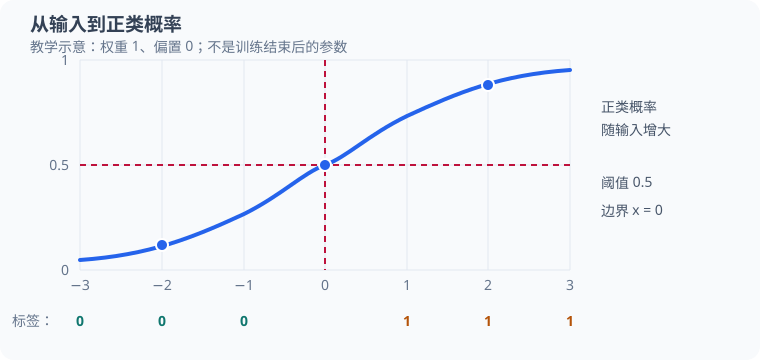
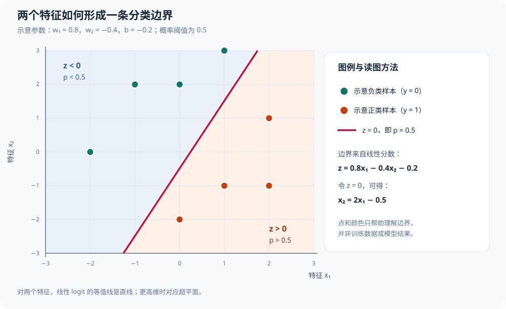

# 逻辑回归（logistic regression）：从概率、似然到 C 实现

本文先分析 [`src/ml/02_logistic_regression.c`](../src/ml/02_logistic_regression.c)，按“数据与参数 → 概率 → 交叉熵 → 梯度 → 参数更新 → 结果解释”的顺序，从零推导一维二分类逻辑回归；后半部分再连接仓库中的多特征、阈值评估、正则化和 Softmax 多分类案例。重点是把数学量对应到真实代码，并展开可手算的训练计算。前置知识可参考[线性回归分析](32_线性回归分析.md)，项目目录见[机器学习学习手册](30_机器学习案例总览.md#3-逻辑回归输出二分类概率)。

## 1. 阅读目标与前置知识

读完后，你应能沿着“输入 → 线性分数 → 概率 → 损失 → 梯度 → 参数更新”追踪一次训练，说明为什么要用 Sigmoid 和交叉熵，并手算两轮更新。无需预先学过逻辑回归；文中会推导需要的公式。

建议熟悉基础代数、指数与自然对数、函数斜率，以及 C 的数组、循环和函数。偏导数、链式法则、似然和梯度都会在本文结合六条样本解释。若还不熟悉“权重、偏置、损失、梯度下降”，可先阅读[线性回归分析](32_线性回归分析.md)的模型、损失和梯度章节。

## 2. 任务、数据与阅读约定

### 2.1 预测概率，再根据需要判断类别

线性回归预测连续数值；**逻辑回归把输入映射为属于某个类别的概率**。本例只有负类和正类，标签分别为 $0$ 和 $1$。这些数字是类别编码，不表示负类“没有价值”或正类“更好”。

[源码训练数据](../src/ml/02_logistic_regression.c#L49)固定如下：

| 输入 $x_i$ | 标签 $y_i$ | 类别 |
| ---: | ---: | --- |
| $-3$ | $0$ | 负类 |
| $-2$ | $0$ | 负类 |
| $-1$ | $0$ | 负类 |
| $1$ | $1$ | 正类 |
| $2$ | $1$ | 正类 |
| $3$ | $1$ | 正类 |



图中为了观察曲线，**仅示意** $w=1$、$b=0$：$p=\sigma(x)$，所以 $x=0$ 时 $p=0.5$。横轴下的 $0$、$1$ 是源码中的真实标签；曲线不是训练后的模型输出，虚线表示本图采用的 $0.5$ 判别阈值。

训练要根据这些样本学会：负输入的正类概率较小，正输入的正类概率较大。概率与最终类别不同，例如正类概率为 $0.8$，表示模型给正类分配了 $80\%$ 的概率；它并不表示真实世界已经保证每次这样的预测都有 $80\%$ 正确率。

源码用 `double` 数组保存标签，便于参与浮点运算，但本例合法标签仍然只有 $0$ 和 $1$。标签不是当前预测概率，训练也不会把标签数组改成预测值。

### 2.2 符号、下标与单位

本文样本序号为 $i=1,\ldots,n$，本例 $n=6$；C 数组从下标 $0$ 开始，所以源码 `x[i]` 对应数学中的 $x_{i+1}$。说明单个样本时会省去下标，使用 $x,y,z,p,\ell$，含义不变。

| 数学记号 | 含义 | 源码对应 |
| --- | --- | --- |
| $x_i$、$y_i$ | 输入与标签，$y_i\in\{0,1\}$ | `x[i]`、`y[i]` |
| $n$ | 样本总数 | `count` |
| $w$、$b$ | 可学习权重与偏置 | `weight`、`bias` |
| $z_i$ | 线性分数，也称 logit | `weight * x[i] + bias` |
| $p_i$ | 属于正类的预测概率 | `sigmoid(...)` 的返回值 |
| $\ell_i$、$L$ | 单样本损失与平均损失 | `loss` 中的累加项与返回值 |
| $e_i=p_i-y_i$ | 概率与标签的差 | `error` |
| $G_w$、$G_b$ | 尚未平均的梯度贡献之和 | `weight_gradient`、`bias_gradient` |
| $g_w$、$g_b$ | 平均损失对参数的梯度 | 上述累加量分别除以 `count` |
| $\eta$ | 学习率，本例为 $0.1$ | 更新表达式中的字面量 `0.1` |
| $k$ | 已完成的参数更新轮数，从 $0$ 开始 | 一轮结束后，数学轮数比 `epoch` 大 $1$ |

本例输入是没有指定物理单位的数字；分数、概率和交叉熵也按无量纲数值处理。自然指数的底数记为 $e\approx2.718282$；带下标的 $e_i$ 则是上表中的预测差，不能混淆。

## 3. 先建立源码地图

| 位置 | 职责与输入 | 返回值或状态变化 |
| --- | --- | --- |
| [`sigmoid`](../src/ml/02_logistic_regression.c#L13) | 接收分数，按符号选择稳定计算分支 | 返回正类概率；不修改模型 |
| [`loss`](../src/ml/02_logistic_regression.c#L32) | 接收参数、输入数组、标签数组和长度 | 返回全部样本的平均交叉熵 |
| [`main` 的准备阶段](../src/ml/02_logistic_regression.c#L47) | 创建固定数据，将参数置零 | 计算初始损失 |
| [训练内层循环](../src/ml/02_logistic_regression.c#L59) | 使用同一组当前参数计算全部样本 | 累加两个梯度和 |
| [参数更新](../src/ml/02_logistic_regression.c#L64) | 用学习率缩放平均梯度 | 原地修改权重、偏置 |
| [训练后的断言](../src/ml/02_logistic_regression.c#L68) | 计算最终损失与新输入概率 | 验证结果，最后输出一行摘要 |

上面这个 C 程序和对应的 [Python 程序](../src/python/ml/02_logistic_regression.py)都只使用一个特征，适合观察最小的训练循环。多特征版本分散在后续独立案例中：[`src/ml/23_csv_standardization.c`](../src/ml/23_csv_standardization.c) 介绍数据读取和训练集标准化，[`src/ml/20_cross_validation.c`](../src/ml/20_cross_validation.c) 展示 L2 选参与数据隔离，[`src/ml/24_reliability_assessment.c`](../src/ml/24_reliability_assessment.c) 展示类别不平衡、阈值和概率校准，[`docs/45_Softmax多分类回归.md`](45_Softmax多分类回归.md) 推导多分类扩展。它们是后续案例，不是 `02_logistic_regression.c` 已实现的功能。

`loss` 借用两个只读数组，不取得内存所有权。调用者必须提供有效长度、有效数组以及合法标签；它的接口要求 `count` 大于零。源码没有运行时检查空数组、非法标签或非有限参数，当前固定数据满足前提。使用稳定公式也不能保证任意巨大参数都安全：`weight * x[i] + bias` 本身仍可能溢出。

本例只用标准头文件中的断言、数学和输出接口，不包含自动求导框架。`loss` 用来计算损失，训练梯度则由 `main` 中的显式公式计算，并不是通过调用 `loss` 自动得到的。

## 4. 从线性分数到概率：为什么使用 Sigmoid

### 4.1 线性层先给出分数

对第 $i$ 条样本，先计算：

$$
z_i=wx_i+b.
\tag{1}
$$

分数可以是任意实数，不能直接当作概率。例如暂取教学参数 $w=0.5$、$b=0$，源码中的输入 $x_i=2$ 产生 $z_i=0.5\times2=1$，输入 $x_i=-2$ 则产生 $z_i=-1$。这里的参数是讲解用的中间状态，不是源码初始化值。

### 4.2 从“几率”与“对数几率”推导概率函数

设 $p$ 为正类概率，$1-p$ 为负类概率，先考虑理想实数计算下的 $0<p<1$。**正负类别概率之比称为几率**：

$$
\text{odds}=\frac{p}{1-p}.
\tag{2}
$$

例如 $p=0.8$ 时，几率为 $0.8/0.2=4$，表示正类概率是负类概率的 $4$ 倍；它并不是概率 $4$。对几率取自然对数，得到对数几率：

$$
\ln\frac{p}{1-p}.
\tag{3}
$$

这里 $\ln$ 表示自然对数，是自然指数的反函数；例如 $\ln(e^2)=2$，$\ln4\approx1.386294$。对数几率可以在整个实数范围内变化。逻辑回归的建模假设，就是让**对数几率与输入呈线性关系**：

$$
\begin{aligned}
\ln\frac{p_i}{1-p_i}&=wx_i+b=z_i.
\end{aligned}
\tag{4}
$$

这是模型选择的假设，不是所有数据天然满足的定律。两边取自然指数，再解出概率：

$$
\begin{aligned}
\frac{p_i}{1-p_i}&=e^{z_i},\\
p_i&=e^{z_i}(1-p_i),\\
p_i(1+e^{z_i})&=e^{z_i},\\
p_i&=\frac{e^{z_i}}{1+e^{z_i}}
=\frac{1}{1+e^{-z_i}}.
\end{aligned}
\tag{5}
$$

最后这个函数就是 Sigmoid，记为 $\sigma$：

$$
p_i=\sigma(z_i).
\tag{6}
$$

例如令 $z=\ln4$，则 $p=4/(1+4)=0.8$；反过来代入 $\ln(0.8/0.2)=\ln4$，恰好恢复原分数。**逻辑回归名称中的“回归”，可以联系为对连续的对数几率建模；整个模型通常用于分类任务**。

### 4.3 分数、概率与决策边界

几个容易手算的对应关系是：

$$
\begin{aligned}
\sigma(0)&=\frac{1}{1+1}=0.5,\\
\sigma(2)&=\frac{1}{1+0.135335}\approx0.880797.
\end{aligned}
\tag{7}
$$

而 $\sigma(-2)\approx0.119203$，并且 $\sigma(-z)=1-\sigma(z)$。例如 $\sigma(-2)=1-0.880797\approx0.119203$；后面解释对称数据的偏置梯度时会用到这个关系。

这个对称关系也可以直接从定义证明：

$$
1-\sigma(z)
=\frac{e^{-z}}{1+e^{-z}}
=\frac{1}{1+e^z}
=\sigma(-z).
\tag{8}
$$

若自行采用“概率至少为 $0.5$ 判为正类”的规则，因为 Sigmoid 单调递增，就有：

$$
p_i\ge0.5
\quad\Longleftrightarrow\quad
z_i\ge0.
\tag{9}
$$

当 $w\ne0$，边界位置为 $x=-b/w$。例如 $w=2$、$b=-1$ 时，边界为 $x=0.5$；若 $w>0$，边界右侧判为正类，若 $w<0$，方向相反。若 $w=0$，概率只由偏置决定，不能再使用除以权重的边界公式。

源码没有返回离散类别的独立分类函数，也没有规定概率恰好为 $0.5$ 时输出哪个标签；它只检查边界两侧的概率。因此“取等号时判正类”是这里举例的规则，不是源码已经实现的行为。

阈值也可以按任务另选。令阈值 $\tau$ 满足 $0<\tau<1$，则：

$$
p_i\ge\tau
\quad\Longleftrightarrow\quad
z_i\ge\ln\frac{\tau}{1-\tau}.
\tag{10}
$$

例如 $\tau=0.8$ 时，分数阈值为 $\ln4\approx1.386294$；$\tau=0.5$ 时才是分数阈值 $0$。改变分类阈值影响类别判定，不会自动改变模型参数或已经计算出的概率。

## 5. Sigmoid 的稳定计算与导数

### 5.1 为什么要分支计算

直接实现 $1/(1+e^{-z})$ 时，如果 $z$ 很负，就需要计算很大的正指数。例如 $z=-1000$ 时会出现 $e^{1000}$，超出常见 `double` 的表示范围。

当 $z<0$，将分子与分母同时乘以 $e^z$，得到等价形式：

$$
\frac{1}{1+e^{-z}}
=\frac{e^z}{e^z+1}.
\tag{11}
$$

于是源码使用：

$$
\sigma(z)=
\begin{cases}
\dfrac{1}{1+e^{-z}}, & z\ge0,\\[4pt]
\dfrac{e^z}{1+e^z}, & z<0.
\end{cases}
\tag{12}
$$

两个分支都只计算非正指数，因此避免了这里的指数上溢。对 $z=-2$，第二分支计算 $e^{-2}\approx0.135335$，返回 $0.135335/(1+0.135335)\approx0.119203$；与数学定义一致。

[`sigmoid` 的真实实现](../src/ml/02_logistic_regression.c#L16)为：

```c
if (z >= 0) {
    return 1 / (1 + exp(-z));
}
double exponential = exp(z);
return exponential / (1 + exponential);
```

在本文运行平台的 `double` 精度下，$z=1000$ 时结果舍入为 $1$，$z=-1000$ 时指数下溢，结果变成 $0$。[源码断言](../src/ml/02_logistic_regression.c#L73)明确验证这两种机器结果。数学上，有限分数产生的概率仍严格位于 $(0,1)$；机器上的端点来自有限精度，不是数学函数在有限位置真的达到端点。

### 5.2 逐步求 Sigmoid 导数

导数描述分数略微变化时，概率如何变化。使用指数函数求导和链式法则：

$$
\begin{aligned}
\frac{dp}{dz}
&=\frac{d}{dz}(1+e^{-z})^{-1}=-(1+e^{-z})^{-2}(-e^{-z})=\frac{e^{-z}}{(1+e^{-z})^2}.
\end{aligned}
\tag{13}
$$

另一方面，$p=1/(1+e^{-z})$，所以 $1-p=e^{-z}/(1+e^{-z})$。两者相乘正好得到上面的导数：

$$
\frac{dp}{dz}=p(1-p).
\tag{14}
$$

例如 $z=0$ 时，$p=0.5$，导数是 $0.5(1-0.5)=0.25$；$z=\ln4$ 时，$p=0.8$，导数是 $0.8\times0.2=0.16$。导数在有限分数处为正，因此 Sigmoid 单调递增。

还可改写为 $p(1-p)=0.25-(p-0.5)^2$，所以导数不超过 $0.25$。概率接近端点时导数接近零，这称为饱和。比如 $p=0.99$ 时导数只有 $0.99\times0.01=0.0099$。不过，不能因此直接认定本模型对“自信但错误”的预测也一定没有有效梯度；交叉熵与 Sigmoid 合成后的导数需要一起推导。

## 6. 从伯努利概率到交叉熵损失

### 6.1 用一个式子表示两种标签的概率

把标签看作只可能为 $0$ 或 $1$ 的随机变量，是伯努利模型。对实际观测到的标签 $y_i$，模型给它分配的概率为：

$$
P(y_i\mid x_i;w,b)=p_i^{y_i}(1-p_i)^{1-y_i}.
\tag{15}
$$

$P$ 表示模型中的条件概率；竖线表示“给定输入”，分号后的参数说明这个概率由当前模型决定。标签为 $1$ 时式子变成 $p_i$，为 $0$ 时变成 $1-p_i$。

例如模型预测正类概率 $p_i=0.8$：若实际标签为 $1$，给观测标签的概率为 $0.8$；若实际标签为 $0$，给观测标签的概率只有 $0.2$。训练希望提高真实标签所获得的概率。

### 6.2 为什么取负对数再求平均

假设各样本标签在给定输入和模型参数后条件独立，就可以将观测标签的概率相乘，形成似然函数 $\Lambda$：

$$
\Lambda(w,b)
=\prod_{i=1}^{n}p_i^{y_i}(1-p_i)^{1-y_i}.
\tag{16}
$$

$\prod$ 表示将全部样本对应项相乘；似然描述当前参数对已经观测到的数据提供多大支持，不是“参数本身为真的概率”。

初始参数下所有 $p_i=0.5$，每个观测标签都得到概率 $0.5$，因此本例初始似然为：

$$
\begin{aligned}
\Lambda(0,0)&=0.5^6=\frac{1}{64}.
\end{aligned}
\tag{17}
$$

求最大似然，就是调整参数让这个乘积尽量大。自然对数单调递增，对乘积取对数不会改变最优参数，还会把乘法变成加法：

$$
\ln\Lambda(w,b)
=\sum_{i=1}^{n}
\left[y_i\ln p_i+(1-y_i)\ln(1-p_i)\right].
\tag{18}
$$

为了用最小化算法训练，在前面加负号；再除以固定正数 $n$，使损失表示每个样本的平均值。由此得到二元交叉熵：

$$
\begin{aligned}
\ell_i&=-y_i\ln p_i-(1-y_i)\ln(1-p_i),\\
L(w,b)&=\frac{1}{n}\sum_{i=1}^{n}\ell_i
=-\frac{1}{n}\ln\Lambda(w,b).
\end{aligned}
\tag{19}
$$

这里 $\ell_i$ 是单样本损失，$L$ 是平均损失。把初始似然代入：

$$
L(0,0)=-\frac{1}{6}\ln\frac{1}{64}
=\frac{\ln64}{6}
=\ln2
\approx0.693147.
\tag{20}
$$

“交叉熵”也可理解为用标签分布衡量预测分布：单条观测标签把全部目标概率质量放在实际类别上，损失就只保留该类别的负对数概率。源码直接按逐样本求和计算，没有真的连乘概率；这样也避免很多小概率连乘造成下溢。

### 6.3 为什么错得越自信，惩罚越大

按标签分别代入，单样本损失简化为：

$$
\ell=
\begin{cases}
-\ln p, & y=1,\\
-\ln(1-p), & y=0.
\end{cases}
\tag{21}
$$

例如：

| 正类概率 $p$ | 标签为 $1$ 时的损失 | 标签为 $0$ 时的损失 |
| ---: | ---: | ---: |
| $0.01$ | $4.605170$ | $0.010050$ |
| $0.5$ | $0.693147$ | $0.693147$ |
| $0.8$ | $0.223144$ | $1.609438$ |
| $0.99$ | $0.010050$ | $4.605170$ |

例如 $y=1,p=0.8$ 时，$\ell=-\ln0.8\approx0.223144$；若实际 $y=0$，同一预测的损失是 $-\ln0.2\approx1.609438$。正确类别被分配越接近零的概率，负对数损失就越大。标签是离散值，但损失随概率连续变化，因而可以通过导数优化。

## 7. 为什么源码使用分数版交叉熵

### 7.1 从概率表达式完整化简

先使用 $p=e^z/(1+e^z)$ 与 $1-p=1/(1+e^z)$：

$$
\begin{aligned}
\ln p&=z-\ln(1+e^z),\\
\ln(1-p)&=-\ln(1+e^z).
\end{aligned}
\tag{22}
$$

以 $z=2$ 为例，$\ln(1+e^2)\approx2.126928$，所以 $\ln p\approx2-2.126928=-0.126928$，$\ln(1-p)\approx-2.126928$。

将这两个式子代回交叉熵，逐项合并：

$$
\begin{aligned}
\ell(z,y)
&=-y\big(z-\ln(1+e^z)\big)
 -(1-y)\big(-\ln(1+e^z)\big)=-yz+\big(y+(1-y)\big)\ln(1+e^z)\\
&=\ln(1+e^z)-yz.
\end{aligned}
\tag{23}
$$

函数 $\ln(1+e^z)$ 常称为 softplus。本例 $z=2,y=1$ 时，$\ell\approx2.126928-2=0.126928$；$z=2,y=0$ 时，$\ell\approx2.126928$，对应正确标签和错误标签两种惩罚。

### 7.2 避免正指数溢出的分段改写

当 $z\ge0$，先将 $e^z$ 从对数内部提出：

$$
\ln(1+e^z)
=\ln\big(e^z(1+e^{-z})\big)
=z+\ln(1+e^{-z}).
\tag{24}
$$

当 $z<0$，直接保留 $\ln(1+e^z)$，内部指数就不会很大。合并两个分支，得到源码使用的稳定形式：

$$
\begin{aligned}
\ell(z,y)&=\max(z,0)-yz+\ln\left(1+e^{-\lvert z\rvert}\right).
\end{aligned}
\tag{25}
$$

$\max(z,0)$ 取分数与零的较大值，$\lvert z\rvert$ 是绝对值。对 $z=2,y=1$，计算 $2-2+\ln(1+e^{-2})\approx0.126928$；对 $z=-2,y=0$，计算 $0+\ln(1+e^{-2})\approx0.126928$。对 $z=0$，两个标签都得到 $\ln2$。

[`loss` 的核心代码](../src/ml/02_logistic_regression.c#L36)为：

```c
double z = weight * x[i] + bias;
total += fmax(z, 0) - y[i] * z + log1p(exp(-fabs(z)));
```

| C 表达式 | 数学作用 | 为什么这样计算 |
| --- | --- | --- |
| `fmax(z, 0)` | $\max(z,0)$ | 补偿正分数分支提出来的线性项 |
| `y[i] * z` | $y_i z_i$ | 选择真实标签对应的损失 |
| `fabs(z)` | $\lvert z\rvert$ | 让指数参数始终不大于零 |
| `log1p(u)` | $\ln(1+u)$ | 当非负数 $u$ 很小时，避免先算加法丢失小量 |

这里 `log1p` 的实参是 $u=e^{-\lvert z\rvert}$。例如理想实数中的 $u=10^{-20}$ 很小，直接在常见浮点精度中计算 `1 + u` 可能舍入成 $1$，随后取对数得到 $0$；`log1p(u)` 则能直接保留约为 $10^{-20}$ 的结果。

### 7.3 概率已经舍入到端点时，损失仍可计算

假设 $z=1000$，机器上的 `sigmoid(z)` 已经舍入为 $1$。若真实标签是 $0$，直接用概率计算需要求 $\ln(1-1)=\ln0$，会失去有限结果；而稳定分数式计算：

$$
\begin{aligned}
\ell(1000,0)&=1000+\ln(1+e^{-1000})\approx1000.
\end{aligned}
\tag{26}
$$

对正确标签，$\ell(1000,1)=1000-1000+\ln(1+e^{-1000})$ 接近零。负分数 $z=-1000$ 时结论对称：真实标签为 $1$ 的损失约为 $1000$，为 $0$ 时接近零。这说明稳定实现保留了“极端自信且错误时应有很大损失”的行为。

不要为了方便随意截断概率，再继续使用未经截断损失的梯度；这可能让所优化的损失和所计算的梯度不一致。当前代码直接从分数计算稳定损失，而梯度也对应同一个数学目标。

虽然稳定式包含分段的最大值和绝对值，它们组合后仍是光滑函数。求导时可以使用等价表达式 $\ln(1+e^z)-yz$，不需要给最大值在零点人为指定不同的学习规则。

## 8. 从交叉熵逐步推导训练梯度

### 8.1 第一步：损失对概率求导

暂时只看一个样本，固定标签 $y$，将损失看作概率 $p$ 的函数：

$$
\ell(p,y)=-y\ln p-(1-y)\ln(1-p).
\tag{27}
$$

利用自然对数的导数和链式法则：

$$
\begin{aligned}
\frac{\partial\ell}{\partial p}
&=-\frac{y}{p}+\frac{1-y}{1-p}=\frac{-y(1-p)+(1-y)p}{p(1-p)}\\
&=\frac{p-y}{p(1-p)}.
\end{aligned}
\tag{28}
$$

第二项为正，是因为 $\ln(1-p)$ 对概率求导会产生一个负号，抵消它前面的负号。例如 $p=0.8,y=1$ 时，导数为 $-1/0.8=-1.25$，也等于 $(0.8-1)/(0.8\times0.2)=-1.25$。

### 8.2 第二步：经过 Sigmoid，得到对分数的导数

再乘上第 4 节已经推导的 $dp/dz=p(1-p)$：

$$
\begin{aligned}
\frac{\partial\ell}{\partial z}
&=\frac{\partial\ell}{\partial p}\frac{dp}{dz}=\frac{p-y}{p(1-p)}p(1-p)\\
&=p-y.
\end{aligned}
\tag{29}
$$

例如 $p=0.8,y=1$，上一步得到 $-1.25$，Sigmoid 导数为 $0.8\times0.2=0.16$，相乘得 $-1.25\times0.16=-0.2$，正好是 $p-y=0.8-1=-0.2$。若 $p=0.2,y=0$，则 $1.25\times0.16=0.2$，推动分数向负方向变化。

这个简洁结果依赖“Sigmoid 配合二元交叉熵”，不能认为任意激活、任意损失都可以直接写成预测减标签。在理想实数中有限分数对应 $0<p<1$，因此约分合法；实现直接计算合并后的 $p-y$，避免在机器端点处显式计算概率分母。

还可用分数版损失独立核对：

$$
\frac{\partial\ell}{\partial z}
=\frac{\partial}{\partial z}\big(\ln(1+e^z)-yz\big)
=\frac{e^z}{1+e^z}-y
=p-y.
\tag{30}
$$

例如 $z=0,y=1$，计算 $1/(1+1)-1=-0.5$；$z=0,y=0$ 则得到 $0.5$。分数版和概率版推导完全一致。

### 8.3 第三步：经过线性层，得到参数梯度

线性分数为 $z_i=wx_i+b$，因此对权重求导得到 $x_i$，对偏置求导得到 $1$。把 $e_i=p_i-y_i$ 记为预测差，则：

$$
\begin{aligned}
\frac{\partial\ell_i}{\partial w}
&=\frac{\partial\ell_i}{\partial z_i}\frac{\partial z_i}{\partial w}
=e_i x_i,\\
\frac{\partial\ell_i}{\partial b}
&=\frac{\partial\ell_i}{\partial z_i}\frac{\partial z_i}{\partial b}
=e_i.
\end{aligned}
\tag{31}
$$

例如第一条样本的 $x_1=-3,y_1=0$，初始概率是 $0.5$，所以 $e_1=0.5$。它对权重的贡献是 $0.5\times(-3)=-1.5$，对偏置的贡献是 $0.5$。注意即使预测差为正，权重贡献仍可能为负，因为还要乘输入。

最后对样本损失取平均：

$$
\begin{aligned}
g_w&=\frac{\partial L}{\partial w}
=\frac{1}{n}\sum_{i=1}^{n}(p_i-y_i)x_i,\\
g_b&=\frac{\partial L}{\partial b}
=\frac{1}{n}\sum_{i=1}^{n}(p_i-y_i).
\end{aligned}
\tag{32}
$$

本例首轮的两个总贡献分别为 $-6$、$0$，除以 $n=6$ 后得到 $g_w=-1$、$g_b=0$；下一节会逐行计算。

### 8.4 公式如何落在 C 变量中

[内层循环](../src/ml/02_logistic_regression.c#L60)没有求导函数调用，而是直接实现刚才推导出的结果：

```c
double error = sigmoid(weight * x[i] + bias) - y[i];
weight_gradient += error * x[i];
bias_gradient += error;
```

`error` 对应数学下标偏移后的 $e_{i+1}$，两条累加语句得到：

$$
\begin{aligned}
G_w&=\sum_{i=1}^{n}e_i x_i,\\
G_b&=\sum_{i=1}^{n}e_i.
\end{aligned}
\tag{33}
$$

**源码里的两个梯度变量存的是和，不是平均值。** 首轮结束时 `weight_gradient` 为 $-6$、`bias_gradient` 为 $0$，实际更新时才除以 `count`，得到 $-1$ 和 $0$。若遗漏这个除法，相当于在本例中把有效学习率放大 $6$ 倍。

这里没有线性回归 MSE 梯度中的额外因子 $2$，因为当前损失是交叉熵，导数已经化简为 $p-y$。`error` 也不是分类错误次数：一个预测正确但概率只有 $0.6$ 的正类样本仍有 $e_i=-0.4$，因此仍会参与训练。

这里相减的是概率与标签，不是分数与标签。若按统计学常见方向定义残差 $r_i=y_i-p_i$，则源码 `error` 为 $e_i=-r_i$；上面这个样本的残差是 $0.4$，源码预测差是 $-0.4$。更换符号约定时必须同步修改求导中的符号。

### 8.5 为什么这里不选择平方误差

平方误差也能配合 Sigmoid 求导，但它是另一个目标。设教学用的平方损失为 $\ell_{\text{sq}}=(p-y)^2$，则：

$$
\frac{\partial\ell_{\text{sq}}}{\partial z}
=2(p-y)p(1-p).
\tag{34}
$$

对自信且错误的 $p=0.01,y=1$，这个导数是 $2(-0.99)\times0.01\times0.99=-0.019602$；交叉熵对分数的导数却是 $0.01-1=-0.99$。交叉熵消去了额外的 Sigmoid 饱和因子，使这种错误在分数层仍产生明显的纠正信号；这不是对所有深层网络都不会出现梯度消失的保证。

## 9. 手算两轮批量梯度下降

### 9.1 第一轮：从零参数计算全部样本

[初始化](../src/ml/02_logistic_regression.c#L52)设置 $w_0=b_0=0$，因此六个分数都为 $0$，概率都为 $0.5$，每条损失都是 $\ln2\approx0.693147$：

| $x_i$ | $y_i$ | $p_i-y_i$ | 权重贡献 $(p_i-y_i)x_i$ | 偏置贡献 $p_i-y_i$ |
| ---: | ---: | ---: | ---: | ---: |
| $-3$ | $0$ | $0.5$ | $-1.5$ | $0.5$ |
| $-2$ | $0$ | $0.5$ | $-1$ | $0.5$ |
| $-1$ | $0$ | $0.5$ | $-0.5$ | $0.5$ |
| $1$ | $1$ | $-0.5$ | $-0.5$ | $-0.5$ |
| $2$ | $1$ | $-0.5$ | $-1$ | $-0.5$ |
| $3$ | $1$ | $-0.5$ | $-1.5$ | $-0.5$ |
| **合计** | | | $-6$ | $0$ |

将权重贡献相加再平均：

$$
\begin{aligned}
g_w&=\frac{-1.5-1-0.5-0.5-1-1.5}{6}=-1.
\end{aligned}
\tag{35}
$$

偏置的正负贡献抵消：

$$
\begin{aligned}
g_b&=\frac{0.5+0.5+0.5-0.5-0.5-0.5}{6}=0.
\end{aligned}
\tag{36}
$$

源码学习率 $\eta=0.1$，更新规则为：

$$
\begin{aligned}
w_{k+1}&=w_k-\eta g_w,\\
b_{k+1}&=b_k-\eta g_b.
\end{aligned}
\tag{37}
$$

所以第一轮得到：

$$
\begin{aligned}
w_1&=0-0.1\times(-1)=0.1,\\
b_1&=0-0.1\times0=0.
\end{aligned}
\tag{38}
$$

在[实际更新表达式](../src/ml/02_logistic_regression.c#L64)中，计算顺序写成“学习率乘总贡献，再除以样本数”：

```c
weight -= 0.1 * weight_gradient / (double)count;
bias -= 0.1 * bias_gradient / (double)count;
```

首轮就是 $0-0.1\times(-6)/6=0.1$。`(double)count` 明确把计数转换为浮点数；当前表达式的其他操作数本来也是 `double`，这里的显式转换主要用于表达意图。两个总梯度在改参数之前已经算好，因此两条赋值虽然先后执行，仍然使用同一组旧参数的梯度。

上述等式按实数运算书写。机器浮点数不能精确表示所有十进制小数，乘法、除法的次序也可能带来末位舍入差异；复核实现时应采用合理误差界，不要要求每个未舍入中间值都与十进制手算结果严格相等。

### 9.2 更新后重新预测并计算真实损失

代入 $w_1=0.1,b_1=0$：

| $x_i$ | $y_i$ | 分数 $z_i$ | 新概率 $p_i$ | 对应真实标签的损失 $\ell_i$ |
| ---: | ---: | ---: | ---: | ---: |
| $-3$ | $0$ | $-0.3$ | $0.425557$ | $0.554355$ |
| $-2$ | $0$ | $-0.2$ | $0.450166$ | $0.598139$ |
| $-1$ | $0$ | $-0.1$ | $0.475021$ | $0.644397$ |
| $1$ | $1$ | $0.1$ | $0.524979$ | $0.644397$ |
| $2$ | $1$ | $0.2$ | $0.549834$ | $0.598139$ |
| $3$ | $1$ | $0.3$ | $0.574443$ | $0.554355$ |

例如最后一行，$z_6=0.1\times3=0.3$，$p_6=1/(1+e^{-0.3})\approx0.574443$；标签为正类，所以 $\ell_6=-\ln0.574443\approx0.554355$。这里展示的小数经过舍入，下面的损失使用未舍入值计算：

$$
\begin{aligned}
L(0.1,0)
&=\frac{2}{6}
\left[\ln(1+e^{-0.1})+\ln(1+e^{-0.2})+\ln(1+e^{-0.3})\right]\\
&\approx\frac{0.644397+0.598139+0.554355}{3}\approx0.598964.
\end{aligned}
\tag{39}
$$

平均损失从 $0.693147$ 降到 $0.598964$。即使此时按阈值分类已经全部正确，训练仍会继续，因为这些概率还没有给正确类别分配很高的置信度。

### 9.3 第二轮：用新概率重新算梯度

第二轮必须重新预测，不能一直沿用首轮的 $-1$ 梯度。借助正负对称性，把绝对输入为 $1$、$2$、$3$ 的样本分别配成一对。每对的权重贡献相等，因此：

$$
\begin{aligned}
g_w
&=-\frac{1}{3}
\left[
1(1-\sigma(0.1))
+2(1-\sigma(0.2))
+3(1-\sigma(0.3))
\right]\\
&\approx-\frac{0.475020813+0.900332005+1.276672450}{3}\approx-0.884008422.
\end{aligned}
\tag{40}
$$

于是：

$$
\begin{aligned}
w_2&=0.1-0.1(-0.884008422)\approx0.188400842,\\
b_2&=0.
\end{aligned}
\tag{41}
$$

在理想实数计算下偏置仍为零。用新权重重新算三对损失，得到：

$$
\begin{aligned}
L(w_2,0)
&=\frac{1}{3}\left[
\ln(1+e^{-w_2})+
\ln(1+e^{-2w_2})+
\ln(1+e^{-3w_2})\right]\approx0.525241.
\end{aligned}
\tag{42}
$$

这展示了完整循环：当前参数决定概率，概率决定梯度，梯度改变参数，下一轮再用新参数重算。

### 9.4 为什么偏置几乎保持零

假设输入为 $a>0$ 的正类样本与输入为 $-a$ 的负类样本成对出现，且当前偏置为零。它们的偏置贡献之和是：

$$
\begin{aligned}
\big(\sigma(wa)-1\big)+\sigma(-wa)
&=\sigma(wa)-1+1-\sigma(wa)=0.
\end{aligned}
\tag{43}
$$

例如第一轮后一对绝对输入为 $3$ 的样本贡献为 $(0.574443-1)+0.425557\approx0$。所以从零偏置开始，理想计算下每轮偏置都保持零。浮点加法和指数计算有舍入误差，机器中的偏置可能是非常小的非零数，不能要求逐位等于零。

这来自数据、标签和初始化的特殊对称性，并不表示逻辑回归通常不需要偏置。

## 10. 为什么能下降，以及为什么没有有限最优权重

### 10.1 反梯度方向与学习率

在当前参数处，定义两个很小的参数改变量 $\Delta w,\Delta b$，损失变化为 $\Delta L$。一阶近似给出：

$$
\Delta L\approx g_w\Delta w+g_b\Delta b.
\tag{44}
$$

取 $\Delta w=-\eta g_w$、$\Delta b=-\eta g_b$，得到：

$$
\Delta L\approx-\eta(g_w^2+g_b^2).
\tag{45}
$$

首轮代入 $\eta=0.1,g_w=-1,g_b=0$，估算损失变化为 $-0.1$。实际变化是 $0.598964-0.693147\approx-0.094184$，因为有限步长还受曲率与更高阶项影响。只有步长足够小时，一阶下降趋势才能保证该次实际更新下降；学习率不是越大越好。

完整的方向推导与过大步长算例见[线性回归文档第 6 节](32_线性回归分析.md#6-梯度下降更新模型参数)。注意这份源码没有每轮打印损失，只在训练前后各调用一次 `loss`；上节的逐轮损失是为讲解重新计算的，并不是程序已有的训练日志。

### 10.2 单样本损失的曲率与凸性

继续对分数梯度求导：

$$
\begin{aligned}
\frac{\partial^2\ell}{\partial z^2}
=\frac{dp}{dz}
&=p(1-p)\ge0.
\end{aligned}
\tag{46}
$$

例如 $p=0.5$ 时二阶导数为 $0.25$，$p=0.8$ 时为 $0.16$。非负二阶导数表示损失沿分数方向向上弯曲，也就是凸函数。

为看清参数层面的情况，取任意固定方向 $(u,v)$，用实数 $t$ 表示沿该方向移动的量。定义 $F(t)=L(w+tu,b+tv)$，并记沿途概率为 $p_i(t)=\sigma((w+tu)x_i+b+tv)$。再次使用链式法则：

$$
F''(t)=\frac{1}{n}\sum_{i=1}^{n}
p_i(t)(1-p_i(t))(ux_i+v)^2\ge0.
\tag{47}
$$

例如在初始参数处，选方向 $(u,v)=(1,0)$，就有 $F''(0)=0.25(9+4+1+1+4+9)/6=7/6$；偏置方向 $(u,v)=(0,1)$ 则得到 $F''(0)=0.25$。

因此线性逻辑回归的平均交叉熵对参数是凸的：若存在有限的驻点，它就是全局最小值。**凸性不保证在没有界限的参数范围内一定存在有限的最优点。** 当前数据恰好展示了这种差别；这个结论也不能直接迁移到具有多层可学习非线性结构的神经网络。

### 10.3 线性可分时，损失继续下降但参数持续增长

本例任意 $w>0,b=0$ 都能用阈值 $0.5$ 正确区分全部样本，所以数据线性可分。例如 $w=0.1$ 和 $w=10$ 的类别判断相同，但对应概率与交叉熵很不同。

令 $a=1,2,3$ 表示正负样本对的输入绝对值。偏置为零时，平均损失可写为：

$$
L(w,0)=\frac{1}{3}\sum_{a=1}^{3}\ln(1+e^{-wa}).
\tag{48}
$$

例如 $w=0$ 时得到 $\ln2$，$w=0.1$ 时得到前面计算的 $0.598964$。对权重求导：

$$
\begin{aligned}
\frac{\partial L(w,0)}{\partial w}
&=-\frac{1}{3}\sum_{a=1}^{3}\frac{a}{1+e^{wa}}<0.
\end{aligned}
\tag{49}
$$

对任何有限 $w$，上式每个分母都为正，因此导数始终为负。初始 $w=0$ 时，导数为 $-(1/2+2/2+3/2)/3=-1$；$w=0.1$ 时约为 $-0.884008422$，与两轮手算一致。

权重继续增大，就能继续降低损失。当 $w\to+\infty$ 时，各项 $e^{-wa}\to0$，所以 $L(w,0)\to0$。但有限权重下所有单样本交叉熵仍大于零，因而损失下确界为零，却没有达到它的有限参数。

所以源码执行 $1000$ 轮得到的是一个有限迭代结果，而不是求出了类似线性回归 $w=2,b=1$ 那样的有限解析最优点。概率越接近端点也不自动证明模型在真实数据上越可靠。

### 10.4 正则化如何改变目标（当前源码未实现）

一种教学扩展是在平均损失上增加权重惩罚：

$$
\begin{aligned}
L_{\lambda}(w,b)&=L(w,b)+\frac{\lambda}{2}w^2,\\
\lambda&>0.
\end{aligned}
\tag{50}
$$

这里 $\lambda$ 是正则化强度，本式只惩罚权重。权重梯度相应变成：

$$
\begin{aligned}
\frac{\partial L_{\lambda}}{\partial w}&=g_w+\lambda w,\\
\frac{\partial L_{\lambda}}{\partial b}&=g_b.
\end{aligned}
\tag{51}
$$

例如 $\lambda=0.1,w=2$ 时，惩罚值为 $0.1\times2^2/2=0.2$，权重梯度多出 $0.1\times2=0.2$。增大权重降低分类损失的收益要与增大的惩罚平衡；对当前两类都出现的数据，这可以约束权重无限增长。

这会改变优化目标和最优参数，不能只在输出损失中加惩罚而不修改训练梯度。已有相关案例可参考[学习手册的正则化部分](30_机器学习案例总览.md)，本文件依然分析未加正则项的原始程序。

## 11. 运行结果、验证边界与学习步骤

### 11.1 构建并沿入口执行一次

在仓库根目录运行：

```sh
make build/ml/02_logistic_regression
./build/ml/02_logistic_regression
```

数学函数通过 `-lm` 链接。程序的实际执行顺序是：

1. 创建固定数据、计算样本数，将权重和偏置置零。
2. 调用 `loss` 记录初始交叉熵；这里没有日志文件写入。
3. 每轮将两个梯度和清零，计算所有样本的概率与贡献。
4. 在样本循环之外除以样本数并更新参数，重复 $1000$ 轮。
5. 重新计算最终损失，检查它有限、低于初始损失且低于 $0.05$。
6. 检查两个新输入的概率以及极端分数的 Sigmoid 结果，最后打印摘要。

本次文档扩展已使用 Apple Clang 17.0.0 执行上述构建与运行，启用 `-std=c23 -Wall -Wextra -Wpedantic -Werror`，原示例的内置断言全部通过；另按源码的数据与更新顺序复核手算结果。文档公式只进行了静态格式检查，未执行公式渲染预览。

### 11.2 有限训练后的数值

本例运行输出为：

```text
逻辑回归：交叉熵 0.6931 → 0.0088，x=-0.5 概率=0.1388，x=0.5 概率=0.8612
```

对同一训练过程进行数值复核，权重约为 $3.650664$，偏置接近零，平均损失约为 $0.008778$。因此对 $x=0.5$：

$$
\begin{aligned}
z&\approx3.650664\times0.5=1.825332,\\
p&=\frac{1}{1+e^{-1.825332}}\approx0.861205.
\end{aligned}
\tag{52}
$$

负输入 $x=-0.5$ 的概率约为 $1-0.861205=0.138795$。新输入位于训练范围内、靠近边界，但只检查这两个点，并不能代替独立测试集。

可以把初始模型作为一个简单基线：$w=b=0$ 时，无论输入是什么都给出 $p=0.5$。本例正负标签各有 $3$ 个，因此每个真实标签都获得 $0.5$ 的概率，平均交叉熵为 $-\ln0.5=\ln2\approx0.693147$；训练后训练集交叉熵约为 $0.008778$。这表明参数更新改善了模型对这组六条样本的拟合。由于基线和训练结果都来自同一训练集，这个对比仍不能证明对新数据的效果。

### 11.3 断言验证了什么，没有验证什么

[内置断言](../src/ml/02_logistic_regression.c#L70)验证有限损失、损失下降、边界两侧的概率方向和极端输入的数值行为。它们没有进行训练/验证/测试拆分，也没有证明真实分类准确率、概率校准或对噪声的鲁棒性。

若把概率按阈值转成类别，准确率衡量“判断对了多少”，交叉熵还衡量“给真实标签分配了多大概率”。本例首轮更新后就已全部分类正确，但平均损失仍约为 $0.598964$；训练结束时类别判断没有变化，损失却下降到约 $0.008778$。两种指标回答的问题不同。

只报告正确分类还会忽略类别比例与错误代价。真正评估时，应先保留独立测试数据，按任务选择阈值、混淆矩阵等指标，并检查概率是否可信；当前示例主要验证数学与实现是否一致。

### 11.4 建议的学习顺序与练习

1. 先手算 $z=0$、$z=2$ 时的概率，再把概率反推成对数几率。
2. 固定 $p=0.8$，分别代入两个标签，解释交叉熵为什么不同。
3. 不看最终答案，从概率导数与 Sigmoid 导数逐项约分，重新得到 $p-y$。
4. 照着表格计算首轮总梯度和平均梯度，确认源码在哪一步除以样本数。
5. 使用首轮更新后的概率手算第二轮，不要重复使用初始梯度。
6. 将一条负类样本标签改为正类，观察偏置不再保持零；这是修改数据的练习，不是原程序行为。
7. 在另一个学习实验中同时修改损失与梯度，加入权重正则化，再比较参数大小；不要把训练损失下降当作泛化能力已经提高。
8. 最后推广到多个输入特征：每个权重都接收同一个分数梯度乘以自己的输入，再进入多层神经网络的链式法则学习。

## 12. 多特征逻辑回归与决策边界

### 12.1 从一个输入推广到多个输入

设每个样本有 $d$ 个特征。第 $i$ 个样本的特征向量记作 $\mathbf{x}_i=(x_{i,1},\ldots,x_{i,d})$，权重向量为 $\mathbf{w}=(w_1,\ldots,w_d)$，偏置 $b$ 是一个标量。模型先对每个特征加权求和，再经过 Sigmoid：

$$
\begin{aligned}
z_i&=b+\sum_{j=1}^{d}w_jx_{i,j},\\
p_i&=\sigma(z_i).
\end{aligned}
\tag{53}
$$

其中 $z_i$ 是 logit，$p_i$ 是正类概率，$j$ 是特征下标。矩阵写法为 $z_i=\mathbf{w}^{\mathsf T}\mathbf{x}_i+b$。这里的 $\mathsf T$ 表示转置，让长度为 $d$ 的两个向量相乘后得到一个标量。

例如有两个特征，取 $\mathbf{x}=(1,2)$、$\mathbf{w}=(0.8,-0.4)$、$b=-0.2$。先算分数，再换算概率：

$$
\begin{aligned}
z&=-0.2+0.8\times1-0.4\times2=-0.2,\\
p&=\sigma(-0.2)\approx0.450166.
\end{aligned}
\tag{54}
$$

若采用阈值 $0.5$，该样本会被判为负类。注意，预测概率和类别是两个结果：调阈值可以改变类别，却不会改变这里算出的 $p$。

### 12.2 边界是直线还是超平面

在阈值 $0.5$ 下，正负类分界发生在 $p_i=0.5$。由于 $\sigma(0)=0.5$ 且 Sigmoid 严格递增，这等价于 $z_i=0$：

$$
\begin{aligned}
b+\sum_{j=1}^{d}w_jx_{i,j}&=0.
\end{aligned}
\tag{55}
$$

一个特征时，边界是数轴上的一个位置；两个特征时，边界通常是一条直线；更多特征时，它是一个超平面。权重向量 $\mathbf{w}$ 垂直于这个边界，并指向 logit 增大的方向。下图用两个特征展示边界两侧的概率区域；颜色只是示意，线和点不是训练结果。



示例参数 $w_1=0.8$、$w_2=-0.4$、$b=-0.2$ 对应的边界为 $x_2=2x_1-0.5$。边界一侧 $z>0$，所以正类概率大于 $0.5$；另一侧 $z<0$，所以正类概率小于 $0.5$。这解释了“线性分类器”：线性的是 logit 和特征之间的关系，概率本身经过 Sigmoid 后并不是线性函数。

## 13. 如何解释权重：对数几率与优势比

权重的单位变化解释建立在“其他特征保持不变”的条件上。模型的对数几率可以写成：

$$
\begin{aligned}
\ln\frac{p}{1-p}&=b+\sum_{j=1}^{d}w_jx_j.
\end{aligned}
\tag{56}
$$

某个特征 $x_j$ 增加 $\Delta$，其他特征不变时，对数几率增加 $w_j\Delta$。把对数几率指数化后，正类与负类的几率会乘上 $e^{w_j\Delta}$；这个乘数叫优势比（odds ratio）：

$$
\begin{aligned}
\mathrm{OR}_j(\Delta)&=e^{w_j\Delta}.
\end{aligned}
\tag{57}
$$

例如 $w_j=0.7$，特征增加 $1$ 个单位，则几率乘以 $e^{0.7}\approx2.014$。若原概率是 $0.2$，原几率为 $0.2/(1-0.2)=0.25$；新几率约为 $0.25\times2.014=0.5035$，换回概率约为 $0.5035/(1+0.5035)=0.335$。

所以“权重为 $0.7$”不表示概率增加 $70\%$，也不表示概率变成原来的两倍。概率变化取决于初始概率：同样的优势比作用在 $p=0.2$ 和 $p=0.8$ 上，会得到不同的概率差。

解释权重前还要检查特征编码与量纲：

- 若特征先做标准化，一个单位通常表示增加一个训练集标准差；模型系数相应解释为标准差尺度上的变化。
- 类别特征常用虚拟变量（dummy variable）编码。系数解释的是相对于被省略的参考类别的差异；若所有类别都编码且同时保留截距，可能出现完全共线性。
- 高相关特征会让权重在它们之间重新分配。预测效果可能相近，但单个系数的大小和符号会不稳定，因此不能仅凭系数大小推断因果关系。

## 14. 逻辑回归能表示哪些边界

### 14.1 原始特征上的边界是线性的

若直接使用原始特征，模型边界满足 $b+\mathbf{w}^{\mathsf T}\mathbf{x}=0$，所以它无法把平面切分成任意弯曲的区域。增加训练轮数只能更充分地拟合这个模型族，不能改变它表达边界的形状。

### 14.2 特征变换可以产生弯曲边界

可以先人工构造新特征，再对新特征使用逻辑回归。例如将 $x_1^2$、$x_1x_2$ 加入模型：

$$
\begin{aligned}
z&=b+w_1x_1+w_2x_2+w_3x_1^2+w_4x_1x_2.
\end{aligned}
\tag{58}
$$

模型仍然对参数 $w_1,\ldots,w_4,b$ 呈线性形式，但代回原始坐标后，$z=0$ 可以是曲线。比如取 $z=x_1^2+x_2^2-1$，概率为 $0.5$ 的边界就是单位圆 $x_1^2+x_2^2=1$。

这种做法叫特征工程（feature engineering）或基函数展开（basis expansion）：人先决定要加入哪些变换，训练过程只学习它们的线性组合系数。它和多层感知机（MLP）不同，MLP 会通过隐藏层学习特征表示。特征变换也可能扩大模型自由度并造成过拟合，因此仍需正则化和独立评估。

## 15. 从概率到类别：阈值、错误代价与指标

### 15.1 阈值是决策规则的一部分

逻辑回归给出 $p=P(y=1\mid\mathbf{x})$，分类器再选择阈值 $\tau$：当 $p\ge\tau$ 时预测正类。因为 Sigmoid 单调递增，等价的 logit 边界是：

$$
\begin{aligned}
z&\ge\ln\frac{\tau}{1-\tau}.
\end{aligned}
\tag{59}
$$

当 $\tau=0.5$ 时，logit 边界为 $0$；当 $\tau=0.2$ 时，边界约为 $-1.3863$，模型更容易预测正类。改变阈值是改变决策规则，不是重新训练模型。

### 15.2 用错误代价推导一个阈值

假设概率可信，并且只考虑误报（false positive）代价 $C_{FP}$ 与漏报（false negative）代价 $C_{FN}$。预测正类的期望错误代价为 $C_{FP}(1-p)$，预测负类的期望错误代价为 $C_{FN}p$。选择代价较小的一边，就得到：

$$
\begin{aligned}
C_{FP}(1-p)&<C_{FN}p,\\
p&>\frac{C_{FP}}{C_{FP}+C_{FN}}.
\end{aligned}
\tag{60}
$$

因此代价驱动的阈值是 $\tau=C_{FP}/(C_{FP}+C_{FN})$。例如误报代价为 $1$、漏报代价为 $4$ 时，阈值为 $1/(1+4)=0.2$。这个结论假设概率校准良好、代价已知且错误代价是唯一需要考虑的因素；现实中还要用验证集检查业务目标、容量限制和公平性要求。不要在测试集上反复尝试阈值。

### 15.3 类别不平衡时准确率可能误导

设有 $100$ 个样本，其中 $10$ 个正类、$90$ 个负类。某个阈值下的混淆矩阵为：

| 真实类别 | 预测正类 | 预测负类 |
| --- | ---: | ---: |
| 正类 | $TP=8$ | $FN=2$ |
| 负类 | $FP=12$ | $TN=78$ |

准确率（accuracy）衡量所有预测中有多少正确；精确率（precision）衡量预测为正类的样本有多少是真的；召回率（recall）衡量正类被找回的比例；特异度（specificity）衡量负类被正确排除的比例。这个例子的指标为：

$$
\begin{aligned}
\mathrm{Accuracy}&=\frac{8+78}{100}=0.86,\\
\mathrm{Precision}&=\frac{8}{8+12}=0.40,\\
\mathrm{Recall}&=\frac{8}{8+2}=0.80,\\
\mathrm{Specificity}&=\frac{78}{78+12}\approx0.867,\\
\mathrm{F1}&=\frac{2\times0.40\times0.80}{0.40+0.80}\approx0.533.
\end{aligned}
\tag{61}
$$

如果总是预测负类，准确率反而是 $90\%$，但正类召回率为 $0$。所以类别比例悬殊时，应结合混淆矩阵、精确率、召回率、F1 或平衡准确率判断。概率模型还应报告交叉熵、Brier 分数或校准图；这些指标评估概率质量，不只评估阈值后的类别。仓库的[类别不平衡与概率校准案例](44_类别不平衡与概率校准.md)展示了完整流程。

## 16. 正则化：限制过大的权重

原文第 10.4 节说明了 L2 正则化（L2 regularization）。多特征模型常在平均交叉熵外增加对权重的惩罚；通常不惩罚截距 $b$：

$$
\begin{aligned}
L_{L2}&=L+\frac{\lambda}{2}\sum_{j=1}^{d}w_j^2,\\
L_{L1}&=L+\lambda\sum_{j=1}^{d}|w_j|.
\end{aligned}
\tag{62}
$$

$\lambda\ge0$ 控制惩罚强度。L2 会把权重往零收缩，通常不会把权重精确变成零；L1 惩罚常能得到稀疏权重，可用于特征筛选，但绝对值在零处不可微，需要使用次梯度或专门的优化方法。弹性网络（Elastic Net）同时加入 L1 与 L2 惩罚。

对 L2 项求导，权重的梯度中会多出一项 $\lambda w_j$，截距梯度不变：

$$
\begin{aligned}
\frac{\partial L_{L2}}{\partial w_j}
&=\frac{\partial L}{\partial w_j}+\lambda w_j,\\
\frac{\partial L_{L2}}{\partial b}
&=\frac{\partial L}{\partial b}.
\end{aligned}
\tag{63}
$$

惩罚直接作用于参数大小，因此不同量纲的特征会影响“同样大小的权重”代表什么；常见做法是在每个训练折内拟合标准化参数，再把同一参数用于验证和测试。$\lambda$ 是超参数，应通过训练/验证或交叉验证选择，最终测试集不能参与挑选。参见[交叉验证案例](41_交叉验证.md)和[CSV 标准化案例](43_CSV标准化与独立测试评估.md)。

## 17. 多分类逻辑回归：Softmax

二分类 Sigmoid 输出一个正类概率；有 $K$ 个互斥类别时，可以为每个类别计算一个 logit $z_{i,k}=\mathbf{w}_k^{\mathsf T}\mathbf{x}_i+b_k$，再用 Softmax 把分数归一化为概率：

$$
\begin{aligned}
p_{i,k}&=\frac{e^{z_{i,k}}}{\sum_{r=0}^{K-1}e^{z_{i,r}}},\\
\sum_{k=0}^{K-1}p_{i,k}&=1.
\end{aligned}
\tag{64}
$$

$k$ 和 $r$ 是类别下标，$p_{i,k}$ 是样本 $i$ 属于类别 $k$ 的概率。训练目标是让真实类别 $y_i$ 的概率变大，常用多类交叉熵 $-\ln p_{i,y_i}$。二分类 Sigmoid 与多分类 Softmax 的概率建模方式相关，但源码实现、参数形状和梯度数组都不相同。

Softmax 适用于一个样本只属于一个类别的互斥多分类。若一个样本可以同时拥有多个标签，通常每个标签分别使用 Sigmoid，而不是让所有概率加和为 $1$。仓库的 [Softmax 多分类回归案例](45_Softmax多分类回归.md)包含稳定计算、梯度推导、训练代码和手算示例。

## 18. 模型假设、常见失效原因与学习路线

### 18.1 使用前检查什么

逻辑回归是判别式模型（discriminative model），直接学习 $P(y\mid\mathbf{x})$。它的主要假设和风险包括：

| 检查项 | 对结果的影响 | 可采取的做法 |
| --- | --- | --- |
| logit 与特征的关系 | 原始特征下默认对数几率是线性的，真实关系弯曲时会欠拟合。 | 检查图表和残差，按领域知识增加交互项或非线性特征。 |
| 特征尺度 | 尺度差异会影响优化速度，也会使正则化对不同特征不均衡。 | 只用训练数据拟合均值、标准差，再应用到其他划分。 |
| 共线性 | 高相关特征会让系数难以单独解释，且对样本扰动敏感。 | 检查相关特征，结合正则化和特征知识解释。 |
| 线性可分 | 无正则化时，完美分离可能没有有限的最大似然参数；见第 10.3 节。 | 使用正则化、补充重叠数据并监控参数和概率。 |
| 类别比例与错误代价 | 固定 $0.5$ 阈值和准确率未必符合目标。 | 在验证集选择阈值，报告混淆矩阵与适合任务的指标。 |
| 数据依赖与泄漏 | 同一用户或时间序列样本随机混入训练和测试会夸大表现。 | 按用户、实体或时间分组拆分；所有预处理只在训练部分拟合。 |
| 概率校准 | 分类正确不意味着预测的概率可信。 | 用独立验证集检查校准，再在测试集评估；参见第 44 篇案例。 |

逻辑回归不要求原始特征服从正态分布；它也不是说预测类别的输出服从某个连续回归误差模型。更准确地说，它为标签指定伯努利或多项分布，并假设 logit 是特征的线性函数。

### 18.2 和相邻算法对照

| 方法 | 学习的内容 | 与逻辑回归的关键差别 |
| --- | --- | --- |
| 线性回归 | 连续数值的条件均值 | 输出不限制在 $[0,1]$；即使目标是标签，也不等同于概率模型。 |
| 朴素贝叶斯（Naive Bayes） | 类别先验和特征条件分布 | 生成式方法（generative model），通过贝叶斯公式求类别后验；条件独立假设较强。 |
| 线性支持向量机（linear SVM） | 最大间隔分类边界 | 优化 hinge 损失；原始间隔分数不是概率，概率需要额外校准。 |
| Softmax 回归 | 互斥多类别的条件概率 | 将二分类概率扩展到多个类别，所有类别概率归一化为 $1$。 |

可分别阅读[朴素贝叶斯](36_朴素贝叶斯.md)、[线性支持向量机](40_线性支持向量机.md)和[Softmax 多分类](45_Softmax多分类回归.md)，比较输出、目标函数、假设和评估方式。模型优劣应在相同数据划分和预处理下比较，不能只比较训练损失。

### 18.3 建议的代码与数学练习顺序

1. 先运行一维 C 与 Python 示例，手算一个样本的 logit、概率、交叉熵和 $p-y$ 梯度。
2. 将一维公式改写成向量形式，逐个核对 `weights[j]` 与 $w_j$ 的对应关系。
3. 阅读 [CSV 与标准化实现](../src/ml/23_csv_standardization.c)，检查均值、尺度只由训练样本计算；手算一个样本的标准化特征和 logit。
4. 阅读[可靠性评估案例](44_类别不平衡与概率校准.md)，分别算一次阈值变化前后的混淆矩阵，并说明精确率与召回率怎样改变。
5. 阅读[交叉验证案例](41_交叉验证.md)，追踪每折如何拟合标准化量、选择 L2 系数，再只评估一次保留测试集。
6. 阅读[Softmax 案例](45_Softmax多分类回归.md)，把二分类的 $p-y$ 梯度推广为 $p_{i,k}-\mathbb{1}[y_i=k]$。
7. 最后和 SVM、朴素贝叶斯比较：分别写出它们学的分数或概率、损失/假设、阈值规则和适合的评估指标。

学习过程中要把三件事分开：模型怎样从特征产生概率、优化器怎样调整参数、应用怎样依据阈值和错误代价采取动作。它们经常组合使用，但分别回答不同问题。
