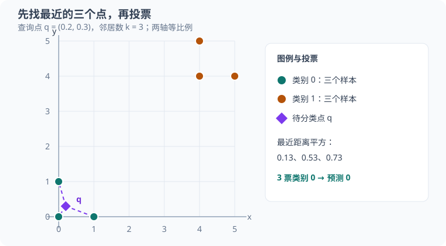

# K 近邻：从距离计算到类别投票

本文从基础开始分析 [`src/ml/03_knn.c`](../src/ml/03_knn.c)，把分类直觉、距离公式、完整手算过程和 C 实现对应起来。项目中其他机器学习案例见[机器学习学习手册](30_machine_learning.md)。

## 1. KNN 要解决什么问题

K 近邻（K-Nearest Neighbors，KNN）**根据一个新样本周围已知样本的标签进行预测**。输入是带标签的历史样本、一个待分类点和邻居数；输出是待分类点的类别。直觉上，如果一个点附近大多数样本属于同一类，就把它也分到那一类。

### 学习目标与前置知识

读完后，你应能从查询点开始，手算到样本的距离平方、排出最近邻、完成类别投票，并解释平局规则、特征尺度和邻居数对结果的影响。无需预先学过机器学习；需要的基础是二维坐标、平方与平方根，以及 C 的数组、结构体和比较函数。

这个算法没有单独的参数训练阶段。程序保存样本；每次预测时计算新点到所有样本的距离，选出最近的若干个，再由它们投票。因此，KNN 常被称为惰性学习方法：它把主要计算留在预测时。

### KNN 与线性回归、逻辑回归的区别

线性回归、逻辑回归通过梯度下降学习权重和偏置；本例 **KNN 不学习这些参数，也不反复更新样本坐标。它的预测规则由保存的数据、距离定义、邻居数和两种平局规则共同决定**。

“没有参数训练”不等于没有需要选择的设置。邻居数 $k$ 是超参数，距离与特征缩放也需要按任务确定。如果以后加入标准化，还需要用训练数据拟合均值和标准差。只是当前源码的预测阶段没有梯度下降。

KNN 依赖一个建模假设：在所选距离下足够接近的样本，其标签往往也有联系。如果距离反映的差异与类别无关，单靠找近邻并不能解决问题。

### 源码地图与运行路线

| 算法部分 | 源码位置 | 保存的信息或代码职责 |
| :--- | :--- | :--- |
| 样本数与样本类型 | [`SAMPLE_COUNT`](../src/ml/03_knn.c#L9)、[`Sample`](../src/ml/03_knn.c#L11) | 固定样本容量，以及横纵坐标和类别标签 |
| 邻居记录 | [`Neighbor`](../src/ml/03_knn.c#L16) | 距离平方、原样本下标和原标签；`distance` 字段实际存距离平方 |
| 排序规则 | [`compare_neighbors`](../src/ml/03_knn.c#L28) | 先比较距离，距离相同再比较原始下标 |
| 单次分类 | [`classify`](../src/ml/03_knn.c#L49) | 校验邻居数、构造并排序邻居、计票、写出类别 |
| 数据与行为断言 | [`main`](../src/ml/03_knn.c#L74) | 初始化固定数据，调用分类函数并检查结果与失败行为 |

实际调用顺序是：`main` 创建六个 `Sample` → `classify` 计算六个距离 → `qsort` 调用 `compare_neighbors` 排序 → `classify` 对前 `k` 个 `Neighbor` 计票 → 将类别写入 `*output` → `main` 用 `assert` 检查结果。代码没有独立的“训练参数”阶段；每个新查询点都会重新走完这条路径。

## 2. 示例数据与记号

程序使用六个二维样本。坐标由 `Sample.x`、`Sample.y` 保存，类别由 `Sample.label` 保存。

| C 数组下标 $i$ | 坐标 $(x_i,y_i)$ | 标签 $c_i$ |
| ---: | :---: | ---: |
| $0$ | $(0,0)$ | $0$ |
| $1$ | $(0,1)$ | $0$ |
| $2$ | $(1,0)$ | $0$ |
| $3$ | $(4,4)$ | $1$ |
| $4$ | $(4,5)$ | $1$ |
| $5$ | $(5,4)$ | $1$ |



图中紫色菱形是源码第一次查询的 $q=(0.2,0.3)$；虚线连接 $k=3$ 时选中的三个样本。它们的距离平方依次为 $0.13$、$0.53$、$0.73$，标签全为 $0$，因此投票结果为类别 $0$。两轴使用相同比例，连线长度可以直接比较。

这里 $i$ 是从 $0$ 开始的样本下标，和 C 数组下标一致；$x_i$、$y_i$ 是第 $i$ 个样本的横、纵坐标；$c_i$ 是它已知的类别，只能取 $0$ 或 $1$。本例样本总数记为 $N=6$。待分类点记为 $q=(x_q,y_q)$，其中 $x_q$、$y_q$ 分别是查询点坐标；$k$ 表示参与投票的最近邻居数量，必须满足 $1\le k\le N$。

这些数学量在结构体和函数参数中的位置如下。注意：C 字段名 `distance` 没有平方字样，但它保存的是距离平方，而不是开平方后的欧氏距离。

| 数学量 | C 表达 | 含义 |
| :--- | :--- | :--- |
| $x_i,y_i,c_i$ | `Sample.x`、`Sample.y`、`Sample.label` | 第 $i$ 条样本的两个坐标和已知类别 |
| $x_q,y_q,k$ | `classify` 的参数 `x`、`y`、`k` | 当前查询点的坐标和邻居数 |
| $d_i^2$ | `Neighbor.distance` | 查询点到原样本 $i$ 的距离平方 |
| $i$ | `Neighbor.index` | 排序前的原数组下标，用于距离平局时稳定次序 |
| $p$ | 局部变量 `positives` | 选中的邻居中类别为 $1$ 的数量 |
| $\hat c(q)$ | `*output` 指向的整数 | 最终预测类别，取 $0$ 或 $1$ |

### 坐标向量与特征维数

两个坐标都是输入特征，标签则是另外保存的 $c_i$。本篇的 $y_i$ 表示纵坐标，不是前两篇回归文档里的目标标签，不能混淆。

将样本写成向量 $s_i=(x_i,y_i)$，查询写成 $q=(x_q,y_q)$，本例特征维数为 $D=2$。推广到更多特征时，用 $s_{ij}$ 表示样本 $i$ 的第 $j$ 个特征，$q_j$ 表示查询的对应分量，其中 $j=0,\ldots,D-1$。二维时，$s_{i0}=x_i$、$s_{i1}=y_i$，$q_0=x_q$、$q_1=y_q$。

标签不参加距离计算。把已知标签当作额外坐标不仅改变几何含义，对新查询也不可行，因为它的标签正是尚待预测的内容。

后文仍用 $p$ 表示 `positives` 对应的整数票数；它不是上一篇逻辑回归中的概率。票数满足 $0\le p\le k$，需要除以邻居数才能得到一个局部类别占比。

## 3. 距离：比较查询点与每条样本

二维平面上两点之间的欧氏距离由勾股定理得到。对查询点 $q=(x_q,y_q)$ 和样本 $s_i=(x_i,y_i)$，横向差为 $x_i-x_q$，纵向差为 $y_i-y_q$。两条垂直边的平方和等于直线距离的平方：

$$
d_i^2=(x_i-x_q)^2+(y_i-y_q)^2.
\tag{1}
$$

其中 $d_i$ 是查询点到样本 $i$ 的欧氏距离，$d_i^2$ 是距离平方。坐标差的正负方向不会影响结果，因为差值会平方。公式假设坐标是有限数，并且平方与相加不会溢出浮点数范围。

以第一个查询点 $q=(0.2,0.3)$ 为例。对样本 $s_0=(0,0)$，逐项代入：

$$
d_0^2=(0-0.2)^2+(0-0.3)^2=(-0.2)^2+(-0.3)^2=0.04+0.09=0.13.
\tag{2}
$$

对样本 $s_1=(0,1)$：

$$
d_1^2=(0-0.2)^2+(1-0.3)^2=(-0.2)^2+0.7^2=0.04+0.49=0.53.
\tag{3}
$$

对样本 $s_2=(1,0)$：

$$
d_2^2=(1-0.2)^2+(0-0.3)^2=0.8^2+(-0.3)^2=0.64+0.09=0.73.
\tag{4}
$$

到后三个样本的计算为：

$$
\begin{aligned}
d_3^2&=(4-0.2)^2+(4-0.3)^2=3.8^2+3.7^2=14.44+13.69=28.13,\\
d_4^2&=(4-0.2)^2+(5-0.3)^2=3.8^2+4.7^2=14.44+22.09=36.53,\\
d_5^2&=(5-0.2)^2+(4-0.3)^2=4.8^2+3.7^2=23.04+13.69=36.73.
\end{aligned}
\tag{5}
$$

[`classify`](../src/ml/03_knn.c#L49) 中的 `dx` 对应 $x_i-x_q$，`dy` 对应 $y_i-y_q$，`neighbors[i].distance` 保存 $d_i^2$。平方根可以省略：对任意样本下标 $r,s$，距离非负，平方根保持大小顺序，因此 $d_r^2<d_s^2$ 当且仅当 $d_r<d_s$。例如 $0.13<0.53$，所以对应的真实距离也满足 $\sqrt{0.13}<\sqrt{0.53}$；要找最近点时无需真的求平方根。

距离循环中的三条关键语句是：

源码位置：[距离计算与 `Neighbor` 初始化](../src/ml/03_knn.c#L55)。

```c
double dx = samples[i].x - x;
double dy = samples[i].y - y;
neighbors[i] = (Neighbor){dx * dx + dy * dy, i, samples[i].label};
```

`samples[i].x`、`samples[i].y` 分别对应 $x_i$、$y_i$；参数 `x`、`y` 分别对应 $x_q$、$y_q$。所以 `dx` 等于 $x_i-x_q$，`dy` 等于 $y_i-y_q$。复合字面量按 [`Neighbor`](../src/ml/03_knn.c#L16) 的成员声明顺序初始化：第一个值 `dx * dx + dy * dy` 写入 `distance`，第二个值 `i` 写入 `index`，第三个值 `samples[i].label` 写入 `label`。这三行完成从距离公式到邻居记录的映射。

以第一次调用中 $i=4$ 的样本 $(4,5)$ 为例，`dx` 为 $4-0.2=3.8$，`dy` 为 $5-0.3=4.7$，记录的 `distance` 为 $3.8^2+4.7^2=14.44+22.09=36.53$。因此记录相当于 `{36.53, 4, 1}`，三个值分别对应 `distance`、`index`、`label`。

### 从二维勾股定理推广到欧氏范数

在一般的 $D$ 维特征空间中，欧氏距离为：

$$
d_i=\lVert s_i-q\rVert_2
=\sqrt{\sum_{j=0}^{D-1}(s_{ij}-q_j)^2}.
\tag{6}
$$

$\lVert\cdot\rVert_2$ 读作“二范数”，这里表示差向量的长度。以 $s_0=(0,0)$、$q=(0.2,0.3)$ 为例，差向量为 $(-0.2,-0.3)$，所以长度是 $\sqrt{0.04+0.09}=\sqrt{0.13}\approx0.360555$。若第三个特征的差为 $0.4$，距离平方就增加 $0.4^2=0.16$，变成 $0.29$。

对当前的选邻居步骤，平方根严格递增，故去掉它仍保持顺序和平局。例如 $\sqrt{0.13}<\sqrt{0.53}$，与 $0.13<0.53$ 等价。源码只需要这种顺序信息，不需要真实距离本身。

### 距离平方不能代替距离的全部性质

欧氏距离非负、对称，同一点到自身的距离为零。距离平方也保留这些性质，却不满足一般的三角不等式。取三个补充点 $A=(0,0)$、$B=(1,0)$、$C=(2,0)$，用 $d(A,B)$ 表示两点间的欧氏距离：

$$
d(A,C)=2=d(A,B)+d(B,C),
\tag{7}
$$

但平方后：

$$
d^2(A,C)=4>1+1=d^2(A,B)+d^2(B,C).
\tag{8}
$$

因此，“距离平方与距离排序相同”只支持当前的最近邻选择；不能顺便把依赖真实距离的所有公式都替换成平方距离。后面若改成距离加权投票，使用距离的倒数与距离平方的倒数也会产生不同权重。

## 4. 排序：取出最近的 $k$ 个邻居

程序把六个距离平方从小到大排序。对 $q=(0.2,0.3)$，顺序是 $0.13,0.53,0.73,28.13,36.53,36.73$，对应的标签顺序为 $0,0,0,1,1,1$。当 $k=3$ 时，最近的三个样本标签都是 $0$。

`qsort` 完成后，局部数组 `neighbors` 的实际内容如下。排序移动的是整个 `Neighbor` 记录，因此距离、原始下标和标签仍然属于同一条样本：

| 排序位置 | `Neighbor.index`（原下标） | `Neighbor.distance`（距离平方） | `Neighbor.label` |
| ---: | ---: | ---: | ---: |
| $0$ | $0$ | $0.13$ | $0$ |
| $1$ | $1$ | $0.53$ | $0$ |
| $2$ | $2$ | $0.73$ | $0$ |
| $3$ | $3$ | $28.13$ | $1$ |
| $4$ | $4$ | $36.53$ | $1$ |
| $5$ | $5$ | $36.73$ | $1$ |

这组输入刚好在排序前后保持相同下标次序。其他查询会把原数组后面的样本排到前面；下一节会用第二次真实调用展示这一点。

代码中的 `qsort` 使用 [`compare_neighbors`](../src/ml/03_knn.c#L28) 比较 `Neighbor.distance`。如果距离相等，比较器再按原始 `index` 从小到大排序。C 标准库的 `qsort` 不保证等价元素保留原来的相对次序；这里用原下标作为第二排序键，让同一输入数组的结果仍然确定。如果同距离样本恰好跨过第 $k$ 个位置，原始下标规则会决定哪一个进入投票集合。

源码在 [`classify` 第 $61$ 行](../src/ml/03_knn.c#L61) 调用 `qsort`：

```c
qsort(neighbors, SAMPLE_COUNT, sizeof(neighbors[0]), compare_neighbors);
```

四个参数依次是待排序数组首地址、元素数量、单个元素字节数和比较函数。这里元素数量是 $6$，`sizeof(neighbors[0])` 自动取得一个 `Neighbor` 的大小；排序会直接重排 `neighbors` 数组，因此后续投票只需读取前 $k$ 个位置。

比较函数收到通用指针后再转回具体类型：

```c
const Neighbor *a = left;
const Neighbor *b = right;
```

`qsort` 接口用 `const void *` 让比较器可以处理不同元素类型；本例知道数组实际元素是 `Neighbor`，所以把指针转换为只读的 `Neighbor` 指针，再访问 `distance` 和 `index`。比较器只观察元素，不修改排序记录。

距离相同与类别票数相同是两种不同的平局。前者由距离和原始下标排序规则处理；后者由分类规则处理，不能混为一谈。

### 排序位置和原始下标是不同的量

可以用 $\pi(r)$ 表示排序位置 $r$ 对应的原始样本下标，其中 $r=0,\ldots,N-1$。例如第一个查询的下标顺序为 $(0,1,2,3,4,5)$，第二个查询的顺序则为 $(3,4,5,1,2,0)$；后者满足 $\pi(0)=3$、$\pi(1)=4$。

最近邻集合就是：

$$
K(q)=\{\pi(0),\pi(1),\ldots,\pi(k-1)\}.
\tag{9}
$$

第二个查询取 $k=3$ 时，集合是 $\{3,4,5\}$，而不是原数组前三个下标 $\{0,1,2\}$。只有排序数组的位置对应“第几近”，原下标用于找回样本身份并打破距离平局。

如果第 $k$ 个位置附近存在等距点，程序仍然只取恰好 $k$ 条记录，并不会把所有同距离样本都加进来。否则参与投票的样本数会改变，已经是另一种规则。

### 补充查询：等距点跨过选择边界

沿用源码的六个样本，另外手算查询 $q=(2.5,2)$、$k=1$。这不是 `main` 中已有的调用，而是用于解释比较器的补充算例。原下标 $2$ 的负类样本和原下标 $3$ 的正类样本距离相同：

$$
d_2^2=(1-2.5)^2+(0-2)^2=2.25+4=6.25,
\tag{10}
$$

$$
d_3^2=(4-2.5)^2+(4-2)^2=2.25+4=6.25.
\tag{11}
$$

其余样本的距离平方都更大；完整排序按“距离平方、原下标”得到：

| 排序位置 | 原下标 | 距离平方 | 标签 |
| ---: | ---: | ---: | ---: |
| $0$ | $2$ | $6.25$ | $0$ |
| $1$ | $3$ | $6.25$ | $1$ |
| $2$ | $1$ | $7.25$ | $0$ |
| $3$ | $0$ | $10.25$ | $0$ |
| $4$ | $5$ | $10.25$ | $1$ |
| $5$ | $4$ | $11.25$ | $1$ |

因为 $k=1$，只选原下标较小的那条负类记录，预测为 $0$。如果交换原数组中下标 $2$、$3$ 的整条样本记录，几何位置和标签的集合没有改变，但同距离时先选中的会是正类，预测改为 $1$。

所以原下标规则保证的是**固定数组下的可重复性**，不保证交换输入次序后预测仍不变，也不代表较小下标具有统计上的优先地位。这里的半整数坐标及距离平方可以被常见二进制浮点数精确表示，因此这个算例也便于观察真正进入等距分支的情况。

### 等距条件如何形成几何边界

只比较刚才两个样本 $(1,0)$、$(4,4)$，令查询到它们的距离相同，逐项展开：

$$
\begin{aligned}
(x_q-1)^2+y_q^2&=(x_q-4)^2+(y_q-4)^2,\\
x_q^2-2x_q+1+y_q^2
&=x_q^2-8x_q+16+y_q^2-8y_q+16,\\
6x_q+8y_q&=31.
\end{aligned}
\tag{12}
$$

代入 $q=(2.5,2)$，左侧为 $6\times2.5+8\times2=31$，确实位于这条等距直线上。只比较这两个点时，直线两侧分别更靠近其中一个样本；完整算法还要考虑另外四个样本，不能把这一条直线直接当作整个模型的分类边界。

对 $k=1$，每条样本拥有“它是最近点”的区域，称为 Voronoi 区域。多个区域按标签拼起来，分类边界整体不必是一条直线。对更大的邻居数，预测由多个最近样本共同决定，单独比较一对距离还不足以确定最终类别。

## 5. 多数投票：由邻居标签得出预测

将排序后最靠前的 $k$ 个样本下标组成集合 $K(q)$。其中类别为 $1$ 的票数记为 $p$；其余 $k-p$ 票来自类别 $0$。分类规则是：

$$
\hat c(q)=
\begin{cases}
1,&p>k-p,\\
0,&p\le k-p.
\end{cases}
\tag{13}
$$

这里 $\hat c(q)$ 是对查询点类别的预测，$p=\sum_{i\in K(q)}\mathbf{1}[c_i=1]$；求和把最近邻集合中标签为 $1$ 的样本数加起来，指示函数 $\mathbf{1}[\cdot]$ 在条件为真时取 $1$、否则取 $0$。当两类票数相同，代码明确选择类别 $0$。对于二分类，如果 $k$ 是奇数，类别票数不会相等；距离相等仍可能发生，因为多个样本可以离查询点同样远。

第一个查询点的最近三个标签为 $0,0,0$，所以 $k=3$、$p=0$：

$$
\hat c(q)=0\quad\text{因为}\quad 0\le 3-0.
\tag{14}
$$

第二个查询点 $q=(4.2,4.3)$ 的最近三个点是 $(4,4)$、$(4,5)$ 和 $(5,4)$，其距离平方分别是 $0.13$、$0.53$ 和 $0.73$，标签都是 $1$。因此 $k=3$、$p=3$，有 $3>3-3$，预测类别为 $1$。例如第一个邻居的计算为：

$$
(4-4.2)^2+(4-4.3)^2=(-0.2)^2+(-0.3)^2=0.04+0.09=0.13.
\tag{15}
$$

完整排序结果可以看到 `qsort` 如何把原数组末尾的正类样本移到最前面：

| 排序位置 | 原下标 `index` | 坐标 | 距离平方 `distance` | 标签 `label` |
| ---: | ---: | :---: | ---: | ---: |
| $0$ | $3$ | $(4,4)$ | $0.13$ | $1$ |
| $1$ | $4$ | $(4,5)$ | $0.53$ | $1$ |
| $2$ | $5$ | $(5,4)$ | $0.73$ | $1$ |
| $3$ | $1$ | $(0,1)$ | $28.53$ | $0$ |
| $4$ | $2$ | $(1,0)$ | $28.73$ | $0$ |
| $5$ | $0$ | $(0,0)$ | $36.13$ | $0$ |

后三项逐项核对为：到 $(0,1)$ 的平方距离是 $(0-4.2)^2+(1-4.3)^2=17.64+10.89=28.53$；到 $(1,0)$ 是 $(1-4.2)^2+(0-4.3)^2=10.24+18.49=28.73$；到 $(0,0)$ 是 $4.2^2+4.3^2=17.64+18.49=36.13$。排序后的循环下标 $0,1,2$ 正好取前三条，所以 `positives` 最终为 $3$。

程序还用查询点 $(2,2)$ 和 $k=6$ 测试票数平局。六个距离平方按规定排序为 $5,5,8,8,13,13$；对应标签为 $0,0,0,1,1,1$。此时 $p=3$ 且 $k-p=6-3=3$，所以 $p\le k-p$，预测为类别 $0$。这验证了“平票选 $0$”的约定。

这次调用的原始距离依下标顺序为 $8,5,5,8,13,13$。例如，到 $(0,1)$ 的距离平方是 $(0-2)^2+(1-2)^2=4+1=5$；到 $(1,0)$ 也是 $(1-2)^2+(0-2)^2=1+4=5$。到 $(0,0)$ 与 $(4,4)$ 都是 $2^2+2^2=8$；到 $(4,5)$ 是 $2^2+3^2=13$，到 $(5,4)$ 是 $3^2+2^2=13$。在相等距离时再按原下标排序，排序后的记录为：

| 排序位置 | 原下标 `index` | 距离平方 `distance` | 标签 `label` |
| ---: | ---: | ---: | ---: |
| $0$ | $1$ | $5$ | $0$ |
| $1$ | $2$ | $5$ | $0$ |
| $2$ | $0$ | $8$ | $0$ |
| $3$ | $3$ | $8$ | $1$ |
| $4$ | $4$ | $13$ | $1$ |
| $5$ | $5$ | $13$ | $1$ |

由于 $k=6$，全部记录都会计票。这个断言验证类别票数平局，但不单独验证相同距离恰好跨过第 $k$ 个边界时哪条记录会被选中；那一行为由比较器中的原下标次排序键保证。

### 多数投票等价于局部分类错误最少

为什么选择票数较多的类别？可以把它写成一个很小的离散优化问题。令 $h\in\{0,1\}$ 为准备输出的候选类别，定义它在最近邻集合上的平均分类错误：

$$
R_q(h)=\frac{1}{k}\sum_{i\in K(q)}\mathbf{1}[c_i\ne h].
\tag{16}
$$

每个不同意候选类别的邻居贡献一个错误。若输出 $h=0$，正类的 $p$ 个邻居会反对它；若输出 $h=1$，负类的 $k-p$ 个邻居会反对它，所以：

$$
R_q(0)=\frac{p}{k},
\qquad
R_q(1)=\frac{k-p}{k}.
\tag{17}
$$

选择类别 $1$ 的严格条件是：

$$
R_q(1)<R_q(0)
\quad\Longleftrightarrow\quad
\frac{k-p}{k}<\frac{p}{k}
\quad\Longleftrightarrow\quad
p>k-p.
\tag{18}
$$

这正是源码的比较表达式。例如果对查询 $(4.2,4.3)$ 改用 $k=5$，从已有排序表可得最近标签为 $1,1,1,0,0$，所以 $p=3$。候选类别 $0$ 的错误率为 $3/5=0.6$，类别 $1$ 的错误率为 $2/5=0.4$，因此预测为 $1$。

如果 $k=6,p=3$，两种候选的局部错误率都是 $0.5$，仅最小化这个局部错误无法唯一选择类别；“平票选 $0$”是程序额外规定的约定。这里没有对连续参数求梯度，而是在两个离散候选中比较结果。

### 邻居占比与概率不是同一个保证

可以把正类票数除以邻居数，记为局部正类占比 $\rho(q)$：

$$
\rho(q)=\frac{p}{k}.
\tag{19}
$$

刚才 $k=5,p=3$ 的例子给出 $\rho=0.6$，而源码的输出仍然只是整数类别 $1$。对当前平票规则，预测正类等价于 $\rho>0.5$，不是 $\rho\ge0.5$。

这个占比可以作为局部概率估计的起点，却不保证已经校准。比如 $k=1$ 时它永远只有 $0$ 或 $1$，显然不能据此断言模型对每个新点都绝对确定；数据量、抽样方式、尺度和邻域选择都会影响估计。当前函数既不返回 $\rho$，也没有进行概率校准评估。

## 6. 按调用顺序走读核心代码

[`Sample`](../src/ml/03_knn.c#L11) 保存坐标 $(x_i,y_i)$ 和标签 $c_i$；[`Neighbor`](../src/ml/03_knn.c#L16) 保存距离平方 $d_i^2$、原始下标 $i$ 和标签 $c_i$。`classify` 的每个代码阶段都对应一项明确职责。

### 第一步：校验 `k`

```c
if (k == 0 || k > SAMPLE_COUNT) {
    return false;
}
```

这段代码位于 [`classify`](../src/ml/03_knn.c#L49) 开头，有效范围是 $1\le k\le6$。它在创建并填充邻居数组前运行；不满足条件就立即返回，所以 `*output` 尚未写入。调用方可根据 `false` 处理失败。函数没有检查 `samples`、`output` 是否为空指针，也不遍历验证标签是否为 $0$ 或 $1$；这些是调用者必须满足的接口前提。

形参 `const Sample samples[SAMPLE_COUNT]` 会按 C 的数组形参规则调整为指针，它不会在运行时自动确认传入了六条样本。`const` 限制函数通过该指针修改样本，方括号中的容量不能替代长度与所有权契约。源码固定访问六条记录，传入更短数组会越界。

### 第二步：生成邻居记录

```c
double dx = samples[i].x - x;
double dy = samples[i].y - y;
neighbors[i] = (Neighbor){dx * dx + dy * dy, i, samples[i].label};
```

循环变量 `i` 此时是原始样本下标，依次取 $0$ 到 $5$。`samples[i].x`、`samples[i].y` 对应 $x_i$、$y_i$，参数 `x`、`y` 对应查询坐标 $x_q$、$y_q$。因此 `dx` 是 $x_i-x_q$，`dy` 是 $y_i-y_q$。复合字面量的三个值按 [`Neighbor`](../src/ml/03_knn.c#L16) 成员顺序写入 `distance`、`index`、`label`。

以第一次调用中 $i=4$ 的样本 $(4,5)$ 为例，`dx` 为 $4-0.2=3.8$，`dy` 为 $5-0.3=4.7$，距离平方为 $3.8^2+4.7^2=14.44+22.09=36.53$。这条记录保存距离平方 $36.53$、原下标 $4$、类别 $1$。`neighbors` 是函数内固定长度数组，只在本次 `classify` 调用期间存在；函数不使用堆分配，也不修改只读输入 `samples`。

### 第三步：排序整条记录

```c
if (a->distance != b->distance) {
    return a->distance < b->distance ? -1 : 1;
}
return (a->index > b->index) - (a->index < b->index);
```

[`compare_neighbors`](../src/ml/03_knn.c#L28) 是传给 `qsort` 的比较回调。第一段让距离平方较小的记录排在前面；相等时进入第二段，以原始下标为次排序键。两个下标比较表达式分别产生 $0$ 或 $1$，相减后得到负数、$0$ 或正数，符合比较器的返回约定。代码没有直接计算 `a->index - b->index`，因为 `size_t` 是无符号类型，较小下标减较大下标会回绕。明确次排序键让等距样本的顺序确定，不依赖 `qsort` 是否稳定。

距离也不能直接相减后强制转成 `int` 作为比较结果。例如两个距离平方是 $0.13$ 和 $0.53$，差为 $-0.4$，转换为整数会得到 $0$，错误地宣称两者相等。当前代码先比较大小，再返回明确的负数或正数，避免这种截断错误。

源码用的是机器存储值的精确相等。数学上距离相同，不保证通过不同浮点运算路径后仍逐位相同；也不要简单把“差小于容差”当作排序相等。设容差 $\varepsilon>0$，三个值依次为 $0$、$0.75\varepsilon$、$1.5\varepsilon$，前两项很近、后两项也很近，但首尾并不近。这种近似相等不具备传递性，不能直接替代比较器需要的一致排序关系。

### 第四步：统计类别并写出结果

对应源码是 [`positives` 计数循环和输出赋值](../src/ml/03_knn.c#L62)。

```c
size_t positives = 0;
for (size_t i = 0; i < k; ++i) {
    positives += neighbors[i].label == 1;
}
*output = positives > k - positives ? 1 : 0;
```

排序完成后，循环变量 `i` 是排序数组的位置，不再是原始样本下标；原下标保存在 `neighbors[i].index`。表达式 `neighbors[i].label == 1` 的结果是假或真，在 C 中转换为整数值 $0$ 或 $1$ 后累加，因此 `positives` 对应公式中的 $p$。`k - positives` 是类别 $0$ 的票数。严格比较 `>` 让票数相等时写入类别 $0$；这依赖标签只取 $0$ 或 $1$ 的前提。

第一次调用选中的标签为 $0,0,0$，循环执行 $3$ 次后 `positives` 为 $0$；比较 $0>3-0$ 为假，所以 `*output` 被赋为 $0$，函数返回 `true`。第二次调用前三个标签为 $1,1,1$，`positives` 为 $3$，因为 $3>3-3$，输出为 $1$。第三次调用的六个标签为 $0,0,0,1,1,1$，两类各有 $3$ 票，输出为 $0$。

成功路径只写 `*output` 并返回 `true`，不修改样本或保留跨调用状态。无效 `k` 的失败路径则在输出赋值前返回 `false`，这正是失败时输出不变的原因。

函数注释要求 `samples` 指向六个有效样本，查询坐标为有限值，`output` 是可写地址。实现只主动检查 `k`。有限坐标仍可能因量级过大，在平方或相加时溢出成无穷大，让远距离样本难以区分；若调用方违反前提传入 NaN，比较器没有专门处理 NaN，排序关系可能不符合 `qsort` 对比较器一致性的要求。

## 7. `main` 中的断言究竟验证了什么

[`main`](../src/ml/03_knn.c#L74) 既构造数据，也充当这个独立示例的测试入口。断言与分类调用的对应关系如下：

| 调用输入 | 断言结果 | 验证内容 |
| :--- | :--- | :--- |
| 查询点 $(0.2,0.3)$，$k=3$ | [断言](../src/ml/03_knn.c#L80) | 第一组附近的三个邻居都属于类别 $0$ |
| 查询点 $(4.2,4.3)$，$k=3$ | [断言](../src/ml/03_knn.c#L82) | 第二组附近的三个邻居都属于类别 $1$ |
| 查询点 $(2,2)$，$k=6$ | [断言](../src/ml/03_knn.c#L84) | 三票对三票时选择类别 $0$ |
| 查询点 $(0,0)$，$k=0$ | [断言](../src/ml/03_knn.c#L87) | 邻居数下界非法，函数失败且输出不变 |
| 查询点 $(0,0)$，$k=7$ | [断言](../src/ml/03_knn.c#L89) | 邻居数超过样本量，函数失败且输出不变 |

`success` 保存 `classify` 的布尔返回值，表示该次 `k` 是否有效；`label` 是传入 `classify` 的输出地址所指向的整数。`label` 先初始化为 $-1$，成功分类会覆盖它；程序随后重新设为 $-1$，再检查两种失败路径均未改变该值。末尾的 `puts` 只打印一行摘要，不输出距离或排序过程。要观察中间值，可在 [`classify`](../src/ml/03_knn.c#L49) 的距离循环、`qsort` 之后、投票循环和输出赋值位置设断点，检查 `neighbors`、`positives` 和 `label`；它们分别对应距离表、排序表、类别 $1$ 票数和预测结果。

构建规则把 `src/ml/*.c` 自动映射到 `build/ml/*`，并给机器学习程序链接数学库；本例虽未调用数学库函数，仍通过统一规则构建，见 [`ML_PROGRAMS`](../Makefile#L49) 和[机器学习链接设置](../Makefile#L863)。运行 `make build/ml/03_knn` 构建目标，再执行 `./build/ml/03_knn`，会运行 `main` 中的全部断言。[`make ml`](../Makefile#L868) 会运行所有机器学习示例，验证范围更广但输出也更多。不要用 `-DNDEBUG` 构建这个断言示例，否则 `assert` 检查会被关闭。

## 8. 邻居数如何改变模型，以及如何选择

### 同一排序结果，不同投票范围

邻居数不改变本次查询已经计算好的距离，只改变排序后取多长的一段。例如沿用前两个真实查询的排序表：

| 查询 | $k$ | 选中的标签 | 正类票数 $p$ | 输出 |
| :--- | ---: | :--- | ---: | ---: |
| $(0.2,0.3)$ | $1$ | $0$ | $0$ | $0$ |
| $(0.2,0.3)$ | $3$ | $0,0,0$ | $0$ | $0$ |
| $(0.2,0.3)$ | $5$ | $0,0,0,1,1$ | $2$ | $0$ |
| $(0.2,0.3)$ | $6$ | $0,0,0,1,1,1$ | $3$ | $0$ |
| $(4.2,4.3)$ | $1$ | $1$ | $1$ | $1$ |
| $(4.2,4.3)$ | $3$ | $1,1,1$ | $3$ | $1$ |
| $(4.2,4.3)$ | $5$ | $1,1,1,0,0$ | $3$ | $1$ |
| $(4.2,4.3)$ | $6$ | $1,1,1,0,0,0$ | $3$ | $0$ |

这张表包含为比较邻居数而增加的手算情况；原 `main` 只对前两个查询使用 $k=3$。

当 $k=N$，所有样本都会投票，距离排序不再影响最终票数。本例总是正负各有三票，所以不论查询点在哪里，都会因为平票规则输出类别 $0$。即使查询恰好是已知正类点 $(4,4)$，选六个邻居后也会输出 $0$。

因此，不能认为邻居越多越好，也不能认为 KNN 只要看到一个完全相同的样本，就一定返回它的标签；后一个结论还依赖邻居数与重复点处理规则。

### 小邻域与大邻域的取舍

定义邻域半径 $R_k(q)$ 为选中邻居中最大的真实距离：

$$
R_k(q)=d_{\pi(k-1)}.
\tag{20}
$$

对同一个查询，增加邻居数只会使这个半径不变或增大。以 $(4.2,4.3)$ 为例，$R_1=\sqrt{0.13}$、$R_3=\sqrt{0.73}$、$R_6=\sqrt{36.13}$；最后一种情况已经把很远的负类样本也包括进来。

较小的邻居数保留局部细节，却容易受个别近处噪声、错误标签或异常点影响；较大的邻居数能平滑一些局部波动，却可能把不同区域混在一起，偏向整体多数类。这通常称为模型的偏差与方差取舍，是理解趋势的概念，不是说任意数据上某个固定邻居数都最好。

二分类使用奇数邻居可以消除票数相同的情况，但不能消除等距邻居；推广到多分类后，奇数也不能保证没有票数平局，例如三个类别各获一票。

### 用验证数据选邻居数，不能用最终测试结果反复调参

完整学习流程应先划分训练、验证与最终测试数据。训练样本用于组成邻居候选，验证样本用于比较邻居数及预处理选择，最终测试数据在选择完成后评估。数据较少时，可以在开发数据内部做交叉验证，但每一折的标准化统计量仍只能来自该折的训练部分。

设评估集中有 $M$ 条查询向量 $v_m$，真实标签为 $t_m$，下标 $m=0,\ldots,M-1$。平均分类错误率可以写为：

$$
\text{error rate}
=\frac{1}{M}\sum_{m=0}^{M-1}
\mathbf{1}[\hat c(v_m)\ne t_m].
\tag{21}
$$

例如补充评估标签为 $(0,0,1)$，预测为 $(0,1,1)$，则错误指示为 $(0,1,0)$，错误率是 $1/3$，准确率是 $2/3$。这仅演示指标计算，不是源码已经做出的独立评估。

源码的六条样本中，类别 $0$ 和类别 $1$ 各有三条。可以用“始终预测类别 $0$”作常数类别基线；由于两类数量并列，选择类别 $0$ 是这项基线的人为约定。在这六条样本上的命中比例是 $3/6=50\%$。源码没有计算这个基线或独立评估集上的准确率；这个数字只帮助理解基线，不能当作模型效果结论。

若直接把训练样本当查询，且仍让它自己参与候选，$k=1$ 通常会选中距离为零的自己，导致过于乐观的结果；相同坐标有冲突标签时还会受平局规则影响。留一法评估需要真正排除被查询的那条记录。

**当前函数固定访问六条样本，不能直接传入更短的交叉验证训练折。** 进行这类扩展前，应先把实际样本数纳入接口；不能将验证样本继续留在候选数组，或靠复制记录凑足容量，否则评估含义已经改变。

## 9. 特征尺度与标准化的数学过程

### 单独改变一个坐标轴，可能改变类别

假设某条记录原先的特征差为 $0.1$、$0.2$，平方距离是 $0.1^2+0.2^2=0.05$。若横轴单位变成原来的 $100$ 倍，横向差变成 $10$，平方距离变成 $10^2+0.2^2=100.04$。变化不只影响数值大小，还可能使邻居排序改变。

下面仍使用源码六条样本，另取查询 $q=(4,0)$、$k=3$。将所有样本和查询的横坐标都乘以 $10$，纵坐标不变，逐条比较：

| 原下标 | 标签 | 原距离平方 | 只把横坐标乘以 $10$ 后的距离平方 |
| ---: | ---: | ---: | ---: |
| $0$ | $0$ | $16$ | $1600$ |
| $1$ | $0$ | $17$ | $1601$ |
| $2$ | $0$ | $9$ | $900$ |
| $3$ | $1$ | $16$ | $16$ |
| $4$ | $1$ | $25$ | $25$ |
| $5$ | $1$ | $17$ | $116$ |

例如样本 $(5,4)$ 原差值为 $(1,4)$，距离平方是 $1^2+4^2=17$；横轴缩放后差值为 $(10,4)$，变成 $10^2+4^2=116$。

缩放前排序下标为 $(2,0,3,1,5,4)$，前三个标签为 $0,0,1$，预测为 $0$；缩放后顺序变为 $(3,4,5,2,0,1)$，前三个标签都是 $1$，预测改为 $1$。这些记录仍代表同一组原始样本，只因横轴的数值单位不同就得到不同结果。

从公式看，改变后的平方距离相当于：

$$
d_{\text{scaled},i}^2
=100(x_i-x_q)^2+(y_i-y_q)^2.
\tag{22}
$$

因此按轴缩放实质上改变了各特征的权重。对比之下，若所有坐标轴一起乘同一个正数，所有平方距离会乘同一个正因子，排序保持不变；整体平移所有样本和查询也不会改变坐标差。查询与训练样本必须使用同一套变换，不能只变换其中一方。

### 第一步：只用训练数据计算均值与尺度

对每个特征 $j=0,\ldots,D-1$，用训练样本求均值 $\mu_j$、方差 $\sigma_j^2$ 和标准差 $\sigma_j$：

$$
\mu_j=\frac{1}{N}\sum_{i=0}^{N-1}s_{ij},
\qquad
\sigma_j^2=\frac{1}{N}\sum_{i=0}^{N-1}(s_{ij}-\mu_j)^2,
\qquad
\sigma_j=\sqrt{\sigma_j^2}.
\tag{23}
$$

这里明确采用除以训练样本数 $N$ 的方差定义，不是除以 $N-1$ 的样本方差估计。标准差与原特征具有相同单位，用它作分母可以消除该轴的单位尺度。

对源码横坐标，均值为：

$$
\mu_0=\frac{0+0+1+4+4+5}{6}
=\frac{14}{6}=\frac{7}{3}.
\tag{24}
$$

中心化后的横坐标依次为 $(-7/3,-7/3,-4/3,5/3,5/3,8/3)$，所以：

$$
\begin{aligned}
\sigma_0^2
&=\frac{49+49+16+25+25+64}{6\times9}\\
&=\frac{228}{54}=\frac{38}{9},\\
\sigma_0&=\frac{\sqrt{38}}{3}\approx2.054805.
\end{aligned}
\tag{25}
$$

纵坐标只是同一组数值的重新排列，因此 $\mu_1=7/3$、$\sigma_1^2=38/9$。这些量是为标准化扩展手算的；当前 `classify` 中没有计算或保存它们。

### 第二步：对样本和查询使用同一套统计量

当标准差非零时，标准化后的特征用波浪号标记：

$$
\tilde s_{ij}=\frac{s_{ij}-\mu_j}{\sigma_j},
\qquad
\tilde q_j=\frac{q_j-\mu_j}{\sigma_j}.
\tag{26}
$$

例如对第一条样本的横坐标及原查询横坐标 $0.2$，有：

$$
\tilde s_{00}=-\frac{7}{\sqrt{38}},
\qquad
\tilde q_0=-\frac{6.4}{\sqrt{38}}.
\tag{27}
$$

两者之差是 $-0.6/\sqrt{38}$，也等于原差值 $-0.2$ 除以标准差 $\sqrt{38}/3$。

标准化后再算距离，展开相减：

$$
\begin{aligned}
d_{\text{std},i}^2
&=\sum_{j=0}^{D-1}(\tilde s_{ij}-\tilde q_j)^2\\
&=\sum_{j=0}^{D-1}
\left(\frac{(s_{ij}-\mu_j)-(q_j-\mu_j)}{\sigma_j}\right)^2\\
&=\sum_{j=0}^{D-1}\frac{(s_{ij}-q_j)^2}{\sigma_j^2}.
\end{aligned}
\tag{28}
$$

均值在差分中抵消，标准差则重新分配各轴的距离权重。对当前数据，两轴方差恰好相同，所以：

$$
d_{\text{std},i}^2=\frac{9}{38}d_i^2.
\tag{29}
$$

例如原查询到样本 $0$、$1$ 的平方距离分别变成 $0.13\times9/38\approx0.030789$ 和 $0.53\times9/38\approx0.125526$。所有距离乘了同一个正数，因此在精确实数计算下，**当前六样本直接标准化后，邻居顺序不会改变**；不能为了讲解而宣称任何标准化都会改结果。

若先把横轴单位乘以 $10$，对应横轴均值和标准差也分别乘以 $10$。使用新的训练统计量标准化，就能抵消这次单位变换，恢复原来的标准化距离与邻居关系。

### 标准化的边界与数据泄漏

若某个特征在训练数据中是常数，标准差为零，不能直接做除法。需要规定丢弃该特征、将缩放因子设为一个固定值等处理策略；不同策略有不同含义，不能静默产生非有限值。

验证、测试与未来查询只能使用训练部分已经拟合好的统计量。不能把测试数据一起放进均值与方差计算，也不能对每个查询单独重新拟合尺度；前者会泄漏评估数据的信息，后者会让查询与训练样本处于不同的坐标系统。

标准化只能处理数值尺度，不能保证每个特征都与类别相关。用整数编码的无序类别也未必适合直接使用欧氏距离，标签编码相差较大不代表事物更不相似。

## 10. 距离与投票方式的进一步扩展

以下内容帮助理解设计选择，**当前源码仍只实现欧氏距离平方排序和等权投票**，没有这些新增接口。

### 曼哈顿距离会选择不同邻居

曼哈顿距离把各特征绝对差相加：

$$
d_{\text{Man}}(s_i,q)=
\sum_{j=0}^{D-1}\lvert s_{ij}-q_j\rvert.
\tag{30}
$$

对原查询 $(0.2,0.3)$ 与样本 $(0,0)$，它是 $0.2+0.3=0.5$，不同于欧氏距离 $\sqrt{0.13}\approx0.360555$。

为了看清两种距离连排序都可能不同，另外取查询 $(0,0)$，候选点 $A=(3,0)$、$B=(2,2)$。欧氏距离分别为 $3$、$\sqrt8\approx2.828427$，选 $B$；曼哈顿距离分别为 $3$、$4$，却选 $A$。这个补充数据不属于源码训练集。

因此选择距离，本身就在定义“哪些差异算大、哪些点算近”。不能认为换一个距离只会改变数值单位，预测结果一定保持一致。

### 距离加权投票与等权投票不同

等权投票让选中邻居各贡献一票。若希望近处邻居权重更大，可以明确选择一种扩展，例如用距离平方构造权重：

$$
\omega_i=\frac{1}{d_i^2+\varepsilon},
\qquad
\varepsilon>0.
\tag{31}
$$

$\omega_i$ 是邻居权重；$\varepsilon$ 是避免除零的正数，在带物理单位的距离中应与距离平方使用一致单位。正负两类的加权总票数为：

$$
W_1=\sum_{i\in K(q)}\omega_i\mathbf{1}[c_i=1],
\qquad
W_0=\sum_{i\in K(q)}\omega_i\mathbf{1}[c_i=0].
\tag{32}
$$

若继续沿用“严格多票才选正类”的约定，就比较 $W_1>W_0$。

补充一个只为解释权重的三邻居算例：距离平方依次为 $1,4,9$，标签为 $1,0,0$。普通投票以一票对两票输出 $0$；取 $\varepsilon=1$ 后，权重为 $1/2,1/5,1/10$，所以 $W_1=0.5$、$W_0=0.2+0.1=0.3$，加权预测改为 $1$。

若改用 $1/(d_i+\varepsilon)$，那是另一套权重。源码 `distance` 字段保存的是平方距离，直接取倒数并不会自动得到真实距离的倒数。完全重合点或相同坐标有冲突标签时，还应明确相应的处理与平局约定。

### 更多特征不一定提供更多有效信息

考虑另一个补充构造：在 $D$ 维空间中，两个候选相对查询的首个特征差分别为 $1$ 和 $2$，其余 $D-1$ 个特征差都为 $1$。它们的平方距离分别为：

$$
d_A^2=1+(D-1)=D,
\qquad
d_B^2=4+(D-1)=D+3.
\tag{33}
$$

因此真实距离之比为：

$$
\frac{d_B}{d_A}=\sqrt{1+\frac{3}{D}}.
\tag{34}
$$

当 $D=1$，这个比值是 $2$；当 $D=101$，变成 $\sqrt{104/101}\approx1.014743$。大量共同的特征差使原本重要的差异，在总体距离中的相对对比变小。

这个构造中的近邻顺序没有反转，也不是高维数据必然失效的证明；它说明增加特征应关注其信息与尺度，而不是只追求维数。实际中无关维度、稀疏采样和距离对比减弱，都可能让“附近样本有相似标签”的假设更难成立。

## 11. 计算代价、运行验证与学习步骤

### 一次预测需要多少工作

若样本数为 $N$、特征维数为 $D$，计算全部距离的时间量级是 $O(ND)$。完整排序通常按 $O(N\log N)$ 估算，计票为 $O(k)$；不过 C 标准没有规定 `qsort` 的具体排序算法与复杂度，不能把这个通常估算说成接口保证。

本例 $N=6,D=2$，每次查询计算 $6\times2=12$ 个坐标差，并构造六条邻居记录；取 $k=3$ 时再读取三条标签。无论取几个邻居，当前实现都先排序全部六条记录，没有提前只选前几条。

邻居临时数组占用 $O(N)$ 空间，原始样本存储在一般的多维情形下占 $O(ND)$ 空间。本例都是固定容量，`Neighbor` 的实际字节大小由 `sizeof` 和平台布局决定，不能简单把字段大小相加当成跨平台保证。

若独立查询次数为 $Q$，当前路径会重复 $Q$ 次距离计算与排序，没有跨查询缓存。更大数据上的候选扩展包括只维护前几个邻居、空间索引等，但它们没有在本例实现，也需要重新评估高维与最坏情况代价。

### 单独构建、运行与观察

`main` 的摘要只表示示例断言通过，不打印上面推导的距离表。可以单独执行：

```sh
make build/ml/03_knn
./build/ml/03_knn
```

预期输出为：

```text
K 近邻：k=3，(0.2,0.3) → 类别0，(4.2,4.3) → 类别1
```

观察过程时，可在距离循环结束、`qsort` 之后、计票循环结束处设置断点。核对 `neighbors` 中每条记录的距离平方、原下标和标签是否一起移动，再观察 `positives` 与最终输出，而不要只查看最后一句摘要。

这个演示是二维、二分类、固定六样本的实现，尚未提供训练/测试拆分、标准化、加权投票或概率输出。内置断言验证固定输入的实现行为；文档补充的其他查询、尺度和投票算例不应被误认为原 `main` 已经逐一执行的测试。

本次文档扩展使用 Apple Clang 17.0.0，以 `-std=c23 -Wall -Wextra -Wpedantic -Werror` 构建并运行原示例，内置断言通过；另按源码数据和比较规则核对补充算例。数学公式仅做静态格式检查，未做渲染预览。

### 建议按顺序完成的练习

1. 手算第一个查询的六个距离平方，确认哪个值对应哪个原始下标。
2. 从第二个查询的排序表取前几条，区分排序位置与原始样本身份。
3. 用相同排序结果计算不同邻居数下的票数，解释为什么取全部样本后总输出类别 $0$。
4. 用补充等距查询观察选择边界，再解释交换样本记录为什么可能影响结果。
5. 先只改变横轴单位，再对训练与查询应用同一套标准化，核对邻居变化。
6. 在独立扩展实验中加入实际样本数参数，再考虑留一法或交叉验证；严格排除被评估样本。
7. 最后比较不同距离与投票权重，分别记录选择规则和最终评估结果，不把局部票数或训练集正确率当作真实泛化能力的证明。
