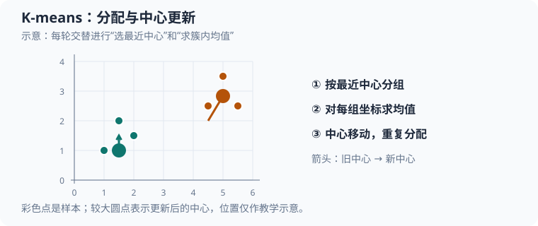

# K 均值聚类（K-means clustering）：从分配到中心更新

本文从基础分析 [`src/ml/04_kmeans.c`](../src/ml/04_kmeans.c)，用固定的六个二维点完整演算 K-means 的分组、中心更新和停止过程，再对应到源码函数；后续章节补充初始化策略、聚类质量评估、适用数据形状与相关算法。对应的 [Python 实现](../src/python/ml/04_kmeans.py)也会与 C 版本对照。机器学习专区的案例索引见[机器学习学习手册](30_机器学习案例总览.md)。



彩色点表示两组样本，箭头表示旧中心移向组内均值。图中坐标用于说明分配与更新，非源码运行截图。

## 1. K-means 要解决什么问题

有一批没有类别标签的数值点，希望把它们分成若干组，并让同一组的点尽量靠近。**K-means 需要预先指定簇数；它反复执行两步：把每个点分给最近的中心，再把每个中心移动到所属点的平均位置**。

“均值”解释了算法名称：更新中心时，使用簇内每个坐标的算术平均值。算法不会学习类别名称；编号为 $0$ 的簇和编号为 $1$ 的簇只是程序内部标识。

## 2. 源码地图与阅读路线

先沿着 `main` 到训练循环读，可以把数学步骤和程序状态对应起来：

| 源码位置 | 作用 | 阅读时关注的状态 |
| --- | --- | --- |
| [`POINT_COUNT`、`CLUSTER_COUNT`](../src/ml/04_kmeans.c#L8) | 固定样本数和簇数 | 本例分别为 $6$ 和 $2$ |
| [`Point`](../src/ml/04_kmeans.c#L12) | 保存二维坐标 | `x` 和 `y` 是两个特征 |
| [`distance_squared`](../src/ml/04_kmeans.c#L23) | 计算两个点之间的平方距离 | `dx`、`dy` 是坐标差 |
| [`nearest`](../src/ml/04_kmeans.c#L36) | 为一个点选择中心 | 返回簇下标，平局返回 $0$ |
| [`objective`](../src/ml/04_kmeans.c#L49) | 累加每个点到最近中心的平方距离 | 每次调用都会重新分配点 |
| [`train`](../src/ml/04_kmeans.c#L64) | 反复分配样本并更新中心 | `sums`、`counts`、`movement` 控制一轮训练 |
| [`main`](../src/ml/04_kmeans.c#L99) | 建立固定数据并检查结果 | 断言验证中心、分组和空簇行为 |
| [Python `train`](../src/python/ml/04_kmeans.py#L9) | 用列表保存两个簇并交替更新 | 返回中心列表和迭代次数；移动量算法与 C 不同 |

主要调用关系是 `main → train → nearest → distance_squared`；`train` 在更新中心前后调用 `objective`，而 `objective` 又会调用 `nearest`。因此 `nearest` 既参与分组，也参与计算目标值。

下面的符号和源码变量按此对应：

| 数学符号 | 源码表达式 | 含义 |
| --- | --- | --- |
| $\mathbf{x}_i$ | `points[i]` | 数组下标为 $i$ 的输入点 |
| $\boldsymbol{\mu}_j$ | `centers[j]` | 编号为 $j$ 的簇中心 |
| $z_i$ | `nearest(points[i], centers)` 的返回值 | 当前把点 $i$ 分给哪个簇 |
| $\sum_{i:z_i=j}\mathbf{x}_i$ | `sums[j]` | 分给簇 $j$ 的坐标累加值 |
| $\|C_j\|$ | `counts[j]` | 分给簇 $j$ 的点数 |
| $\boldsymbol{\mu}_j^{\text{new}}$ | `updated` | 本轮算出的新中心 |
| $J_{\text{before}}$、$J_{\text{after}}$ | `previous`、`current` | 更新中心前后的目标值 |
| $M$ | `movement` | 本轮所有中心移动量的平方和 |
| 轮次下标 | `iteration` | 从 $0$ 开始计数；返回值是轮数，所以通常为下标加 $1$ |

C 与 Python 都使用相同六个点、两个固定初始中心、最近中心分配、簇均值更新和空簇保留策略；两者都把等距离点分给编号较小的簇。实现细节有两处值得对照：C 原地修改传入的 `centers` 并返回轮数，Python 先复制中心列表并返回 `(centers, iterations)`；更重要的是，C 将每个中心的**位移平方**相加后与 $10^{-12}$ 比较，而 Python 将中心的**欧氏位移长度**相加后与同一数值比较。停止阈值的含义不同，只是本例第二轮都得到精确不动的中心，所以均返回 $2$ 轮。C 每轮还用断言检查目标值不升，Python 没有计算这项检查。

## 3. 数据、中心与符号

本例有 $N=6$ 个二维点，目标簇数为 $K=2$，每个点的特征维数为 $D=2$。第 $i$ 个点写作 $\mathbf{x}_i=(x_{i,1},x_{i,2})$，其中 $i$ 是从 $0$ 开始的数组下标，$x_{i,1}$ 与 $x_{i,2}$ 分别是横坐标和纵坐标。两个初始中心写作 $\boldsymbol{\mu}_0$ 与 $\boldsymbol{\mu}_1$；下标表示簇编号，不是样本编号。

| 数组下标 $i$ | 点 $\mathbf{x}_i$ |
| ---: | :---: |
| $0$ | $(0,0)$ |
| $1$ | $(0,1)$ |
| $2$ | $(1,0)$ |
| $3$ | $(8,8)$ |
| $4$ | $(8,9)$ |
| $5$ | $(9,8)$ |

源码把 $N$、$K$ 分别定义为 `POINT_COUNT`、`CLUSTER_COUNT`。[`main` 中的数据和中心初始化](../src/ml/04_kmeans.c#L102)直接取 `points[0]` 和 `points[3]`，也就是 $\boldsymbol{\mu}_0=(0,0)$、$\boldsymbol{\mu}_1=(8,8)$；这不是随机初始化。

## 4. 第一步：把每个点分给最近中心

在二维平面中，点 $\mathbf{x}_i=(x_{i,1},x_{i,2})$ 到中心 $\boldsymbol{\mu}_j=(\mu_{j,1},\mu_{j,2})$ 的欧氏距离平方是：

$$
d_{i,j}^{2}=(x_{i,1}-\mu_{j,1})^2+(x_{i,2}-\mu_{j,2})^2.
\tag{1}
$$

这里 $d_{i,j}^{2}$ 表示样本 $i$ 到簇中心 $j$ 的距离平方。算法把点分给距离最小的中心：

$$
z_i=\underset{j\in\{0,1\}}{\operatorname{argmin}}\;d_{i,j}^{2}.
\tag{2}
$$

$z_i$ 是点 $i$ 当前的簇编号；$\operatorname{argmin}$ 表示“使距离最小的那个编号”。距离平方足以比较远近，因为距离非负，平方不会改变大小顺序，所以实现不需要开平方。

以 $\mathbf{x}_1=(0,1)$ 为例，它到初始中心 $\boldsymbol{\mu}_0=(0,0)$ 的距离平方是：

$$
\begin{aligned}
d_{1,0}^{2}&=(0-0)^2+(1-0)^2=0+1=1.
\end{aligned}
\tag{3}
$$

它到另一个中心 $\boldsymbol{\mu}_1=(8,8)$ 的距离平方是：

$$
\begin{aligned}
d_{1,1}^{2}&=(0-8)^2+(1-8)^2=64+49=113.
\end{aligned}
\tag{4}
$$

因为 $1<113$，所以 $z_1=0$。同样计算六个点，可得完整分配：

| 点 $\mathbf{x}_i$ | 到 $\boldsymbol{\mu}_0$ 的距离平方 | 到 $\boldsymbol{\mu}_1$ 的距离平方 | 簇编号 $z_i$ |
| :---: | ---: | ---: | ---: |
| $(0,0)$ | $0$ | $128$ | $0$ |
| $(0,1)$ | $1$ | $113$ | $0$ |
| $(1,0)$ | $1$ | $113$ | $0$ |
| $(8,8)$ | $128$ | $0$ | $1$ |
| $(8,9)$ | $145$ | $1$ | $1$ |
| $(9,8)$ | $145$ | $1$ | $1$ |

这些计算对应 [`distance_squared`](../src/ml/04_kmeans.c#L23) 和 [`nearest`](../src/ml/04_kmeans.c#L36)。核心代码是：

```c
return distance_squared(point, centers[0]) <= distance_squared(point, centers[1])
           ? 0
           : 1;
```

这里 `point` 是正在分配的点，`centers[0]` 与 `centers[1]` 是两个候选中心。`<=` 表示第一个中心距离更短或恰好相等时都返回 $0$。这个函数直接写死了两个中心；虽然 `CLUSTER_COUNT` 是常量，单纯把它改为 $3$ 并不会让 `nearest` 自动支持第三个簇。

注意，源码没有创建长度为 $N$ 的簇标签数组。每次调用 `nearest` 都根据传入的当前中心重新计算 $z_i$，因此中心变化后，一个点理论上可以在下一轮改变簇编号。

## 5. 第二步：把中心移动到簇内均值

固定分组后，对非空簇 $j$，新中心是簇内所有点的坐标平均值：

$$
\boldsymbol{\mu}_j^{\text{new}}=
\frac{1}{|C_j|}\sum_{i:z_i=j}\mathbf{x}_i.
\tag{5}
$$

这里 $C_j$ 是当前属于簇 $j$ 的点的集合，$|C_j|$ 是集合中的点数；向量求和表示分别累加各坐标，最后除以点数。例如簇 $0$ 包含 $(0,0)$、$(0,1)$、$(1,0)$，因此它的新中心横坐标为 $x$ 坐标的平均值：

$$
\begin{aligned}
\mu_{0,1}^{\text{new}}&=\frac{0+0+1}{3}=\frac{1}{3}.
\end{aligned}
\tag{6}
$$

纵坐标也逐项取平均：

$$
\begin{aligned}
\mu_{0,2}^{\text{new}}&=\frac{0+1+0}{3}=\frac{1}{3},\\
\boldsymbol{\mu}_0^{\text{new}}&=\left(\frac{1}{3},\frac{1}{3}\right).
\end{aligned}
\tag{7}
$$

同理，簇 $1$ 的横纵坐标分别是 $\frac{8+8+9}{3}=\frac{25}{3}$ 和 $\frac{8+9+8}{3}=\frac{25}{3}$，所以 $\boldsymbol{\mu}_1^{\text{new}}=(\frac{25}{3},\frac{25}{3})$，约为 $(8.333,8.333)$。

为什么均值是合适的新中心？对某一维坐标，令簇内坐标为 $a_1,\ldots,a_m$，候选中心坐标为 $u$，这维的平方误差和是 $J(u)=\sum_{r=1}^{m}(a_r-u)^2$。对 $u$ 求导并令导数为零：

$$
\begin{aligned}
\frac{dJ}{du}&=2\sum_{r=1}^{m}(u-a_r)=0
\quad\Longrightarrow\quad
u=\frac{1}{m}\sum_{r=1}^{m}a_r.
\end{aligned}
\tag{8}
$$

这里 $m$ 是该簇点数，$r$ 是簇内点的序号，$a_r$ 是第 $r$ 个点在当前坐标轴上的值，$u$ 是待选中心坐标。对簇 $0$ 的横坐标，$m=3$ 且 $a_1=0,a_2=0,a_3=1$，导数为 $2[(u-0)+(u-0)+(u-1)]=6u-2$；令它等于 $0$ 得 $u=\frac{1}{3}$。纵坐标同理。这说明在固定分组下，均值使平方距离总和最小。

[`train` 的分配累加循环](../src/ml/04_kmeans.c#L69) 每轮首先清零两个累加数组，然后对每个点执行：

```c
size_t cluster = nearest(points[i], centers);
sums[cluster].x += points[i].x;
sums[cluster].y += points[i].y;
++counts[cluster];
```

此时 `cluster` 是刚算出的 $z_i$；`sums[cluster].x` 与 `.y` 分别累计该簇横纵坐标，`counts[cluster]` 记录分配数。遍历结束后，样本数、均值分子和分母都已经齐备。

接着源码在[中心更新循环](../src/ml/04_kmeans.c#L77)中更新非空簇：

```c
if (counts[cluster] == 0) {
    continue;
}
Point updated = {sums[cluster].x / (double)counts[cluster],
                 sums[cluster].y / (double)counts[cluster]};
movement += distance_squared(centers[cluster], updated);
centers[cluster] = updated;
```

`counts[cluster] == 0` 时执行 `continue`，跳过本轮中心赋值，原中心因此保留。非空时，整数计数先显式转换为 `double` 再相除，避免整数除法；随后先累计旧中心到 `updated` 的距离平方，再把新坐标写回 `centers`。这段顺序很关键：如果先覆盖中心，就无法用 `centers[cluster]` 计算移动量。

## 6. 目标函数为什么会下降

K-means 要降低所有点到其所属中心的平方距离总和，称为簇内平方误差或目标值：

$$
\begin{aligned}
J&=\sum_{i=0}^{N-1}\left\|\mathbf{x}_i-\boldsymbol{\mu}_{z_i}\right\|^2.
\end{aligned}
\tag{9}
$$

这里 $J$ 是目标值，$N$ 是点数，$\|\cdot\|^2$ 表示各坐标差平方后相加，$z_i$ 是点 $i$ 的簇编号。分配步骤为每个点选择最近中心，不会增加它到中心的距离；中心更新步骤用均值最小化固定簇内的平方误差。因此，精确算术下每轮目标值不会增加。浮点运算会产生舍入误差，源码用容差 $10^{-9}$ 检查：`current <= previous + 1e-9`。

初始中心下的距离平方依次为 $0,1,1,0,1,1$，所以初始目标为：

$$
\begin{aligned}
J_{\text{initial}}&=0+1+1+0+1+1=4.
\end{aligned}
\tag{10}
$$

更新到均值后，簇 $0$ 三个点到新中心的距离平方分别为 $\frac{2}{9}$、$\frac{5}{9}$、$\frac{5}{9}$，总和为 $\frac{12}{9}=\frac{4}{3}$。簇 $1$ 平移了 $8$ 个单位，几何形状相同，距离平方也分别为 $\frac{2}{9}$、$\frac{5}{9}$、$\frac{5}{9}$，总和也是 $\frac{4}{3}$。因此：

$$
\begin{aligned}
J_{\text{new}}&=\frac{4}{3}+\frac{4}{3}=\frac{8}{3}\approx2.667<4=J_{\text{initial}}.
\end{aligned}
\tag{11}
$$

这和 [`main`](../src/ml/04_kmeans.c#L106) 中“训练后目标低于初始目标”的断言一致。程序的 [`objective` 累加循环](../src/ml/04_kmeans.c#L51) 对每个点重新查找最近中心并累加距离平方：

```c
double total = 0;
for (size_t i = 0; i < POINT_COUNT; ++i) {
    total += distance_squared(points[i], centers[nearest(points[i], centers)]);
}
return total;
```

`total` 是正在构造的 $J$；数组下标 `i` 遍历所有样本。表达式先调用 `nearest` 取得 $z_i$，再将 $\mathbf{x}_i$ 到对应中心的距离平方加到总和。`objective` 不接收标签数组，所以它计算的是“按当前中心重新分配后”的目标值。

## 7. 停止条件与一次完整运行

中心更新后，代码把所有中心移动量的平方相加：

$$
\begin{aligned}
M&=\sum_{j=0}^{K-1}\left\|\boldsymbol{\mu}_j^{\text{new}}-\boldsymbol{\mu}_j^{\text{old}}\right\|^2.
\end{aligned}
\tag{12}
$$

这里 $M$ 是总移动量平方，$K$ 是簇数，$\boldsymbol{\mu}_j^{\text{old}}$ 与 $\boldsymbol{\mu}_j^{\text{new}}$ 分别是更新前后的中心。第一轮中两个中心各自移动了 $\frac{1}{3}$ 个单位的横向距离和 $\frac{1}{3}$ 个单位的纵向距离，所以：

$$
\begin{aligned}
M&=\left[\left(\frac{1}{3}\right)^2+\left(\frac{1}{3}\right)^2\right]\\
&\quad+\left[\left(\frac{1}{3}\right)^2+\left(\frac{1}{3}\right)^2\right]=\frac{2}{9}+\frac{2}{9}\\
&=\frac{4}{9}.
\end{aligned}
\tag{13}
$$

因为 $\frac{4}{9}>10^{-12}$，第一轮不会停止。下一轮仍得到相同分组和中心，$M=0$，满足[`train` 的停止条件](../src/ml/04_kmeans.c#L88) `movement < 1e-12`，函数返回迭代数 $2$。阈值比较的是平方移动量，单位是坐标单位的平方；若特征尺度变化很大，同一数值阈值代表的实际位移也会变化。

`train` 最多运行 $100$ 轮。若达到上限仍未满足移动阈值，它也返回 $100$；如果恰好在最后一轮收敛，返回值同样是 $100$，因此仅凭返回值无法区分两种情况。教学主程序用 `iterations < 100` 断言当前样例提前收敛；工程接口应额外返回明确的收敛状态。

### 7.1 第一轮：从初始中心更新到均值

训练函数每轮先按当前中心分配样本。对初始中心 $\boldsymbol{\mu}_0=(0,0)$、$\boldsymbol{\mu}_1=(8,8)$，分组表中的结果给出三个点属于每个簇，因此源码中的临时状态为：

| 状态 | 簇 $0$ | 簇 $1$ |
| --- | ---: | ---: |
| `sums[j]` | $(1,1)$ | $(25,25)$ |
| `counts[j]` | $3$ | $3$ |

`previous = objective(points, centers)` 在更新中心前执行，得到 $J_{\text{before}}=4$。之后两个 `updated` 分别为 $\left(\frac{1}{3},\frac{1}{3}\right)$ 和 $\left(\frac{25}{3},\frac{25}{3}\right)$。移动量按照旧中心计算：

$$
\begin{aligned}
M&=\left[\left(\frac{1}{3}-0\right)^2+\left(\frac{1}{3}-0\right)^2\right]
 +\left[\left(\frac{25}{3}-8\right)^2+\left(\frac{25}{3}-8\right)^2\right]
&=\frac{2}{9}+\frac{2}{9}\\
&=\frac{4}{9}\approx0.4444.
\end{aligned}
\tag{14}
$$

这里第二个中心每个坐标也只移动了 $\frac{1}{3}$，因为 $\frac{25}{3}-8=\frac{1}{3}$。更新完成后，`current = objective(points, centers)` 得到 $\frac{8}{3}\approx2.6667$。断言 `isfinite(current) && current <= previous + 1e-9` 通过：结果有限，且 $\frac{8}{3}\le4+10^{-9}$。不过 $M=\frac{4}{9}$ 不小于停止阈值 $10^{-12}$，所以 `iteration == 0` 这一轮不会返回。

### 7.2 第二轮：确认中心稳定

下一轮用新中心重新分配。六个点仍然分在原来的两个簇中，因此 `sums`、`counts` 与第一轮相同，算出的均值也和现有中心完全相同。每个 `updated` 与对应旧中心的差都为零，于是 `movement == 0`；`previous` 和 `current` 都是 $\frac{8}{3}$，有限性与单调性断言继续通过。条件 `movement < 1e-12` 成立，代码返回 `iteration + 1`，即 $1+1=2$ 轮。

| `iteration` | 进入本轮时的中心 | 更新后的中心 | `movement` | 本轮结果 |
| ---: | --- | --- | ---: | --- |
| $0$ | $(0,0)$、$(8,8)$ | $(\frac{1}{3},\frac{1}{3})$、$(\frac{25}{3},\frac{25}{3})$ | $\frac{4}{9}$ | 继续 |
| $1$ | $(\frac{1}{3},\frac{1}{3})$、$(\frac{25}{3},\frac{25}{3})$ | 不变 | $0$ | 返回 $2$ |

## 8. `main` 的断言实际验证了什么

[`main`](../src/ml/04_kmeans.c#L99) 使用固定点集和固定初始化，因此运行结果可复现。各断言的范围如下：

| 断言 | 验证内容 | 没有验证的内容 |
| --- | --- | --- |
| [`iterations < 100` 且最终目标低于初始值](../src/ml/04_kmeans.c#L106) | 样例在迭代上限前停止，目标值有下降 | 不证明其他数据也会收敛 |
| [`centers[0].x` 接近 $\frac{1}{3}$](../src/ml/04_kmeans.c#L107) | 第一簇中心的横坐标 | 没有单独断言 `centers[0].y` |
| [`centers[1].x` 接近 $\frac{25}{3}$](../src/ml/04_kmeans.c#L108) | 第二簇中心的横坐标 | 没有单独断言 `centers[1].y` |
| [`nearest` 与样本下标的对应关系](../src/ml/04_kmeans.c#L110) | 前三个点归簇 $0$，后三个点归簇 $1$ | 没有直接测试等距离分配规则 |
| [空簇结果有限且第二中心横坐标仍为 $100$](../src/ml/04_kmeans.c#L115) | 空簇没有造成无效目标值，中心横坐标保留 | 没有单独断言第二中心的纵坐标 |

`train` 内部的 `assert(isfinite(current) && current <= previous + 1e-9)` 还会逐轮检查目标有限且不明显上升。断言只有在未定义 `NDEBUG` 时生效；仓库 Makefile 的常规构建不使用 `-DNDEBUG`。这些是固定样例的实现检查，不是对新数据泛化能力的评估。

## 9. 空簇分支的实际执行

[`main` 中的空簇边界样例](../src/ml/04_kmeans.c#L112)把六个点都设成 $(1,1)$，初始中心是 $(1,1)$ 与 $(100,100)$。每个输入点到第一个中心的距离平方为 $0$，到第二个中心为 $(1-100)^2+(1-100)^2=19602$，因此六个点都归入簇 $0$。分配循环结束时，`counts[0]` 为 $6$、`counts[1]` 为 $0$；簇 $0$ 的新均值仍是 $(1,1)$。

更新簇 $1$ 时，`counts[1] == 0` 条件触发，执行 `continue`，所以 `centers[1]` 的整个 `Point` 保持 $(100,100)$。簇 $0$ 没有移动，`movement` 为 $0$，目标值仍是 $0$，第一轮即返回。主程序的断言只直接比较 `empty_test[1].x` 与 $100$，但代码分支没有对 `.y` 赋值，因此纵坐标也保留原值。

保留旧中心是本示例选择的空簇策略：它避免除以零，并维持中心数量不变，但空中心可能一直无法吸引样本。其他实现可以把空中心重新放到离现有中心最远的样本上，或调整簇数量；这些策略会改变迭代过程，当前源码没有实现。

## 10. 复杂度、假设与适用边界

完整执行顺序是：`main` 构造无标签点并设置初始中心；`train` 清零 `sums` 和 `counts`，通过 `nearest` 分配点；对非空簇计算均值并累计中心移动量；调用 `objective` 检查目标没有明显上升；中心变化足够小时返回，否则进入下一轮。这里没有保存每个点的长期簇标签数组，每轮都会重新分配。

如果样本数为 $N$、簇数为 $K$、特征维数为 $D$、迭代轮数为 $T$，一次分配需要比较每个点到每个中心的距离，计算量约为 $O(NKD)$。在 `train` 中，每轮做一次显式分配，并在更新前后各调用一次 `objective`，所以常数上相当于三次分配遍历；渐进复杂度仍为 $O(TNKD)$。本例 $N=6$、$K=2$、$D=2$，单次分配执行 $6\times2=12$ 次点到中心距离计算，即 $6\times2\times2=24$ 个坐标差分量。每轮的三次遍历合计 $36$ 次点到中心距离计算、$72$ 个坐标差分量。循环上限是 $T=100$，这个样例实际运行 $2$ 轮。额外空间为 $O(KD)$，主要是 `sums`、`counts` 和中心数组；不包括输入数据。

初始中心会影响最终结果，因为不同的起点可能收敛到不同的局部低点，未必找到所有可能划分中的全局最低目标。特征单位也会影响距离：若横坐标按比例 $100$ 放大，横向差值 $1$ 的平方贡献就从 $1^2=1$ 变为 $(100\times1)^2=10000$，纵向差异会相对失去影响。真实数据通常需要先用训练集统计量标准化特征。离群点也会显著拉动均值中心。

实现还作了这些简化或假设：

- `nearest` 只处理两个簇；扩展 $K$ 时必须将固定比较改为遍历中心并维护最小距离。
- 输入点和中心没有显式的有限性检查。即使每个坐标本身有限，平方或累加也可能溢出为无穷；训练断言会在启用时发现非有限的 `current`，但不会给调用者返回详细错误。
- `movement` 比较的是平方距离阈值 $10^{-12}$，因此等价于总中心位移的平方和小于阈值，不是每个中心都满足某个绝对距离阈值。特征单位变化会改变此判据的实际意义。
- 迭代次数返回值不能表达是否收敛；达到上限的未收敛与最后一轮恰好收敛都可能返回 $100$。
- 使用平方欧氏距离和算术平均值，适合数值尺度有意义、簇大致紧凑的情形；它对初始化、特征尺度和离群点敏感，也不保证全局最优。

可继续尝试：交换初始中心并观察簇编号如何变化；改变初始中心位置观察最终目标是否改变；把一个坐标轴放大后观察分组；修改点集，让两个中心等距于某个点，确认平局会归到编号较小的簇。内置断言验证的是这组固定数据和边界行为，并不证明任意数据都能得到全局最优聚类。

## 11. 把 K-means 看成两步交替最小化

前面的分配与求均值可以合并写成同一个优化问题。令 $z_i\in\{0,\ldots,K-1\}$ 表示点 $i$ 的簇编号，令 $\boldsymbol{\mu}_j$ 表示簇 $j$ 的中心，则总平方误差是：

$$
J(\mathbf{z},\boldsymbol{\mu})=
\sum_{i=0}^{N-1}\left\|\mathbf{x}_i-\boldsymbol{\mu}_{z_i}\right\|_2^2.
\tag{15}
$$

这里 $\mathbf{z}=(z_0,\ldots,z_{N-1})$ 收集所有点的簇编号，$\boldsymbol{\mu}$ 收集全部 $K$ 个中心；$\|\cdot\|_2^2$ 表示各坐标差的平方和。目标同时依赖“每个点属于谁”和“每个簇中心在哪儿”。源码没有构造 $\mathbf{z}$ 数组，而是在 `nearest` 中即时求出单个 $z_i$。

直接同时搜索所有可能的分组和中心很困难。K-means 固定其中一类变量、优化另一类变量，然后交替执行：

1. **固定中心，优化分组。** 每个点独立选择最近的中心。这正是 `nearest` 的工作；对每个点单独取最小距离，就使当前中心下的总平方误差最小。
2. **固定分组，优化中心。** 每个簇独立把中心移到簇内均值。这正是 `sums`、`counts` 和 `updated` 实现的步骤。

### 11.1 为什么固定分组时，均值是平方误差的最优中心

先看一个簇中的 $m$ 个向量样本 $\mathbf{x}_1,\ldots,\mathbf{x}_m$。候选中心为 $\mathbf{u}$，簇内误差为：

$$
\begin{aligned}
F(\mathbf{u})&=\sum_{r=1}^{m}\left\|\mathbf{x}_r-\mathbf{u}\right\|_2^2.
\end{aligned}
\tag{16}
$$

这里 $r$ 是簇内样本序号，$m$ 是点数，$\mathbf{u}$ 与每个 $\mathbf{x}_r$ 都有 $D$ 个坐标。将平方范数按坐标展开后，对中心向量求梯度：

$$
\nabla_{\mathbf{u}}F(\mathbf{u})
=2m\mathbf{u}-2\sum_{r=1}^{m}\mathbf{x}_r.
\tag{17}
$$

令梯度为零，得到唯一驻点：

$$
\mathbf{u}^{*}=\frac{1}{m}\sum_{r=1}^{m}\mathbf{x}_r.
\tag{18}
$$

因为 $F$ 的 Hessian 矩阵是 $2m\mathbf{I}$，其中 $\mathbf{I}$ 是 $D$ 维单位矩阵；当 $m>0$ 时，$2m\mathbf{I}$ 正定，所以这个驻点是全局最小值，而不只是一个局部极小点。

用本例簇 $0$ 验算。三个点的向量和为 $(1,1)$，所以 $m=3$，$\mathbf{u}^{*}=(\frac{1}{3},\frac{1}{3})$。梯度为：

$$
\nabla F(\mathbf{u})=6\mathbf{u}-2(1,1).
\tag{19}
$$

令两个坐标的梯度都为零，分别得到 $6u_x-2=0$ 与 $6u_y-2=0$，因此 $u_x=u_y=\frac{1}{3}$。在旧中心 $(0,0)$ 处，误差为 $0^2+1^2+1^2=2$；在均值处，误差为 $\frac{2}{9}+\frac{5}{9}+\frac{5}{9}=\frac{4}{3}$。

还可以用平方误差分解直接看出为什么均值最好。令 $\bar{\mathbf{x}}=\frac{1}{m}\sum_{r=1}^{m}\mathbf{x}_r$ 为样本均值，则：

$$
\begin{aligned}
\sum_{r=1}^{m}\left\|\mathbf{x}_r-\mathbf{u}\right\|_2^2
&=\sum_{r=1}^{m}\left\|\mathbf{x}_r-\bar{\mathbf{x}}\right\|_2^2
+m\left\|\mathbf{u}-\bar{\mathbf{x}}\right\|_2^2.
\end{aligned}
\tag{20}
$$

展开平方时，交叉项为零，因为 $\sum_{r=1}^{m}(\mathbf{x}_r-\bar{\mathbf{x}})=\mathbf{0}$。右侧最后一项始终非负；只有 $\mathbf{u}=\bar{\mathbf{x}}$ 时它为零。因此任何其他中心都不会得到更小的簇内平方误差。对簇 $0$，均值处误差为 $\frac{4}{3}$，而旧中心 $(0,0)$ 与均值相距平方 $\frac{2}{9}$，所以旧中心的误差是 $\frac{4}{3}+3\times\frac{2}{9}=2$。

这也解释了均值对离群点敏感：每个样本都以平方距离贡献误差，远处点的贡献会快速变大；为降低这项误差，算术平均值会被它拉动。若希望使用对离群点更稳健的中心，通常要改用其他目标和更新规则；那就不再是当前源码的 K-means。

### 11.2 为什么每轮的目标值不会增加

令 $t$ 从 $0$ 开始表示迭代轮次；第 $t$ 轮开始时的中心记作 $\boldsymbol{\mu}^{(t)}$，按这些中心分配后的簇编号记作 $\mathbf{z}^{(t)}$。本轮均值更新得到 $\boldsymbol{\mu}^{(t+1)}$，下一轮再据此得到 $\mathbf{z}^{(t+1)}$。连续两轮的目标值满足：

$$
J(\mathbf{z}^{(t+1)},\boldsymbol{\mu}^{(t+1)})
\leq J(\mathbf{z}^{(t)},\boldsymbol{\mu}^{(t+1)})
\leq J(\mathbf{z}^{(t)},\boldsymbol{\mu}^{(t)}).
\tag{21}
$$

第一个不等式来自按新中心把点重新分给最近的簇；第二个来自固定本轮分组并用均值替换旧中心。因此目标值沿轮次不增加。若有空簇，它没有分到任何点，保留原中心不会改变固定分组下的目标值。源码在[更新前后计算目标值的位置](../src/ml/04_kmeans.c#L75)计算并比较这两个目标值。浮点舍入意味着代码允许目标值有不超过 $10^{-9}$ 的正向波动，不是精确实数运算下的严格数学不等式。

目标不增加并不意味着每轮都严格下降，也不意味着找到了所有可能分组中的最小值。两个中心已经位于各自簇的均值时，再执行分配和更新就会停在一个稳定解；这个解可能只是由当前初始化到达的局部最优解。

## 12. 几何视角：中心之间的分界线

两个中心到某个点距离相等的位置构成分界线。对初始中心 $\boldsymbol{\mu}_0=(0,0)$ 和 $\boldsymbol{\mu}_1=(8,8)$，设任意查询点为 $\mathbf{q}=(q_x,q_y)$，令它到两个中心的距离平方相等：

$$
q_x^2+q_y^2=(q_x-8)^2+(q_y-8)^2.
\tag{22}
$$

展开并消去两边相同的平方项，得到：

$$
16q_x+16q_y=128
\quad\Longrightarrow\quad
q_x+q_y=8.
\tag{23}
$$

这条直线是两中心的垂直平分线：直线一侧的点离中心 $0$ 更近，另一侧的点离中心 $1$ 更近。补充查询点 $(4,4)$ 恰好在直线上，到两个中心的距离平方都是 $32$。源码中的 `<=` 让这个平局固定归入编号较小的簇 $0$。它只是边界约定；交换两个中心在数组中的顺序，会交换簇编号，也可能改变平局点的归属。

更新到 $\boldsymbol{\mu}_0=(\frac{1}{3},\frac{1}{3})$、$\boldsymbol{\mu}_1=(\frac{25}{3},\frac{25}{3})$ 后，新的等距线变为：

$$
q_x+q_y=\frac{26}{3}.
\tag{24}
$$

因此聚类分界线会随着中心移动。多个中心在二维空间中形成多个 Voronoi 区域；`nearest` 实际上是把点定位到其中一个区域。此处的分界线推导是对源码固定两个中心的几何解释，不代表程序实现了通用的 Voronoi 图。

## 13. 特征尺度如何改变聚类

平方欧氏距离会把每个特征的平方差直接相加。若不同坐标的数值范围或单位差很多，范围较大的特征可能主导分配。下面先用一个单独的三点算例说明，**这些点和中心不是源码内的固定样本**。

此处用 $d^2(\mathbf{a},\mathbf{b})=\|\mathbf{a}-\mathbf{b}\|_2^2$ 表示两个向量的欧氏距离平方。令候选中心为 $\mathbf{c}_0=(0,0)$、$\mathbf{c}_1=(1,10)$，待分配点为 $\mathbf{q}=(0,10)$。原始单位下：

$$
\begin{aligned}
d^2(\mathbf{q},\mathbf{c}_0)&=(0-0)^2+(10-0)^2=100,\\
d^2(\mathbf{q},\mathbf{c}_1)&=(0-1)^2+(10-10)^2=1.
\end{aligned}
\tag{25}
$$

点会分到中心 $\mathbf{c}_1$。现在只把横坐标单位放大 $100$ 倍，并对点与中心同时做这个坐标变换；中心变成 $(0,0)$、$(100,10)$，查询点变成 $(0,10)$。新的距离平方为 $100$ 和 $10000$，点改为分到中心 $\mathbf{c}_0$。相同几何数据仅改变横轴计量单位，分组就可能改变，因为普通欧氏距离把所有坐标默认赋予相同的单位权重。

常见处理是使用训练样本拟合的均值和标准差缩放各特征。以下用 $r$ 表示从 $1$ 到 $D$ 的特征下标；对第 $r$ 个特征，训练集均值和总体方差为：

$$
\begin{aligned}
\bar{x}_r&=\frac{1}{N}\sum_{i=0}^{N-1}x_{i,r},\\
s_r^2&=\frac{1}{N}\sum_{i=0}^{N-1}(x_{i,r}-\bar{x}_r)^2.
\end{aligned}
\tag{26}
$$

这里 $i$ 是样本下标，$x_{i,r}$ 是样本 $i$ 的第 $r$ 个特征，$\bar{x}_r$ 是训练均值，$s_r^2$ 是采用分母 $N$ 的总体方差。标准化后的坐标是 $\tilde{x}_{i,r}=(x_{i,r}-\bar{x}_r)/s_r$；若 $s_r=0$，该特征在训练集恒定，必须明确选择跳过、置零或报错等策略，不能直接除以零。

本例的横坐标总和为 $26$，故 $\bar{x}_1=\frac{13}{3}$。横坐标离均差平方和为：

$$
2\left(0-\frac{13}{3}\right)^2
+\left(1-\frac{13}{3}\right)^2
+2\left(8-\frac{13}{3}\right)^2
+\left(9-\frac{13}{3}\right)^2
=\frac{292}{3}.
\tag{27}
$$

所以总体方差为 $s_1^2=(\frac{292}{3})/6=\frac{146}{9}$，标准差为 $s_1=\frac{\sqrt{146}}{3}\approx4.028$。纵坐标只是同一组数值的重排，因此均值和方差也分别是 $\frac{13}{3}$ 与 $\frac{146}{9}$。本例若对横纵坐标使用这组相同的统计量，每个坐标差都除以相同的标准差，于是距离平方统一乘以 $1/s_1^2=\frac{9}{146}$，簇分配结果不变。标准化不是必然改变结果；它是否改变聚类取决于每个特征的缩放比例。

如果各特征标准差不同，标准化后的平方距离为：

$$
\begin{aligned}
\tilde{d}_{i,j}^{2}
&=\sum_{r=1}^{D}\left(\frac{x_{i,r}-\mu_{j,r}}{s_r}\right)^2
=\sum_{r=1}^{D}\frac{(x_{i,r}-\mu_{j,r})^2}{s_r^2}.
\end{aligned}
\tag{28}
$$

这里 $r$ 是从 $1$ 到 $D$ 的特征下标，$s_r$ 是训练集第 $r$ 个特征的标准差，$\mu_{j,r}$ 是中心 $j$ 的第 $r$ 个坐标。该变换等价于给第 $r$ 个特征的平方差乘上权重 $1/s_r^2$；这改变了距离度量，因此有可能改变 Voronoi 分区和最终簇。标准化参数只能从训练部分计算，再原样用于验证、测试和待聚类数据，避免把评估数据的信息提前带入预处理。

对第 $r$ 个特征，减去同一个训练均值不会改变点与中心的差值，因为 $(x_{i,r}-\bar{x}_r)-(\mu_{j,r}-\bar{x}_r)=x_{i,r}-\mu_{j,r}$。真正可能改变分区的是再除以不同特征的标准差。当前源码没有计算均值、方差或标准化坐标；上面的公式是实际应用中要补充的预处理步骤，不应误认为训练函数已经执行了它。

## 14. 簇数、初始化与局部最优

源码将簇数固定为 $K=2$，中心固定初始化为两个已有点。对固定数据与每个候选 $K$，如果都能求出全局最优划分和中心，K-means 的最小目标值会随 $K$ 增大而不增：更多中心可以复用旧中心，或给部分点单独设置中心。实际运行从给定初始化出发，只做有限轮迭代，可能停在局部最优，因此不同 $K$ 的实测目标值不一定严格单调。不能只选择训练目标值最小的 $K$。

用当前六个点作理论对比：若 $K=1$，唯一中心是全体均值 $(\frac{13}{3},\frac{13}{3})$，总平方误差为 $\frac{584}{3}\approx194.667$；源码当前 $K=2$ 的固定初始化收敛到目标值 $\frac{8}{3}\approx2.667$；若允许 $K=6$，每个点各自作为中心，目标值可以是 $0$。$K=1$ 与 $K=6$ 是为解释簇数影响所作的数学比较，固定双簇源码不能直接运行这两种配置。

| 假设的簇数 $K$ | 该数据上的目标值 | 解释 |
| ---: | ---: | --- |
| $1$ | $\frac{584}{3}$ | 一个全局均值要代表两团相隔较远的数据 |
| $2$ | $\frac{8}{3}$ | 当前固定初始中心得到的结果 |
| $6$ | $0$ | 每个输入点都可成为一个中心，误差为零但分组失去概括性 |

可用肘部法观察增加 $K$ 后目标值改善幅度何时明显变小，但“肘部”可能不清楚，不能保证找出唯一正确的簇数。还可以用轮廓系数、领域知识或下游任务效果辅助判断；这些方法当前都未实现。无标签聚类没有一个可直接套用的分类准确率，评估指标要与数据和用途相匹配。

初始化决定了算法从哪里开始交替优化。本例的中心来自 `points[0]` 与 `points[3]`，固定顺序使结果可复现；这不是唯一策略。实际程序可以尝试多组初始中心，再比较最终目标值并保留较小者。多次初始化通常能降低偶然落入较差局部解的机会，但有限次重启仍不构成找到全局最优的证明。K-means++ 是一种更有依据的中心初始化策略，当前文件没有实现它。

### 14.1 K-means++：按离已有中心的距离抽样

K-means++ 的第一步从样本中均匀随机选一个中心。之后，对每个尚未选为中心的点 $\mathbf{x}$，令 $\delta(\mathbf{x})$ 为它到最近已选中心的欧氏距离；下一个中心按距离平方成比例抽样：

$$
\begin{aligned}
P_{\mathrm{select}}(\mathbf{x})
&=\frac{\delta(\mathbf{x})^2}
{\sum_{\mathbf{x}'\in X}\delta(\mathbf{x}')^2}.
\end{aligned}
\tag{29}
$$

$P_{\mathrm{select}}(\mathbf{x})$ 是候选点 $\mathbf{x}$ 成为下一个中心的概率；$X$ 是当前数据点集合，$\mathbf{x}'$ 遍历候选点。距离较远的点更可能成为新中心，因而初始化倾向于覆盖彼此分开的区域；这是一种有随机性的抽样，不是直接选择“最远点”，也不能保证最终聚类全局最优。

用一维点 $X=\{0,2,10\}$、簇数 $K=2$ 演示。假设第一个中心已经抽到 $0$，则三个点到已选中心的距离平方分别是 $0,4,100$：

| 候选点 $x$ | $\delta(x)^2$ | 下一中心的概率 |
| ---: | ---: | ---: |
| $0$ | $0$ | $0$ |
| $2$ | $4$ | $4/104=1/26\approx3.85\%$ |
| $10$ | $100$ | $100/104=25/26\approx96.15\%$ |

这个例子让第二个中心大概率落到远处的 $10$，避免两个中心都挤在同一小片区域。若所有候选点到已有中心的距离平方和为零，例如数据都重合，就不能按该概率式抽样；实现需要检测退化情况并制定策略。当前 C 与 Python 案例都用固定数据下标初始化，没有随机数、K-means++ 或多次重启。

### 14.2 多次重启：比较同一簇数下的多个结果

随机初始化或 K-means++ 每次运行可能走到不同局部最优。常见做法是固定数据、特征处理方式与簇数 $K$，改变初始中心重复运行 $R$ 次，记录每次最终目标值 $J_r$，选其中最小的一次：

$$
\begin{aligned}
J_{\mathrm{best}}&=\min_{1\le r\le R}J_r.
\end{aligned}
\tag{30}
$$

$r$ 是重启编号，$R$ 是重启次数，$J_r$ 是第 $r$ 次运行收敛后的簇内平方误差。例如三次运行得到 $12.4,8.1,9.0$，则保留第二次的 $8.1$。这只能说明在这些初始化和迭代路径中它的目标值最低，并不证明已找到全局最小值；比较不同 $K$ 时也不能只靠更小的 $J_{\mathrm{best}}$，因为增加簇数本来就会降低训练误差。

固定随机种子可以复现实验，但不应只公布一条随机运行结果。实用报告可以记录每次的种子、是否收敛、最终目标值和中心，再给出最佳结果与不同重启间的波动。空簇处理仍须定义，因为 K-means++ 不能保证后续每个簇一直有样本。

## 15. 浮点数、停止阈值与返回值

`movement` 累加的是所有非空中心的坐标位移平方，而不是实际移动距离：

$$
\begin{aligned}
M&=\sum_{j=0}^{K-1}\\
&\quad\left\|\boldsymbol{\mu}_j^{\text{new}}-\boldsymbol{\mu}_j^{\text{old}}\right\|_2^2.
\end{aligned}
\tag{31}
$$

因此源代码条件 `movement < 1e-12` 等价于合并后的中心位移范数小于 $10^{-6}$，因为 $\sqrt{10^{-12}}=10^{-6}$。这里的合并范数把所有中心的所有坐标放在一起计算；它能保证每个中心单独移动小于 $10^{-6}$，但比逐个中心分别比较更严格，因为多个中心的小移动会累加。空簇被保留的中心没有移动，对 $M$ 的贡献为零。

这个绝对阈值依赖坐标单位。若所有坐标都乘以 $100$，相同几何位移的平方会变成原来的 $10000$ 倍；阈值 $10^{-12}$ 并不会随单位自动调整。实际项目应考虑先缩放数据，或使用相对变化阈值，并明确阈值的单位和含义。

训练循环每轮还用 `isfinite(current)` 排除非有限目标，并用 $10^{-9}$ 容差容忍目标值的微小浮点波动。它不是输入校验：源码没有在计算前拒绝 NaN、无穷大或可能溢出的坐标。`assert` 在定义 `NDEBUG` 时会被预处理掉，因此生产接口不能把断言当作错误处理或输入验证。

最后，`train` 返回执行轮数，而没有独立的 `converged` 状态。如果循环用满 $100$ 轮，返回值不能说明是“最后一轮刚好满足阈值”还是“达到上限仍未满足阈值”；本例通过 `iterations < 100` 断言样例提前结束。教学代码中这足够观察流程，扩展接口时应返回轮数与收敛状态，必要时同时返回最终目标值和终止原因。

## 16. 构建、运行与继续实验

在仓库根目录单独构建并运行本案例：

```sh
make build/ml/04_kmeans
./build/ml/04_kmeans
```

第一条命令只构建 K-means 示例；第二条命令运行固定样本及内置断言。预期输出如下：

```text
K-means：2 次迭代，中心0=(0.333,0.333)，中心1=(8.333,8.333)
```

对应的 Python 示例可直接运行 `python3 src/python/ml/04_kmeans.py`。它使用同一组点和初始中心，但中心移动量与 C 版本定义不同，详见第 2 节；本例两者都在第二轮中心不再移动时结束。

可以按下面顺序继续学习，每次先预测结果，再修改代码验证：

1. 把查询点设为 $(4,4)$，手算两中心的距离平方，观察等距时的簇编号。
2. 交换 `centers[0]` 与 `centers[1]`，区分簇编号变化和实际分区变化。
3. 移动初始中心，比较收敛后的中心和 `objective`，观察初始化对局部解的影响。
4. 把某个特征单位放大，并对照第 13 节的距离权重推导，说明分组改变的原因。
5. 尝试把簇数推广为可配置值；需要同时修改 `nearest`、中心数组、累加数组和测试，不能只改 `CLUSTER_COUNT`。
6. 给初始化增加多次重启，并记录每次的初始中心、最终目标与是否收敛；日志若写入文件，遵守仓库的 `logs/` 路径约定。
7. 用第 14.1 节的点手算 K-means++ 的抽样概率，再固定随机种子运行多次初始化。
8. 用第 17 节的四个一维点手算一个样本的轮廓系数，并解释它为什么不是类别准确率。
9. 用相同数据比较 K-means、DBSCAN 和 GMM，先说清每种算法适合的簇形状和输出含义，再运行验证。

## 17. 如何评估聚类结果

### 17.1 簇内平方误差与肘部法

前文的 $J$ 也称簇内平方和（within-cluster sum of squares，WCSS），在一些实现中叫惯性（inertia）。固定数据和簇数时，较小的 $J$ 表示点总体更靠近中心；增加 $K$ 通常会继续降低它，所以不能仅选 $J$ 最小的配置。若数据集样本数不同，比较总和还会受 $N$ 影响，至少应同时查看每样本平均误差 $J/N$。

肘部法分别运行多个簇数，绘制 $K$ 对 $J$ 的曲线，寻找“继续增加中心后收益开始变小”的区域。这里寻找的是实用折中，不是由曲线自动推出唯一真值；曲线没有明显弯折时，应结合轮廓系数、中心稳定性、领域知识或下游任务。

### 17.2 轮廓系数：对照簇内和簇间距离

轮廓系数（silhouette coefficient）用点 $i$ 的平均簇内距离 $a(i)$ 和最近其他簇的平均距离 $b(i)$ 比较其分配是否合适：

$$
\begin{aligned}
a(i)&=\frac{1}{|C_{z_i}|-1}
\sum_{\substack{j\in C_{z_i}\\j\ne i}}d(\mathbf{x}_i,\mathbf{x}_j),\\
b(i)&=\min_{c\ne z_i}\frac{1}{|C_c|}
\sum_{j\in C_c}d(\mathbf{x}_i,\mathbf{x}_j),\\
s_{\mathrm{sil}}(i)&=\frac{b(i)-a(i)}{\max\{a(i),b(i)\}}.
\end{aligned}
\tag{32}
$$

$C_c$ 是当前簇编号为 $c$ 的样本集合，$z_i$ 是样本 $i$ 的簇编号；$d$ 是用于评估的样本间距离。$a(i)$ 排除点自身，$b(i)$ 取到其他簇的平均距离中最小的一个。点 $i$ 的轮廓系数 $s_{\mathrm{sil}}(i)$ 通常在 $[-1,1]$：接近 $1$ 表示点更贴近本簇且远离其他簇，接近 $0$ 表示靠近簇边界，负值提示其他簇可能更近。单点簇的 $a(i)$ 无定义，常见约定将其轮廓系数设为 $0$；只有一个簇时没有其他簇可计算 $b(i)$，轮廓系数也未定义；若分母为零也需要明确处理。

用一维样本 $\{0,2,10,12\}$，分成 $C_0=\{0,2\}$ 与 $C_1=\{10,12\}$。对 $x_i=0$，同簇中另一个点距离为 $2$，所以 $a(i)=2$；到另一簇的平均距离是 $(10+12)/2=11$，所以 $b(i)=11$。代入得到：

$$
\begin{aligned}
s_{\mathrm{sil}}(i)&=\frac{11-2}{\max(2,11)}=\frac{9}{11}\approx0.818.
\end{aligned}
\tag{33}
$$

这表示该点在这组一维数据中与自身簇相对接近、与另一簇相对分开。整个模型通常报告所有点轮廓系数的平均值，再在候选 $K$ 之间比较。轮廓系数仍依赖所选距离，会偏好紧凑、分离的簇；对非凸形状、不同密度或高维距离退化的数据，它也不是万能裁判。当前 C/Python K-means 程序都没有计算 WCSS 曲线或轮廓系数。

### 17.3 有真实标签时，簇编号不能直接当类别编号

K-means 的簇编号可以任意置换。真实类别若为 $(0,0,1,1)$，一种聚类结果可能是 $(1,1,0,0)$；两者的分组完全一致，但逐位置比较数字会得到零准确率。若用已知标签做外部评估，应采用对簇编号置换不敏感的调整兰德指数（adjusted Rand index，ARI）、归一化互信息（normalized mutual information，NMI），或先用最优匹配对齐编号再计算分类式指标。

标签只能用于事后评估，不能偷偷参与无监督拟合。若研究目的是检验聚类能否恢复已知类别，还要预先说明标签是仅用于最终评价，还是被用于调参；后一种选择会让结果不再是纯粹的无监督评估。

即使没有真实标签，也可检查不同随机种子、不同抽样子集或轻微数据扰动下的簇是否稳定。若同一批点经常在运行间大幅换组，单次运行给出的中心和标签就不应被视为确定结构。

## 18. K-means 适合什么形状，以及何时换算法

K-means 最小化平方欧氏距离，并把中心更新为均值；这使它适合数值特征上较紧凑、尺度有意义、形状大致团状的分组。它不显式要求数据精确服从高斯分布，但最近中心分配会形成由 Voronoi（沃罗诺伊）边界划分的区域。弯月形、同心环、密度差异很大的簇，可能被切开或合并；远离主体的离群点会显著拉动均值中心。分类特征也没有自然的算术均值。

| 方法 | 更适合的需求 | 与 K-means 的主要区别或代价 |
| --- | --- | --- |
| K-means | 紧凑数值簇、需要中心和快速基线 | 需给定 $K$；平方误差、均值中心对离群点敏感。 |
| DBSCAN | 任意形状、需要显式识别噪声 | 用半径与最小邻居数找密度连通簇，不必预先给簇数；对密度参数敏感。见 [DBSCAN 教程](46_DBSCAN密度聚类.md)。 |
| GMM + EM | 簇有椭圆形扩散，且希望得到软归属概率 | 用高斯混合与概率责任度拟合；依赖分布模型，仍受初始化和局部最优影响。见 [GMM 与 EM 教程](49_高斯混合模型与期望最大化.md)。 |
| K 中心点聚类（K-medoids） | 想让中心必须是实际样本，或使用自定义距离 | 以代表样本替代算术均值，对少量离群值通常更稳健；大数据计算代价较高。 |
| K 众数聚类（K-modes）与 K 原型聚类（K-prototypes） | 类别数据或数值与类别混合 | 使用类别众数或混合距离，不对类别编码直接求算术均值；需单独设计距离和更新规则。 |
| 小批量 K-means（mini-batch K-means） | 样本很多，想降低每轮更新成本 | 每次只抽一小批数据近似更新中心，速度更快但更新有噪声，结果可能不同于全批量算法。 |

选算法时先问三个问题：特征上的“距离”是否有实际含义；希望每个点硬归类、获得软概率，还是显式标记噪声；簇的形状和密度是否符合最近均值分组。再用同一份数据和合适的评估流程比较，而不是因为算法名称熟悉就默认 K-means 合适。
