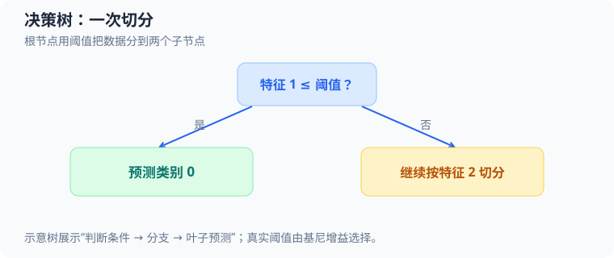

# 二维决策树：基尼增益与源码走读

本案例对应[学习计划阶段 9.2](50_deep_learning_plan.md)。程序用纯 C 实现一个二维二分类 CART 风格决策树：从坐标样本中学习若干 `x[feature] <= threshold` 判断，最后沿树走到叶节点并输出类别。核心实现是 [`src/ml/16_decision_tree.c`](../src/ml/16_decision_tree.c)，不依赖 SDL 或机器学习框架。

```sh
make decision-tree           # 训练、打印树并导出决策边界 BMP
make test-decision-tree      # 手算基尼增益、深度、停止和失败路径
make sanitize-decision-tree  # 地址和未定义行为检查
```

运行 `make decision-tree` 会在 `exports/` 独占创建 BMP，不覆盖已有图片。只想看终端里的树和误差，可以在构建后直接运行 `./build/ml/16_decision_tree`；默认运行不导出图片。



图示一个阈值判断如何形成左右分支。实际代码通过比较候选切分的基尼增益确定特征与阈值。

## 源码地图

| 概念 | 源码位置 | 对应状态与作用 |
| --- | --- | --- |
| 样本和配置 | [`TreeSample`、`TreeConfig`](../src/ml/16_decision_tree.c#L17) | `x[2]` 是两个坐标特征，`label` 为 $0$ 或 $1$；配置树深和叶节点最小样本数。 |
| 节点与整棵树 | [`TreeNode`、`DecisionTree`](../src/ml/16_decision_tree.c#L27) | 内部节点保存特征、阈值、子节点索引和增益；叶节点用 `feature == -1` 标记并保存多数类。 |
| 基尼不纯度 | [`gini`](../src/ml/16_decision_tree.c#L61) | 用正类比例计算当前节点的类别混杂程度。 |
| 候选切分 | [`find_split`](../src/ml/16_decision_tree.c#L96) | 每个特征分别排序，检查相邻不同值的中点，选择最大正增益。 |
| 递归建树 | [`build_node`](../src/ml/16_decision_tree.c#L152)、[`tree_fit`](../src/ml/16_decision_tree.c#L215) | 建立节点并递归生成左右子树；成功后整体替换旧树。 |
| 样本预测 | [`tree_predict`](../src/ml/16_decision_tree.c#L250) | 从节点索引 $0$ 开始，按阈值条件反复选择左、右子节点。 |
| 演示数据和可视化 | [`main`](../src/ml/16_decision_tree.c#L368)、[`export_boundary`](../src/ml/16_decision_tree.c#L322) | 生成规则网格，比较树桩与深度 $2$ 的树；可选绘制分类背景并导出 BMP。 |

## 决策树怎样选择切分

节点如果同时包含正类与负类，就还不够“纯”。令当前节点为 $t$，其中正类数量为 $m_t$，样本总数为 $n_t$，正类比例为 $p_t=m_t/n_t$。二分类基尼不纯度为：

$$
G(t)=1-\left(p_t^2+(1-p_t)^2\right)=2p_t(1-p_t)
\tag{1}
$$

纯节点的 $p_t$ 是 $0$ 或 $1$，所以 $G(t)=0$；正负各半时 $p_t=1/2$，不纯度达到最大值 $0.5$。源码的 `gini(positives, count)` 将 `positives` 转成 `p_t`，再计算 `2.0 * p * (1.0 - p)`。函数要求 `count > 0`；建树只会为非空样本集合调用它。

一次切分把父节点分成左、右两个子节点。令父节点有 $n$ 个样本，左右分别有 $n_L$ 和 $n_R$ 个样本，故 $n=n_L+n_R$；切分后的加权不纯度为：

$$
G_{\text{after}}=\frac{n_L}{n}G(L)+\frac{n_R}{n}G(R)
\tag{2}
$$

这里 $G(L)$、$G(R)$ 分别是左右子节点的基尼不纯度。左右权重按样本数计算，避免一个只有少量样本的纯节点掩盖另一个大而混杂的节点。切分带来的基尼增益是父节点不纯度减去加权子节点不纯度：

$$
\operatorname{Gain}=G(\text{parent})-G_{\text{after}}
\tag{3}
$$

增益越大，说明这次切分越能减少类别混杂。源码只保留超过当前最佳增益 $10^{-12}$ 的候选；没有正增益时 `find_split` 返回 `false`，当前节点成为叶节点。

## 如何枚举阈值

对某个特征，`FeatureValue` 保存该特征值、原样本索引和标签。`compare_values` 先按特征值排序，再按原始索引打破相同值的排序平局，因此候选顺序可重复。对排序后的相邻值 $v_i$ 与 $v_{i+1}$，只在 $v_i<v_{i+1}$ 时考虑阈值，避免把相同坐标拆到两边。中点写成：

$$
\tau_i=v_i+\frac{v_{i+1}-v_i}{2},\qquad v_i<v_{i+1}
\tag{4}
$$

其中 $i$ 从 $0$ 到当前节点样本数减 $2$，$v_i$ 是当前特征排序后的第 $i$ 个值，$\tau_i$ 是候选阈值。实现还会跳过会因浮点舍入而达到或超过 $v_{i+1}$ 的中点。实际分组条件在 `build_node` 和 `tree_predict` 中统一为 `x[feature] <= threshold` 走左边，否则走右边。

例如根节点的 $x_0$ 特征有相邻不同值 $-0.4$ 和 $0.4$，代入中点式得到：

$$
\tau=-0.4+\frac{0.4-(-0.4)}{2}=0
\tag{5}
$$

对每个合法候选，`find_split` 通过循环前缀维护左侧正类数量 `left_positives`；右侧正类数量直接由父节点正类数减去左侧数量得到。`left_count` 和 `right_count` 同时必须不小于 `min_leaf`。这避免了对每个阈值重新扫描所有样本统计标签，但每个特征在当前节点仍会先排序一次。

## 用源码中的 $4$ 个样本手算根节点

测试函数 [`test_gain_and_depth`](../tests/decision_tree_test.c#L13) 和主程序的网格都包含下面这组关键样本。坐标是两个特征 $x_0$、$x_1$，标签 $1$ 表示正类：

|  $x_0$ |  $x_1$ | 标签 $y$ |     |
| -----: | -----: | -----: | --- |
| $-0.8$ | $-0.8$ |    $0$ |     |
| $-0.8$ |  $0.8$ |    $0$ |     |
|  $0.8$ | $-0.8$ |    $0$ |     |
|  $0.8$ |  $0.8$ |    $1$ |     |

根节点有 $m=1$ 个正类和 $n=4$ 个样本，所以正类比例 $p=1/4$。代入基尼公式：

$$
G(\text{root})=2\cdot\frac{1}{4}\cdot\left(1-\frac{1}{4}\right)=\frac{3}{8}=0.375
\tag{6}
$$

按特征 $x_0$ 的候选中点 $\tau=0$ 切分，左侧条件是 $x_0\le0$。左边有 $2$ 个负类，因而 $G(L)=0$；右边有 $1$ 个正类和 $1$ 个负类，因而 $G(R)=0.5$。左右各有 $2$ 个样本，得到：

$$
G_{\text{after}}=\frac{2}{4}\cdot0+\frac{2}{4}\cdot0.5=0.25
\tag{7}
$$

$$
\operatorname{Gain}=0.375-0.25=0.125
\tag{8}
$$

按 $x_1$ 切分也得到相同增益。`find_split` 按特征编号从 $0$ 开始搜索，且只在新增益严格超过旧值加 $10^{-12}$ 时更新；所以平局保留先找到的 $x_0$。这是代码的确定性平局约定，不是所有决策树库都采用的规则。测试断言根节点使用特征 $0$、阈值 $0$、增益 $0.125$。

## 继续长出第二层

根节点的右边包含 $2$ 个样本，其中 $1$ 个正类、$1$ 个负类，基尼不纯度为 $0.5$。按 $x_1\le0$ 再切一次，左边只有负类，右边只有正类，两边都是纯节点：

$$
G_{\text{after}}=\frac{1}{2}\cdot0+\frac{1}{2}\cdot0=0,\qquad
\operatorname{Gain}=0.5-0=0.5
\tag{9}
$$

根节点深度是 $0$。因此 `max_depth=1` 允许根节点切分，但深度为 $1$ 的子节点停止；`max_depth=2` 则允许右侧子节点再切一次，最终在深度 $2$ 形成纯叶节点。这解释了测试结果：深度 $1$ 的树桩有 $3$ 个节点，深度 $2$ 的树有 $5$ 个节点。

每个叶节点保存多数类。令 $m_t$ 为叶节点 $t$ 的正类数，$n_t$ 为其总样本数，预测标签 $\hat y_t$ 为：

$$
\hat y_t=\begin{cases}
1,&m_t>n_t-m_t\\
0,&m_t\le n_t-m_t
\end{cases}
\tag{10}
$$

因此票数相同明确归为类别 $0$。树桩右叶节点有 $m_t=4$ 个正类和 $n_t=8$ 个样本，判断 $4>8-4$ 不成立，所以它预测 $0$；再切一层后，两个叶节点分别只有负类和正类。

## 从训练到一次预测

主程序 [`main`](../src/ml/16_decision_tree.c#L368) 用坐标 $-0.8$、$-0.4$、$0.4$、$0.8$ 组成 $4\times4$ 网格。仅当 $x_0>0$ 且 $x_1>0$ 时标签为 $1$，因此训练集共 $16$ 个点，其中正类 $4$ 个。测试集另有 $8$ 个网格间坐标，标签仍按同一规则给出。

树桩用 `TreeConfig{1, 1}` 训练，深树用 `TreeConfig{2, 1}` 训练。`tree_fit` 先检查样本数量、配置、标签、坐标是否有限且位于 $[-1,1]$，再建立索引数组。它在局部变量 `next` 中建树，全部成功后才执行 `*tree = next`；无效输入或递归构造失败都不会替换旧树。

以测试点 $(x_0,x_1)=(0.6,0.6)$ 为例：

1. 根节点判断 $0.6\le0$，结果为假，沿右子节点前进。
2. 树桩在这里已经到叶节点，叶标签为 $0$，所以树桩预测 $0$。
3. 深树继续判断 $0.6\le0$（这次检查特征 $x_1$），仍为假，沿右子节点到正类叶节点，预测 $1$。

边界点 $(0,0.8)$ 则因根节点使用 `<=` 而走左边，深树也预测 $0$。这些路径与测试断言一致。`tree_predict` 先验证输入坐标，再从节点索引 $0$ 开始遍历；输出参数只在到达有效叶节点后写入，因此预测失败时调用者的旧输出保持不变。

## 主程序输出与二维图

运行 `./build/ml/16_decision_tree` 得到：

```text
深度1树桩：
x0 <= 0.000? 基尼增益 0.125
  叶: 类别0 (8样本, 0正类)
  叶: 类别0 (8样本, 4正类)
深度2决策树：
x0 <= 0.000? 基尼增益 0.125
  叶: 类别0 (8样本, 0正类)
  x1 <= 0.000? 基尼增益 0.500
    叶: 类别0 (4样本, 0正类)
    叶: 类别1 (4样本, 4正类)
树桩错误数：训练 4/16，测试 2/8
深树错误数：训练 0/16，测试 0/8
```

`count_errors` 对每个样本调用 `tree_predict`，累计预测标签与真实标签不一致的次数。这里树桩把右半边的平票叶节点预测为 $0$，所以漏掉 $4$ 个训练正类和 $2$ 个测试正类；深树把右半边再按 $x_1$ 切开，固定数据上的训练和测试错误数都为 $0$。测试点与训练点遵循相同的人工规则，因此这只是算法行为演示，不能据此宣称模型对真实数据有零错误率。

可选的 `export_boundary` 会逐像素把像素中心映射回 $[-1,1]^2$ 坐标，分别调用树桩和深树预测，再把标签画成浅色背景；最后叠加训练样本圆点并通过 BMP 捕获接口独占创建图片。左半边是树桩，右半边是深度 $2$ 的树。背景颜色显示的是模型预测，不是这些未采样位置的真实标签。

## 停止条件与实现边界

- 当前节点纯净时直接成为叶节点；达到 `max_depth`、无法让左右子节点都满足 `min_leaf`、所有特征都没有不同相邻值，或最佳基尼增益不超过 $10^{-12}$ 时也停止。
- 每次合法切分都要求左右至少有 `min_leaf` 个样本。由于两边都至少需要该数量，若 `min_leaf > n/2` 就无需尝试切分；在 $4$ 个样本、`min_leaf=3` 时，$3>4/2$，所以当前节点提前成为叶节点。`min_leaf=2` 则仍允许左右各有 $2$ 个样本。若所有坐标完全相同，即使标签混杂也找不到合法阈值，只能输出多数类叶节点。
- 单节点只选择当前基尼增益最大的一个切分，不会搜索未来多层组合，也不做剪枝。它是贪心算法，可能错过需要先做零增益切分才能分开的模式；例如对称 XOR 数据在根节点的两种特征切分都没有正增益，因此本实现会停在根叶节点。当前专项测试没有包含 XOR 数据。
- 输入固定为二维、二分类、最多 $64$ 个样本；坐标必须是有限数且位于 $[-1,1]$。核心数据结构不显式分配动态节点内存，节点和递归索引使用固定容量数组。最大二叉树节点数设为 $2\times64-1=127$，足以容纳每个叶节点至少对应一个训练样本的满二叉树。
- `TreeNode.feature == -1` 表示叶节点，内部节点保存左右子节点索引。节点先占用数组索引，再递归构建子树；只有左右子树都成功后才把当前节点标记为内部节点。`tree_fit` 使用临时 `DecisionTree`，所以部分构建失败不会留下半棵新树覆盖旧树。

[`tests/decision_tree_test.c`](../tests/decision_tree_test.c#L13) 核对手算不纯度与增益、确定性平局、深度变化、边界点、纯节点、重复坐标、最小叶规模、非法标签、非有限坐标和失败保留。`make test-decision-tree` 与 `make sanitize-decision-tree` 验证这些固定测试路径；它们不能证明在其他分布或真实数据上的预测效果。构建入口见 [`Makefile`](../Makefile#L1101)。

## 练习

1. 把 `max_depth` 设为 $0$、$1$、$2$，对照根节点和叶节点的类别计数，观察模型容量怎样改变训练误差。
2. 把 `min_leaf` 提高到 $2$，查看根切分是否仍合法；再提高到大于当前样本数的一半，观察提前停止。
3. 改造标签生成规则，让正类只出现在两个对角象限，观察根节点是否有正增益，以及树为何无法通过零增益第一步继续学习。
4. 将二分类基尼公式推广到多个类别，令每个类别 $k$ 的比例为 $p_k$，验证不纯度可写为 $1-\sum_k p_k^2$。
