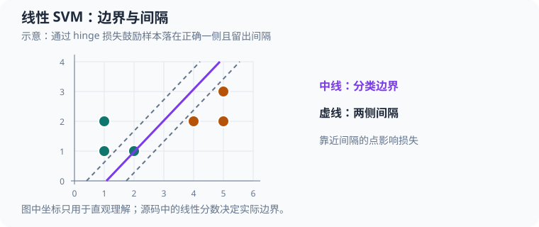

# 线性支持向量机：从 hinge 损失到小批量训练

本文沿 [`src/ml/19_linear_svm.c`](../src/ml/19_linear_svm.c) 的实际执行顺序分析一个二维软间隔线性 SVM，并说明它如何与逻辑回归作对照。示例使用固定种子生成数据，只用纯 C、定长数组和小批量次梯度下降，不依赖机器学习框架。

运行 `make build/ml/19_linear_svm` 后执行 `./build/ml/19_linear_svm` 可查看模型参数、hinge 损失、几何间隔及错误数。对应的 [Makefile 目标](../Makefile#L1161) 中，`make sanitize-linear-svm` 用 ASan 和 UBSan 运行同一固定示例；`make linear-svm` 还会将分类区域和边界图独占写入 `exports/`，不覆盖已有图片。



中线表示分类边界，两条虚线表示间隔边界；靠近或违反间隔的点会产生 hinge 损失。图中坐标不是训练输出。

## 源码地图

| 概念 | 源码位置 | 代码状态与作用 |
| --- | --- | --- |
| 常量与类型 | [`Sample`、`Dataset`、`LinearModel`、`Metrics`](../src/ml/19_linear_svm.c#L11) | 每个样本含 $2$ 个特征和 $\{-1,+1\}$ 标签；模型含两个权重和一个偏置。 |
| 合成数据 | [`random_unit`、`dataset_generate`](../src/ml/19_linear_svm.c#L47) | 生成边界带噪声的二维数据，并按固定下标翻转少量标签。 |
| 决策分数 | [`decision_value`](../src/ml/19_linear_svm.c#L87) | 计算 $\mathbf{w}^{\mathsf T}\mathbf{x}+b$，供 SVM、逻辑回归和绘图共用。 |
| hinge 指标 | [`svm_metrics`](../src/ml/19_linear_svm.c#L103) | 统计平均 hinge 数据损失、加权目标和错误数。 |
| SVM 训练 | [`svm_fit`](../src/ml/19_linear_svm.c#L134) | 每轮确定性打乱样本，按小批次累计 hinge 次梯度并加 L2 权重梯度。 |
| 逻辑回归对照 | [`sigmoid`、`logistic_fit`](../src/ml/19_linear_svm.c#L203) | 在相同训练集上优化逻辑损失，使用单独的学习率与随机状态。 |
| 可视化与入口 | [`export_comparison`](../src/ml/19_linear_svm.c#L286)、[`main`](../src/ml/19_linear_svm.c#L367) | 绘制 SVM 决策线和两条间隔线、逻辑回归决策线；主函数评估训练集和独立测试集。 |

## 1. 输入数据与线性决策分数

本例训练集有 $N_{\mathrm{train}}=96$ 条样本，测试集有 $N_{\mathrm{test}}=48$ 条。第 $i$ 条样本的两个特征组成向量 $\mathbf{x}_i=(x_{i,1},x_{i,2})^{\mathsf T}\in\mathbb{R}^2$，标签记作 $y_i\in\{-1,+1\}$。这里 $i$ 是数据集内从 $0$ 开始的数组下标。`Sample.features[0]`、`Sample.features[1]` 对应 $x_{i,1}$、$x_{i,2}$；`Sample.label` 对应 $y_i$。

`random_unit` 使用 $32$ 位线性同余状态 $S_t$ 产生 $[0,1)$ 中的随机值 $r_t$：

$$
S_{t+1}=(1664525S_t+1013904223)\bmod2^{32},\qquad
r_t=\frac{\lfloor S_{t+1}/2^8\rfloor}{2^{24}}
\tag{1}
$$

这里 $t$ 表示随机数调用次序；无符号整数回绕实现对 $2^{32}$ 取模。样本特征分别用两个随机数映射到 $[-1,1)$，边界噪声位于 $[-0.22,0.22)$。令 $\tilde y_i$ 为翻转之前的标签：

$$
x_{i,1}=2r_{i,1}-1,\qquad
x_{i,2}=2r_{i,2}-1,\qquad
\eta_i=0.22(2r_{i,3}-1)
\tag{2}
$$

$$
\tilde y_i=\begin{cases}
+1,&x_{i,1}+0.65x_{i,2}+\eta_i\ge0\\
-1,&x_{i,1}+0.65x_{i,2}+\eta_i<0
\end{cases},\qquad
y_i=\begin{cases}-\tilde y_i,&i\bmod29=0\\\tilde y_i,&i\bmod29\ne0\end{cases}
\tag{3}
$$

因此训练集固定翻转下标 $i\in\{0,29,58,87\}$，测试集固定翻转 $i\in\{0,29\}$。随机边界噪声会产生难分样本，固定翻转则明确让数据不完全可分。测试集由不同种子生成，不参与模型拟合。

例如测试集下标 $i=0$ 使用种子 $20261016$。前三次随机调用依次得到 $r_{0,1}\approx0.44199485$、$r_{0,2}\approx0.71579868$、$r_{0,3}\approx0.08074230$，所以：

$$
x_{0,1}=2(0.44199485)-1\approx-0.11601031,\qquad
x_{0,2}=2(0.71579868)-1\approx0.43159735
\tag{4}
$$

$$
\eta_0=0.22(2(0.08074230)-1)\approx-0.18447339
\tag{5}
$$

翻转前的边界分数是 $-0.11601031+0.65(0.43159735)-0.18447339\approx-0.01994542$，所以 $\tilde y_0=-1$。由于 $0\bmod29=0$，标签翻转后 $y_0=+1$。这条样本稍后用于追踪最终模型的预测。

模型的线性分数由 `decision_value` 计算。令 $\mathbf{w}=(w_1,w_2)^{\mathsf T}$ 为权重，$b$ 为偏置，$f(\mathbf{x})$ 为分数：

$$
f(\mathbf{x})=\mathbf{w}^{\mathsf T}\mathbf{x}+b
=w_1x_1+w_2x_2+b
\tag{6}
$$

`LinearModel.weights[j]` 对应 $w_{j+1}$，`LinearModel.bias` 对应 $b$。正分数倾向正类，负分数倾向负类；恰好为零时是决策边界，程序的绘图将它归入正类。

## 2. 间隔、hinge 损失与正则化目标

标签乘以模型分数后得到有符号间隔 $m_i=y_i f(\mathbf{x}_i)$。若 $m_i>0$，样本在正确一侧；若 $m_i\ge1$，它还位于规范化间隔线之外。hinge 损失在间隔达到 $1$ 后为零，未达到时按缺少的间隔线性惩罚：

$$
m_i=y_i(\mathbf{w}^{\mathsf T}\mathbf{x}_i+b),\qquad
L_i=\max(0,1-m_i)
\tag{7}
$$

其中 $L_i$ 是第 $i$ 条样本的 hinge 损失。SVM 训练的批量目标是平均数据损失加权重的 L2 惩罚：

$$
J(\mathbf{w},b)=\frac{1}{N}\sum_{i=0}^{N-1}L_i
+\frac{\lambda}{2}\lVert\mathbf{w}\rVert_2^2
\tag{8}
$$

这里 $N$ 是传入数据集的样本数，$\lambda$ 对应 `REGULARIZATION=0.03`，$\lVert\mathbf{w}\rVert_2^2=w_1^2+w_2^2$。正则项只惩罚权重，不惩罚偏置。目标使用平均 hinge 损失；这与把未平均损失直接相加的常见原始问题写法尺度不同，比较正则系数时要注意样本数的归一化。

`svm_metrics` 对每个样本计算 $m_i$，累加 $\max(0,1-m_i)$ 后除以样本数，再把 $\lambda\lVert\mathbf{w}\rVert_2^2/2$ 加到 `objective`。例如从最终输出反推，SVM 的平均数据损失约为 $0.311477$，权重惩罚约为：

$$
\frac{0.03}{2}(1.799520^2+1.289077^2)\approx0.073500
\tag{9}
$$

所以完整目标约为 $0.311477+0.073500=0.384977$。`data_loss` 与 `objective` 不同，后者还含权重惩罚。

## 3. hinge 次梯度怎样进入 C 代码

当 $m_i<1$ 时，hinge 的数据项对权重和偏置的次梯度分别是 $-y_i\mathbf{x}_i$ 和 $-y_i$；当 $m_i>1$ 时，损失已经为零，数据梯度也为零。$m_i=1$ 是折点，次梯度不唯一；代码用 `if (margin < 1.0)`，因此在等于 $1$ 时选零数据次梯度，这是合法选择。正则项另给权重梯度 $\lambda\mathbf{w}$，但不给偏置梯度。

令 $\mathcal{B}$ 表示当前小批次的样本下标集合，$B=|\mathcal{B}|$ 为批次大小。代码累加所有满足 $m_i<1$ 的数据梯度后求平均，并加入一次完整的正则梯度：

$$
\mathbf{g}_w=\lambda\mathbf{w}
-\frac{1}{B}\sum_{i\in\mathcal{B},\ m_i<1}y_i\mathbf{x}_i,
\qquad
g_b=-\frac{1}{B}\sum_{i\in\mathcal{B},\ m_i<1}y_i
\tag{10}
$$

以学习率 $\alpha$ 更新参数：

$$
\mathbf{w}\leftarrow\mathbf{w}-\alpha\mathbf{g}_w,\qquad
b\leftarrow b-\alpha g_b
\tag{11}
$$

这里 $\mathbf{g}_w$、$g_b$ 是当前批次的权重和偏置梯度，$\alpha$ 是当前 epoch 的学习率。源码先清零梯度数组，再在 `margin < 1.0` 分支里执行 `weight_gradient[feature] -= label * feature_value` 和 `bias_gradient -= label`；批次结束后将权重梯度除以 $B$ 并加上 `REGULARIZATION * fitted.weights[feature]`。偏置梯度只除以 $B$。因此实现和公式一致。

## 4. 手算第一个小批次的完整更新

`svm_fit` 从 $\mathbf{w}=(0,0)^{\mathsf T}$、$b=0$ 开始，先把训练下标初始化为 $0,1,\ldots,95$，再用随机状态 $71237$ 执行 Fisher–Yates 打乱。首轮第一个小批次的真实顺序是 $47,41,93,8,7,85,4,62,6,13,82,14$。所有样本初始分数为 $0$，故 $m_i=0<1$，每一条都进入 hinge 次梯度分支，且初始权重正则梯度为零。

表中每行的单样本梯度是 $-y_i\mathbf{x}_i$，偏置梯度是 $-y_i$：

| 样本下标 $i$ | 标签 $y_i$ | 特征 $(x_{i,1},x_{i,2})$ | 权重梯度 $-y_i\mathbf{x}_i$ | 偏置梯度 $-y_i$ |
| ---: | ---: | ---: | ---: | ---: |
| $47$ | $-1$ | $(-0.909570,-0.205904)$ | $(-0.909570,-0.205904)$ | $1$ |
| $41$ | $1$ | $(0.317095,-0.467902)$ | $(-0.317095,0.467902)$ | $-1$ |
| $93$ | $-1$ | $(-0.339654,-0.807577)$ | $(-0.339654,-0.807577)$ | $1$ |
| $8$ | $-1$ | $(-0.996455,-0.353753)$ | $(-0.996455,-0.353753)$ | $1$ |
| $7$ | $-1$ | $(-0.890892,-0.945756)$ | $(-0.890892,-0.945756)$ | $1$ |
| $85$ | $-1$ | $(-0.842395,-0.464799)$ | $(-0.842395,-0.464799)$ | $1$ |
| $4$ | $-1$ | $(0.610862,-0.970577)$ | $(0.610862,-0.970577)$ | $1$ |
| $62$ | $1$ | $(-0.230490,0.630428)$ | $(0.230490,-0.630428)$ | $-1$ |
| $6$ | $-1$ | $(0.195910,-0.451763)$ | $(0.195910,-0.451763)$ | $1$ |
| $13$ | $-1$ | $(-0.866675,-0.921766)$ | $(-0.866675,-0.921766)$ | $1$ |
| $82$ | $1$ | $(0.129651,0.600923)$ | $(-0.129651,-0.600923)$ | $-1$ |
| $14$ | $1$ | $(0.145662,0.345934)$ | $(-0.145662,-0.345934)$ | $-1$ |

把表中 $12$ 行相加，权重梯度和约为 $(-4.400788,-6.231277)$，偏置梯度和为 $4$。除以批次大小 $B=12$：

$$
\mathbf{g}_w\approx(-0.366732,-0.519273),\qquad
g_b=\frac{4}{12}=0.333333
\tag{12}
$$

首轮学习率是 $\alpha_0=0.08/(1+0.004\cdot0)=0.08$。代入更新式，得到第一次批次更新：

$$
w_1=0-0.08(-0.366732)\approx0.029339,\qquad
w_2=0-0.08(-0.519273)\approx0.041542
\tag{13}
$$

$$
b=0-0.08(0.333333)\approx-0.026667
\tag{14}
$$

这与临时探针按源码复算的 $\mathbf{w}=(0.029338590,0.041541845)^{\mathsf T}$、$b=-0.026666667$ 一致。训练中下一批次继续用更新后的模型计算每条样本的新间隔，并重新累计梯度；由于权重已非零，下一次还会加入 $\lambda\mathbf{w}$ 正则项。

例如批次第一个样本下标 $47$ 的标签是 $-1$。更新后它的分数为 $f(\mathbf{x}_{47})\approx-0.061906$，所以间隔 $m_{47}=(-1)(-0.061906)\approx0.061906$，hinge 损失为 $1-0.061906=0.938094$。该样本已在正确一侧，但仍处于单位间隔以内，因此下一批次若再次遇到仍会贡献数据梯度。

源码每个 epoch 都重新打乱训练样本，之后按 `BATCH_SIZE=12` 切批。固定数据规模 $96$ 可以整除 $12$，所以每轮有 $8$ 个批次；$500$ 轮共 $4000$ 次参数更新。学习率按 epoch 衰减：

$$
\alpha_e=\frac{0.08}{1+0.004e},\qquad e=0,1,\ldots,499
\tag{15}
$$

随机状态在 `svm_fit` 中固定初始化为 $71237$，因此同一实现与工具链下打乱次序可复现。训练使用局部 `fitted` 模型；只有训练结束且权重、偏置均有限时才复制到调用者的 `model`，失败不会部分覆盖原模型。

## 5. 最终模型、边界和几何间隔

当前固定实验得到的 SVM 参数约为 $\mathbf{w}=(1.799520,1.289077)^{\mathsf T}$、$b=0.269553$。决策边界由 $f(\mathbf{x})=0$ 给出；两条规范化间隔线由 $f(\mathbf{x})=+1$ 和 $f(\mathbf{x})=-1$ 给出。它们共享法向量 $\mathbf{w}$，所以边界到任一间隔线的距离是 $1/\lVert\mathbf{w}\rVert_2$，两条间隔线之间的宽度是 $2/\lVert\mathbf{w}\rVert_2$：

$$
\lVert\mathbf{w}\rVert_2=\sqrt{1.799520^2+1.289077^2}\approx2.213593
\tag{16}
$$

$$
\text{半间隔}=\frac{1}{2.213593}\approx0.451754,\qquad
\text{完整间隔宽度}=\frac{2}{2.213593}\approx0.903509
\tag{17}
$$

程序打印的“几何间隔”是半间隔 $1/\lVert\mathbf{w}\rVert_2$，不是两条间隔线之间的完整宽度，也不是训练样本到边界的最小实际距离。由于有标签翻转和边界噪声，若干训练点可以落在间隔内或被错分；软间隔目标允许这种情况并惩罚其 hinge 损失。

用前面追踪的测试样本 $i=0$ 检查最终模型：其最终标签为 $+1$，坐标为 $(-0.11601031,0.43159735)$。代入最终模型：

$$
f(\mathbf{x}_0)=1.799520(-0.11601031)+1.289077(0.43159735)+0.269553
\approx0.617153
\tag{18}
$$

因此间隔为 $m_0=(+1)(0.617153)=0.617153$，预测类别正确，但仍小于 $1$，该样本的 hinge 损失约为 $0.382847$。这说明“分类正确”和“已离开间隔带”是两个不同条件。

## 6. 结果与逻辑回归对照

无参数运行的当前输出为：

```text
线性 SVM：w=[ 1.800,  1.289], b= 0.270, ||w||=2.214, 几何间隔=0.452
SVM hinge 数据损失 0.3115，含 L2 目标 0.3850；训练错误 13/96，测试错误 3/48
逻辑回归：w=[ 1.947,  1.383], b= 0.149；训练错误 10/96，测试错误 2/48
标签噪声使数据非完全可分；分类错误和间隔用于观察软间隔的取舍。
```

两种方法使用相同的训练与测试样本，也使用相同的 L2 系数，但逻辑回归用 sigmoid 和二元交叉熵梯度，初始学习率为 $0.06$，并使用另一条打乱随机流；SVM 初始学习率为 $0.08$。因此它们是教学对照，不是只改变一个算法组件的严格基准。此例逻辑回归测试错误为 $2/48$，SVM 为 $3/48$；这只反映当前固定合成数据与参数，不能说明哪种方法普遍更优。

`logistic_fit` 将标签 $+1$ 映射为目标 $1$，标签 $-1$ 映射为目标 $0$，用 `sigmoid(f)-target` 更新权重和偏置。`main` 为逻辑回归调用的仍是 `svm_metrics`，但只打印它的错误数；该函数为逻辑回归计算的 hinge 指标不是逻辑回归训练目标，也没有被显示。因此不能把 SVM 的 hinge 目标与逻辑回归的优化损失作数值比较。

## 7. 图像如何对应模型

`export_comparison` 将画布左右分成两个面板。左侧背景按 SVM 分数正负着色，并绘制 $f(\mathbf{x})=0$ 的决策线和 $f(\mathbf{x})=\pm1$ 两条灰色间隔线；右侧显示逻辑回归分类区域和它的 $f(\mathbf{x})=0$ 决策线。正类点用橙色、负类点用蓝色；训练点为实心圆，测试点用白色外圈和类别色内圆区分。绘制斜线时，代码由 $w_1x_1+w_2x_2+b=c$ 解出 $x_2=-(w_1x_1+b-c)/w_2$，其中 $c$ 对 SVM 取 $-1,0,+1$，对逻辑回归只取 $0$；若第二权重接近零，则尝试画竖直线。

`make linear-svm` 会运行 `--export`。本次验证时在临时目录运行了同一导出模式，BMP 独占创建成功，尺寸为 $320\times240$；没有在仓库 `exports/` 留下新图片。普通运行和 `sanitize-linear-svm` 不导出图像。

## 8. 边界、错误约定与验证范围

- `dataset_generate` 要求数据集指针有效，样本数在 $2$ 到 $96$ 之间；成功时用局部 `generated` 整体替换数据集。训练入口还检查标签必须为 $-1$ 或 $+1$，两个特征必须有限。
- `svm_fit` 与 `logistic_fit` 都要求样本数至少为 $2$、不超过 $96$；训练结束检查权重和偏置有限。`svm_metrics` 只要求数据集非空，假定输入标签和特征遵循本例约定。
- 分类平局有两个明确行为：绘图用 `score >= 0` 预测 $+1$；错误统计使用 $m_i\le0$ 计错。因此当 $f(\mathbf{x})=0$ 且真实标签为 $+1$ 时，绘图预测为正确的正类，而 `svm_metrics` 仍将它算作错误。训练集和测试集当前没有因该边界规则导致的输出异常，但使用这些静态函数时要了解这项约定差异。
- 本实现是线性原始目标的教学版，通过 hinge 次梯度做小批量优化；没有对偶变量、显式支持向量集合、核函数或收敛提前停止。学习率和轮数是固定配置。
- Makefile 没有 `test-linear-svm` 专项断言目标。`make sanitize-linear-svm` 成功验证固定数据上的训练、评估和输出路径没有触发 ASan/UBSan 报告；它不验证次梯度数值正确性、不同数据分布上的泛化或统计稳定性。

建议依次阅读 [`dataset_generate`](../src/ml/19_linear_svm.c#L60)、[`decision_value`](../src/ml/19_linear_svm.c#L87)、[`svm_metrics`](../src/ml/19_linear_svm.c#L103)、[`svm_fit`](../src/ml/19_linear_svm.c#L134) 和 [`main`](../src/ml/19_linear_svm.c#L367)。练习时可将 `REGULARIZATION` 改为 $0.01$ 或 $0.1$，同时比较 $\lVert\mathbf{w}\rVert_2$、半间隔和测试错误；也可取消标签翻转，观察软间隔损失是否下降。每次只改一个因素，才能更容易解释结果变化。
