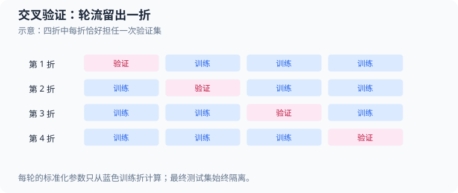

# 交叉验证（cross-validation）：分层 K 折与训练集隔离

本案例对应[学习计划阶段 10.1](50_深度学习学习计划.md)，核心实现位于 [`src/ml/20_cross_validation.c`](../src/ml/20_cross_validation.c)。程序用纯 C 在合成二分类数据上比较逻辑回归的 $4$ 个 L2 系数，再用选中的系数在完整开发集上重训，最后评估独立测试集。理解重点是：每折的预处理只能看该折训练数据，测试集不能参与选参。

运行 `make cross-validation` 查看各候选值的折内 `log-loss`、平均分和最终测试结果；运行 `make sanitize-cross-validation` 检查本案例执行期间的内存访问和未定义行为。对应构建规则位于 [Makefile](../Makefile#L1179)。



每一行是一轮示意：粉色折作验证，其余蓝色折作训练。标准化统计量必须在当轮训练折上重新计算。

## 1. 先看数据如何流动

```text
开发样本 ──按类别分层并分配到若干折──> 固定折编号
                         │ 每次留出一折
                         ├─ 其余折：拟合均值/标准差、训练逻辑回归
                         └─ 留出折：计算 log-loss
                                   ↓ 对每个候选系数遍历全部折
                            按平均 log-loss 选择系数
                                   ↓
                 全部开发样本拟合预处理并重训
                                   ↓
                     独立测试样本评估一次
```

程序在 `main` 一开始就分别生成开发集和测试集，但在全部交叉验证及系数选择完成前，测试集不会传入分折、标准化、拟合或评估函数。重训完成后才用它计算最终指标。两个集合都由同一个 `Dataset` 类型表示，所以隔离是由 `main` 的调用顺序保证的，不是类型系统强制保证的。

## 2. 源码地图

| 概念 | 源码位置 | 关键字段或变量 | 作用 |
| --- | --- | --- | --- |
| 样本、数据集、标准化参数、模型和指标 | [`Sample` 到 `Metrics`](../src/ml/20_cross_validation.c#L21) | `features`、`label`、`mean`、`scale`、`weights` | 对应原始样本、预处理参数、线性模型和评估结果。 |
| 固定数据生成 | [`random_unit`、`dataset_generate`](../src/ml/20_cross_validation.c#L53) | `seed`、`latent`、`small_noise` | 生成类别平衡但两列尺度不同的二维数据。 |
| 分层折分 | [`shuffle_indices`、`stratified_folds`](../src/ml/20_cross_validation.c#L90) | `class_indices`、`class_counts`、`folds` | 按类别分别打乱，再轮流分配折编号。 |
| 折内预处理 | [`standardizer_fit`、`standardize_sample`](../src/ml/20_cross_validation.c#L145) | `mean`、`scale`、`indices` | 只用当前训练下标计算并应用标准化参数。 |
| 逻辑回归训练 | [`sigmoid`、`logistic_fit`](../src/ml/20_cross_validation.c#L219) | `score`、`target`、`gradient`、`regularization` | 用全批量梯度下降最小化平均交叉熵和 L2 权重项。 |
| 评估和交叉验证 | [`evaluate_indices`、`cross_validate`](../src/ml/20_cross_validation.c#L297) | `log_loss`、`errors`、`coverage` | 汇总留出折分数，并检查每条开发样本恰好验证一次。 |
| 选择、重训和最终测试 | [`main`](../src/ml/20_cross_validation.c#L396) | `best_loss`、`selected_regularization` | 比较候选系数，之后用全开发集重训并评估测试集。 |

## 3. 固定数据与分层折编号

开发集包含 $120$ 条样本，测试集包含 $48$ 条样本；每条样本有 $2$ 个特征，标签是 $-1$ 或 $+1$。源码以数组下标奇偶交替产生标签：

$$
y_i=\begin{cases}
-1,&i\bmod2=0\\
+1,&i\bmod2=1
\end{cases}
\tag{1}
$$

这里 $i$ 是从 $0$ 开始的样本下标，所以 $i=0$ 时标签是 $-1$；每个数据集因此恰好各有一半正类和负类。伪随机数由 $32$ 位状态 $S_t$ 生成：

$$
S_{t+1}=(1664525S_t+1013904223)\bmod 2^{32},\qquad
r_t=\frac{\lfloor S_{t+1}/2^8\rfloor}{2^{24}}
\tag{2}
$$

这里 $t$ 是随机数调用次序，$r_t\in[0,1)$；无符号整数回绕实现模 $2^{32}$。开发集、测试集和折分分别使用固定种子 $20261015$、$20261016$、$4567$，因此同一实现会得到可重复数据和折编号。这个线性同余生成器只用于教学复现，不是安全随机数。

以开发集下标 $i=0$ 为例，源码将其标签设为 $y_0=-1$。从初始状态 $S_0=20261015$ 开始，前两个随机状态为 $S_1=1896688906$、$S_2=2684762337$，对应 $r_1\approx0.44160730$、$r_2\approx0.62509489$。代入特征生成式可得 $u_0\approx-0.778464$、$q_0\approx0.250190$，从而 $x_{0,1}\approx-8.590998$、$x_{0,2}\approx-0.020352$。这些值与后面第 $0$ 折实际读取的第一个训练样本一致。

令 $y_i\in\{-1,+1\}$ 为第 $i$ 条样本的类别，$u_i$ 为带类别信号的潜在量，$q_i$ 为额外噪声。$r_{i,1}$、$r_{i,2}$ 分别表示生成第 $i$ 条样本时先后两次调用随机函数得到的值。源码生成特征的方式是：

$$
u_i=0.65y_i+1.1(2r_{i,1}-1),\qquad q_i=2r_{i,2}-1
\tag{3}
$$

$$
x_{i,1}=12u_i+3q_i,\qquad x_{i,2}=0.03u_i+0.012q_i
\tag{4}
$$

下标 $i$ 从 $0$ 开始；$x_{i,1}$、$x_{i,2}$ 分别对应 `Sample.features[0]` 和 `Sample.features[1]`。第一列的数值尺度远大于第二列，训练前若不缩放，梯度更新会受到特征单位影响。

`stratified_folds` 先把负类和正类下标分开放入 `class_indices`，各自用 Fisher–Yates 方法打乱。令 $h$ 为某类别打乱后的名次、$K$ 为折数，则该样本的折编号为 $h\bmod K$。本例 $K=4$，每类 $60$ 条，所以每折验证集恰好有 $15$ 个负类和 $15$ 个正类，共 $30$ 条；其余 $90$ 条用于训练。实际下标 $i=9$ 的正类样本在正类打乱序列中的名次是 $h=40$，所以它进入第 $40\bmod4=0$ 折，后面会作为该折首个验证样本出现。类别分层让每折的类别比例一致，不保证每一折的特征分布完全相同。

## 4. 每一折都单独拟合标准化参数

`cross_validate` 遍历每个折编号，把该折样本写入 `validation_indices`，其余样本写入 `training_indices`。随后只把训练下标交给 `standardizer_fit`。对第 $j$ 个特征，训练子集的均值、总体标准差和标准化值分别是：

$$
\mu_j=\frac{1}{n_{\mathrm{train}}}\sum_{i\in T}x_{i,j},\qquad
\sigma_j=\sqrt{\frac{1}{n_{\mathrm{train}}}\sum_{i\in T}(x_{i,j}-\mu_j)^2}
\tag{5}
$$

$$
z_{i,j}=\frac{x_{i,j}-\mu_j}{\sigma_j}
\tag{6}
$$

其中 $T$ 是当前折的训练样本下标集合，$n_{\mathrm{train}}=|T|$，$j\in\{1,2\}$；$\mu_j$ 和 $\sigma_j$ 对应 `Standardizer.mean[j]` 与 `Standardizer.scale[j]`，$z_{i,j}$ 是交给模型的标准化特征。分母使用 $n_{\mathrm{train}}$，因此这是总体标准差，不是分母为 $n_{\mathrm{train}}-1$ 的样本标准差。

在实际第 $0$ 折，训练样本数为 $90$，代码算得 $\boldsymbol{\mu}\approx(-0.048170,-0.000621)$，$\boldsymbol{\sigma}\approx(12.009447,0.030959)$。该折的第一个训练样本是开发集下标 $i=0$，原始特征约为 $(-8.590998,-0.020352)$，于是：

$$
z_{0,1}=\frac{-8.590998-(-0.048170)}{12.009447}\approx-0.711342,\qquad
z_{0,2}=\frac{-0.020352-(-0.000621)}{0.030959}\approx-0.637322
\tag{7}
$$

验证样本也使用这组均值和标准差变换，但不会参与它们的计算。若先用完整开发集计算标准差，验证样本的信息会泄漏到训练过程；若在最终重训时继续使用某个折的统计量，也会丢弃开发集其余样本的信息。因此代码在交叉验证后重新用全部开发集拟合一套最终参数。

若某列标准差非有限或不大于 `DBL_EPSILON`，`standardizer_fit` 会失败，避免除以零或极小尺度。输出对象只在全部统计量有效时才被替换；`standardize_sample` 也先写局部数组，确认成功后才复制到调用者输出。

## 5. 逻辑回归的概率、损失和梯度

标准化后的特征组成向量 $\mathbf{z}_i=(z_{i,1},z_{i,2})^{\mathsf T}$。模型参数是权重 $\mathbf{w}=(w_1,w_2)^{\mathsf T}$ 和偏置 $b$；线性分数 $s_i$、正类概率 $p_i$ 以及把标签转换成 $0/1$ 的目标 $a_i$ 为：

$$
s_i=\mathbf{w}^{\mathsf T}\mathbf{z}_i+b,\qquad
p_i=\operatorname{sigmoid}(s_i)=\frac{1}{1+\exp(-s_i)},\qquad
a_i=\frac{y_i+1}{2}
\tag{8}
$$

这里 $y_i=-1$ 对应 $a_i=0$，$y_i=+1$ 对应 $a_i=1$；`logistic_fit` 中的 `score`、`sigmoid(score)` 和 `target` 分别对应 $s_i$、$p_i$ 和 $a_i$。$p_i$ 是模型给出的正类概率，决策边界为 $s_i=0$，即 $p_i=0.5$。

单样本二元交叉熵 $\ell_i$ 会惩罚错误且过度自信的概率。这里 $\ln$ 是自然对数。对训练子集 $T$，代码的优化目标是平均交叉熵加权重 L2 惩罚：

$$
\ell_i=-a_i\ln p_i-(1-a_i)\ln(1-p_i),\qquad
J(\mathbf{w},b)=\frac{1}{n_{\mathrm{train}}}\sum_{i\in T}\ell_i+
\frac{\lambda}{2}\lVert\mathbf{w}\rVert_2^2
\tag{9}
$$

其中 $\lambda$ 是候选正则系数，$\lVert\mathbf{w}\rVert_2^2=w_1^2+w_2^2$ 是权重向量的平方欧几里得范数；偏置 $b$ 不受惩罚。所有模型都从 $\mathbf{w}=\mathbf{0}$、$b=0$ 初始化，此时任意样本的 $p_i=0.5$，所以初始目标值为：

$$
J(\mathbf{0},0)=\frac{1}{n_{\mathrm{train}}}\sum_{i\in T}\ln2+0=\ln2\approx0.693147
\tag{10}
$$

令 $p_i=\operatorname{sigmoid}(s_i)$，链式法则和 $\operatorname{sigmoid}'(s_i)=p_i(1-p_i)$ 给出交叉熵对分数的导数：

$$
\frac{\partial\ell_i}{\partial s_i}=
-a_i(1-p_i)+(1-a_i)p_i=p_i-a_i
\tag{11}
$$

再乘以 $\partial s_i/\partial\mathbf{w}=\mathbf{z}_i$ 或 $\partial s_i/\partial b=1$，并对训练样本求平均、加入权重惩罚的导数，可得到：

$$
\nabla_{\mathbf{w}}J=\frac{1}{n_{\mathrm{train}}}\sum_{i\in T}(p_i-a_i)\mathbf{z}_i+\lambda\mathbf{w},\qquad
\frac{\partial J}{\partial b}=\frac{1}{n_{\mathrm{train}}}\sum_{i\in T}(p_i-a_i)
\tag{12}
$$

源码每个 epoch 都先把全部训练样本的梯度累加，再除以样本数更新一次参数；这是一轮一次的全批量梯度下降，不是逐样本 SGD。学习率按 epoch $e$ 衰减为 $\alpha_e=0.2/(1+0.003e)$，其中 $e=0,1,\ldots,599$。权重和偏置按 $\mathbf{w}\leftarrow\mathbf{w}-\alpha_e\nabla_{\mathbf{w}}J$、$b\leftarrow b-\alpha_e\partial J/\partial b$ 更新。

源码对应的核心计算如下；`error` 就是 $p_i-a_i$：

```c
double target = sample->label > 0 ? 1.0 : 0.0;
double error = sigmoid(score) - target;
gradient[feature] += error * features[feature];
bias_gradient += error;
```

随后 `logistic_fit` 将平均梯度与 `regularization * fitted.weights[feature]` 相加，再用学习率更新；偏置只使用平均误差梯度。`sigmoid` 对非负和负输入分开计算，避免直接计算 $\exp(-s_i)$ 时在大负分数处溢出。

## 6. 手算第 $0$ 折第一次参数更新

每次 `logistic_fit` 都从 $\mathbf{w}=\mathbf{0}$、$b=0$ 开始。第 $0$ 折训练集有 $45$ 个正类和 $45$ 个负类。初始时每个样本的 $s_i=0$、$p_i=0.5$；对刚才的训练样本 $i=0$，$a_0=0$，因此 `error` 为 $0.5$，它给权重梯度累加的贡献是：

$$
(p_0-a_0)\mathbf{z}_0=0.5(-0.711342,-0.637322)
\approx(-0.355671,-0.318661)
\tag{13}
$$

全部 $90$ 条训练样本累加并取平均后，临时探针按源码计算得到权重梯度 $(-0.376060,-0.375503)$。偏置梯度为 $0$，因为正负类数量相等，初始概率相同，正类的误差 $-0.5$ 与负类的误差 $+0.5$ 相互抵消。此时 sigmoid 的导数也是 $0.5(1-0.5)=0.25$；交叉熵链式求导后，分数梯度简化为 $p_i-a_i$。初始权重为零，所以正则梯度 $\lambda\mathbf{w}$ 也为零。首轮学习率 $\alpha_0=0.2$，第一次完整更新为：

$$
\mathbf{w}^{(1)}=\mathbf{0}-0.2(-0.376060,-0.375503)
\approx(0.075212,0.075101),\qquad b^{(1)}=0
\tag{14}
$$

这里上标 $(1)$ 表示第一次更新后的参数，不是幂。下一 epoch 会用新权重重新计算所有 $90$ 个分数和概率，梯度也会改变；此时正则梯度已是 $\lambda\mathbf{w}^{(1)}$。模型经过 $600$ 次全批量更新后才用于该折的验证样本。

第 $0$ 折第一个验证样本是开发集下标 $i=9$，标签为 $+1$，标准化特征约为 $(0.755979,0.683623)$。使用候选 $\lambda=0.0001$ 在该折训练得到的参数约为 $\mathbf{w}=(1.710304,1.683632)$、$b=0.186232$，所以：

$$
s_9=1.710304(0.755979)+1.683632(0.683623)+0.186232\approx2.630156
\tag{15}
$$

$$
p_9=\operatorname{sigmoid}(2.630156)\approx0.932777,\qquad
\ell_9=-\ln(0.932777)\approx0.069589
\tag{16}
$$

因为真实目标为 $1$，交叉熵使用 $-\ln p_9$。`evaluate_indices` 对该折全部 $30$ 条验证损失求平均，得到该候选在第 $0$ 折的 log-loss，输出约为 $0.4942$；其他三折用各自独立的标准化参数和模型重复同一过程。

## 7. 候选选择、最终重训和测试

源码按顺序比较 $\lambda\in\{0.0001,0.01,0.1,1.0\}$。同一套固定折编号用于所有候选，使比较时只改变正则系数；`mean_loss < best_loss` 只在严格更小时更新，因此完全相等时保留先出现的候选。程序实际输出如下：

| 正则系数 $\lambda$ | 第 $0$ 折 | 第 $1$ 折 | 第 $2$ 折 | 第 $3$ 折 | 四折平均 |
| ---: | ---: | ---: | ---: | ---: | ---: |
| $0.0001$ | $0.4942$ | $0.3630$ | $0.2313$ | $0.3242$ | $0.3532$ |
| $0.01$ | $0.4795$ | $0.3683$ | $0.2423$ | $0.3269$ | $0.3542$ |
| $0.1$ | $0.4799$ | $0.4177$ | $0.3104$ | $0.3648$ | $0.3932$ |
| $1.0$ | $0.5839$ | $0.5675$ | $0.5139$ | $0.5287$ | $0.5485$ |

交叉验证分数定义为各折平均损失的算术平均：

$$
\bar L(\lambda)=\frac{1}{K}\sum_{k=0}^{K-1}L_k(\lambda)
\tag{17}
$$

其中 $K=4$，$L_k(\lambda)$ 是候选 $\lambda$ 在第 $k$ 折的平均 log-loss。本例每折验证样本数都是 $30$，所以折平均也等于合并全部 $120$ 个折外预测后的样本平均；如果折大小不相同，当前实现仍等权平均折分数，而不是按每折样本数加权。

最低平均值是 $0.3532$，所以选择 $\lambda=0.0001$。例如四折平均的实际计算是 $(0.4942+0.3630+0.2313+0.3242)/4\approx0.353175$，按输出精度显示为 $0.3532$。`main` 随后用全部 $120$ 条开发样本拟合新的均值和标准差，并从零开始训练最终模型；本例最终均值约为 $(-0.387,-0.00127)$，标准差约为 $(11.687,0.02995)$。最终模型权重约为 $(1.530237,1.423369)$，偏置约为 $0.118427$。模型和预处理参数都确定之后，测试集才被传给 `evaluate_indices`，输出：

```text
最终测试集（仅评估一次）：log-loss=0.4384，错误=12/48，准确率=75.0%
```

这是固定合成测试集上的一次测量，不代表模型在真实数据或其他随机样本上的泛化保证。反复根据这 $48$ 条测试样本改系数、训练轮数或其他设置，会让测试集事实上参与调参，破坏它作为最终留出集的作用。

## 8. 评估与边界约定

`evaluate_indices` 用稳定 sigmoid 得到概率，并把概率限制在 $[10^{-15},1-10^{-15}]$ 后再取对数，避免 `log(0)`。预测类别按 `score >= 0.0` 判为正类，否则判为负类；如果分数恰好为零，程序因此将平局判给正类。`Metrics.errors` 只计分类错误，`Metrics.log_loss` 则衡量概率质量，两者含义不同：预测类别正确但概率很不自信时，错误数可以为零而 log-loss 仍较大。

`stratified_folds` 会拒绝无效标签或缺少任一类别的数据；每一类在各折中的数量最多相差一条。`dataset_generate` 要求样本数为偶数且在 $2$ 到 $120$ 之间。标准化遇到非法下标、非有限特征或近零尺度会失败。模型训练在局部变量中进行，只有全部参数有限时才写入调用者模型；评估输出也在损失有限后才整体写入。交叉验证会检查每个样本恰好进入一个验证折；失败时 `fold_losses` 可能已写入前面成功折的部分结果。

本实现使用固定的 $4$ 折和四个候选值，没有重复多次分折，也没有用独立随机种子估计选参结果的波动。`make sanitize-cross-validation` 能发现本次运行中的内存和未定义行为问题，但源码没有独立的 `test-cross-validation` 断言目标；消毒器通过不等于已证明交叉验证效果可靠或泛化良好。

建议按 [`stratified_folds`](../src/ml/20_cross_validation.c#L108)、[`standardizer_fit`](../src/ml/20_cross_validation.c#L145)、[`logistic_fit`](../src/ml/20_cross_validation.c#L238)、[`cross_validate`](../src/ml/20_cross_validation.c#L344) 和 [`main`](../src/ml/20_cross_validation.c#L396) 的顺序阅读，再尝试改变折数或候选正则系数。每次只改一个因素，并始终把最终测试集留到选参完成之后。
