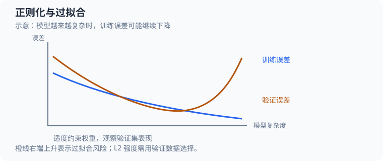

# 神经网络正则化（neural network regularization）：从过拟合到 L2 梯度

本案例对应[学习计划阶段 10.2](50_深度学习学习计划.md)，源码为 [`src/ml/21_regularization.c`](../src/ml/21_regularization.c)。它用纯 C 实现一个 $2\to24\to1$ 的 tanh MLP：仅用 $24$ 条带标签噪声的训练样本拟合圆形分类，再用验证集选择 L2 系数，最后评估独立测试集。案例同时展示正则项怎样进入目标函数、反向传播梯度和每次参数更新。

运行 `make regularization` 查看各候选系数的训练损失、验证损失、权重范数及三组种子的测试结果。运行 `make test-regularization` 检查全部参数的梯度和输入边界；`make sanitize-regularization` 用 ASan、UBSan 执行相同测试。构建规则在 [Makefile](../Makefile#L1196)。



蓝线与橙线展示过拟合的典型趋势，并非本程序测出的曲线。选择正则化强度时，应比较验证集而非仅看训练误差。

## 1. 源码地图

| 概念 | 源码位置 | 关键字段或变量 | 作用 |
| --- | --- | --- | --- |
| 固定种子数据 | [`random_unit`](../src/ml/21_regularization.c#L67)、[`dataset_generate`](../src/ml/21_regularization.c#L81) | `features`、`target`、`flip_probability` | 生成内圆与外环两类；只翻转训练标签。 |
| 网络结构与中间状态 | [`Network`](../src/ml/21_regularization.c#L46)、[`Forward`](../src/ml/21_regularization.c#L50) | `parameters`、`hidden_linear`、`hidden`、`logit` | 用固定数组保存 $97$ 个参数和一次前向传播结果。 |
| 前向传播 | [`forward`](../src/ml/21_regularization.c#L115) | `value`、`result.hidden`、`result.probability` | 依次计算隐藏层 tanh、输出 logit 和 sigmoid 概率。 |
| BCE 与完整梯度 | [`binary_cross_entropy`](../src/ml/21_regularization.c#L164)、[`loss_and_gradient`](../src/ml/21_regularization.c#L180) | `output_delta`、`hidden_delta`、`accumulated` | 平均数据损失和解析梯度，再只对权重加 L2 项。 |
| 初始化与训练 | [`network_initialize`](../src/ml/21_regularization.c#L257)、[`train`](../src/ml/21_regularization.c#L279) | `limit`、`learning_rate`、`epoch` | Xavier 均匀初始化后执行固定轮数的全批量梯度下降。 |
| 选参与最终评估 | [`evaluate`](../src/ml/21_regularization.c#L309)、[`run_trial`](../src/ml/21_regularization.c#L361) | `best_validation_loss`、`best_network` | 只按验证 BCE 选择模型，随后评估一次独立测试集。 |
| 梯度和边界测试 | [`test_gradients`](../src/ml/21_regularization.c#L418)、[`run_tests`](../src/ml/21_regularization.c#L478) | `analytic`、`numeric`、`epsilon` | 用中心差分核对全部参数，并检查偏置不受惩罚。 |

## 2. 数据为什么能展示过拟合

样本是二维坐标 $\mathbf{x}_i=(x_{i,1},x_{i,2})^{\mathsf T}$，最终类别目标 $y_i\in\{0,1\}$。数组下标从 $0$ 开始，源码先以 $c_i=i\bmod2$ 生成基础类别：偶数样本在内圆，奇数样本在外环。角度、半径和坐标噪声由固定种子的伪随机数生成。状态 $S_m$ 是第 $m$ 次随机调用前的 $32$ 位状态，$m$ 是从 $0$ 开始的调用序号：

$$
S_{m+1}=(1664525S_m+1013904223)\bmod2^{32},\qquad
r_m=\frac{\lfloor S_{m+1}/2^8\rfloor}{2^{24}}
\tag{1}
$$

每条样本的 $r_{i,k}$ 表示生成第 $i$ 条样本时第 $k$ 次随机调用的结果。令 $\theta_i$ 为角度、$\rho_i$ 为半径，则：

$$
\theta_i=2\pi r_{i,1},\qquad
\rho_i=\begin{cases}
0.36\sqrt{r_{i,2}},&c_i=0\\
0.62+0.30r_{i,2},&c_i=1
\end{cases}
\tag{2}
$$

$$
x_{i,1}=\rho_i\cos\theta_i+0.08(2r_{i,3}-1),\qquad
x_{i,2}=\rho_i\sin\theta_i+0.08(2r_{i,4}-1)
\tag{3}
$$

这里 $r_{i,k}\in[0,1)$；$\theta_i$ 是弧度角，$\rho_i$ 是半径。内圆半径通过平方根变换，令圆盘内部面积分布均匀；外环半径在 $[0.62,0.92)$ 内变化。两个坐标都再加上 $[-0.08,0.08)$ 的噪声。坐标生成后，代码再以概率 $p_{\mathrm{flip}}$ 翻转标签：

$$
y_i=\begin{cases}
1-c_i,&r_{i,5}<p_{\mathrm{flip}}\\
c_i,&r_{i,5}\ge p_{\mathrm{flip}}
\end{cases}
\tag{4}
$$

其中 $p_{\mathrm{flip}}$ 对应 `flip_probability`；训练时为 $0.20$，验证和测试时为 $0$。因此训练标签可能与决定圆环位置的基础类别 $c_i$ 不同，但坐标不会随标签翻转而改变。

以训练种子 $42$ 的第 $0$ 条样本为例，前五个随机值约为 $(0.25234514,0.08812499,0.57728118,0.22255421,0.37566018)$。于是 $c_0=0$、$\theta_0=2\pi(0.25234514)\approx1.585531$、$\rho_0=0.36\sqrt{0.08812499}\approx0.106869$，坐标噪声约为 $(0.012365,-0.044391)$，得到 $\mathbf{x}_0\approx(0.01079033,0.06246614)$。第五个随机值大于 $0.20$，本条标签没有翻转，最终 $y_0=0$。

把坐标公式逐项代入，第一维为 $0.106869\cos(1.585531)+0.08(2\cdot0.577281-1)\approx-0.001575+0.012365=0.010790$；第二维为 $0.106869\sin(1.585531)+0.08(2\cdot0.222554-1)\approx0.106857-0.044391=0.062466$。这也说明角度、半径和两个独立坐标噪声分别来自前四次随机调用。

训练集有 $24$ 条样本，每条训练标签以概率 $0.20$ 翻转；验证集和测试集各有 $192$ 条样本，标签不翻转。代码只翻标签、不移动坐标，所以模型可能把训练噪声也拟合进去。验证集与测试集用不同种子独立生成，代表无翻转标签下的分类表现。每次实验的基础种子依次为 $42$、$143$、$244$；验证、测试、网络初始化分别使用基础种子加 $1000$、$2000$、$5000$。

## 3. 参数布局与初始化

网络有 $2$ 个输入、$24$ 个 tanh 隐藏单元和 $1$ 个 sigmoid 输出。隐藏层权重、隐藏偏置、输出权重和输出偏置在 `parameters` 中按顺序连续存放：

| 参数段 | 数学含义 | 数组下标范围 | 数量 |
| --- | --- | --- | ---: |
| `W1_OFFSET` | $W^{(1)}_{j,k}$，输入到隐藏层的权重 | $[0,48)$ | $48$ |
| `B1_OFFSET` | $b^{(1)}_j$，隐藏层偏置 | $[48,72)$ | $24$ |
| `W2_OFFSET` | $W^{(2)}_j$，隐藏层到输出的权重 | $[72,96)$ | $24$ |
| `B2_OFFSET` | $b^{(2)}$，输出偏置 | $[96,97)$ | $1$ |

这里 $j\in\{0,\ldots,23\}$ 是隐藏单元下标，$k\in\{0,1\}$ 是输入特征下标。参数总数为 $48+24+24+1=97$。L2 只覆盖 $72$ 个权重，不覆盖 $25$ 个偏置；`weight_norm_squared` 遍历的正是 `W1_OFFSET..B1_OFFSET` 和 `W2_OFFSET..B2_OFFSET` 两段。源码常量 `PARAMETER_COUNT` 因此是 $97$，测试会检查全部这些参数。

`network_initialize` 用 Xavier 均匀范围初始化权重，偏置保持为零。对输入到隐藏层，范围上限是 $\sqrt{6/(2+24)}\approx0.480384$；对隐藏到输出层，上限是 $\sqrt{6/(24+1)}\approx0.489898$。每个权重按 $a(2r-1)$ 生成，其中 $a$ 是对应层的范围上限，$r\in[0,1)$ 是一次 `random_unit` 调用结果。`run_trial` 对每个候选都传入同一初始化种子，因此在一个实验内，候选之间的差别来自正则系数，而不是初始参数。

例如种子 $5042$ 生成的第一个随机值为 $r\approx0.19010729$，所以输入到隐藏层第一个权重为 $0.48038446(2\cdot0.19010729-1)\approx-0.29773529$，与下面手算所用的 `W1_OFFSET` 参数相同。

## 4. 前向传播与稳定 BCE

令 $a_j$ 和 $h_j$ 分别表示隐藏单元 $j$ 的线性输入与 tanh 激活；$s$ 是输出 logit，$p$ 是正类概率。它们对应 `Forward.hidden_linear[j]`、`Forward.hidden[j]`、`Forward.logit` 和 `Forward.probability`：

$$
a_j=b^{(1)}_j+\sum_{k=0}^{1}W^{(1)}_{j,k}x_{i,k},\qquad
h_j=\tanh(a_j)
\tag{5}
$$

$$
s=b^{(2)}+\sum_{j=0}^{23}W^{(2)}_jh_j,\qquad
p=\operatorname{sigmoid}(s)=\frac{1}{1+\exp(-s)}
\tag{6}
$$

一次 sigmoid 加权求和后，预测 $p\ge0.5$ 时归为外环类，否则归为内圆类。样本 $0$ 的实际 logit 代入后，$p=1/(1+\exp(0.00661339))\approx0.49834666$，因此预测为内圆类。`forward` 检查网络参数与样本特征都有限，并要求标签恰好为 $0$ 或 $1$；它先写局部 `result`，所有结果有效后才整体复制到输出，失败不会留下半份前向状态。

样本的二元交叉熵可以从 logit 直接写成 $\ell_i=\ln(1+\exp(s_i))-y_i s_i$。当 $s_i$ 很大时直接计算指数可能溢出，因此 `binary_cross_entropy` 用等价的稳定形式：

$$
\ell_i=\max(s_i,0)+\ln\left(1+\exp(-|s_i|)\right)-y_i s_i
\tag{7}
$$

其中 $i$ 是样本下标，$y_i$ 是该样本的二元目标。对于训练样本 $i=0$，本次实际前向得到 $s_0\approx-0.00661339$、$y_0=0$，所以 $\ell_0=\ln(1+\exp(-0.00661339))\approx0.689846$。稳定公式在这个负 logit 下将指数限制为 $\exp(-|s_0|)$，避免计算较大的正指数。

## 5. L2 如何进入目标函数与反向传播

对含 $N$ 条样本的数据集，源码先平均所有 BCE，再加上权重平方和的惩罚。令 $\mathcal{W}$ 表示两层权重的集合，偏置不在其中：

$$
L_{\mathrm{data}}=\frac{1}{N}\sum_{i=0}^{N-1}\ell_i,\qquad
J(\theta)=L_{\mathrm{data}}+\frac{\lambda}{2}\sum_{w\in\mathcal{W}}w^2
\tag{8}
$$

这里 $\theta$ 是全部 $97$ 个网络参数，$\lambda\ge0$ 是 L2 系数，$N$ 是当前训练集大小；`Metrics.loss` 和 `data_loss` 只表示 $L_{\mathrm{data}}$，`objective` 表示完整的 $J$。例如初始网络在训练集上的 $L_{\mathrm{data}}\approx0.694126$，权重平方和约为 $5.902601$。取 $\lambda=0.003$ 时，惩罚值为 $0.003\cdot5.902601/2\approx0.008854$，所以 $J\approx0.694126+0.008854=0.702980$；偏置不贡献这项惩罚。

对 sigmoid 输出和二元交叉熵求导，使用 $\operatorname{sigmoid}'(s)=p(1-p)$，可得输出 logit 的误差：

$$
\frac{\partial\ell_i}{\partial s}=-y_i(1-p)+(1-y_i)p=p-y_i=\delta^{(2)}
\tag{9}
$$

对样本 $0$，$y_0=0$、$p_0\approx0.49834666$，代入可得 $-0(1-0.49834666)+(1-0)0.49834666=0.49834666$，正好是代码里的 `output_delta`。这里的 $\delta^{(2)}$ 是单个样本的输出误差；批次梯度稍后才对所有样本求平均。

再沿网络反向传播，使用 $\tanh'(a_j)=1-h_j^2$：

$$
\delta^{(2)}=p-y_i,\qquad
\frac{\partial\ell_i}{\partial W^{(2)}_j}=\delta^{(2)}h_j,\qquad
\delta^{(1)}_j=\delta^{(2)}W^{(2)}_j(1-h_j^2)
\tag{10}
$$

$$
\frac{\partial\ell_i}{\partial W^{(1)}_{j,k}}=\delta^{(1)}_jx_{i,k},\qquad
\frac{\partial\ell_i}{\partial b^{(1)}_j}=\delta^{(1)}_j,\qquad
\frac{\partial\ell_i}{\partial b^{(2)}}=\delta^{(2)}
\tag{11}
$$

对 $N$ 个样本的梯度先求平均。因为 $\frac{\partial}{\partial w}(\frac{\lambda}{2}w^2)=\lambda w$，所以只对权重增加 $\lambda w$：

$$
\frac{\partial J}{\partial w}=\frac{1}{N}\sum_{i=0}^{N-1}\frac{\partial\ell_i}{\partial w}+\lambda w
\quad(w\in\mathcal{W}),\qquad
\frac{\partial J}{\partial b}=\frac{1}{N}\sum_{i=0}^{N-1}\frac{\partial\ell_i}{\partial b}
\tag{12}
$$

这就是 L2 在代码中的位置：`loss_and_gradient` 先把每个样本的输出误差反传到两层，再将数据梯度累加在 `accumulated`。实现核心如下，`unit` 和 `feature` 分别是隐藏单元与输入特征下标：

```c
double output_delta = pass.probability - sample->target;
accumulated[B2_OFFSET] += output_delta;
accumulated[W2_OFFSET + unit] += output_delta * pass.hidden[unit];
double hidden_delta = output_delta * network->parameters[W2_OFFSET + unit] *
                      (1.0 - pass.hidden[unit] * pass.hidden[unit]);
accumulated[B1_OFFSET + unit] += hidden_delta;
accumulated[W1_OFFSET + unit * FEATURE_COUNT + feature] +=
    hidden_delta * sample->features[feature];
```

批次结束后统一乘以 $1/N$，再只遍历两段权重执行 `accumulated[parameter] += lambda * weight`。训练按 $\theta\leftarrow\theta-\alpha\nabla J$ 更新全部参数；学习率 $\alpha=0.12$ 固定，每一轮先用同一组旧参数计算完整梯度，再一次性更新，没有动量、Adam 或学习率衰减。

## 6. 手算一个真实样本和第一次更新

第一组实验的训练种子是 $42$，网络初始化种子是 $5042$。训练集第 $0$ 条样本最终标签为 $y_0=0$，特征为 $\mathbf{x}_0\approx(0.01079033,0.06246614)$。初始化时隐藏单元 $0$ 的权重为 $W^{(1)}_{0,0}\approx-0.29773529$、$W^{(1)}_{0,1}\approx0.10275502$，偏置为 $0$，因此：

$$
a_0=(-0.29773529)(0.01079033)+(0.10275502)(0.06246614)
\approx-0.00321266+0.00641871=0.00320605
\tag{13}
$$

$$
h_0=\tanh(0.00320605)\approx0.00320604
\tag{14}
$$

将 $24$ 个隐藏激活都乘以对应输出权重并加上输出偏置后，实际 logit 是 $s_0\approx-0.00661339$，概率 $p_0\approx0.49834666$。因为 $p_0<0.5$，预测为内圆类；本样本目标也是 $0$，所以预测正确，但 BCE 仍为约 $0.689846$，说明概率非常接近不确定状态。

输出误差为 $\delta^{(2)}=p_0-y_0\approx0.49834666$。隐藏到输出的第 $0$ 个权重初值为 $W^{(2)}_0\approx-0.35517696$，所以该样本对这个权重的梯度为：

$$
\frac{\partial\ell_0}{\partial W^{(2)}_0}
=0.49834666(0.00320604)\approx0.00159772
\tag{15}
$$

隐藏单元 $0$ 的反向误差和输入到隐藏层第一个权重的样本梯度为：

$$
\delta^{(1)}_0=0.49834666(-0.35517696)(1-0.00320604^2)\approx-0.17699943
\tag{16}
$$

$$
\frac{\partial\ell_0}{\partial W^{(1)}_{0,0}}
=(-0.17699943)(0.01079033)\approx-0.00190988
\tag{17}
$$

一个样本只贡献整批梯度的一部分。把 $24$ 条训练样本的梯度平均后，$W^{(1)}_{0,0}$ 的数据梯度是 $0.01324287$。对 $\lambda=0.003$，该参数的正则梯度是 $\lambda W^{(1)}_{0,0}=0.003(-0.29773529)\approx-0.00089321$，所以完整梯度为 $0.01234967$。第一次更新分别为：

$$
W^{(1)}_{0,0}\big|_{\lambda=0}=-0.29773529-0.12(0.01324287)\approx-0.29932443
\tag{18}
$$

$$
W^{(1)}_{0,0}\big|_{\lambda=0.003}=-0.29773529-0.12(0.01234967)\approx-0.29921725
\tag{19}
$$

因为该权重为负，正则梯度也为负，梯度下降会让更新比无正则时更靠近零。若权重为正，$\lambda w$ 会为正，也同样把更新拉向零。下一个 epoch 会基于新参数重新计算全部 $24$ 条样本的前向结果和梯度；这个过程重复 $7000$ 次。

## 7. 验证集选参与运行结果

每组实验比较 $\lambda\in\{0,0.00003,0.0001,0.001,0.003,0.01\}$。每个候选都使用相同的 $24$ 条训练样本、相同初始化和 $7000$ 轮训练；`run_trial` 按验证 BCE 严格变小时更新最佳模型，验证准确率只打印，不参与选择；若 BCE 完全相等，则保留候选表中先出现的模型。下面是种子 $42$ 的完整对照：

| $\lambda$ | 训练 BCE | 含正则目标 | 验证 BCE | 验证准确率 | $\sum_{w\in\mathcal{W}}w^2$ |
| ---: | ---: | ---: | ---: | ---: | ---: |
| $0$ | $0.0220$ | $0.0220$ | $0.5455$ | $79.2\%$ | $315.516$ |
| $0.00003$ | $0.0230$ | $0.0276$ | $0.5395$ | $79.2\%$ | $310.036$ |
| $0.0001$ | $0.0252$ | $0.0401$ | $0.5265$ | $79.2\%$ | $297.937$ |
| $0.001$ | $0.0602$ | $0.1593$ | $0.4325$ | $79.2\%$ | $198.222$ |
| $0.003$ | $0.1391$ | $0.3114$ | $0.3709$ | $80.7\%$ | $114.871$ |
| $0.01$ | $0.4638$ | $0.6018$ | $0.5114$ | $79.2\%$ | $27.610$ |

在第一组实验中，$\lambda=0.003$ 的验证 BCE 最低，因此选中该模型。随着正则增强，训练 BCE 上升、权重平方和总体下降；但 $\lambda=0.01$ 的验证 BCE 又升高，体现惩罚过强时模型可能欠拟合。准确率对概率变化不如 BCE 敏感，所以前几个候选的验证准确率相同，仍能由 BCE 排出差异。

程序对三个基础种子都选中 $\lambda=0.003$，并在各自独立测试集上只评估选中模型一次：

| 训练种子 | 选中 $\lambda$ | 测试 BCE | 测试准确率 |
| ---: | ---: | ---: | ---: |
| $42$ | $0.003$ | $0.4223$ | $78.6\%$ |
| $143$ | $0.003$ | $0.3805$ | $81.8\%$ |
| $244$ | $0.003$ | $0.3880$ | $90.6\%$ |

三次测试 BCE 均值约为 $(0.4223+0.3805+0.3880)/3=0.3969$，准确率均值约为 $(78.6+81.8+90.6)/3=83.7\%$。多种子结果说明本次合成数据上观察到的趋势较一致，但不能保证真实数据也会得到同样的最佳系数或准确率。

## 8. 梯度验证与边界

`test_gradients` 用 $8$ 条固定样本、固定初始化和 $\lambda=0.07$，对全部 $97$ 个参数做中心差分。令 $\boldsymbol{\theta}\in\mathbb{R}^{97}$ 是完整参数向量，$\theta_j$ 是第 $j$ 个参数，$\mathbf{e}_j$ 是只有第 $j$ 项为 $1$ 的单位向量，$j\in\{0,\ldots,96\}$，$\varepsilon=10^{-5}$。数值梯度和归一化误差为：

$$
g^{\mathrm{num}}_j=\frac{J(\boldsymbol{\theta}+\varepsilon\mathbf{e}_j)-J(\boldsymbol{\theta}-\varepsilon\mathbf{e}_j)}{2\varepsilon},\qquad
E_j=\frac{|g^{\mathrm{num}}_j-g^{\mathrm{analytic}}_j|}
{\max(1,|g^{\mathrm{num}}_j|,|g^{\mathrm{analytic}}_j|)}
\tag{20}
$$

以测试中的第 $0$ 个参数为例（数据种子 $71$、网络种子 $17$），其解析梯度约为 $-0.028121220008$；将该参数分别加减 $10^{-5}$ 后，目标值约为 $J_+=0.858608983305$ 和 $J_-=0.858609545729$，所以数值梯度为 $(J_+-J_-)/(2\cdot10^{-5})\approx-0.028121220003$，与解析值一致。每个参数都要求 $E_j\le2\times10^{-6}$。测试另外确认 $\lambda=0$ 时总目标等于数据损失，并比较有无正则时两层偏置梯度不变，验证惩罚项确实只作用于权重。固定种子数据会逐项完全相同；奇数样本数、非有限特征和负正则系数会被拒绝，`loss_and_gradient` 失败时不覆盖调用者的梯度或损失输出。

`dataset_generate` 要求样本数为偶数且位于 $[2,192]$，翻转概率必须有限并位于 $[0,1]$；`forward` 要求特征、参数有限且标签为 $0$ 或 $1$。`train` 要求数据非空、轮数为正、学习率有限且为正；它原地更新网络，若更新途中出现非有限值会返回失败；由于按数组顺序原地更新，网络可能保留此前轮次和本轮已写入的部分参数。正常实验使用局部网络，失败后主流程立即终止，不会写模型文件或其他产物。

测试验证的是解析梯度、偏置排除、固定种子和边界行为，不是模型对真实任务的泛化能力。源码没有早停：所有候选固定训练 $7000$ 轮，验证集只用于选正则系数。练习时可以改变训练样本数或标签翻转概率，但不要用测试集反复挑参数；若新增早停，也应只依据验证集决定训练轮数。
