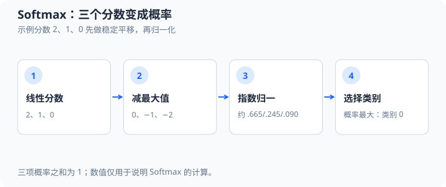

# Softmax 多分类回归（Softmax regression）：公式、梯度与 C 实现

本文分析 [`src/ml/25_softmax_regression.c`](../src/ml/25_softmax_regression.c) 中的三分类线性 Softmax 回归。程序用 $36$ 个固定二维样本训练一个线性分类器，再分别报告训练集、验证集和测试集结果。运行 `make softmax-regression` 可查看输出，`make test-softmax-regression` 会验证概率、手算梯度和数据划分。

这是一种经典机器学习模型，不是多层神经网络。它适合用来学习多分类概率、交叉熵及其梯度，也能为后续 CNN 和 Transformer 的 Softmax 分类头打基础。

示例分数 $2,1,0$ 减去最大值后为 $0,-1,-2$，所得概率约为 $0.665,0.245,0.090$；减常数不改变概率。

## 1. 输入、输出与源码地图

每个样本有两个特征和一个类别编号。类别编号为 $0$、$1$ 或 $2$。模型为每个类别保存一行权重和一个偏置；输出是三个概率，概率最大的类别作为预测。

| 概念 | 源码位置 | 对应字段或变量 | 作用 |
| --- | --- | --- | --- |
| 固定样本及数据划分 | [`Sample`](../src/ml/25_softmax_regression.c#L30)、[`Dataset`](../src/ml/25_softmax_regression.c#L36) | `features`、`label`、`split` | 保存二维输入、类别和训练/验证/测试用途。 |
| 数据生成 | [`dataset_generate`](../src/ml/25_softmax_regression.c#L64) | `centers`、`offsets` | 围绕三个中心构造样本，每类按 $8/2/2$ 划分。 |
| 模型参数 | [`SoftmaxModel`](../src/ml/25_softmax_regression.c#L41) | `weights`、`biases` | 每个类别有两个特征权重和一个偏置。 |
| 稳定 Softmax | [`softmax`](../src/ml/25_softmax_regression.c#L107) | `maximum`、`denominator` | 减去最大 logit 后计算归一化指数。 |
| 单样本前向与损失 | [`model_predict`](../src/ml/25_softmax_regression.c#L149) | `logits`、`probabilities`、`loss` | 从线性打分得到概率、预测类别和交叉熵。 |
| 梯度下降 | [`model_train_epoch`](../src/ml/25_softmax_regression.c#L198) | `error`、`weight_gradients`、`bias_gradients` | 累加训练样本梯度，取平均后更新参数。 |
| 划分评估 | [`evaluate`](../src/ml/25_softmax_regression.c#L266) | `correct`、`cross_entropy` | 计算指定划分的准确率与平均损失。 |
| 程序流程 | [`main`](../src/ml/25_softmax_regression.c#L301) | `dataset`、`model`、`training`、`test` | 初始化、训练固定轮数，再分开报告三个划分。 |

## 2. 从特征到类别概率

令 $i$ 表示样本编号，$c$ 表示类别编号，$f$ 表示特征编号。特征向量为 $\mathbf{x}_i=(x_{i,0},x_{i,1})$，真实类别为 $y_i\in\{0,1,2\}$。代码中的 `sample->features[f]` 对应 $x_{i,f}$，`sample->label` 对应 $y_i$。第 $c$ 类权重为 $\mathbf{w}_c$，偏置为 $b_c$，对应 `weights[c][f]` 和 `biases[c]`。

先为每个类别计算线性分数，也叫 logit：

$$
z_{i,c}=b_c+\sum_{f=0}^{1}w_{c,f}x_{i,f}.
\tag{1}
$$

这里 $z_{i,c}$ 是样本 $i$ 属于类别 $c$ 的未归一化分数。源码在 `model_predict` 中先将 `logits[class_index]` 设为偏置，再逐特征累加 `weight * feature`。

例如取一个便于手算的输入 $\mathbf{x}=(1,2)$，假设某类别的权重是 $\mathbf{w}=(0.2,-0.1)$、偏置是 $b=0.3$，则该类别分数为 $z=0.3+0.2\times1-0.1\times2=0.3$。这是单独的算式示例；程序实际训练从全零权重和偏置开始，因此首轮每个类别 logit 都是 $0$。

Softmax 把三个分数转成和为 $1$ 的概率。为了计算稳定，先令 $m_i=\max_c z_{i,c}$，再计算：

$$
p_{i,c}=\frac{\exp(z_{i,c}-m_i)}{\sum_{k=0}^{2}\exp(z_{i,k}-m_i)}.
\tag{2}
$$

$p_{i,c}$ 是类别 $c$ 的预测概率，$k$ 是分母中的类别求和下标。减去同一个最大值不会改变概率，因为分子、分母都乘上了相同因子 $\exp(-m_i)$；它能避免直接对很大的正数取指数。`softmax` 用 `maximum` 保存 $m_i$，把指数暂存在 `values`，再用 `denominator` 归一化。

手算一组分数 $\mathbf{z}=(0,\ln 2,\ln 3)$。最大分数是 $\ln 3$，减最大值后指数分别为 $1/3$、$2/3$、$1$，其和为 $2$，所以概率为 $(1/6,2/6,3/6)$。这也说明 Softmax 保留了分数的相对大小，而不是把分数简单截成 $0$ 到 $1$。

程序在 [`model_predict`](../src/ml/25_softmax_regression.c#L149) 中选择最大概率类别。若最大值并列，严格使用 `>` 的循环会保留编号较小的类别。单样本交叉熵为：

$$
\ell_i=-\ln p_{i,y_i}.
\tag{3}
$$

若上述手算样本的真实类别是 $1$，损失为 $-\ln(2/6)=\ln 3\approx1.0986$。源码以 `-log(fmax(probability, DBL_MIN))` 保护对数输入，避免概率下溢为零后调用 `log(0)`。

## 3. 交叉熵梯度如何变成参数更新

训练集有 $N$ 个样本，平均交叉熵为：

$$
L=-\frac{1}{N}\sum_{i=1}^{N}\ln p_{i,y_i}.
\tag{4}
$$

$N=2$ 时，若两个样本的真实类别概率分别为 $1/2$ 和 $1/4$，则平均交叉熵为 $-[\ln(1/2)+\ln(1/4)]/2=3\ln2/2\approx1.0397$。这是用于理解平均方式的算术例子；程序中的 `evaluate` 会累计指定划分的样本损失，再除以 `metrics.count`。

$L$ 是优化目标，$N$ 是训练样本数。把 Softmax 与交叉熵对线性分数求导，会得到一个简洁的误差项：

$$
\frac{\partial L}{\partial z_{i,c}}=\frac{1}{N}\left(p_{i,c}-\mathbb{1}[y_i=c]\right).
\tag{5}
$$

$\mathbb{1}[y_i=c]$ 在真实类别等于 $c$ 时为 $1$，否则为 $0$。再用链式法则，因 $z_{i,c}$ 对 $w_{c,f}$ 的导数是 $x_{i,f}$，对 $b_c$ 的导数是 $1$：

$$
\frac{\partial L}{\partial w_{c,f}}=\frac{1}{N}\sum_{i=1}^{N}\left(p_{i,c}-\mathbb{1}[y_i=c]\right)x_{i,f},
\qquad
\frac{\partial L}{\partial b_c}=\frac{1}{N}\sum_{i=1}^{N}\left(p_{i,c}-\mathbb{1}[y_i=c]\right).
\tag{6}
$$

参数使用学习率 $\eta$ 做梯度下降：

$$
w_{c,f}\leftarrow w_{c,f}-\eta\frac{\partial L}{\partial w_{c,f}},
\qquad
b_c\leftarrow b_c-\eta\frac{\partial L}{\partial b_c}.
\tag{7}
$$

在 `model_train_epoch` 中，`error` 保存 $p_{i,c}-\mathbb{1}[y_i=c]$；`weight_gradients[c][f]` 累加误差乘特征，`bias_gradients[c]` 累加误差。循环结束后除以 `training_count`，再按学习率更新。`updated` 是临时模型；只有全部参数更新仍为有限数时，源码才用 `*model = updated` 提交更改。

用一个真实测试里的小样本检查方向：令输入为 $(1,-1)$、真实类别为 $0$，且初始模型权重和偏置全为 $0$。此时三个 logit 都是 $0$，概率都是 $1/3$。类别 $0$ 在两个特征上的梯度分别是 $(1/3-1)\times1=-2/3$ 与 $(1/3-1)\times(-1)=2/3$；其偏置梯度是 $-2/3$。学习率为 $0.1$ 时，类别 $0$ 的权重更新为 $(+0.0667,-0.0667)$，偏置更新为 $+0.0667$。这会提高该样本对应类别 $0$ 的 logit。测试 `test_one_sample_gradient_update` 用断言核对包括其他两个类别在内的全部手算更新。

## 4. 实际数据流和输出

`dataset_generate` 为三类设置不同中心：大致位于 $(-2,-1.2)$、$(2,-1.2)$ 和 $(0,2.2)$。同一组偏移重复加到各中心，得到每类 $12$ 个点；每类前 $8$ 个用于训练，随后 $2$ 个用于验证，最后 $2$ 个用于测试。总数因此是训练 $24$ 个、验证 $6$ 个、测试 $6$ 个。固定偏移让边界清楚，也使示例完全可重复。

`main` 从零参数开始，先记录验证交叉熵，再按学习率 $0.12$ 训练 $400$ 轮。随后 `evaluate` 分别计算三个划分的平均损失和正确数。当前实际运行输出为：训练准确率 $100\%$、验证准确率 $100\%$、测试准确率 $100\%$；验证交叉熵从约 $1.0986$ 降至约 $0.0065$。每个评估划分只有 $6$ 个样本，因此这个结果只验证固定合成数据上的实现，不表示真实数据中的泛化保证。

## 5. 边界、测试和继续实验

`softmax` 拒绝空指针和非有限 logit，且使用局部数组保证失败时不覆盖调用者的概率数组。`model_train_epoch` 拒绝空训练划分、无效学习率、非法标签及非有限中间结果。数据分割只按 `sample->split` 读取，验证集和测试集不进入梯度累加；当前示例不在验证集上选轮次，只用固定轮数展示算法。

运行 `make test-softmax-regression` 会检查手算 Softmax、极端 logit、单样本梯度、训练数据计数和无效参数的失败保留。`make sanitize-softmax-regression` 用 AddressSanitizer 与 UndefinedBehaviorSanitizer 运行同一组断言。测试不验证模型在外部数据集上的效果，也不覆盖所有浮点输入范围。

适合的练习是改变类别中心、加入重叠样本，再比较线性 Softmax 与更深的 MLP。若分类边界弯曲，线性模型即使训练正确，也可能无法表达数据结构。
