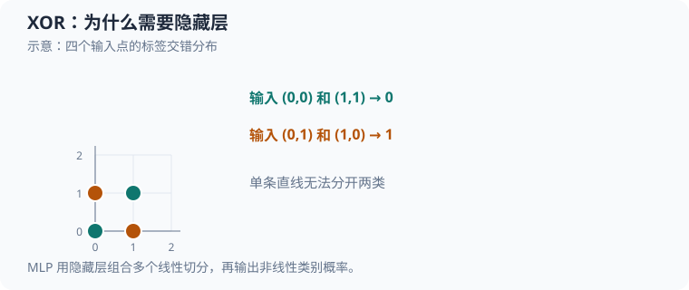

# 阶段 1：从单个神经元（neuron）到 XOR 小网络

本教程逐步拆解 [`src/ml/06_xor_mlp.c`](../src/ml/06_xor_mlp.c)：从一个手算的 S 型函数（sigmoid）神经元，走到含隐藏层的 XOR 网络，再核对真实初始化、前向传播、反向传播、一次参数更新和训练结果。建议先读[阶段 0：数值基础](51_数值计算与梯度.md)。



两个类别交错分布，单条直线无法分开；隐藏层把多个线性变换组合为非线性决策边界。

## 1. 运行与源码地图

```sh
make xor-mlp
make test-xor-mlp
make sanitize-xor-mlp
```

程序不需要输入、数据文件或外部框架。`make test-xor-mlp` 运行演示和断言；`make sanitize-xor-mlp` 使用地址与未定义行为消毒器重新构建并运行。

| 概念 | 源码 | 负责的状态或动作 |
| --- | --- | --- |
| 网络和前向缓存 | [`Network`、`Forward`](../src/ml/06_xor_mlp.c#L27-L35) | 固定数组保存参数、隐藏层输出、logit 和概率 |
| 确定性初始化 | [`network_initialize`](../src/ml/06_xor_mlp.c#L65-L91) | 权重按种子生成，偏置清零 |
| 前向传播 | [`network_forward`](../src/ml/06_xor_mlp.c#L93-L113) | 从输入依次计算隐藏层、logit 和概率 |
| 单样本反向传播 | [`network_backward`](../src/ml/06_xor_mlp.c#L115-L138) | 写入 17 个梯度，不改参数 |
| 随机梯度下降（stochastic gradient descent，SGD）与平均损失 | [`network_update`、`network_loss`](../src/ml/06_xor_mlp.c#L140-L168) | 更新参数；在四个样本上重新评估损失 |
| 行为验证 | [`test_neuron` 至 `test_initialization_and_update`](../src/ml/06_xor_mlp.c#L170-L258) | 检查数值稳定性、梯度、零初始化和更新 |
| 训练入口 | [`main`](../src/ml/06_xor_mlp.c#L260-L321) | 固定顺序训练、定期输出、检查预测 |
| Python 对照 | [`src/python/ml/06_xor_mlp.py`](../src/python/ml/06_xor_mlp.py) | 使用同一 XOR 真值表，展示全批量反向传播；训练更新顺序与 C 不同。 |

执行顺序是：先验证单神经元和随机初始化网络的梯度，再验证零初始化与单步更新，最后训练并检查完整 XOR 真值表。训练入口的细节见 [`main` 的训练循环](../src/ml/06_xor_mlp.c#L275-L320)。

## 2. 任务、变量和网络形状

异或（exclusive OR，XOR）的两个输入不同则标签为 $1$，相同则标签为 $0$。样本索引为 $n\in\{0,1,2,3\}$，输入下标为 $i\in\{0,1\}$；这两个下标在源码循环中都从 $0$ 开始。

| 数学符号                 | 含义                     | 源码对应                                                   |
| -------------------- | ---------------------- | ------------------------------------------------------ |
| $x_{n,i}\in\{0,1\}$  | 第 $n$ 个样本的第 $i$ 个输入    | `xor_inputs[n][i]`                                     |
| $y_n\in\{0,1\}$      | 第 $n$ 个样本的正确标签         | `xor_targets[n]`                                       |
| $h\in\{0,1,2,3\}$    | 隐藏神经元下标                | `for (size_t h = 0; h < HIDDEN; ++h)`                  |
| $W_{1,h,i}, b_{1,h}$ | 输入层到隐藏层的权重和偏置          | `parameters[W1 + h * INPUTS + i]`、`parameters[B1 + h]` |
| $u_h, a_h$           | 隐藏层第 $h$ 个神经元的加权输入与激活  | `preactivation`、`forward.hidden[h]`                    |
| $W_{2,h}, b_2$       | 隐藏层到输出层的权重和偏置          | `parameters[W2 + h]`、`parameters[B2]`                  |
| $z, p$               | sigmoid 前的 logit 和输出概率 | `forward.logit`、`forward.probability`                  |
| $L, J$               | 单个样本的交叉熵和四样本平均损失       | `binary_cross_entropy`、`network_loss`                  |

所有输入、权重、偏置、激活和损失在这个小例子中都没有物理单位。令 $\mathbb R$ 表示实数集合，网络形状为：

$$
\begin{aligned}
x&\in\mathbb R^2,\\
W_1&\in\mathbb R^{4\times2},\\
b_1&\in\mathbb R^4,\\
a&\in\mathbb R^4,\\
W_2&\in\mathbb R^4,\\
b_2&\in\mathbb R,\\
z&\in\mathbb R,\\
p&\in(0,1).
\end{aligned}
\tag{1}
$$

源码把参数存入单个 `double parameters[17]`，便于统一遍历和逐项检查梯度。枚举偏移定义在 [`W1` 到 `PARAMETERS`](../src/ml/06_xor_mlp.c#L18-L25)：

| 参数 | 数量 | `parameters` 下标 |
| --- | ---: | --- |
| $W_1$ | $4\times2=8$ | $2h+i$，范围 $0\ldots7$ |
| $b_1$ | $4$ | $8+h$，范围 $8\ldots11$ |
| $W_2$ | $4$ | $12+h$，范围 $12\ldots15$ |
| $b_2$ | $1$ | $16$ |

总参数数为 $8+4+4+1=17$。这里没有动态内存分配；输入数组和梯度数组的容量由编译期常量固定。

## 3. 为什么单个神经元不能解决 XOR

单个 S 型函数（sigmoid）神经元的输出为 $p=\sigma(z)$，其中 $z=\alpha_0x_0+\alpha_1x_1+\beta$；$\alpha_0,\alpha_1$ 是两个输入权重，$\beta$ 是偏置，$\sigma$ 是 sigmoid 函数。按 $p\ge0.5$ 判为正类，等价于按 $z\ge0$ 分类，因此分类边界是一条直线。

两个正样本 $(0,1)$ 和 $(1,0)$ 要求：

$$
\begin{aligned}
\alpha_1+\beta&\ge0,\\
\alpha_0+\beta&\ge0.
\end{aligned}
\tag{2}
$$

相加得到 $\alpha_0+\alpha_1+2\beta\ge0$。两个负样本 $(0,0)$ 和 $(1,1)$ 则要求：

$$
\begin{aligned}
\beta&<0,\\
\alpha_0+\alpha_1+\beta&<0.
\end{aligned}
\tag{3}
$$

相加得到同一个左侧表达式 $\alpha_0+\alpha_1+2\beta<0$，与前一个不等式矛盾。增加训练轮数无法弥补模型表达能力不足；需要非线性隐藏层。源码在 [`network_forward`](../src/ml/06_xor_mlp.c#L99-L112) 中用双曲正切（hyperbolic tangent，tanh）产生非线性特征，再由输出层组合。

## 4. 单个 sigmoid 神经元：从输入算到梯度

源码先用一个手算样例验证 sigmoid、损失和导数：$x_0=1$、$x_1=2$，权重 $w_0=0.5$、$w_1=-0.25$，偏置 $b=0.1$，标签 $y=1$。这些数值对应 [`test_neuron`](../src/ml/06_xor_mlp.c#L170-L193) 和 `main` 的演示输出。

### 4.1 前向计算与稳定交叉熵

logit 是线性分数，不是概率：

$$
z=w_0x_0+w_1x_1+b
=0.5\times1+(-0.25)\times2+0.1
=0.1.
\tag{4}
$$

sigmoid 把实数分数映射到概率。$z\ge0$ 时用 $1/(1+e^{-z})$；$z<0$ 时源码改用 $e^z/(1+e^z)$，避免求可能溢出的大正指数：

$$
\begin{aligned}
p&=\sigma(z)=\begin{cases}
\dfrac{1}{1+e^{-z}},  z\ge0,\\[4pt]
\dfrac{e^z}{1+e^z},  z<0.
\end{cases}\\
p&=\sigma(0.1)\approx0.5249791875.
\end{aligned}
\tag{5}
$$

分支实现见 [`sigmoid`](../src/ml/06_xor_mlp.c#L40-L52)。浮点舍入可能让极端输入的概率恰好成为 $0$ 或 $1$，所以损失不能简单地对这个概率取对数。二分类交叉熵的常规定义是：

$$
L=-y\ln p-(1-y)\ln(1-p).
\tag{6}
$$

其中 $y$ 是取 $0$ 或 $1$ 的标签，$\ln$ 是自然对数。将 sigmoid 代入后可改写成仅依赖 logit 的稳定形式：

$$
\begin{aligned}
L(z,y)&=\max(z,0)-yz+\ln\!\left(1+e^{-|z|}\right).
\end{aligned}
\tag{7}
$$

对本例，$y=1$ 且 $z=0.1$：

$$
L=0.1-1\times0.1+\ln(1+e^{-0.1})
=\ln(1+0.9048374)
\approx0.6443966601.
\tag{8}
$$

源码使用 `fmax`、`fabs` 和 `log1p` 实现此式，见 [`binary_cross_entropy`](../src/ml/06_xor_mlp.c#L54-L63)。例如 $z=1000,y=0$ 时，损失为 $1000+\ln(1+e^{-1000})\approx1000$，不会先把 $p$ 舍入为 $1$ 再计算 $\ln(1-p)$。

### 4.2 从交叉熵推导输出梯度

先对概率求导，再乘 sigmoid 的导数。利用 $dp/dz=p(1-p)$：

$$
\begin{aligned}
\frac{dL}{dz}
&=\left(-\frac{y}{p}+\frac{1-y}{1-p}\right)p(1-p)
=-y(1-p)+(1-y)p
=p-y.
\end{aligned}
\tag{9}
$$

本例代入 $p\approx0.5249791875$、$y=1$：

$$
\begin{aligned}
\delta_{\mathrm{out}}&=\frac{dL}{dz}=p-y
=0.5249791875-1
\approx-0.4750208125.
\end{aligned}
\tag{10}
$$

这里 $\delta_{\mathrm{out}}$ 表示输出 logit 的梯度。权重通过 $z=w_0x_0+w_1x_1+b$ 影响损失，因此：

$$
\frac{\partial L}{\partial w_0}
=\delta_{\mathrm{out}}x_0
=-0.4750208125\times1
=-0.4750208125,
\tag{11}
$$

$$
\begin{aligned}
\frac{\partial L}{\partial w_1}
&=\delta_{\mathrm{out}}x_1
=-0.4750208125\times2
=-0.9500416250,\\
\frac{\partial L}{\partial b}
&=\delta_{\mathrm{out}}
\approx-0.4750208125.
\end{aligned}
\tag{12}
$$

因此实现中不再额外乘 $p(1-p)$：这个因子已经在 sigmoid 与交叉熵的合并求导中抵消。`test_neuron` 用中心差分对 $dL/dz$ 做独立数值核对。

## 5. 初始化如何变成确定的参数

[`random_weight`](../src/ml/06_xor_mlp.c#L65-L75) 使用 `uint32_t` 状态，而不是平台实现可能不同的 `rand()`。令 $q_k$ 为第 $k$ 次更新前的 32 位无符号状态，$r_k$ 为更新后状态右移 $8$ 位的整数，$u_k$ 为归一化值，则源码对应：

$$
\begin{aligned}
q_{k+1}&=(1664525q_k+1013904223)\bmod2^{32},\\
r_k&=\left\lfloor\frac{q_{k+1}}{2^8}\right\rfloor,
\end{aligned}
\tag{13}
$$

$$
\begin{aligned}
u_k&=\frac{r_k}{2^{24}}\in[0,1),\\
w_k&=1.6u_k-0.8\in[-0.8,0.8).
\end{aligned}
\tag{14}
$$

这里 $q_0=42$ 是本例种子，$k$ 是权重生成序号；模 $2^{32}$ 对应无符号整数回绕。`network_initialize` 先把整个网络清零，再对每个隐藏神经元依次生成两个 $W_1$ 权重和一个 $W_2$ 权重，所以所有偏置初始为零。

按此算法从种子 $42$ 生成、四舍五入到小数点后六位的初始参数为：

$$
\begin{aligned}
W_1&=\begin{bmatrix}
-0.396248 & -0.659000\\
 -0.443913 & -0.198944\\
-0.084350 & -0.610464\\
 0.791415 &  0.565124
\end{bmatrix},\\
W_2&=\begin{bmatrix}
0.123650 & -0.758938 & 0.598102 & -0.000517
\end{bmatrix},
\end{aligned}
\tag{15}
$$

$$
\begin{aligned}
b_1&=\begin{bmatrix}0&0&0&0\end{bmatrix}^{\mathsf T},\\
b_2&=0.
\end{aligned}
\tag{16}
$$

矩阵行对应 $h=0,1,2,3$，列对应 $i=0,1$。这些数值是按源码的整数生成步骤计算后显示的近似值；后续手算使用未舍入的权重，只在文档中显示有限小数位。相同编译环境中的两次初始化会逐位相等，源码也逐项断言这一点。不同数学库实现可能令后续 `tanh` 结果有细微舍入差异。

## 6. 真实 XOR 网络的一次完整前向与更新

训练循环中的第一个样本是 $n=0$：$x_0=(0,0)$、$y_0=0$。令 $u_h$ 为隐藏神经元的加权输入，$a_h$ 为 `tanh` 输出。前向传播公式与 [`network_forward`](../src/ml/06_xor_mlp.c#L99-L112) 一一对应：

$$
\begin{aligned}
u_h&=b_{1,h}+\sum_{i=0}^{1}W_{1,h,i}x_{0,i},\\
a_h&=\tanh(u_h),
\end{aligned}
\tag{17}
$$

$$
\begin{aligned}
z&=b_2+\sum_{h=0}^{3}W_{2,h}a_h,\\
p&=\sigma(z).
\end{aligned}
\tag{18}
$$

源码在每个隐藏单元中累加输入，再把 `tanh` 结果立刻送入输出层；末尾才计算 sigmoid：

```c
double preactivation = network->parameters[B1 + h];
for (size_t i = 0; i < INPUTS; ++i) {
    preactivation += network->parameters[W1 + h * INPUTS + i] * x[i];
}
forward.hidden[h] = tanh(preactivation);
forward.logit += network->parameters[W2 + h] * forward.hidden[h];
```

对应 [`network_forward`](../src/ml/06_xor_mlp.c#L99-L112)：`preactivation` 对应 $u_h$，`forward.hidden[h]` 对应 $a_h$，`forward.logit` 对应 $z$。循环结束后第 $111$ 行才计算 `forward.probability = sigmoid(forward.logit)`。

由于两个输入均为零、初始隐藏偏置也为零，对每个 $h$ 都有：

$$
\begin{aligned}
u_h&=0+W_{1,h,0}\times0+W_{1,h,1}\times0=0,\\
a_h&=\tanh(0)=0.
\end{aligned}
\tag{19}
$$

所以 $z=0+\sum_{h=0}^{3}W_{2,h}\times0=0$，$p=\sigma(0)=0.5$。标签 $y_0=0$，该样本损失为：

$$
\begin{aligned}
L_0&=\max(0,0)-0\times0+\ln(1+e^0)=\ln2\approx0.6931471806.
\end{aligned}
\tag{20}
$$

反向传播先得 $\delta_{\mathrm{out}}=p-y_0=0.5$。对隐藏层，令 $\delta_h$ 表示损失对 $u_h$ 的导数。因为 $d\tanh(u_h)/du_h=1-a_h^2$，链式法则给出：

$$
\begin{aligned}
\delta_h&=\delta_{\mathrm{out}}W_{2,h}(1-a_h^2),\\
\frac{\partial L}{\partial W_{2,h}}&=\delta_{\mathrm{out}}a_h,\\
\frac{\partial L}{\partial b_2}&=\delta_{\mathrm{out}},
\end{aligned}
\tag{21}
$$

$$
\begin{aligned}
\frac{\partial L}{\partial W_{1,h,i}}&=\delta_hx_{0,i},\\
\frac{\partial L}{\partial b_{1,h}}&=\delta_h.
\end{aligned}
\tag{22}
$$

此时 $a_h=0$，所以输出权重梯度全为零；$x_{0,i}=0$，所以输入权重梯度全为零。隐藏偏置梯度则为 $\delta_h=0.5W_{2,h}$。代入初始 $W_2$ 得：

$$
\begin{aligned}
\nabla_{b_1}L_0&\approx
\begin{bmatrix}
0.061824942 & -0.379468918 & 0.299050951 & -0.000258636
\end{bmatrix}^{\mathsf T},\\
\nabla_{b_2}L_0&=0.5.
\end{aligned}
\tag{23}
$$

`network_backward` 将这些梯度写入数组；它不会修改网络。接着训练率 $\eta=0.1$，`network_update` 对每个参数下标 $r\in\{0,\ldots,16\}$ 执行 $\theta_r\leftarrow\theta_r-\eta g_r$，其中 $\theta_r$ 是参数，$g_r$ 是对应梯度。于是这一步后：

$$
\begin{aligned}
b_1&\approx
\begin{bmatrix}
-0.006182494 & 0.037946892 & -0.029905095 & 0.000025864
\end{bmatrix}^{\mathsf T},\\
b_2&=-0.05,
\end{aligned}
\tag{24}
$$

而 $W_1$、$W_2$ 保持原值。这展示了为什么“输入为零”时输入权重没有更新，但隐藏偏置和输出偏置仍能更新。反向传播必须读取更新前的 $W_2$；因此代码先完整计算梯度，再调用 [`network_update`](../src/ml/06_xor_mlp.c#L140-L153)。

紧接着循环处理 $n=1$，即 $x_1=(0,1)$、$y_1=1$。使用刚更新的偏置，四个隐藏层加权输入约为：

$$
\begin{aligned}
u&\approx\begin{bmatrix}-0.665183&-0.160997&-0.640369&0.565150\end{bmatrix}^{\mathsf T},\\
a&=\tanh(u)\approx\begin{bmatrix}-0.581802&-0.159620&-0.565151&0.511789\end{bmatrix}^{\mathsf T}.
\end{aligned}
\tag{25}
$$

输出层将四个特征加权求和：

$$
\begin{aligned}
z&\approx-0.05-0.071940+0.121142-0.338018-0.000265=-0.339081,\\
p&=\sigma(z)\approx0.416033.
\end{aligned}
\tag{26}
$$

因为正确标签是 $1$，这次概率仍偏低，稳定交叉熵约为 $L_1=0.876991$。下一次反向传播会产生非零的 $W_1$ 梯度，因为输入的第二个分量为 $1$；随后更新会同时改变隐藏特征和输出。这里展示的是源码固定顺序 SGD 的前两次样本处理，不是独立于训练循环的虚构批次。

## 7. 隐藏层反向传播逐项解释

把上面的链式法则推广到任意输入。对每个隐藏下标 $h$ 和输入下标 $i$：

$$
\begin{aligned}
u_h&=b_{1,h}+\sum_{i=0}^{1}W_{1,h,i}x_i,\\
a_h&=\tanh(u_h),\\
z&=b_2+\sum_{h=0}^{3}W_{2,h}a_h.
\end{aligned}
\tag{27}
$$

令 $y$ 是当前样本标签，$p=\sigma(z)$ 是前向缓存的概率。输出层误差信号为 $\delta_{\mathrm{out}}=p-y$；继续向隐藏层传递时乘以输出权重和 `tanh` 的导数：

$$
\delta_h=\frac{\partial L}{\partial u_h}
=\delta_{\mathrm{out}}W_{2,h}(1-a_h^2).
\tag{28}
$$

例如当某隐藏激活 $a_h=0.5$、对应输出权重 $W_{2,h}=0.4$、输出误差 $\delta_{\mathrm{out}}=-0.2$ 时：

$$
\begin{aligned}
\delta_h=(-0.2)\times0.4\times(1-0.5^2)
&=-0.08\times0.75=-0.06.
\end{aligned}
\tag{29}
$$

这个隐藏神经元的输入权重梯度等于其误差信号乘以输入。若输入分量 $x_i=2$，则 $\partial L/\partial W_{1,h,i}=-0.06\times2=-0.12$；偏置梯度为 $\partial L/\partial b_{1,h}=-0.06$。这些例子是对源码公式的手算示范，数值不声称是训练过程中的某个隐藏单元状态。

代码中 `forward.hidden[h]` 保存 $a_h$，所以无需再次调用 `tanh`。`network_backward` 中的 `network->parameters[W2 + h]` 是刚才前向传播对应的旧输出权重；若先更新它再计算 $\delta_h$，梯度就不再对应同一个参数版本。

源码的关键计算顺序如下：

```c
double output_delta = forward->probability - target;
gradients[W2 + h] = output_delta * forward->hidden[h];
double hidden_delta = output_delta * network->parameters[W2 + h] *
                      (1 - forward->hidden[h] * forward->hidden[h]);
gradients[B1 + h] = hidden_delta;
```

这几行分别对应 $\delta_{\mathrm{out}}$、$\partial L/\partial W_{2,h}$、$\delta_h$ 和 $\partial L/\partial b_{1,h}$。随后内层循环将 `hidden_delta * x[i]` 写入 $W_1$ 对应的梯度槽位。

## 8. SGD、平均损失与训练输出

一个 epoch 是按固定顺序访问四个样本一次。每个样本都独立执行前向、反向、更新，因此这里是在线 SGD，而不是整批梯度下降：

$$
\begin{aligned}
\theta^{(t+1)}&=\theta^{(t)}-\eta\nabla_\theta L_n(\theta^{(t)}),\\
\eta&=0.1.
\end{aligned}
\tag{30}
$$

其中 $t$ 是单次样本更新序号，$n$ 是当前样本序号，$\theta$ 是全部 $17$ 个参数组成的向量。源码每轮有四次更新，总共执行 $5000\times4=20000$ 次更新。输出的平均损失是在更新后用同一份当前网络重新计算：

```c
Forward forward = network_forward(&network, xor_inputs[sample]);
double gradients[PARAMETERS] = {0};
network_backward(&network, xor_inputs[sample], xor_targets[sample], &forward, gradients);
network_update(&network, gradients, LEARNING_RATE);
```

这段固定顺序循环位于 [`main`](../src/ml/06_xor_mlp.c#L288-L296)。每次 `network_update` 对参数数组逐项执行：

```c
network->parameters[p] -= learning_rate * gradients[p];
```

也就是 $\theta_r\leftarrow\theta_r-\eta g_r$；实现同时断言更新后的每个参数仍是有限数。

$$
J(\theta)=\frac{1}{4}\sum_{n=0}^{3}L(z_n,y_n).
\tag{31}
$$

这里 $z_n$ 是当前网络对第 $n$ 个样本算出的 logit，$y_n$ 是对应标签。用种子 $42$ 的初始参数计算，四个样本损失依次约为 $0.693147$、$0.824990$、$0.589571$ 和 $0.679898$，因此：

$$
J(\theta^{(0)})\approx\frac{0.693147+0.824990+0.589571+0.679898}{4}
\approx0.696902.
\tag{32}
$$

固定环境本次运行的训练观察值为：

```text
epoch=   0，平均交叉熵=0.696902
epoch= 500，平均交叉熵=0.023407
epoch=1000，平均交叉熵=0.008552
epoch=1500，平均交叉熵=0.005101
epoch=2000，平均交叉熵=0.003601
epoch=2500，平均交叉熵=0.002770
epoch=3000，平均交叉熵=0.002245
epoch=3500，平均交叉熵=0.001885
epoch=4000，平均交叉熵=0.001623
epoch=4500，平均交叉熵=0.001425
epoch=5000，平均交叉熵=0.001269
```

程序按 $p\ge0.5$ 判为 $1$，最终输出为：

```text
x=[0,0]，目标=0，概率=0.000234，预测=0
x=[0,1]，目标=1，概率=0.998497，预测=1
x=[1,0]，目标=1，概率=0.998746，预测=1
x=[1,1]，目标=0，概率=0.002081，预测=0
```

源码断言最终损失有限、低于初始损失且小于 $0.02$；正样本概率大于 $0.95$，负样本概率小于 $0.05$。这些检查证明本次实现拟合了完整布尔真值表，不代表模型能泛化到其他数据，也不保证任意种子或学习率都有相同曲线。

## 9. 为什么初始化不能全部为零

全零初始化时，每个隐藏层加权输入和激活都是零，输出概率为 $0.5$。对任一 XOR 样本，输出权重梯度为 $\delta_{\mathrm{out}}a_h=0$；隐藏误差信号也含有 $W_{2,h}=0$，所以 $W_1$ 和 $b_1$ 的梯度为零。每个隐藏单元得到完全相同的信号，无法学出不同特征。

此外 XOR 标签中有两个 $0$ 和两个 $1$。对输出偏置，四个样本的梯度分别为 $0.5,-0.5,-0.5,0.5$，平均值为：

$$
\frac{0.5-0.5-0.5+0.5}{4}=0.
\tag{33}
$$

因此源码测试中全零网络的四样本平均梯度全部为零，网络会停在 $p=0.5$。仅把偏置设为零并没有这个问题：随机权重已经让不同隐藏单元得到不同输入响应。固定种子使实验可复现，但不是每个随机初始化都能保证同样快地收敛。

## 10. 梯度检查与测试实际证明什么

反向传播公式写错时，程序仍可能训练出看似合理的结果，因此源码另用有限差分检查解析梯度。令 $\theta_r$ 是第 $r$ 个参数，$\varepsilon=10^{-5}$ 是扰动大小，$\mathbf e_r$ 是仅第 $r$ 项为 $1$ 的单位向量，则数值梯度为：

$$
g^{\mathrm{num}}_r=
\frac{L(\theta+\varepsilon\mathbf e_r)-L(\theta-\varepsilon\mathbf e_r)}{2\varepsilon}.
\tag{34}
$$

分子是在只增加或减少一个参数后重新前向计算的损失差；除以 $2\varepsilon$ 是中心差分近似。源码对四个样本、每个样本的 $17$ 个参数都进行比较。接受条件为：

$$
\begin{aligned}
|g^{\mathrm{num}}_r-g^{\mathrm{ana}}_r|
&<10^{-8}+10^{-6}\max\!\left(|g^{\mathrm{num}}_r|,|g^{\mathrm{ana}}_r|\right),
\end{aligned}
\tag{35}
$$

其中 $g^{\mathrm{ana}}_r$ 是 `network_backward` 写出的解析梯度。绝对误差项照顾接近零的梯度，相对误差项随梯度大小缩放。本次 `make test-xor-mlp` 输出最大绝对误差 $1.399\times10^{-11}$。

测试还覆盖：极端 logit 下 sigmoid 和 BCE 的数值行为；种子 $42$ 重复初始化完全相同；一次 $\eta=0.01$ 更新符合参数减梯度的公式且降低被测样本损失；训练结束后参数和概率有限，四个预测正确。消毒器通过说明本次路径没有发现地址或未定义行为问题，但不证明任意输入、编译器或平台都没有缺陷。

## 11. C 实现与学习边界

- `Network` 和 `Forward` 使用固定长度数组，内存布局简单，没有堆分配或外部深度学习框架。
- `uint32_t`、`size_t`、`assert` 和数学函数来自标准头文件；构建命令通过 `-lm` 链接数学库。不同编译器对 C23 的支持程度可能不同，但本案例没有依赖 C23 独有语法。
- `assert` 用于教学验证；若定义 `NDEBUG`，断言会被移除，因此验证时应保持断言开启。
- 输入、标签和参数的合法范围由本固定案例保证；网络函数不是带完整运行时校验的通用库接口。
- 数据顺序固定，没有打乱、小批量、Adam、模型保存或真实数据评估；这些属于后续阶段主题。

## 12. 隐藏层如何表示非线性关系

XOR 需要两条线性判别条件的组合。用阶跃函数 $H(t)$ 表示 $t\ge0$ 时输出 $1$、否则输出 $0$，可先构造“或”和“与非”两个隐藏特征，再把它们相与：

$$
\begin{aligned}
h_{\mathrm{OR}}&=H(x_0+x_1-0.5),\\
h_{\mathrm{NAND}}&=H(-x_0-x_1+1.5),\\
\hat y&=H(h_{\mathrm{OR}}+h_{\mathrm{NAND}}-1.5).
\end{aligned}
\tag{36}
$$

手算 $(x_0,x_1)=(0,0)$ 时，两个隐藏值为 $0,1$，输出 $H(-0.5)=0$；输入 $(0,1)$ 时隐藏值为 $1,1$，输出 $H(0.5)=1$；$(1,0)$ 同样输出 $1$；$(1,1)$ 的隐藏值为 $1,0$，输出 $0$。隐藏层把原输入变成可组合的中间特征，输出层再在新表示上做线性判定。

这个阈值网络只用于解释逻辑结构，和源码参数并不相同：C/Python 示例使用连续的 `tanh` 隐藏激活及 sigmoid 输出，通过梯度下降学习。真实网络不需要恰好实现上面的 OR/NAND 子电路，而是找到一个能降低四条样本交叉熵的参数组合。

在满足激活函数等条件时，单隐藏层网络配合足够多神经元可以在紧致区域上逼近连续函数，这称为通用逼近性质（universal approximation property）。常见满足条件的非多项式激活函数包括 sigmoid、tanh 和 ReLU。它说明模型“有能力表示”很多函数，不说明训练算法一定找到合适权重，也不保证有限样本上的泛化。实践中还要区分三件事：网络容量是否足够、优化是否学到合适参数、训练数据是否能代表新数据。深层网络通过逐层组合特征，某些结构化函数可比单纯增加宽度更紧凑地表达，但更深也会增加优化难度。

## 13. 激活函数、梯度传递与初始化

反向传播会把梯度乘上每层激活函数的导数。双曲正切（hyperbolic tangent，tanh）的导数为 $1-h^2$；当隐藏输入 $u=0$ 时导数是 $1$，而 $u=3$ 时 $\tanh(3)\approx0.99505$，导数约为 $1-0.99505^2\approx0.00987$。如果多个深层节点都处于饱和区，梯度连续相乘会变得很小，这就是梯度消失（vanishing gradient）现象，较早层参数就难以更新。sigmoid 的最大导数也只有 $1/4$，在极端正负输入处同样饱和。

| 激活函数 | 输出范围与导数特征 | 教学中要观察的现象 |
| --- | --- | --- |
| sigmoid | 输出 $(0,1)$，最大导数为 $1/4$；两端饱和。 | 常用于二分类输出概率，不适合很多深层隐藏层直接堆叠。 |
| tanh | 输出 $(-1,1)$，零点附近导数较大，两端饱和。 | 当前 XOR 隐藏层使用它；输出以 $0$ 为中心。 |
| 修正线性单元（rectified linear unit，ReLU） | $\max(0,u)$，正区导数为 $1$，负区导数为 $0$。 | 阶段 2 的二维 MLP 使用；负区神经元可能长期没有梯度。 |

XOR 示例故意用小范围随机权重，并通过固定种子保持可复现；它不是针对深层网络的通用初始化方案。二维 MLP 对 ReLU 隐藏层使用 He 初始化（He initialization）的均匀变体，见[阶段 2 初始化说明](53_二维多层感知机.md)。全零初始化则会让隐藏神经元得到相同信号，无法分工，相关对称性已在本教程第 9 节手算。

## 14. C 与 Python 训练循环的差异

两个版本使用相同的四条 XOR 样本、$2\to4\to1$ 网络和 $5000$ 轮训练，但参数更新粒度不同：

| 实现 | 随机初始化 | 每轮梯度与参数更新 |
| --- | --- | --- |
| C | 自写 `uint32_t` 伪随机数，种子 $42$，权重范围 $[-0.8,0.8)$。 | 随机梯度下降（stochastic gradient descent，SGD）：顺序取一个样本，计算该样本梯度后立即更新；每轮更新 $4$ 次。 |
| Python | `random.Random(7)`，权重同样从 $[-0.8,0.8)$ 取值。 | 先累加四个样本的梯度，再以平均梯度更新一次；每轮更新 $1$ 次。 |

Python 代码将梯度和乘以 `rate=0.1/len(DATA)`，等价于对平均损失使用学习率 $0.1$ 的全批量（full-batch）SGD；C 则是学习率 $0.1$ 的逐样本 SGD。两者即使网络结构相同，也不会得到逐轮相同的损失或参数。它们都只验证了四个布尔输入的拟合，没有保留独立数据集；这足以教学 XOR 的表示与训练，不足以证明一般任务的泛化。

## 15. 神经网络的通用训练地图

XOR 案例把神经网络缩小到 $17$ 个参数，但训练一个更大网络仍遵循同一条链路：定义输入和目标 → 选择网络结构与输出形式 → 前向计算 → 计算损失 → 反向传播得到梯度 → 优化器更新参数 → 用未参与更新的数据评估。下面把这个案例里的组成部分放回一般神经网络（neural network）的语境中。

### 15.1 网络是函数的逐层组合

令 $L$ 表示网络层数，$l\in\{1,\ldots,L\}$ 是层编号，$d_l$ 表示第 $l$ 层的神经元数，$\mathbf{a}^{(l)}$ 表示该层输出，$\mathbf{x}$ 是输入，$W^{(l)}$、$\mathbf{b}^{(l)}$ 分别是可训练权重和偏置，$\phi_l$ 是激活函数。层编号写在括号上标中，它不是乘方：

$$
\begin{aligned}
\mathbf{a}^{(0)}&=\mathbf{x},\\
\mathbf{z}^{(l)}&=W^{(l)}\mathbf{a}^{(l-1)}+\mathbf{b}^{(l)},\\
\mathbf{a}^{(l)}&=\phi_l\!\left(\mathbf{z}^{(l)}\right).
\end{aligned}
\tag{37}
$$

对全连接层，$W^{(l)}\in\mathbb{R}^{d_l\times d_{l-1}}$，$\mathbf{a}^{(l-1)}\in\mathbb{R}^{d_{l-1}}$，而 $\mathbf{z}^{(l)}$、$\mathbf{a}^{(l)}$ 和 $\mathbf{b}^{(l)}$ 都有 $d_l$ 个元素。矩阵乘法先把上一层每个输出按权重组合，偏置再平移分数；激活函数增加非线性。若所有 $\phi_l$ 都是恒等映射，任意多层仿射变换合起来仍是一个仿射变换，深度本身不会增加非线性表达能力。

全连接层的权重数是输入维度乘输出维度，此外每个输出神经元各有一个偏置。若各层宽度依次为 $d_0,d_1,\ldots,d_L$，参数总数为：

$$
\begin{aligned}
P&=\sum_{l=1}^{L}\left(d_{l-1}d_l+d_l\right).
\end{aligned}
\tag{38}
$$

以当前 XOR 的 $2\to4\to1$ 为例，第一层有 $2\times4+4=12$ 个参数，输出层有 $4\times1+1=5$ 个参数，所以 $P=12+5=17$。这与源码中的 `PARAMETERS` 和扁平 `parameters` 数组一致。网络变宽或变深会增加可表示的函数，也增加计算、内存和过拟合风险；参数更多并不自动意味着测试效果更好。

### 15.2 前向传播、反向传播和优化器各做什么

前向传播（forward propagation）把输入变成预测，并缓存后续求导所需的中间量。本例的 [`network_forward`](../src/ml/06_xor_mlp.c#L93-L113) 保存隐藏层输出、logit 和概率。损失函数（loss function）把预测与目标的差异变成标量；反向传播（backpropagation）按链式法则计算损失对各参数的偏导数，本例 [`network_backward`](../src/ml/06_xor_mlp.c#L115-L138) 写出全部 $17$ 个梯度，但不改参数。优化器（optimizer）再使用梯度修改参数，[`network_update`](../src/ml/06_xor_mlp.c#L140-L149) 执行的是最基本的梯度下降。

这三个概念不能混为一谈：反向传播回答“参数改变一点会怎样影响损失”，优化器回答“根据这个梯度如何更新参数”。令 $\theta_t$ 表示第 $t$ 次更新前的全部参数；在 XOR 的 C 源码中，它对应 `network.parameters`。$B_t$ 是这一步使用的样本批次，$J_{B_t}$ 是该批次的平均损失，$g_t$ 是对应梯度，$\eta$ 是学习率，则一次普通梯度下降更新为：

$$
\begin{aligned}
g_t&=\nabla_{\theta}J_{B_t}(\theta_t),\\
\theta_{t+1}&=\theta_t-\eta g_t.
\end{aligned}
\tag{39}
$$

同一次更新所需的全部梯度都应基于同一版本的 $\theta_t$ 算出，再统一更新到 $\theta_{t+1}$。若算完一部分梯度就修改参数，剩余梯度会混合不同参数版本，结果不再是同一个目标函数在 $\theta_t$ 处的梯度。XOR 的 C 代码在 [`main` 的训练循环](../src/ml/06_xor_mlp.c#L275-L320)中对每条样本先完成反向传播，再更新参数；二维 MLP 则先累积一个小批量的梯度再更新。

### 15.3 输出层和损失函数要匹配任务

隐藏层负责形成特征表示，输出层应与目标类型和评估目标相配。常用组合如下：

| 任务 | 输出形式 | 常用损失 | 仓库中的进一步阅读 |
| --- | --- | --- | --- |
| 数值回归 | 线性输出，不限制范围 | 均方误差（mean squared error，MSE）或 Huber 损失 | [线性回归](32_线性回归分析.md)、[梯度提升树](47_梯度提升树.md) |
| 单标签二分类 | 一个 logit，经 sigmoid 得到正类概率 | 二元交叉熵（binary cross-entropy，BCE） | 本教程的 sigmoid 神经元 |
| 单标签多分类 | 每类一个 logit，经 Softmax 得到互斥类别概率 | 多类交叉熵（cross-entropy） | [Softmax 多分类](45_Softmax多分类回归.md)、[CNN](54_CNN图像分类.md) |
| 多标签分类 | 每个标签独立 sigmoid | 每个标签分别计算 BCE 后求和或平均 | 本仓库暂未提供专门案例 |
| 下一字符或下一个 token | 每个词表项一个 logit，经 Softmax 归一化 | 正确 token 的交叉熵 | [字符 RNN](56_字符循环神经网络.md)、[小型 Transformer](58_小型Transformer.md) |

“单标签多分类”表示每个样本只能属于一个类别，类别概率应归一化为总和 $1$；“多标签”表示一个样本可以同时拥有多个标签，各标签概率彼此独立，不能把它们误当作互斥类别。数值稳定也属于损失实现的一部分：二分类可直接从 logit 计算稳定 BCE，多分类 Softmax 通常先减最大 logit 再归一化。不要先把概率截断或舍入，再对可能为 $0$ 的值取对数；本 XOR 案例与 Softmax 教程都展示了稳定实现。

### 15.4 样本、批次、更新步和轮次

一个样本（sample）是一条输入及其目标；批次（batch）是一次共同计算梯度的一组样本；更新步（step）是优化器修改参数一次；轮次（epoch）表示训练集被完整使用一遍。因此一个 epoch 并不必然等于一次参数更新。

设批次大小为 $B$，批内样本编号为 $i\in\{1,\ldots,B\}$，第 $i$ 个样本在当前参数下的损失为 $\ell_i$，批次平均损失及其梯度为：

$$
\begin{aligned}
J_B(\theta)&=\frac{1}{B}\sum_{i=1}^{B}\ell_i(\theta),\\
\nabla_\theta J_B(\theta)&=\frac{1}{B}\sum_{i=1}^{B}\nabla_\theta\ell_i(\theta).
\end{aligned}
\tag{40}
$$

简单手算：若某个标量参数在两个样本上的梯度分别为 $2$ 和 $-1$，批次平均梯度为 $(2+(-1))/2=0.5$；参数当前为 $1$、学习率为 $0.1$ 时，更新后为 $1-0.1\times0.5=0.95$。梯度的正负方向会在批次中相互抵消，所以批次平均不是“每个样本各更新一次再平均参数”的同义操作；后者每一步都可能改变后续梯度。

全批量梯度下降（full-batch gradient descent）每次用整个训练集算梯度；随机梯度下降（stochastic gradient descent，SGD）每次用一个样本；小批量 SGD 每次用一部分样本。全批量更新方向通常更平滑但每步成本大，单样本更新频繁且噪声大，小批量在计算效率和梯度稳定性之间折中。XOR 的 C 程序每个样本更新一次；Python 对照每四个样本更新一次；二维 MLP 使用打乱后的小批量。XOR 的 C 版本固定按真值表顺序遍历，因此 SGD 在此描述的是“按单样本梯度更新”，不表示样本顺序每轮都随机。比较训练曲线前必须先确认更新次数、批次平均方式和学习率定义一致。

动量（momentum）会平滑近期梯度方向，Adam 会维护梯度及梯度平方的指数移动平均，并为不同参数自适应调整步长。它们改变的是“怎样用梯度更新”，不会替代前向计算、损失定义或反向传播；Adam 也不保证对每个任务都更快或泛化更好。学习率、批次大小、优化器和训练轮数属于训练超参数，权重与偏置则是训练过程中学到的模型参数。SGD 与 Adam 的实现和逐步数值见[二维 MLP 优化器章节](53_二维多层感知机.md)。

### 15.5 训练集表现、泛化与常用控制

训练损失下降只说明模型拟合了参与更新的数据。验证集用于比较超参数、停止轮次或模型版本；测试集应留到选择完成后做最终评估。若根据测试结果反复改模型，测试集也参与了选择，最终指标会偏乐观。交叉验证适合在数据较少时轮换验证子集，但预处理步骤也必须在每轮训练折内拟合，详见[交叉验证教程](41_交叉验证.md)。

训练损失低而验证损失明显较高，常提示过拟合；训练和验证损失都高，可能是模型表达能力不足、优化未收敛、学习率不合适、输入尺度异常或标签/数据有问题。可比较更简单的基线、增加数据、调整容量、使用权重惩罚或早停。L2、L1、权重衰减、先验解释及其边界见[神经网络正则化](42_神经网络正则化.md)；不同种子和模型的公平比较见[模型比较教程](48_公平模型比较.md)。

### 15.6 深层网络的初始化、梯度与归一化

初始化影响前向激活和反向梯度的尺度。Xavier 初始化（Xavier initialization，也称 Glorot 初始化）常用于 sigmoid 或 tanh 一类激活，He 初始化（He initialization）常用于 ReLU 一类激活；它们按层输入、输出规模设定权重方差，目标是让信号尺度不过快放大或缩小。具体公式和 ReLU 数值例子见[二维 MLP 的初始化章节](53_二维多层感知机.md)。零偏置通常可以使用，但把所有权重都设为零会让对称隐藏单元收到相同梯度，无法学成不同特征。

深层链式求导会连续相乘局部导数。若乘积反复小于 $1$，早期层梯度可能消失；若反复大于 $1$，梯度可能爆炸。tanh/sigmoid 饱和、ReLU 长期落在负区、过大学习率和序列过长都可能造成训练困难。可观察各层激活范围、梯度范数、非有限值和损失走势；循环网络可用梯度裁剪，深层网络可使用合适初始化与残差连接。残差块把输入直接送到后续表示，例如：

$$
\begin{aligned}
\mathbf{a}^{(l+1)}&=\mathbf{a}^{(l)}+F_l\!\left(\mathbf{a}^{(l)}\right).
\end{aligned}
\tag{41}
$$

这里 $F_l$ 表示由若干层组成的可学习变换。输入和变换输出形状相同时可直接相加；形状不同时需投影或其他适配。恒等支路提供较直接的信息和梯度路径，但残差结构不能替代正确的数据、初始化和优化设置，参见[ResNet 教程](61_残差网络.md)。

输入标准化、批归一化（batch normalization，BatchNorm）和层归一化（layer normalization，LayerNorm）都涉及尺度处理，但对象和统计范围不同。输入标准化用训练集统计量缩放原始特征；BatchNorm 在训练时使用小批量激活统计量、推理时使用累计统计量；LayerNorm 对单个样本或序列位置的特征维度归一化，训练和推理都不依赖其他样本。Transformer 教程展示 LayerNorm；任何从数据估计的预处理统计量都不能先看验证集或测试集。

### 15.7 项目中的网络结构如何互相连接

| 结构 | 主要归纳偏置或解决的问题 | 本仓库示例 |
| --- | --- | --- |
| 多层感知机（multilayer perceptron，MLP） | 全连接组合特征，适合表格或低维向量；不主动利用空间邻接结构。 | [XOR](52_XOR多层感知机.md)、[二维分类](53_二维多层感知机.md) |
| 卷积神经网络（convolutional neural network，CNN） | 局部连接与卷积核共享，适合图像空间结构。 | [CNN 图形分类](54_CNN图像分类.md) |
| 循环神经网络（recurrent neural network，RNN）与门控网络 | 沿序列复用状态和参数；门控帮助保留较长时间的信息。 | [字符 RNN](56_字符循环神经网络.md)、[GRU](57_GRU门控网络.md) |
| Transformer | 用自注意力根据上下文加权汇总信息，适合并行处理序列位置。 | [小型 Transformer](58_小型Transformer.md) |
| 自编码器、VAE 与 GAN | 学习压缩表示、潜在分布或对抗式生成目标。 | [去噪自编码器](55_去噪自编码器.md)、[VAE](59_变分自编码器.md)、[GAN](60_生成对抗网络.md) |
| 残差网络（residual network，ResNet） | 通过跳接让深层表示保留身份路径，便于优化更深网络。 | [ResNet](61_残差网络.md) |

架构不是“越新越好”的排行榜。先看数据结构和目标：图像中的邻域关系使 CNN 有用，序列中的时间顺序使 RNN/Transformer 有用；Transformer 训练时可以并行计算多个位置，但自回归生成仍需逐 token 扩展上下文；低维表格小样本可能用线性模型或树模型更合适。先建立简单基线，再选择与数据结构匹配的网络，并用相同划分和指标比较。

## 16. 练习

1. 在 [`network_forward`](../src/ml/06_xor_mlp.c#L99-L113) 断点观察 $u_h$、$a_h$、$z$ 和 $p$，用上面的公式手算同一个样本。
2. 对某个 $h$，分别解释输出梯度 $\partial L/\partial W_{2,h}$、隐藏误差信号 $\delta_h$ 和输入权重梯度 $\partial L/\partial W_{1,h,i}$ 的来源。
3. 将网络参数全部清零，预测四个输入的概率，并对照对称性推导。
4. 保留有限差分检查，改变隐藏宽度、学习率或样本顺序，观察哪些断言和训练曲线会变化。
5. 证明增加任意多个纯线性层仍只能得到一个线性变换；再思考 `tanh` 为何能让隐藏层产生非线性特征。

理解了前向、梯度和更新之间的对应关系后，再进入阶段 2 的二维分类、决策边界和更复杂训练策略。
