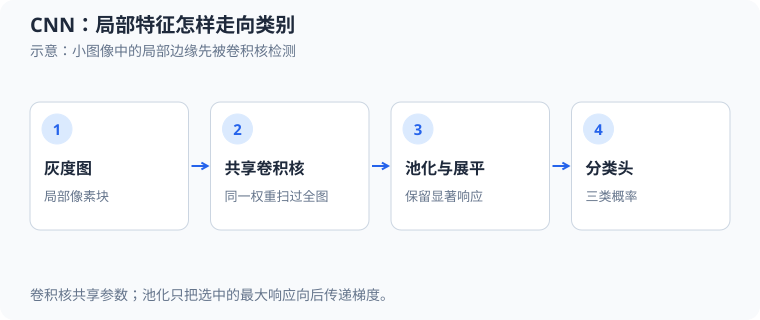
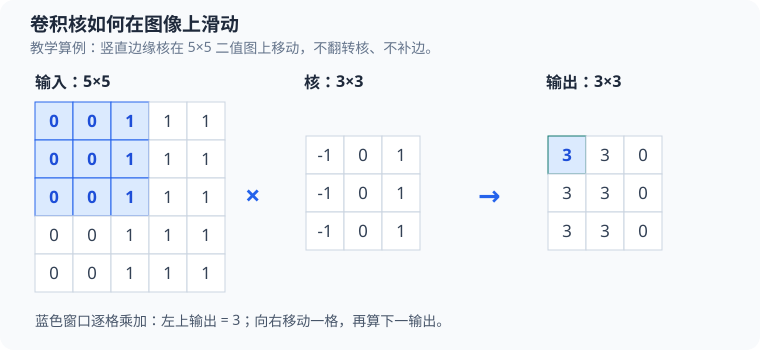
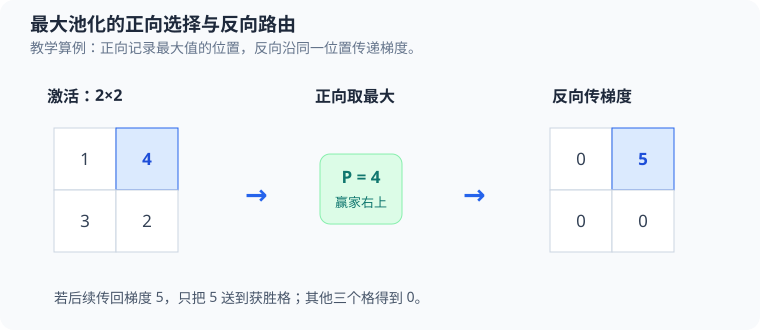

# 阶段 3：CNN 灰度图形分类源码分析

本教程以 [`src/ml/08_cnn_shapes.c`](../src/ml/08_cnn_shapes.c) 为主线，追踪一张合成灰度图如何经过卷积、ReLU、最大池化和全连接层，变成圆形、方形或三角形的分类结果，再沿同一条计算图反向求梯度并更新权重。实现固定输入形状，只用 C 和数学库；没有调用机器学习框架。



同一个卷积核在图像上滑动并共享参数；经过池化、展平和分类头得到三类概率。

## 从零认识输入、输出和几个关键词

一张灰度图可以先看成数字表：每个格子是一个像素，数值越大越亮。本例的输入是一张 $16\times16$ 的单通道图，像素在 $[0,1]$ 内。`Sample.image` 把这张表按行存入 $256$ 个 `double`；`Sample.target` 告诉训练器正确形状是圆形、方形还是三角形。模型最终输出三个概率，例如 $(0.7,0.2,0.1)$ 表示它当前更倾向于圆形；这不是给图像的每个像素分类。

普通全连接层让每个输出直接读取所有输入。CNN 则先用一个**小窗口**读取图像的局部区域：一个卷积核负责规定窗口内每个像素的权重，窗口每移动一步就计算一个新输出。整张输出数字表叫**特征图**；不同卷积核得到不同输出通道。这样，同一组权重可以在图像各处寻找类似的局部模式。

| 术语 | 在本例中对应什么 | 先记住的含义 |
| --- | --- | --- |
| 像素 | `Sample.image[row * SIDE + column]` | 输入图上的一个灰度数。 |
| 卷积核或滤波器 | `network->parameters` 中一组 $3\times3$ 权重 | 用同一组权重逐位置计算局部点积；由训练学得。 |
| 步长 | 卷积输出行列循环每次加 $1$ | 窗口每次沿输入移动一个像素。 |
| 填充 | 本例为 $0$ | 边缘外不补值，只计算完整落在图内的窗口。 |
| 通道 | `channel`，取 $0$ 到 $3$ | 四个核各生成一张特征图；输入只有一个灰度通道。 |
| 特征 | `Forward.pooled` 中的 $196$ 个数 | 池化后的局部响应，作为分类层输入。 |

**学习**指调整卷积核、分类权重和偏置，使正确类别的损失下降。代码没有预设“圆形核”或“方形核”；核从伪随机数初始化，训练中的交叉熵和反向传播决定它们如何变化。下面先看源码地图和数据，再手算一遍小图上的滑动窗口，最后回到真实训练样本。

## 运行方式与本次验证

```sh
make build/ml/08_cnn_shapes     # 首次运行前编译
./build/ml/08_cnn_shapes       # 训练、显示指标；不写图片或日志
make test-cnn-shapes           # 运行行为断言和完整训练；不导出图片
make sanitize-cnn-shapes       # 使用 ASan/UBSan 运行同一组验证
make cnn-shapes                # 显式导出三张 BMP
```

`make cnn-shapes` 会在 `exports/` 独占创建样本拼图、初始特征图和最佳模型特征图。普通运行和测试不生成持久图片或日志。VS Code 选择 `C: ml/08_cnn_shapes.c` 后按 F5 会传入 `--export`。

本次 `make test-cnn-shapes` 和 `make sanitize-cnn-shapes` 均通过。普通运行中，训练交叉熵从 $1.2126$ 降至 $0.0034$；验证准确率达到 $98.9\%$。若测试样本总数为 $N$、其中正确数为 $C$，准确率是 $C/N$；本次独立测试为 $90/90=100.0\%$，交叉熵为 $0.0077$。我另外在临时目录运行了 `--export`，确认生成三张 $320\times240$ BMP 后清理了临时目录。固定合成数据上的结果只验证这个教学任务，不能代表真实图像泛化能力。

## 源码地图

| 概念 | 源码位置 | 主要状态或变量 |
| --- | --- | --- |
| 固定尺寸、参数区段与结构体 | [`宏、枚举和类型`](../src/ml/08_cnn_shapes.c#L15-L84) | `PARAMETERS`、`Forward`、`Adam`、混淆矩阵 |
| 随机数和合成图像 | [`random_unit`、`dataset_generate`](../src/ml/08_cnn_shapes.c#L93-L138) | `seed`、`Sample.image`、`target` |
| 卷积、softmax、损失 | [`convolution_at` 到 `cross_entropy`](../src/ml/08_cnn_shapes.c#L148-L199) | 局部点积、概率、log-sum-exp |
| 权重初始化和前向传播 | [`network_initialize`、`network_forward`](../src/ml/08_cnn_shapes.c#L206-L266) | 卷积核、`preactivation`、`winners`、`logits` |
| 反向传播与 Adam | [`network_backward`、`network_update`](../src/ml/08_cnn_shapes.c#L279-L348) | 参数梯度、输入梯度、一阶与二阶矩 |
| 推理与评估 | [`predict`、`evaluate`](../src/ml/08_cnn_shapes.c#L350-L389) | 最大概率类别、平均损失、混淆矩阵 |
| 数值和规则测试 | [`same_region`、`test_gradients`、`test_rules`](../src/ml/08_cnn_shapes.c#L390-L518) | 有限差分、边界、池化平局和极端 logits |
| 图片导出 | [`draw_tile`、`export_images`](../src/ml/08_cnn_shapes.c#L519-L603) | 小图放大、特征归一化、BMP 写入 |
| 训练与入口 | [`train`、`main`](../src/ml/08_cnn_shapes.c#L604-L723) | 洗牌、小批量、验证选模、测试集评估 |

执行路线是：生成三个独立数据集 → 初始化参数 → 检查数值梯度和规则边界 → 用训练集小批量更新 → 用验证集保存损失最低的参数 → 最后评估测试集。图片导出只读取模型和样本，不参与训练。

## 一、输入是什么：三类合成灰度图

一张图像有 $16\times16=256$ 个像素，保存在 `Sample.image[PIXELS]`；每个像素是 `double`，范围被裁切到 $[0,1]$。标签 `target` 是 $0$、$1$ 或 $2$，依次代表圆形、方形、三角形。数据集按 `i % CLASSES` 分配标签，所以每个类别数量相同。

对像素列 $s$、行 $r$，代码先计算相对图形中心的偏移
$$
d_x=s-c_x,\qquad d_y=r-c_y.
\tag{1}
$$
这里 $c_x,c_y$ 是随机中心，坐标单位是像素，$r,s$ 从 $0$ 开始。半径参数 $\rho$ 同时用作圆半径、正方形半边长和三角形高度尺度。类别内部条件分别是
$$
\begin{aligned}
\text{圆形：}&\quad d_x^2+d_y^2\le \rho^2,\\
\text{方形：}&\quad |d_x|\le \rho\ \land\ |d_y|\le \rho,\\
\text{三角形：}&\quad -\rho\le d_y\le \rho\ \land\
|d_x|\le \frac{d_y+\rho}{2}.
\end{aligned}
\tag{2}
$$
三角形在 $d_y=-\rho$ 处收尖，在 $d_y=\rho$ 处形成底边；图像行号向下增加，因此尖端位于图像上方。源码将中心坐标采样于 $[6.5,8.5)$，将尺度采样于 $[3,4.5)$，将前景亮度采样于 $[0.8,1)$；每类共用这些范围和噪声规则，避免仅用位置或亮度就能判断标签。

背景像素先取 $0$，前景像素取亮度 $I_{\mathrm{fg}}$；随后每个像素都加噪并裁切：
$$
x_{r,s}=\min\!\left(1,\max\!\left(0,\ v_{r,s}+0.08(U-0.5)\right)\right),
\tag{3}
$$
其中 $v_{r,s}$ 是前景亮度 $I_{\mathrm{fg}}$ 或背景零值，$U\in[0,1)$ 是本像素的伪随机数，所以噪声范围为 $[-0.04,0.04)$。`image[row * SIDE + column]` 是行优先一维数组中的像素位置。

训练、验证和测试分别包含 $180$、$90$、$90$ 张图，使用种子 $2025$、$2026$、$2027$。每个数据集有 $3$ 的整数倍样本数，生成器断言 `count` 在 $[3,180]$ 内且是 $3$ 的倍数。三个集合的随机状态分开；测试集不计算梯度，也不参与模型选择，见 [`dataset_generate`](../src/ml/08_cnn_shapes.c#L105) 与 [`main`](../src/ml/08_cnn_shapes.c#L683)。

### 真实训练样本的像素例子

随机数更新为
$$
R_{\ell+1}=(1664525R_\ell+1013904223)\bmod 2^{32},\qquad
U_\ell=\frac{\lfloor R_{\ell+1}/2^8\rfloor}{2^{24}}\in[0,1).
\tag{4}
$$
$R_\ell$ 是第 $\ell$ 次更新前的 `uint32_t` 状态，$\ell$ 从 $0$ 开始计随机数调用；无符号溢出按模 $2^{32}$ 回绕。生成一个样本时，代码先取中心横纵坐标、尺度和亮度，再为 $256$ 个像素各取一次噪声随机数。

用训练数据种子 $2025$ 生成的数组下标 $45$ 是圆形样本。由于每个更早的样本消耗 $4+256=260$ 次随机数，它的图形参数为
$$
(c_x,c_y)\approx(7.325208,7.656242),\quad
\rho\approx3.542011,\quad I_{\mathrm{fg}}\approx0.873462.
\tag{5}
$$
看它的像素 $(r,s)=(1,2)$：
$$
d_x=2-7.325208\approx-5.325208,\qquad
d_y=1-7.656242\approx-6.656242,
\tag{6}
$$
$$
d_x^2+d_y^2\approx72.663397
> \rho^2\approx12.545845.
\tag{7}
$$
它在圆形外，所以 $v_{1,2}=0$。该像素噪声随机数为 $U\approx0.957193$，于是
$$
x_{1,2}=0+0.08(0.957193-0.5)\approx0.036575.
\tag{8}
$$
这个小数不是前景，而是背景噪声；前面的图形条件和裁切顺序决定了它如何进入网络。

## 二、网络形状和 $631$ 个参数

宏定义给出 `SIDE=16`、`KERNEL=3`、`CHANNELS=4`、`CLASSES=3`。卷积步长为 $1$，不填充边缘，输出边长因此是 $16-3+1=14$；$2\times2$ 最大池化的步长也是 $2$。

| 阶段 | 数学形状 | 对应缓存 |
| --- | --- | --- |
| 灰度输入 | $1\times16\times16$ | `Sample.image` |
| 卷积加偏置 | $4\times14\times14$ | `Forward.preactivation` |
| ReLU | $4\times14\times14$ | `Forward.activation` |
| 最大池化 | $4\times7\times7$ | `Forward.pooled` |
| 展平 | $196$ | `Forward.pooled` 的连续元素 |
| 三类全连接分数 | $3$ | `Forward.logits` |
| softmax 概率 | $3$ | `Forward.probabilities` |

`Forward` 还存放 $196$ 个池化窗口各自的卷积图获胜下标 `winners`。卷积图按通道优先排布，索引为 `channel * 196 + row * 14 + column`；池化向量索引为 `channel * 49 + pool_row * 7 + pool_column`。展平只把这个既有一维顺序交给全连接层，不会再次复制数据。

参数数组各区段如下。类别下标 $c$、通道下标 $q$、卷积核行列 $a,b$、池化特征下标 $i$ 均从 $0$ 开始：

| 参数块 | 数量 | 起始下标 | 单个元素下标 |
| --- | ---: | ---: | --- |
| 卷积核 $K$ | $4\times3\times3=36$ | $0$ | $9q+3a+b$ |
| 卷积偏置 $b^{\mathrm{conv}}$ | $4$ | $36$ | $36+q$ |
| 全连接权重 $V$ | $3\times196=588$ | $40$ | $40+196c+i$ |
| 分类偏置 $b^{\mathrm{fc}}$ | $3$ | $628$ | $628+c$ |
| 总计 | $36+4+588+3=631$ | $0$ | 最后一个下标为 $630$ |

因此 `CONV_B=36`、`FC_W=40`、`FC_B=628`、`PARAMETERS=631`。单通道输入意味着每个输出通道各有一个 $3\times3$ 核；它不是常见 RGB 多输入通道卷积的完整张量形式，具体偏移定义见 [`参数枚举`](../src/ml/08_cnn_shapes.c#L35)。

## 三、初始化：共享核从哪里来

初始化先将网络的 $631$ 个参数全部清零，再只填充卷积权重和全连接权重，所以所有偏置保持为 $0$。给定 $U\in[0,1)$ 和尺度 $\alpha$，权重通过 $(2U-1)\alpha$ 映射到 $[-\alpha,\alpha)$。卷积核使用 $\alpha=\sqrt{6/9}$，全连接权重使用 $\alpha=\sqrt{3/196}$：
$$
\operatorname{Var}(K_{q,a,b})\approx\frac{(\sqrt{6/9})^2}{3}=\frac{2}{9},
\qquad
\operatorname{Var}(V_{c,i})\approx\frac{(\sqrt{3/196})^2}{3}=\frac{1}{196}.
\tag{9}
$$
这里的方差来自连续均匀分布的理论尺度，是解释初始化意图的近似；实际代码使用固定种子的有限伪随机序列。卷积尺度考虑每个卷积位置的 $9$ 个输入；分类层尺度随 $196$ 个特征缩小，避免初始 logits 过大。代码先清零参数，再按两个尺度填充权重，见 [`network_initialize`](../src/ml/08_cnn_shapes.c#L206)。

种子 $42$ 下，通道 $0$ 的实际初始化核约为
$$
K_0\approx
\begin{bmatrix}
-0.404419 & -0.672589 & 0.126200\\
-0.453067 & -0.203046 & -0.774588\\
-0.086089 & -0.623052 & 0.610435
\end{bmatrix}.
\tag{10}
$$
这不是预先写好的边缘核；训练会根据分类损失调整这些参数。用于导出图像的固定左右边缘核是单独的展示数据，不参与模型。

## 四、前向传播：从局部像素块到分类概率

### 先用一张小图手算卷积

先暂时离开源码的 $16\times16$ 图，使用下面的**教学小图**看清计算方式。左边输入有 $5$ 行 $5$ 列，右边的 $3\times3$ 核在每行都放了 $(-1,0,1)$：它让窗口右边的亮像素加分、左边的亮像素减分。输入中从暗到亮的竖直边缘因此会得到较大的响应。这个核是人为设置来手算的，**不是**程序训练得到的权重。



把教学输入、核和结果分别记为 $X^{\mathrm{toy}}$、$W^{\mathrm{toy}}$、$Y^{\mathrm{toy}}$。行、列从 $0$ 开始，图中左上蓝色窗口和输出格的关系是：

$$
X^{\mathrm{toy}}=
\begin{bmatrix}
0&0&1&1&1\\
0&0&1&1&1\\
0&0&1&1&1\\
0&0&1&1&1\\
0&0&1&1&1
\end{bmatrix},\qquad
W^{\mathrm{toy}}=
\begin{bmatrix}
-1&0&1\\
-1&0&1\\
-1&0&1
\end{bmatrix}.
\tag{11}
$$

核不翻转，窗口内对应格逐个相乘、再把 $9$ 个乘积相加。若窗口左上角位于输入的第 $r$ 行、第 $s$ 列，输出为：

$$
Y^{\mathrm{toy}}_{r,s}
=\sum_{a=0}^{2}\sum_{b=0}^{2}
W^{\mathrm{toy}}_{a,b}X^{\mathrm{toy}}_{r+a,s+b},
\qquad 0\le r,s<3.
\tag{12}
$$

其中 $a,b$ 分别是核内的行、列偏移；$r+a,s+b$ 是窗口覆盖的输入坐标。例如左上角 $r=s=0$ 时，三行像素都是 $(0,0,1)$，所以：

$$
Y^{\mathrm{toy}}_{0,0}
=3\bigl[0(-1)+0(0)+1(1)\bigr]=3.
\tag{13}
$$

窗口向右移动一格，三行变成 $(0,1,1)$，各行仍贡献 $1$，所以 $Y^{\mathrm{toy}}_{0,1}=3$；再向右移动一格，三行是 $(1,1,1)$，各行贡献 $-1+0+1=0$，所以 $Y^{\mathrm{toy}}_{0,2}=0$。因为五行相同，继续向下滑动得到相同的三行输出：

$$
Y^{\mathrm{toy}}=
\begin{bmatrix}
3&3&0\\
3&3&0\\
3&3&0
\end{bmatrix}.
\tag{14}
$$

这就是“卷积核在图像上滑动”的具体含义：**每个输出格只由一个局部窗口计算，但所有位置使用同一组核权重**。数学上的离散卷积通常要翻转核；本例与常见 CNN 实现一样不翻转，严格名称是*互相关*。这不影响我们学习权重共享和局部特征，只需在复现手算时保持方向一致。

输出为何从 $5\times5$ 变成 $3\times3$？设一边输入长度为 $N$、核边长为 $K$、每侧填充像素数为 $P$、步长为 $S$，且窗口必须完整落在填充后的范围内，则一边的输出格数为：

$$
N_{\mathrm{out}}=\left\lfloor\frac{N+2P-K}{S}\right\rfloor+1.
\tag{15}
$$

公式从窗口起点计数得到：第一个起点是 $0$，最后一个起点至多为 $N+2P-K$，每次前进 $S$，所以共有上式个位置。小图中 $N=5$、$K=3$、$P=0$、$S=1$，代入得 $N_{\mathrm{out}}=\lfloor(5-3)/1\rfloor+1=3$。源码中 `SIDE=16`、`KERNEL=3`，同样不填充、步长为 $1$，所以 `CONV_SIDE` 对应 $N_{\mathrm{out}}=16-3+1=14$。本式要求输入至少能容纳一个核；源码的固定尺寸满足这一点。

现在对照 [`convolution_at`](../src/ml/08_cnn_shapes.c#L148) 中的核心循环：

```c
for (size_t ky = 0; ky < KERNEL; ++ky) {
    for (size_t kx = 0; kx < KERNEL; ++kx) {
        value += image[(row + ky) * SIDE + column + kx] * kernel[ky * KERNEL + kx];
    }
}
```

`row`、`column` 是窗口起点 $r,s$；`ky`、`kx` 是核内偏移 $a,b$；`image[(row + ky) * SIDE + column + kx]` 读取输入 $X_{r+a,s+b}$，`kernel[ky * KERNEL + kx]` 读取核权重 $K_{q,a,b}$。例如源码输入位置 $(r,s)=(1,0)$、核内位置 $(a,b)=(0,2)$ 读取 `image[1 * 16 + 2]`，也就是 `image[18]`，其核权重在 `kernel[2]`。这恰是后文真实样本计算中 $0.036575\times0.126200$ 的一项。函数本身只求点积；调用方再加通道偏置并应用 ReLU。

### 卷积、偏置和 ReLU

令 $X_{r,s}$ 为输入像素，$K_{q,a,b}$ 为第 $q$ 个卷积核的元素，$b_q^{\mathrm{conv}}$ 为该通道偏置。输出位置满足 $0\le r,s<14$，核位置满足 $0\le a,b<3$：
$$
Z_{q,r,s}=b_q^{\mathrm{conv}}+
\sum_{a=0}^{2}\sum_{b=0}^{2}K_{q,a,b}X_{r+a,s+b},
\qquad
A_{q,r,s}=\max(0,Z_{q,r,s}).
\tag{16}
$$
$Z$ 是 `preactivation`，$A$ 是 `activation`。同一个 $K_q$ 在 $14\times14$ 个位置重复使用，这就是权重共享；每个输出只看当前 $3\times3$ 区域，这就是局部连接。代码没有翻转核，所以严格说计算的是互相关，虽然深度学习代码通常仍称它为卷积。

一个通道在 $14\times14=196$ 个位置都计算输出，却只用 $3\times3=9$ 个核权重和 $1$ 个偏置。四个通道一共得到 $4\times196=784$ 个卷积响应，卷积层本身只有 $4\times(9+1)=40$ 个可训练参数。每个通道可以学习不同局部响应；它们仍读取同一张灰度输入图。ReLU 在加偏置**之后**生效，例如 $Z=3$ 得到 $A=3$，$Z=-2$ 得到 $A=0$。核与偏置从训练损失中学习，前面的边缘核小图只是固定的教学算例。

```c
f->preactivation[index] = convolution_at(image, kernel, row, column) +
                          network->parameters[CONV_B + channel];
f->activation[index] = fmax(0, f->preactivation[index]);
```

`convolution_at` 的内层循环将九个像素与九个权重相乘并累加；偏置在点积之后加上，ReLU 再把负值归零。对图像边缘不补零，因此输出的 $14\times14$ 覆盖范围完全落在输入图像内部，见 [`convolution_at`](../src/ml/08_cnn_shapes.c#L148) 与 [`network_forward`](../src/ml/08_cnn_shapes.c#L226)。

### 最大池化和离散路由

令 $u,v\in\{0,\ldots,6\}$ 是池化行列，$d_r,d_c\in\{0,1\}$ 是一个池化窗口内部的偏移：
$$
P_{q,u,v}=
\max_{d_r,d_c\in\{0,1\}}
A_{q,2u+d_r,\,2v+d_c}.
\tag{17}
$$



图中是另一组**教学数字**：一个 $2\times2$ 窗口为 $\bigl[\begin{smallmatrix}1&4\\3&2\end{smallmatrix}\bigr]$，前向得到 $P=\max(1,4,3,2)=4$，并记住右上格获胜。若后续损失 $L$ 传回的梯度为 $\partial L/\partial P=5$，池化层把它还给右上格：

$$
\frac{\partial L}{\partial A_{\mathrm{window}}}
=\begin{bmatrix}0&5\\0&0\end{bmatrix}.
\tag{18}
$$

这里 $A_{\mathrm{window}}$ 表示这四个激活值组成的窗口；三个未获胜位置的梯度为 $0$。回到源码，`winner` 保存激活数组中的**绝对下标**，`f->winners[feature]` 留给 [`network_backward`](../src/ml/08_cnn_shapes.c#L279) 使用。若赢家对应的 `preactivation` 非正，代码还会用 ReLU 的零导数截断这条路径。

有并列最大值时，源码只在候选值**严格大于**当前赢家时更新下标，因此保留按行优先顺序遇到的第一个位置。这让同一输入的池化结果和反向路由保持确定。

固定种子的第一个训练批次以样本 $45$ 开始。对它的通道 $q=0$、池化位置 $(u,v)=(0,0)$，四个候选值是：

| 卷积图位置 $(r,s)$ | 激活前分数 $Z$ | ReLU 后 $A$ |
| --- | ---: | ---: |
| $(0,0)$ | $-0.037598629$ | $0$ |
| $(0,1)$ | $-0.022189033$ | $0$ |
| $(1,0)$ | $0.015504780$ | $0.015504780$ |
| $(1,1)$ | $-0.024311236$ | $0$ |

因此 `winners[0]` 是通道 $0$ 的绝对下标 $14=0\times196+1\times14+0$，池化输出 $P_{0,0,0}=0.015504780483$。赢家对应输入图像的行 $1$、列 $0$ 左上角的 $3\times3$ 图像块。用该块和实际初始化卷积核逐项相乘：
$$
X_{\mathrm{patch}}=
\begin{bmatrix}
0 & 0 & 0.036575\\
0.026583 & 0 & 0\\
0 & 0 & 0.037568
\end{bmatrix},
\qquad
Z_{0,1,0}=0+\sum_{a=0}^{2}\sum_{b=0}^{2}K_{0,a,b}X_{1+a,b}
=0.036575(0.126200)+0.026583(-0.453067)+0.037568(0.610435)
\approx0.015504780.
\tag{19}
$$
这些项就是该位置的九项互相关点积中非零的三项。由于结果加上零偏置后仍为正，ReLU 保留它；池化窗口另外三个位置都是 $0$，所以该位置获胜。

### 展平、logits、softmax 与损失

将 $196$ 个池化特征记作 $P_i$，其中 $i\in\{0,\ldots,195\}$。分类权重是 $V_{c,i}$，分类偏置是 $b_c^{\mathrm{fc}}$，类别 $c\in\{0,1,2\}$ 的 logit 为
$$
z_c=b_c^{\mathrm{fc}}+\sum_{i=0}^{195}V_{c,i}P_i.
\tag{20}
$$
logit 是尚未归一化的类别分数。设 $z_{\max}=\max_c z_c$，softmax 先减去 $z_{\max}$ 再取指数：
$$
p_c=\frac{\exp(z_c-z_{\max})}{\sum_{k=0}^{2}\exp(z_k-z_{\max})}.
\tag{21}
$$
$k$ 是类别求和下标，$p_c$ 是类别 $c$ 的预测概率；减去相同常数不改变概率，但能避免直接计算大正指数。预测取最大概率；代码只在严格更大时替换，所以平局选最小类别下标。

样本 $45$ 的完整 $196$ 维池化向量经全连接层后，实际 logits 为
$$
(z_0,z_1,z_2)\approx(0.663765355,-0.168653833,-0.194177997).
\tag{22}
$$
最大值 $z_{\max}=z_0$，指数项约为
$$
\left(
e^{z_0-z_{\max}},e^{z_1-z_{\max}},e^{z_2-z_{\max}}
\right)
\approx(1,0.434995676,0.424033273),
\qquad
\text{分母}\approx1.859028949.
\tag{23}
$$
因此
$$
(p_0,p_1,p_2)\approx(0.537915238,0.233990803,0.228093959).
\tag{24}
$$
目标类别是 $y=0$，预测类别也是 $0$。

源码直接用 logits 计算三分类交叉熵，不先对可能舍入成 $0$ 的概率取对数。令 $z_y$ 为正确类别的 logit，损失为
$$
L(z,y)=z_{\max}-z_y+\ln\!\left(\sum_{c=0}^{2}e^{z_c-z_{\max}}\right).
\tag{25}
$$
对样本 $45$，$z_{\max}=z_y$，所以
$$
L=0+\ln(1.859028949)\approx0.620054281.
\tag{26}
$$
`softmax` 与 `cross_entropy` 都减去最大 logit；极端分数测试也验证了这种写法的数值行为。

## 五、反向传播：梯度如何经过全连接、池化和共享卷积核

### softmax 与交叉熵的合并梯度

令 $y$ 为正确类别，$\mathbf1[c=y]$ 在条件成立时为 $1$，否则为 $0$。softmax 与交叉熵合并后，logit 梯度简化为
$$
\delta_c=\frac{\partial L}{\partial z_c}=p_c-\mathbf1[c=y].
\tag{27}
$$
它省去了显式构造 softmax 雅可比矩阵。样本 $45$ 的三项为
$$
(\delta_0,\delta_1,\delta_2)
\approx(-0.462084762,0.233990803,0.228093959).
\tag{28}
$$
正确类的误差为 $p_0-1$，其他类的误差就是各自概率。

全连接权重梯度、偏置梯度以及传回特征 $i$ 的梯度为
$$
\frac{\partial L}{\partial V_{c,i}}=\delta_cP_i,\qquad
\frac{\partial L}{\partial b_c^{\mathrm{fc}}}=\delta_c,\qquad
g_i=\frac{\partial L}{\partial P_i}
=\sum_{c=0}^{2}\delta_cV_{c,i}.
\tag{29}
$$
这里 $g_i$ 要累加三个分类路径；代码中的 `pooled_gradient[feature] += ...` 正在做这个求和。对刚才的特征 $P_0=0.015504780483$，三个类别的回传路径是：

| 类别 $c$ | $\delta_c$ | $V_{c,0}$ | 路径贡献 $\delta_cV_{c,0}$ |
| ---: | ---: | ---: | ---: |
| $0$ | $-0.462084762$ | $0.021194567$ | $-0.009793686$ |
| $1$ | $0.233990803$ | $0.017706028$ | $0.004143048$ |
| $2$ | $0.228093959$ | $-0.010684675$ | $-0.002437110$ |
| 合计 |  |  | $g_0\approx-0.008087748$ |

所以全连接偏置梯度 $\partial L/\partial b_0^{\mathrm{fc}}\approx-0.462084762$；对应权重梯度为
$$
\frac{\partial L}{\partial V_{0,0}}
=\delta_0P_0
\approx(-0.462084762)(0.015504780483)
\approx-0.007164523.
\tag{30}
$$

### 池化赢家、ReLU 与卷积梯度

对每个池化输出，先用 `winners[feature]` 找回卷积图位置。若获胜位置的激活前分数 $Z$ 小于或等于 $0$，ReLU 导数按代码约定取 $0$，该特征不向卷积层传梯度；若 $Z>0$，池化与 ReLU 的梯度全部路由给赢家。对样本 $45$ 的特征 $P_0$，赢家 $Z=0.015504780483>0$，因此 $g_0$ 会传回通道 $0$ 的卷积核。

令 $(r^*_{q,u,v},s^*_{q,u,v})$ 是池化窗口 $(q,u,v)$ 的赢家位置。若赢家激活为正，则卷积核梯度与卷积偏置梯度为
$$
\frac{\partial L}{\partial K_{q,a,b}}
=\sum_{\substack{u,v\\Z_{q,r^*,s^*}>0}}
g_{q,u,v}X_{r^*_{q,u,v}+a,\,s^*_{q,u,v}+b},
\qquad
\frac{\partial L}{\partial b_q^{\mathrm{conv}}}
=\sum_{\substack{u,v\\Z_{q,r^*,s^*}>0}}g_{q,u,v}.
\tag{31}
$$
这里池化展平特征下标满足 $i=49q+7u+v$，所以 $g_{q,u,v}$ 就是前面定义的 $g_i$。求和遍历同一通道内所有池化窗口的赢家。因为共享卷积核在许多位置复用，对同一个核权重的梯度必须**累加**这些位置的贡献；不能只保留最后一次点积的结果，代码对应 [`network_backward`](../src/ml/08_cnn_shapes.c#L279)。

例如，特征 $P_0$ 对通道 $0$ 核元素 $K_{0,0,2}$ 的单个位置贡献是
$$
g_0X_{1,2}
\approx(-0.008087748465)(0.036575441360)
\approx-0.000295813.
\tag{32}
$$
同一张样本还有其他池化窗口会使用同一个核元素。把通道 $0$ 所有正激活赢家的空间贡献累加后，源码得到
$$
\frac{\partial L}{\partial K_{0,0,2}}\approx0.055346491,
\qquad
\frac{\partial L}{\partial b_0^{\mathrm{conv}}}\approx-0.155221092.
\tag{33}
$$
这两个数是单个样本的梯度；后面的训练还会对一批样本再求平均。

输入图像梯度也要累加，因为不同卷积核、不同通道和重叠卷积区域可能都读取同一个像素：
$$
\frac{\partial L}{\partial X_{r^*+a,s^*+b}}
\mathrel{+}=g_{q,u,v}K_{q,a,b}.
\tag{34}
$$
`image_gradient` 保存这个完整的 $256$ 项梯度。训练更新只需要参数梯度，因此忽略它；数值梯度测试会逐像素检查它。对样本 $45$，像素 $(r,s)=(2,1)$ 的总输入梯度约为 $-0.079623404$，这里合计了所有通道和重叠卷积窗口的贡献，并非只来自特征 $P_0$。

## 六、小批量平均与第一次 Adam 更新

训练开始时用种子 $2028$ 初始化打乱随机状态；该状态跨轮次持续前进，每轮重新排列下标后执行 Fisher–Yates 洗牌。批次梯度平均完成后才更新网络，验证损失改善时复制一份最佳参数，见 [`train`](../src/ml/08_cnn_shapes.c#L604)。第一批的 $12$ 个样本及标签依次为
$$
(45,0),(158,2),(176,2),(146,2),(92,2),(153,0),
(109,1),(136,1),(119,2),(83,2),(120,0),(87,0).
\tag{35}
$$
这一批里三个类别分别有 $4$、$2$、$6$ 个样本。`order` 只改变访问次序，不搬动图像数据。

令 $g_{n,j}$ 为批次内样本 $n$ 对扁平参数下标 $j$ 的单样本梯度，批次大小 $B=12$，则训练使用
$$
\bar g_j=\frac{1}{B}\sum_{n=0}^{B-1}g_{n,j}.
\tag{36}
$$
批内所有前向和反向都读取同一版 `current` 参数；直到 $12$ 个梯度累计完成后，才调用一次 `network_update`。比如分类偏置 `FC_B+0` 的首批平均梯度为
$$
\bar g_{628}
=\frac{1}{12}\sum_{n=0}^{11}
\left(p_{n,0}-\mathbf1[y_n=0]\right)
\approx0.126389596.
\tag{37}
$$
这批中有 $4$ 个圆形样本；首批对圆形概率的总和约为 $5.516675156$，因此
$$
\bar g_{628}\approx\frac{5.516675156-4}{12}=0.126389596.
\tag{38}
$$

优化器是 Adam，矩按**批次更新**计步。令 $t$ 为批次更新序号，$\bar g_{t,j}$ 为当前批量梯度，$m_{t,j}$ 和 $v_{t,j}$ 分别是一阶、二阶矩，$\beta_1=0.9$、$\beta_2=0.999$、学习率 $\eta=0.003$、$\epsilon=10^{-8}$：
$$
m_{t,j}=\beta_1m_{t-1,j}+(1-\beta_1)\bar g_{t,j},
\qquad
v_{t,j}=\beta_2v_{t-1,j}+(1-\beta_2)\bar g_{t,j}^2,
\tag{39}
$$
$$
\widehat m_{t,j}=\frac{m_{t,j}}{1-\beta_1^t},
\qquad
\widehat v_{t,j}=\frac{v_{t,j}}{1-\beta_2^t},
\qquad
\theta_j\leftarrow\theta_j-\eta
\frac{\widehat m_{t,j}}{\sqrt{\widehat v_{t,j}}+\epsilon}.
\tag{40}
$$
$\theta_j$ 是扁平参数数组中下标为 $j$ 的参数。源码用 `beta1_power`、`beta2_power` 保存 $\beta_1^t$、$\beta_2^t$，并把 $\epsilon$ 放在平方根外。首批开始时矩为 $0$，所以对参数下标 $j=628$，第一次偏差校正后 $\widehat m_{1,628}=\bar g_{628}$、$\widehat v_{1,628}=\bar g_{628}^2$。该偏置初值为 $0$，更新结果为
$$
\theta_{628}
=0-0.003\frac{0.126389596}{0.126389596+10^{-8}}
\approx-0.002999999763.
\tag{41}
$$
这解释了为什么 Adam 第一步的位移大小接近学习率，而 SGD 的位移会直接乘以梯度大小。

训练集有 $180/12=15$ 个批次，每轮更新 $15$ 次；$80$ 轮共 $1200$ 次 Adam 更新。每轮结束后评估验证集；若验证交叉熵低于此前最低值，`best` 就复制当前网络参数。训练继续使用 `current`，不会回滚到 `best` 重新优化；最终只用验证集选出的 `best` 评估测试集。这里没有模型文件保存，最佳模型只存在本次运行的内存中。

`evaluate` 要求数据集非空；对含 $N$ 个样本的数据集，它返回平均交叉熵、正确数和混淆矩阵。令 $\hat y_n=\arg\max_c p_{n,c}$ 是样本 $n$ 的预测类别，指标为
$$
J_D=\frac{1}{N}\sum_{n=0}^{N-1}L(z_n,y_n),qquad
\mathrm{accuracy}=\frac{1}{N}\sum_{n=0}^{N-1}\mathbf1[\hat y_n=y_n].
\tag{42}
$$
混淆矩阵元素 $M_{a,b}$ 统计真实类别 $a$ 被预测为类别 $b$ 的样本数，所以代码按“行是真实标签、列是预测标签”写入。最终测试集 $N=90$、正确数为 $90$，故准确率 $90/90=100\%$；其平均交叉熵为 $0.0077$。这份指标来自选定的验证最佳参数，测试集只评估一次，见 [`evaluate`](../src/ml/08_cnn_shapes.c#L367) 与 [`main`](../src/ml/08_cnn_shapes.c#L702)。

## 七、数值梯度检查和规则边界

`test_gradients` 使用专门构造的夹具：输入像素按 $x_i=0.1+i/256$ 递增，卷积权重按 $K_j=0.02+0.005j$ 设置，其中 $j$ 是卷积权重区段的扁平下标 $0$ 到 $35$；卷积偏置为 $0.1$，目标类别为 $1$。输入最大值为 $0.1+255/256\approx1.096094$，略高于合成训练图像的像素上限；它只是用于导数验证的有限数值夹具，不是训练样本。这个递增输入与正卷积核使测试路径处于固定的 ReLU 分支和池化赢家区域，具体有限差分循环见 [`test_gradients`](../src/ml/08_cnn_shapes.c#L408)。

令 $\theta_j$ 为下标 $j$ 的网络参数，有限差分步长 $\Delta=10^{-5}$，$J$ 为该单样本交叉熵；参数下标 $j$ 从 $0$ 到 $630$，像素下标 $i$ 从 $0$ 到 $255$。中心差分用两个略微扰动的前向结果近似解析梯度：
$$
g_j^{\mathrm{num}}
=\frac{J(\theta+\Delta e_j)-J(\theta-\Delta e_j)}{2\Delta},
\tag{43}
$$
其中 $e_j$ 是只有第 $j$ 项为 $1$ 的单位向量。对参数下标 $j=40$（类别 $0$、池化特征 $0$ 的全连接权重），程序实际得到
$$
J(\theta+10^{-5}e_{40})\approx0.965558513331,\qquad
J(\theta-10^{-5}e_{40})\approx0.965557100154,
\tag{44}
$$
$$
g_{40}^{\mathrm{num}}\approx0.070658841600,\qquad
g_{40}^{\mathrm{ana}}\approx0.070658841603.
\tag{45}
$$
两者差约为 $3\times10^{-12}$。测试允许的误差是
$$
|g_j^{\mathrm{num}}-g_j^{\mathrm{ana}}|
<10^{-8}+10^{-6}|g_j^{\mathrm{num}}|.
\tag{46}
$$
断言检查全部 $631$ 个参数和全部 $256$ 个输入像素。每次有限差分还比较正负扰动后的 ReLU 正负分支与 `winners`；若扰动跨过激活零点或改变池化赢家，就不把跨分段的差值误当作当前分支的导数验证。

其他规则断言覆盖：

- 输入像素按行优先填为 $1$ 到 $256$，全 $1$ 的 $3\times3$ 核在左上与右下输出分别为 $162$ 和 $2151$，验证 valid 边界索引。
- 输入全为 $1$、核仅中心权重为 $1$ 时，每个池化窗口四值相等；严格大于的替换规则使第一个窗口选绝对下标 $0$，相邻窗口选下标 $2$。
- 全零网络的 logits 相同，概率平局时 `predict` 选择类别 $0$；ReLU 在零点按导数 $0$ 处理。
- logits 为 $(1000,0,-1000)$ 时，稳定 softmax 得到概率 $(1,0,0)$（浮点舍入后），真实类别为 $2$ 的交叉熵仍为 $2000$，不会因先算 $\ln(0)$ 而变成无穷。
- `main` 断言最佳模型训练损失低于初始损失，测试准确率至少为 $80\%$ 且测试损失小于 $0.6$。验证通过只说明固定夹具、固定随机种子和本次实现满足这些条件；它不是对任意数据分布的保证。

运行断言时不要定义 `NDEBUG`，否则标准 `assert` 会被编译掉。`make test-cnn-shapes` 和 `make sanitize-cnn-shapes` 都保留断言。

## 八、如何阅读导出的特征图

`main` 只接受无额外参数、`--test` 或 `--export`；其他参数报用法并返回失败。`--test` 仍运行断言、训练和最终评估，只省略逐轮日志；`--export` 在训练前后各导出图片，写入失败会显示原因并返回失败。`export_images` 写三张 $320\times240$ BMP：九张训练样本拼图、训练前模型对一张验证图的特征图、最佳验证模型对同一验证图的特征图。文件写入复用 [`bmp_capture`](../src/graphics/bmp_capture.h)，通过 `exports/` 下独占创建保留旧图；程序没有日志文件。

特征图包括输入、固定左右边缘响应和四个学习通道的 ReLU 激活。每个特征小图单独按自身最小值和最大值归一化到灰度范围；输入则按原像素 $[0,1]$ 显示。这样能看清响应的位置，却不能据此比较不同小图的绝对激活强度。固定边缘核只是参照，学习通道也不保证分别对应“边缘”“圆形”或其他可命名概念。

## 九、实现边界与继续实验

这份代码适合学习计算图和反向传播，接口并非通用 CNN：固定数组和静态数据集避免动态分配，输入固定为单通道 $16\times16$，只使用 $4$ 个 $3\times3$ 核、步长 $1$、无填充和 $2\times2$ 最大池化；没有数据增强、批归一化、Dropout、多层卷积或动态张量。卷积在边界处丢弃不能完整容纳的窗口。卷积共享权重带来局部平移等变性，但有限边界、池化分块和全连接分类器不保证任意平移不变性。

可以按以下顺序继续观察和实验：

1. 在 `network_forward` 中断下，验证一个池化窗口扫描的四个候选值和行优先赢家。
2. 在 `network_backward` 中查看 `pooled_gradient` 如何汇总三个类别，再跟踪 `gradients[weight] += ...` 如何累计共享核贡献。
3. 将输入改为全部常数，观察池化平局；确认 `same_region` 为什么要比较赢家下标。
4. 改变图形中心范围、尺寸或噪声，并保留独立验证和测试种子，观察混淆矩阵如何变化。
5. 实现一个同数据集的展平 MLP，对比权重共享带来的参数数量、训练曲线和错误类别。

完成 CNN 的计算图走读后，可以继续看[阶段 $4$ 去噪自编码器](55_denoising_autoencoder.md)，比较分类目标和像素重建目标。
