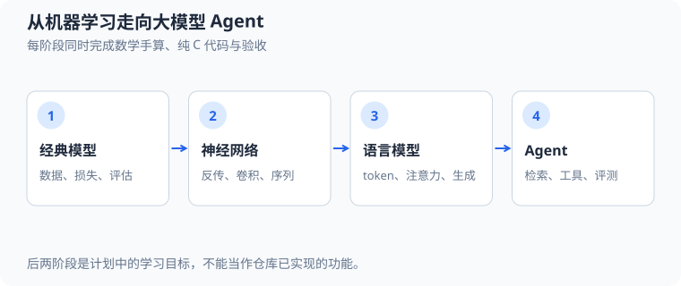

# 从零学习机器学习（machine learning）、深度学习（deep learning）、大语言模型（large language model，LLM）与智能体（agent）

这是一条**数学、C 核心实现与 Python 实验同步推进**的教学路线。目标是能手算小例子、解释源码中的关键步骤、运行可重复实验，最后实现一个可评估的小型检索与工具调用 Agent。阶段编号表示学习顺序，不表示模型性能等级；完成标准比学习时长更重要。建议每周投入 4～6 小时，每个阶段用 2～4 次学习完成；难点可以多花时间。

已有案例之后的补充专题框架见[机器学习、深度学习与大模型补充学习框架](71_机器学习深度学习大模型补充框架.md)；该文档目前只列章节与实践方向，详细推导和代码案例后续补充。

每阶段同时完成数学手算、算法实现与验收：先用 C 实现小型核心，再按需要用 Python 做数据准备、图表、快速对照或成熟工具验证；不要求每个案例都写两份。图中的语言模型和 Agent 是后续计划，不代表当前仓库已实现。

## 1. 先看仓库现状与缺口

| 范围 | 已有内容 | 还需补充 |
| --- | --- | --- |
| C、Python 与数学入门 | [C 基础](01_C语言基础.md)、[Python 项目约定](23_Python入门与项目约定.md)、[公式读法](31_数学公式与符号读法.md)、[数值基础](51_数值计算与梯度.md) | 将代数、概率、微积分的手算题与 C 核心实现及 Python 实验配对。 |
| 经典机器学习与可信评估 | `src/ml/01_*.c`～`04_*.c`、`15_*.c`～`28_*.c`；[机器学习总览](30_机器学习案例总览.md) | 模型与预处理参数的保存、加载及推理一致性。 |
| 深度学习 | `src/ml/05_*.c`～`14_*.c`、`21_regularization.c`、`22_resnet.c`；[原有计划](50_深度学习学习计划.md) | 面向语言模型的分词、数据管线、生成、训练与推理。 |
| 强化学习 | [Snake DQN](62_深度强化学习贪吃蛇.md) 已实现；策略梯度在原计划中 | 把状态、动作、奖励和 Agent 工具调用的状态机区别讲清。 |
| 大模型与 Agent | [小型 Transformer](58_小型Transformer.md) 已展示因果注意力 | 指令学习、参数高效适配、检索、工具调用、任务评测与安全边界。 |

这里的“大模型”指学习大语言模型的核心机制；仓库以 CPU 上可运行的小模型验证原理，**不把参数量、外部框架或真实产品 API 当成学习门槛**。小模型不会自然获得通用对话或可靠工具使用能力。Agent 可以先用确定性模拟模型学习控制流程，再接入训练过的小模型；两部分分别评估。

## 2. 每个阶段固定交付物

每阶段用同一节奏，做到“看公式—手算—找代码—运行—解释失败”。完成一阶段后再进入下一阶段。

1. **数学笔记**：从定义推到目标公式；用 LaTeX 书写每个符号及下标的含义、形状、取值范围和单位；至少完整手算一个含具体数字的例子。
2. **源码练习**：标出公式对应的 C 函数、数组索引和循环；需要 Python 时用它处理数据、绘图或建立对照实现。新增案例先用小数组及固定种子，遇到非有限数、维度错误和文件失败要有明确行为。
3. **验证**：手算值与程序比较；有梯度时做中心差分检查；区分训练、验证、最终测试数据，按数据来源去重和隔离。
4. **实验记录**：记录配置、随机种子、数据划分、基线、指标和一次失败案例。日志文件一律放 `logs/`，图片放 `exports/`；长训练不接入默认 `make test`。
5. **教学文档**：至少包含问题、公式推导、逐数计算、源码映射、运行命令、边界、练习题与参考答案。新案例按仓库约定接入 Makefile、短测试、README 和[阅读顺序](00_文档阅读顺序.md)。

下面“拟新增”是将来的实施目标，**目前没有对应源码或 Make 命令**；“已有”才可直接运行。每阶段的验收门槛是学习目标，不承诺某个随机种子取得特定精度。

## 3. 第一段：基础数学与经典机器学习

### 3.1 阶段 0｜C、数组、浮点数与数学语言（已有主教材）

- **数学**：标量、向量、矩阵与形状；函数和复合函数；导数、偏导数、链式法则；条件概率、对数、期望与方差。手算 $[1,2]\cdot[3,4]=11$、$\frac{d}{dw}(wx-y)^2=2(wx-y)x$，并解释各符号。
- **代码**：按 [C 基础](01_C语言基础.md) → [公式读法](31_数学公式与符号读法.md) → [数值基础](51_数值计算与梯度.md) 阅读，运行 `make numeric-foundations`。用 `double` 和小数组复现点积及中心差分。
- **过关**：能说清行优先矩阵下 `(row, col)` 的索引、浮点误差为何影响比较、链式法则为何与反向传播有关。

### 3.2 阶段 1｜线性模型、概率与优化（已有）

- **数学**：从 $\hat y=wx+b$ 推出均方误差梯度与梯度下降；从伯努利似然推到二分类交叉熵；手算 sigmoid、对数概率、学习率的作用。
- **代码**：阅读 [线性回归](32_线性回归分析.md)、[逻辑回归](33_逻辑回归分析.md)；运行 `make build/ml/01_linear_regression build/ml/02_logistic_regression` 编译，再分别执行 `./build/ml/01_linear_regression` 和 `./build/ml/02_logistic_regression`。对照同名源码中的预测、损失与更新。
- **过关**：用一条样本完整计算预测、损失、梯度及一次更新；指出训练集误差不等于泛化误差。

### 3.3 阶段 2｜其他学习方式与公平评估（已有；持久化待补）

- **数学**：欧氏距离、条件概率、信息量、方差、协方差、交叉验证的均值与标准差；手算一次 KNN 投票或决策树分裂，再手算混淆矩阵及精确率/召回率。
- **代码**：按 [机器学习总览](30_机器学习案例总览.md) 学习 KNN、K-means、朴素贝叶斯、树、随机森林、PCA、SVM；再读 [CSV 标准化](43_CSV标准化与独立测试评估.md) → [可靠性评估](44_类别不平衡与概率校准.md) → [公平比较](48_公平模型比较.md)。运行 `make model-comparison test-model-comparison`。
- **拟新增**：完成 `src/ml/23_csv_standardization.c` 的模型/标准化参数版本化保存与加载练习；加载后预测应与保存前逐项一致。
- **过关**：能指出数据泄漏的具体位置；能解释为何模型比较须共用划分、预算与指标。

## 4. 第二段：神经网络与序列模型

### 4.1 阶段 3｜反向传播和优化器（已有）

- **数学**：把计算图拆成局部导数；推出 $\partial L/\partial w$、$\partial L/\partial b$；理解小批量梯度、SGD、Adam 和 L2 正则化。手算两层网络的一条反向路径。
- **代码**：`make xor-mlp mlp-2d regularization`；阅读 [XOR 网络](52_XOR多层感知机.md)、[二维 MLP](53_二维多层感知机.md)、[正则化](42_神经网络正则化.md)。对每类参数做中心差分检查。
- **过关**：解释为什么输出误差要沿权重传回隐藏层，以及为什么测试集不能用于选训练轮次。

### 4.2 阶段 4｜卷积、表示学习与生成（已有；原计划有后续选做）

- **数学**：二维卷积输出尺寸、卷积核的共享梯度；重建损失、VAE 的 KL 项、GAN 的交替目标。每次只手算 $2\times2$ 或更小的局部例子。
- **代码**：依次运行 `make cnn-shapes autoencoder vae gan resnet`，阅读 [CNN](54_CNN图像分类.md)、[自编码器](55_去噪自编码器.md)、[VAE](59_变分自编码器.md)、[GAN](60_生成对抗网络.md)、[ResNet](61_残差网络.md)。
- **过关**：分清判别式与生成式目标、重建与采样；说明卷积的权重共享和残差连接的梯度路径。原计划的 U-Net、GCN、对比学习和扩散模型作为选修，进入语言主线无需先完成。

### 4.3 阶段 5｜序列、状态与注意力（已有）

- **数学**：RNN 的时间展开和共享参数梯度；GRU 门控；$QK^{\mathsf T}/\sqrt{d_k}$、因果掩码、softmax、残差与 LayerNorm。对两个 token 手算一次注意力。
- **代码**：`make char-rnn gru-memory tiny-transformer`；阅读 [RNN](56_字符循环神经网络.md) → [GRU](57_GRU门控网络.md) → [Transformer](58_小型Transformer.md)。观察 `src/ml/12_tiny_transformer.c` 的注意力矩阵和下一字符预测。
- **过关**：修改未来 token 后，较早位置的预测保持不变；能标注 $Q,K,V$ 的形状和掩码发生的位置。

### 4.4 阶段 6｜强化学习的两条线（DQN 已有，策略梯度待做）

- **数学**：从有限状态马尔可夫决策过程到 $G_t=\sum_{k=0}^{T-t}\gamma^k r_{t+k}$；区分 $Q(s,a)$、策略 $\pi(a\mid s)$ 与价值 $V(s)$。用两步轨迹算折扣回报。
- **代码**：阅读 [Snake DQN](62_深度强化学习贪吃蛇.md)，运行 `make test-snake-ai`。原计划 [阶段 14](50_深度学习学习计划.md) 的 REINFORCE、Actor-Critic 留作进阶实现。
- **过关**：能解释经验回放、目标网络、探索，以及为什么后面的工具型 Agent 不等于已经使用强化学习训练。

## 5. 第三段：从小型 Transformer 到语言模型

### 5.1 阶段 7｜文本、token 与数据管线（拟新增，优先）

- **数学**：字符/字节/子词 token 的差异；统计词频和相邻对频次；用 $H=-\sum_i p_i\log_2 p_i$ 理解信息量，不把压缩率直接当模型质量。
- **代码目标**：拟新增 `src/ml/29_tokenizer.c`：从 UTF-8 字节读取短语料，先实现字节级词表，再实现简化 BPE 合并；保存词表并验证编码—解码往返。训练/验证/测试按**原文档或完整序列**拆分，再生成上下文窗口，禁止重叠窗口跨集合。中文字符的 UTF-8 多字节行为需写明。
- **过关**：手算一轮最频繁相邻对合并；相同输入和词表可重现 token 序列；空语料、非法字节策略、词表容量上限都有测试。

### 5.2 阶段 8｜自回归预训练与生成（拟新增，主线核心）

- **数学**：概率链式分解 $p(x_1,\ldots,x_T)=\prod_{t=1}^{T}p(x_t\mid x_{<t})$；从最大似然推出平均负对数似然 $L=-\frac1N\sum_t\log p(x_t\mid x_{<t})$；困惑度 $\mathrm{PPL}=e^L$。推导温度采样、top-$k$ 与 top-$p$ 的归一化概率。
- **代码目标**：拟新增 `src/ml/30_tiny_language_model.c`：复用已有小型 Transformer 的可验证数学核心，明确 token 嵌入、参数布局、因果掩码、训练循环和自回归生成。先字节级小语料，再接阶段 7 的词表；记录训练/验证损失及固定提示的生成样例。长训练单独命令运行。
- **过关**：与 unigram、bigram 基线在同一留出集比较 NLL；小语料可过拟合用于调试，独立文本才用于报告泛化；固定种子采样可复现，概率总和约为 1。

### 5.3 阶段 9｜推理系统与上下文限制（拟新增）

- **数学**：注意力矩阵的存储随上下文长度 $T$ 约为 $O(T^2)$；KV 缓存以额外内存避免对旧 token 的重复投影与注意力输入重算。手算两步生成时缓存新增的 K/V 形状，比较全量重算与增量推理的结果。
- **代码目标**：拟新增 `src/ml/31_lm_inference.c`：实现贪心、温度、top-$k$、top-$p$，再实现单层 KV 缓存；加输入长度检查、停止 token 和最大生成步数。
- **过关**：贪心模式缓存与全量重算逐步 logits 一致（浮点容差内）；采样在固定种子下可复现；对越界上下文有明确截断或报错策略。

### 5.4 阶段 10｜指令学习与偏好优化（拟新增，进阶）

- **数学**：监督微调 SFT 只对目标回复 token 计算交叉熵；LoRA 将权重增量写成 $\Delta W=BA$；偏好对 $(y^+,y^-)$ 用 Bradley–Terry 概率理解“更喜欢”的监督信号，再阅读 DPO 损失。先手算两条短回复的 token 对数概率差。
- **代码目标**：拟新增 `src/ml/32_instruction_tuning.c`：固定小型预训练模型，演示“提示部分不计损失、答案部分计损失”的 SFT；先全参数训练，再在小矩阵上验证 LoRA 前向与梯度。DPO 可先实现**损失及梯度的教学测试**，不要求小模型获得可靠对话能力。完整 RLHF/PPO 放在选修。
- **过关**：更改提示 token 的损失掩码不会让它们直接贡献目标损失；LoRA 冻结的底座权重不变；偏好优化的符号和参考模型固定状态可用极小数值例子验证。

## 6. 第四段：检索、工具调用与 Agent

### 6.1 阶段 11｜检索增强生成 RAG（拟新增）

- **数学**：向量余弦相似度 $s(q,d)=\frac{q\cdot d}{\lVert q\rVert_2\lVert d\rVert_2}$；理解 top-$k$ 召回率与“检索正确”和“回答正确”两层评估。先用手写二维向量算排序，再比较词频/TF-IDF 与可选的学习式嵌入。
- **代码目标**：拟新增 `src/ml/33_local_retrieval.c`：读取仓库内的少量**允许使用的本地文档**，分块、建索引、检索、返回出处和片段；先用词频/TF-IDF 保证 C 实现可读，不要求外部向量库。将检索结果放入阶段 8 的提示中，独立报告检索命中率、答案正确率和出处正确率。
- **过关**：未知问题允许回答“证据不足”；更换测试问题不重新拟合其答案；文档片段不能被当作控制指令。分块大小、重叠和索引版本可重现。

### 6.2 阶段 12｜工具调用与最小 Agent（拟新增）

- **数学/算法**：将 Agent 写成有界状态转移 $s_{t+1}=F(s_t,a_t,o_t)$，其中 $s_t$ 为当前状态、$a_t$ 为工具动作、$o_t$ 为观察结果；终止于完成、失败或达到步数上限。用三步任务画状态表并手算成功率 $\text{成功任务数}/\text{总任务数}$。
- **代码目标**：拟新增 `src/agent/`：先用确定性“模拟模型”输出结构化动作，注册只读计算器与本地检索工具；实现参数校验、执行、观察结果回填和最终回答。再用阶段 8～10 的小模型替换动作选择器，比较两者；模型输出只能提出动作，执行权由宿主程序掌握。可借鉴 ReAct 的交替思考与行动，但不要求把内部思维文本暴露为产品输出。
- **过关**：测试无效工具名、错误参数、工具失败、重复调用、死循环、超时/步数限制与终止状态；完成任务的答案能追溯到具体工具结果。

### 6.3 阶段 13｜记忆、任务分解与评测（拟新增，毕业项目）

- **数学/评估**：把正确率拆为任务成功率、工具选择准确率、检索命中率、引用正确率和平均步骤数；多种子或固定任务集合报告均值与失败类型。对于有成本的调用，使用 $C=\sum_t c(a_t)$ 记录工具次数/耗时预算，而不是只看答案。
- **代码目标**：拟新增 `src/agent/` 的任务队列、短期状态摘要、长期本地记忆与回放器；建立 20～30 道小任务的固定训练开发/最终测试集，覆盖计算、查文档、多步查证、证据不足和恶意文档指令。先跑规则基线，再跑模型 Agent；按任务 ID 保存轨迹到 `logs/agent/`，报告成功率、工具成本与失败分析。
- **过关**：同一任务可重放；外部文档不能覆盖系统规则或触发未授权写入；每次实验固定工具版本、任务集和预算。最后写一篇“模型能力、编排能力、检索质量各贡献什么”的复盘。

## 7. 五个从手算到代码的示范

这些计算展示每篇后续教程应达到的细度，数值仅为教学例子。

1. **一次梯度下降**：样本 $x=2$、$y=5$，初始 $w=1$、$b=0$，模型 $\hat y=wx+b=2$，损失 $L=\frac12(\hat y-y)^2=4.5$。由链式法则，$\frac{\partial L}{\partial w}=(\hat y-y)x=-6$，$\frac{\partial L}{\partial b}=\hat y-y=-3$。学习率 $\eta=0.1$ 时，$w'=w-\eta\partial L/\partial w=1.6$，$b'=0.3$，新预测 $3.5$，新损失 $1.125$。$x$ 是输入，$y$ 是标签，$w,b$ 是参数，$L$ 是损失；可对照 `src/ml/01_linear_regression.c` 的预测、梯度与更新循环。
2. **一次 token 预测**：正确 token 的模型概率为 $p=0.25$，单 token 交叉熵 $\ell=-\ln p\approx1.3863$，该 token 对应的困惑度 $e^\ell=4$。若两个 token 的正确类概率依次为 $0.25$ 和 $0.5$，平均损失 $L=-(\ln0.25+\ln0.5)/2\approx1.0397$，$\mathrm{PPL}=e^L\approx2.8284$。$p$ 是正确 token 的条件概率，$L$ 是该段的平均损失；程序应在 softmax 后按正确索引取对数，并检查概率非零。
3. **一次因果注意力**：在单维示例中令第二个位置的查询 $q_2=1$，两个历史键 $k_1=0,k_2=\ln2$，对应值 $v_1=2,v_2=4$，键维度 $d_k=1$。分数 $z_{21}=q_2k_1/\sqrt{d_k}=0$、$z_{22}=\ln2$，所以权重 $\alpha_{21}=1/(1+2)=1/3$、$\alpha_{22}=2/3$，输出 $o_2=\alpha_{21}v_1+\alpha_{22}v_2=10/3$。$q,k,v$ 分别为查询、键和值，$z$ 为注意力分数，$\alpha$ 为归一化权重；第三个位置若存在，应被因果掩码排除。对照 `src/ml/12_tiny_transformer.c` 的分数、掩码、softmax 和加权求和循环。
4. **一次检索排序**：查询向量 $q=(1,0)$，文档向量 $d_1=(3,4)$、$d_2=(0,2)$。余弦相似度 $s(q,d_1)=3/5=0.6$、$s(q,d_2)=0$，所以 $d_1$ 排在前面。$q$ 是查询，$d_i$ 是第 $i$ 个文档，$s$ 是相似度；零向量必须单独处理，不能除零。
5. **一次 Agent 评测**：固定 10 道任务中成功 7 道，共调用工具 18 次，则成功率 $7/10=0.7$，每题平均工具调用 $18/10=1.8$。若 3 道失败中 2 道检索未命中、1 道工具参数错误，应分别修复检索和动作校验，不能把单个成功率当作全部结论。
6. **一次 BPE 合并**：假设当前 token 序列为 `a b a b a`，相邻对 `(a,b)` 出现 2 次，`(b,a)` 也出现 2 次。若约定并列时按字典序选择 `(a,b)`，新增 token `ab`，从左到右不重叠合并后得到 `ab ab a`。词频统计和并列规则都必须写入测试；这是教学版序列示例，真正分词还需定义单词边界与字节处理。
7. **一次偏好损失**：令偏好回复为 $y^+$、不偏好回复为 $y^-$，当前策略 $\pi_\theta$ 给它们的概率分别是 $0.6,0.4$，固定参考策略 $\pi_{\mathrm{ref}}$ 各给 $0.5$，强度 $\beta=1$。DPO 的对数优势差 $m$ 由策略相对参考策略的概率比计算，具体代入见下方。

本例中，先计算偏好回复与不偏好回复相对于参考策略的概率比 $\rho^+$、$\rho^-$，再代入对数优势差：

$$
\begin{aligned}
\rho^+&=\frac{\pi_\theta(y^+)}{\pi_{\mathrm{ref}}(y^+)}=\frac{0.6}{0.5}=1.2,\\
\rho^-&=\frac{\pi_\theta(y^-)}{\pi_{\mathrm{ref}}(y^-)}=\frac{0.4}{0.5}=0.8,\\
m&=\beta\left(\ln\rho^+-\ln\rho^-\right)=\ln(1.2)-\ln(0.8)=\ln(1.5)\approx0.4055.
\end{aligned}
\tag{1}
$$

因此偏好概率和对应的负对数似然损失为：

$$
\begin{aligned}
p_{\mathrm{pref}}&=\sigma(m)=\frac{1}{1+e^{-m}}=0.6,\\
\ell_{\mathrm{DPO}}&=-\ln p_{\mathrm{pref}}\approx0.5108.
\end{aligned}
\tag{2}
$$

$\theta$ 是待训练参数；实际实现中 $\pi(y\mid x)$ 是给定提示 $x$ 的**整段回复条件概率**，由回复 token 的对数概率求和得到，不能把这里的两个教学数字当成单 token 的通用情形。

## 8. 推荐实施顺序与首次任务

先按 `01 → 30 → 31 → 32 → 33 → 43 → 48 → 50 → 51 → 52 → 56 → 57 → 58 → 70` 读现有文档；阶段 2 的树模型和阶段 4 的图像模型可穿插，不阻塞语言主线。随后按 **29 分词 → 30 语言模型 → 31 推理 → 32 指令学习 → 33 检索 → Agent 控制循环 → Agent 评测** 实施。每个新增案例保留独立的中文源码分析文档，采用本路线的“五件交付物”模板。

**第一个可执行任务**：重新运行 `make numeric-foundations` 与 `make tiny-transformer`，手算上面第 1、2、3 题，并在现有源码中标出对应计算位置。完成后实施 `29_tokenizer.c`；这是当前通向语言模型最小且独立的缺口。阶段 10 的后训练和阶段 6 的策略梯度可以并行学习数学，但代码仍按依赖顺序推进。

## 9. 原始资料与延伸阅读

- [BPE 子词方法原论文](https://arxiv.org/abs/1508.07909)：阶段 7 的分词思想。
- [Attention Is All You Need](https://arxiv.org/abs/1706.03762)：阶段 5、8 的注意力和 Transformer 基础。
- [InstructGPT 原论文](https://arxiv.org/abs/2203.02155)：阶段 10 的指令数据、偏好与人类反馈路线。
- [LoRA 原论文](https://arxiv.org/abs/2106.09685)、[DPO 原论文](https://arxiv.org/abs/2305.18290)：阶段 10 的两种后训练方向。
- [RAG 原论文](https://arxiv.org/abs/2005.11401)、[ReAct 原论文](https://arxiv.org/abs/2210.03629)：阶段 11～12 的检索与行动交替。
- [GAIA 基准论文](https://arxiv.org/abs/2311.12983)：阶段 13 的综合任务评测参考；本仓库先用可控小任务集教学。
