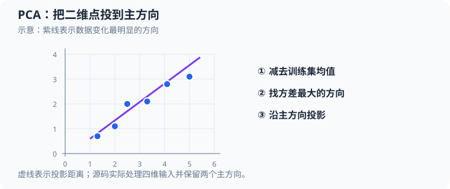

# 主成分分析（principal component analysis，PCA）：从源码理解四维到二维

本文按 [`src/ml/18_pca.c`](../../src/ml/18_pca.c) 的执行顺序分析这个教学实现。它用训练集拟合 $4$ 个相关特征的均值、协方差和前 $2$ 个主方向，再把训练样本与独立测试样本投影到二维并重建。程序不读取类别标签，也不依赖机器学习框架。

运行 `make build/ml/18_pca` 后执行 `./build/ml/18_pca`，可查看均值、主成分、解释方差比例、重建误差和前 $3$ 个测试点的投影。`make sanitize-pca` 使用地址与未定义行为消毒器运行同一数值流程。`make pca` 额外把投影图独占写入 `exports/`，不会覆盖旧图片；图中蓝点表示训练样本，橙点表示测试样本。



紫线表示方差较大的方向，虚线示意点到该方向的投影。源码实际从四维特征提取两个主方向。

## 1. 源码地图

| 概念 | 源码位置 | 代码状态及作用 |
| --- | --- | --- |
| 维度与数据结构 | [`Dataset`、`PcaModel`、`PcaResult`](../../src/ml/18_pca.c#L12) | 固定保存最多 $64\times4$ 个特征、$4\times4$ 协方差、$2\times4$ 个方向，以及投影和重建结果。 |
| 合成数据 | [`random_unit`、`dataset_generate`](../../src/ml/18_pca.c#L43) | 固定种子生成两个潜在变量，再按特征权重混合并加入小噪声。 |
| 向量操作 | [`normalize`、`remove_projection`](../../src/ml/18_pca.c#L86) | 将方向变成单位向量，并从向量中移除已知方向上的分量。 |
| 主方向求解 | [`dominant_component`](../../src/ml/18_pca.c#L127) | 用 $256$ 次幂迭代近似特征向量，以 Rayleigh 商估计特征值，再用残差检查结果。 |
| 训练拟合 | [`pca_fit`](../../src/ml/18_pca.c#L212) | 只用给定训练集计算均值、总体协方差和两个正交方向；成功后整体更新模型。 |
| 投影与重建 | [`pca_transform`](../../src/ml/18_pca.c#L267) | 将一个四维输入中心化、投影到两个方向，再映射回四维。 |
| 压缩误差 | [`reconstruction_mse`](../../src/ml/18_pca.c#L306) | 计算所有样本、所有特征上的平均平方重建误差。 |
| 绘图与程序入口 | [`export_projection`](../../src/ml/18_pca.c#L338)、[`main`](../../src/ml/18_pca.c#L419) | 仅在 `--export` 模式绘制二维散点图；主流程训练、评估并输出数值。 |
| Python 对照示例 | [`main`](../../src/python/ml/18_pca.py#L6) | 用 $8$ 个二维点和 $30$ 次幂迭代求第一方向，演示一维投影与重建。 |

## 2. 这个 PCA 要解决什么问题

每条样本有 $4$ 个数值特征。PCA 找到数据变化最大的方向，把样本压到较少的坐标上。这里把维度从 $d=4$ 降到 $k=2$：压缩后的点只保存两个投影坐标；如果需要近似还原，再用两个方向重建回原来的 $4$ 个特征。

令 $N$ 为训练样本数，$d$ 为原特征数，$k$ 为保留的主成分数。代码中的 `FEATURE_COUNT`、`TRAIN_COUNT` 和 `COMPONENT_COUNT` 分别是 $d=4$、训练上限 $N=64$ 和 $k=2$。数学样本记作 $\mathbf{x}_i\in\mathbb{R}^{d}$，其中行下标 $i$ 从 $0$ 到 $N-1$；特征下标 $j$ 从 $0$ 到 $d-1$。它对应 `Dataset.values[i][j]`。

`PcaModel.mean[j]` 保存第 $j$ 个特征的训练均值；`covariance[j][\ell]` 保存第 $j$、$\ell$ 个特征的协方差；`components[\texttt{component}][j]` 保存一个主方向的第 $j$ 个坐标；`eigenvalues[\texttt{component}]` 保存该方向的特征值。数学方向下标 $q$ 从 $1$ 开始，而 C 循环变量 `component` 从 $0$ 开始，二者关系是 $q=\texttt{component}+1$。代码把每个方向放在 `components` 的一行。`PcaResult.projection[\texttt{component}]` 对应数学坐标 $z_q$；`reconstruction[j]` 是重建后的特征。数组 `dataset->values[i][j]` 对应数学样本 $x_{ij}$。

## 3. 第一阶段：代码如何生成相关数据

`main` 固定使用种子 $2025$ 生成 $64$ 条训练样本，使用不同种子 $2026$ 生成 $32$ 条测试样本。`random_unit` 每次更新一个无符号 $32$ 位状态 $S_t$，再取新状态的高 $24$ 位生成 $[0,1)$ 中的数 $r_t$：

$$
\begin{aligned}
S_{t+1}&=(1664525S_t+1013904223)\bmod 2^{32},\\
r_t&=\frac{\left\lfloor S_{t+1}/2^8\right\rfloor}{2^{24}}
\end{aligned}
\tag{1}
$$

这里 $r_t$ 是用新状态最高的 $24$ 位映射得到的伪随机数，状态按 $2^{32}$ 回绕。每一行独立产生两个随机数 $r_{i,1}$、$r_{i,2}$，并得到潜在数 $h_{i,1}=2r_{i,1}-1$ 和 $h_{i,2}=2r_{i,2}-1$，所以二者位于 $[-1,1)$。每个特征再用一个随机数 $r_{ij}$ 产生噪声 $\epsilon_{ij}=0.2r_{ij}-0.1$，范围为 $[-0.1,0.1)$。令 $a_j$、$b_j$ 为两个潜在方向对特征 $j$ 的权重，数据值为：

$$
x_{ij}=a_jh_{i,1}+b_jh_{i,2}+\epsilon_{ij}
\tag{2}
$$

权重向量在代码中分别是 $(2,1,3,-1)$ 和 $(0.2,-0.4,0.1,0.5)$。例如测试集第 $0$ 行使用种子 $2026$，生成 $h_{0,1}=-0.95750165$、$h_{0,2}=-0.91120982$，第 $0$ 个特征的噪声为 $\epsilon_{0,0}=-0.09230130$。代入权重 $a_0=2$、$b_0=0.2$：

以随机状态 $S_0=2026$ 为例，第一次更新得到 $S_1=(1664525\cdot2026+1013904223)\bmod2^{32}=91264577$，所以 $r_{0,1}=\lfloor91264577/256\rfloor/2^{24}\approx0.02124918$，进而 $h_{0,1}=2r_{0,1}-1\approx-0.95750165$。第二次调用得到 $h_{0,2}\approx-0.91120982$；第三次调用得到 $r_{0,0}\approx0.03849351$，所以 $\epsilon_{0,0}=0.2\cdot0.03849351-0.1\approx-0.09230130$。

$$
\begin{aligned}
x_{0,0}&=2(-0.95750165)+0.2(-0.91120982)-0.09230130\approx-2.18954656
\end{aligned}
\tag{3}
$$

这与程序打印的首个测试向量第一项一致。潜在方向让四个观测特征相关；独立噪声避免样本完全落在二维平面上。随机数发生器用于可重复教学数据，不是安全或高质量统计抽样工具。

对应的特征生成语句是：

```c
generated.values[row][feature] = first_weight[feature] * first +
                                 second_weight[feature] * second + noise;
```

这里 `first`、`second` 对应 $h_{i,1}$、$h_{i,2}$，两个权重数组对应 $a_j$、$b_j$，`noise` 对应 $\epsilon_{ij}$。

## 4. 第二阶段：只用训练集估计中心和协方差

PCA 先逐列求训练均值。令 $x_{ij}$ 是第 $i$ 条训练样本的第 $j$ 个特征，$\mu_j$ 是该特征的均值，中心化后的值记为 $x^c_{ij}$：

$$
\begin{aligned}
\mu_j&=\frac{1}{N}\sum_{i=0}^{N-1}x_{ij},\\
x^c_{ij}&=x_{ij}-\mu_j
\end{aligned}
\tag{4}
$$

程序的 `fitted.mean[feature]` 对所有训练行累加，再除以 `dataset->count`；随后用原始值减均值。当前训练集的均值约为 $[0.027922,-0.016275,0.030340,0.008817]$。测试样本 $0$ 的第 $0$ 个特征中心化后为 $-2.18954656-0.02792175=-2.21746831$。

协方差矩阵 $C$ 的行列各对应一个特征，$C_{j\ell}$ 衡量这两列是否一起变化：

$$
\begin{aligned}
C_{j\ell}&=\frac{1}{N}\sum_{i=0}^{N-1}x^c_{ij}x^c_{i\ell},\\
C&=\frac{1}{N}(X-\mathbf{1}\boldsymbol{\mu}^{\mathsf T})^{\mathsf T}
(X-\mathbf{1}\boldsymbol{\mu}^{\mathsf T})
\end{aligned}
\tag{5}
$$

其中 $X$ 是形状为 $N\times d$ 的样本矩阵，$\boldsymbol{\mu}$ 是长度为 $d$ 的均值向量，$\mathbf{1}$ 是长度为 $N$ 的全 $1$ 向量，$\mathsf T$ 表示转置。代码的三层循环逐个累加 $x^c_{ij}x^c_{i\ell}$，再除以 $N$。它使用总体协方差的分母 $N$，不是无偏样本协方差常见的 $N-1$；同一数据上二者只差一个整体比例，因此方向和解释方差比例不变，但特征值的数值会缩放。

训练得到的协方差矩阵约为：

$$
C\approx
\begin{bmatrix}
1.351346553&0.647961352&2.015291240&-0.659901550\\
0.647961352&0.385446027&0.993172645&-0.403472461\\
2.015291240&0.993172645&3.028377782&-1.018770335\\
-0.659901550&-0.403472461&-1.018770335&0.432005762
\end{bmatrix}
\tag{6}
$$

例如第 $0$ 个特征的方差是 $C_{00}\approx1.351347$；第 $0$、第 $2$ 个特征的协方差是 $C_{02}\approx2.015291$，表示它们在本数据中倾向于同向变化。矩阵总方差是对角线之和，即迹 $\operatorname{tr}(C)=1.351346553+0.385446027+3.028377782+0.432005762\approx5.197176124$。代码将这个和放入 `total_variance`。

源码先在样本循环里累加中心化特征的乘积，再将每个矩阵元素除以样本数：

```c
fitted.covariance[left][right] += centered_left * centered_right;
fitted.covariance[left][right] /= (double)dataset->count;
```

循环变量 `left`、`right` 对应公式中的 $j$、$\ell$，`centered_left`、`centered_right` 对应 $x^c_{ij}$、$x^c_{i\ell}$。

## 5. 第三阶段：用幂迭代求主方向

主成分是协方差矩阵的单位特征向量。若方向 $\mathbf{u}$ 对应特征值 $\lambda$，则 $C\mathbf{u}=\lambda\mathbf{u}$；单位约束是 $\lVert\mathbf{u}\rVert_2=1$。特征值表示沿该方向的方差。最大特征值对应变化最大的方向，因此是第一主成分。

源码没有调用通用特征值库，而使用幂迭代：将当前向量乘以 $C$，再归一化。对单位向量而言，重复乘以 $C$ 会让最大特征方向上的分量相对变大：

$$
\mathbf{v}^{(t+1)}=\frac{C\mathbf{v}^{(t)}}{\lVert C\mathbf{v}^{(t)}\rVert_2}
\tag{7}
$$

上式中的 $t$ 是迭代编号，$\mathbf{v}^{(t)}$ 是第 $t$ 轮的单位方向。代码初始向量为 $\mathbf{q}=(1,0.5,-0.25,0.75)^{\mathsf T}$，其长度为 $\sqrt{1.875}\approx1.369306$，归一化后：

$$
\mathbf{v}^{(0)}\approx(0.730297,0.365148,-0.182574,0.547723)^{\mathsf T}
\tag{8}
$$

`normalize` 先计算向量各坐标平方和，只有范数平方有限且大于 `DBL_MIN` 才缩放向量；零向量、过小向量或非有限向量会让拟合失败，避免除以接近零的范数。

用上面的训练协方差矩阵做一次乘法得到 $C\mathbf{v}^{(0)}\approx(0.494103,0.211630,0.723509,-0.206631)^{\mathsf T}$，其长度约为 $0.924709$。因此一次完整更新后：

$$
\mathbf{v}^{(1)}=\frac{C\mathbf{v}^{(0)}}{\lVert C\mathbf{v}^{(0)}\rVert_2}
\approx(0.534333,0.228862,0.782418,-0.223455)^{\mathsf T}
\tag{9}
$$

这正对应 [`dominant_component`](../../src/ml/18_pca.c#L127) 中 `next[row] += covariance[row][column] * vector[column]`，随后调用 `normalize(next)` 并复制回 `vector`。本例不是只做这一轮：常量 `POWER_ITERATIONS` 固定为 $256$，每轮都执行乘法与归一化。

循环主体的关键语句如下：

```c
next[row] += covariance[row][column] * vector[column];
```

它实现矩阵乘向量的第 `row` 个分量 $\sum_{\text{column}}C_{\text{row},\text{column}}v_{\text{column}}$；内层循环完成该分量后，外层对整个新向量归一化。

求第二方向时，幂迭代必须排除第一方向，否则仍会收敛回最大特征方向。`remove_projection` 对单位向量 $\mathbf{u}_1$ 执行正交投影扣除：

$$
\operatorname{remove}(\mathbf{v},\mathbf{u}_1)
=\mathbf{v}-(\mathbf{v}^{\mathsf T}\mathbf{u}_1)\mathbf{u}_1
\tag{10}
$$

例如对初始向量 $\mathbf{q}$ 和代码算出的第一方向 $\mathbf{u}_1$，投影系数约为 $\mathbf{q}^{\mathsf T}\mathbf{u}_1=0.250234$；扣除后的向量约为 $(0.871396,0.435198,-0.443471,0.816694)^{\mathsf T}$，再归一化为 $(0.647277,0.323268,-0.329412,0.606645)^{\mathsf T}$。第二方向的每一轮都会先乘以 $C$，再执行相同投影扣除并归一化。这是代码通过 `orthogonal_to` 处理第二方向的方式。

第二方向每一轮的完整更新可写成：

$$
\mathbf{v}_2^{(t+1)}=
\frac{C\mathbf{v}_2^{(t)}-
(\mathbf{u}_1^{\mathsf T}C\mathbf{v}_2^{(t)})\mathbf{u}_1}
{\left\lVert C\mathbf{v}_2^{(t)}-
(\mathbf{u}_1^{\mathsf T}C\mathbf{v}_2^{(t)})\mathbf{u}_1\right\rVert_2}
\tag{11}
$$

将上面的初始第二方向代入当前协方差矩阵，$C\mathbf{v}_2^{(0)}\approx(0.019974,-0.027915,0.009897,0.040101)^{\mathsf T}$，它在第一方向上的投影系数约为 $-1.4\times10^{-13}$。减去该分量后向量范数约为 $0.053704$，归一化得到第一轮结果 $(0.371916,-0.519784,0.184278,0.746689)^{\mathsf T}$。由于第一方向是协方差矩阵的特征方向，理论上与它正交的向量乘以 $C$ 后仍与它正交；代码每轮再次投影，是为了抑制近似误差和浮点误差。

方向确定后，代码使用 Rayleigh 商计算特征值估计，并用特征残差检查是否接近特征向量：

$$
\begin{aligned}
\lambda&=\mathbf{u}^{\mathsf T}C\mathbf{u},\\
\boldsymbol{\rho}&=C\mathbf{u}-\lambda\mathbf{u},\\
\lVert\boldsymbol{\rho}\rVert_2&\le10^{-8}(1+\lambda)
\end{aligned}
\tag{12}
$$

这里 $\mathbf{u}$ 是当前归一化方向，$\lambda$ 是对应特征值估计，$\boldsymbol{\rho}$ 是残差向量。以第一方向为例，程序得到 $\lambda_1\approx5.05183879$，残差长度约为 $3.9\times10^{-12}$，小于 $10^{-8}(1+5.05183879)\approx6.1\times10^{-8}$，所以检查通过。若特征值非正、计算出现非有限数或残差过大，函数返回 `false`，不会写入输出参数。

乘以协方差后向量的符号可能翻转，但 $\mathbf{u}$ 和 $-\mathbf{u}$ 表示同一条轴。循环中若新旧方向点积为负，代码将新向量取反，避免迭代时符号来回跳；最终还把绝对值最大的分量规范为正数，得到稳定易读的打印形式。当前训练结果为：

$$
\mathbf{u}_1\approx(0.513936,0.258963,0.773157,-0.266525)^{\mathsf T},\quad
\lambda_1\approx5.051839
\tag{13}
$$

$$
\mathbf{u}_2\approx(0.322406,-0.568209,0.225183,0.722831)^{\mathsf T},\quad
\lambda_2\approx0.137457
\tag{14}
$$

`pca_fit` 先将所有结果写入局部 `fitted`，验证协方差有限、总方差为正、两个方向都成功后，才执行 `*model = fitted`。所以失败不会留下半个新模型。第二方向在每轮都移除第一方向的投影；受浮点舍入影响，正交是数值近似而非符号上的绝对精确。

## 6. 第四阶段：手算测试样本的投影和重建

`pca_transform` 先减去训练均值，再计算输入与每个主方向的点积。令 $\mathbf{x}$ 是一个四维样本、$\boldsymbol{\mu}$ 是训练均值、$\mathbf{u}_q$ 是第 $q$ 个单位方向，则它保存的二维坐标 $z_q$ 为：

$$
\begin{aligned}
z_q&=(\mathbf{x}-\boldsymbol{\mu})^{\mathsf T}\mathbf{u}_q
=\sum_{j=0}^{d-1}(x_j-\mu_j)u_{qj},\\
q&\in\{1,2\}
\end{aligned}
\tag{15}
$$

这里 $j$ 是原特征下标，$u_{qj}$ 是第 $q$ 个主方向在特征 $j$ 上的分量。以程序打印的第一个测试样本为例，$\mathbf{x}\approx(-2.189547,-0.560413,-2.934683,0.498702)^{\mathsf T}$；中心化结果约为 $(-2.217468,-0.544138,-2.965023,0.489885)^{\mathsf T}$。分别乘以两个主方向并求和：

$$
z_1\approx-2.217468313(0.513935888)-0.544137647(0.258963378)
-2.965023159(0.773157323)+0.489884715(-0.266525093)\approx-3.703544
\tag{16}
$$

$$
z_2\approx-2.217468313(0.322406427)-0.544137647(-0.568209312)
-2.965023159(0.225182914)+0.489884715(0.722831189)\approx-0.719311
\tag{17}
$$

这与 `main` 打印的投影 $[-3.704,-0.719]$ 一致。代码中 `projection[q]` 对应 $z_q$；双重循环的每个乘积是中心化特征乘以 `components[q][j]`。

源码的投影累加语句正是上述点积：

```c
result.projection[component] +=
    (input[feature] - model->mean[feature]) * model->components[component][feature];
```

压缩后要近似还原，程序从均值开始，把每个投影坐标乘回对应主方向：

$$
\hat{x}_j=\mu_j+\sum_{q=1}^{k}z_qu_{qj}
\tag{18}
$$

例如第 $0$ 个特征的重建值是 $0.027922+(-3.703544)(0.513936)+(-0.719311)(0.322406)\approx-2.107373$。四个特征逐项结果如下；平方误差列是 $(x_{0j}-\hat{x}_j)^2$：

| 特征 $j$ | 输入 $x_{0j}$ | 均值 $\mu_j$ | 第一方向贡献 $z_1u_{1j}$ | 第二方向贡献 $z_2u_{2j}$ | 重建 $\hat{x}_j$ | 平方误差 |
| ---: | ---: | ---: | ---: | ---: | ---: | ---: |
| $0$ | $-2.189547$ | $0.027922$ | $-1.903384$ | $-0.231910$ | $-2.107373$ | $0.006753$ |
| $1$ | $-0.560413$ | $-0.016275$ | $-0.959082$ | $0.408719$ | $-0.566639$ | $0.000039$ |
| $2$ | $-2.934683$ | $0.030340$ | $-2.863422$ | $-0.161976$ | $-2.995058$ | $0.003645$ |
| $3$ | $0.498702$ | $0.008817$ | $0.987087$ | $-0.519940$ | $0.475964$ | $0.000517$ |

四个平方误差之和约为 $0.01095348$，除以特征数 $4$，该样本的逐特征平均平方误差为 $0.00273837$。这是一条样本的误差，不是整批测试集误差。`pca_transform` 将结果先存入局部 `PcaResult`，检查重建值有限后才整体写入调用者输出；空指针、非有限输入或数值溢出时返回失败。

## 7. 第五阶段：解释方差和重建误差

协方差矩阵的总方差等于迹，也等于全部特征值之和。二维投影保留的方差比例为前两个特征值之和除以总方差：

$$
\begin{aligned}
R_2=\frac{\lambda_1+\lambda_2}{\operatorname{tr}(C)}
&=\frac{5.051839+0.137457}{5.197176}\\
&\approx0.998484
\end{aligned}
\tag{19}
$$

因此输出约为 $99.85\%$。这表示在训练集的协方差尺度上，两个方向覆盖了大部分方差；它不意味着每个样本都能无损还原，也不代表分类准确率。该案例没有标签，PCA 只寻找变化方向，不会主动寻找区分类别的轴。

令 $\hat{x}_{ij}$ 是样本 $i$ 重建后的第 $j$ 个特征，重建均方误差对所有数据点和全部 $4$ 个特征一起取平均：

$$
\operatorname{MSE}=\frac{1}{Nd}\sum_{i=0}^{N-1}\sum_{j=0}^{d-1}
(x_{ij}-\hat{x}_{ij})^2
\tag{20}
$$

本例训练误差为 $0.001970$，独立测试误差为 $0.001547$。例如单样本计算中，四个特征的平方误差和为 $0.01095348$，故单样本 MSE 是 $0.01095348/4\approx0.00273837$；整体指标还要将 $32$ 条测试样本的所有平方误差累加，再除以 $32\cdot4$。这里测试误差略低是这组固定合成样本的结果，不能据此断言测试数据通常比训练数据容易。

`reconstruction_mse` 对每个特征累加平方差，最后的分母正是样本数乘特征数：

```c
double difference = dataset->values[row][feature] - result.reconstruction[feature];
total_squared_error += difference * difference;
double mse = total_squared_error / (double)(dataset->count * FEATURE_COUNT);
```

## 8. 从入口到输出的控制流

`main` 仅接受无参数或 `--export`。它按种子生成训练和测试集，只把训练集传入 `pca_fit`；之后将同一个已拟合模型用于两组数据的重建误差和测试投影。这避免了测试集参与均值、协方差或主方向拟合。任何生成、拟合、投影或重建失败都会打印错误并返回非零状态。最后还检查解释方差比例为有限正数且不超过 $1+10^{-10}$，并检查标准输出没有错误。

图像导出由 `export_projection` 完成。它先用训练集投影求每个主成分轴的最小值和最大值，再加至少 $0.1$ 的留白；测试投影只用于绘制，不参与坐标范围确定。零点落在范围内时才绘制灰色轴。`make pca` 对应的 Makefile 目标见 [`Makefile`](../../Makefile#L1138)。普通直接运行不写图片，`--export` 失败时会把错误交给 `perror` 输出。BMP 编码和独占路径创建由共享图形模块负责。

## 9. 实现边界与学习建议

- 本例固定为 $d=4$、$k=2$；数组容量最多容纳 $64$ 条训练上限内的样本。`dataset_generate` 要求样本数在 $2$ 到 $64$ 之间，并先生成局部数据，成功后才替换输出数据集。
- `pca_fit` 检查输入坐标和协方差是否有限，并要求总方差为正；`dominant_component` 还要求特征值估计为正且 $256$ 轮后的残差足够小。零方差数据或无法得到两个正特征值时，拟合失败且原模型保持不变。
- 幂迭代近似求特征方向，不做完整特征分解；固定轮数后通过残差检查，但没有独立证明找到的是全局最大特征值。结果依赖初始向量含有目标特征方向分量；若最大特征值相同，主方向也可能不唯一。
- 第二方向每轮都对第一方向做正交化；但代码没有另行比较 $\mathbf{u}_1^{\mathsf T}\mathbf{u}_2$ 并设置独立断言。学习时可把两个方向的点积打印出来，观察浮点误差下的近似正交性。
- 实现使用原始协方差，不做特征标准化。若特征单位或数值尺度差异很大，大尺度特征可能主导方向；可先标准化数据，再比较两种 PCA 的方向和重建误差。
- Makefile 没有 `test-pca` 专项断言目标。`make sanitize-pca` 运行当前固定数据路径并由 ASan、UBSan 检查内存和未定义行为；它没有随机数据属性测试、数值精度断言或真实数据评估。`make pca` 可单独检查 BMP 导出，但会在 `exports/` 新建图片。

建议按 `dataset_generate` → `pca_fit` → `dominant_component` → `pca_transform` → `reconstruction_mse` 的顺序阅读源码。接着可以尝试将保留方向数从 $2$ 改为 $1$，观察解释方差比例和重建误差；再增加特征缩放差异，理解协方差 PCA 与标准化后 PCA 的区别。

## 10. PCA 为什么等价于寻找最大方差方向

前面的代码先计算协方差矩阵，再寻找它的特征向量。现在从“投影后变化最大”推导为什么会出现特征向量。设随机样本向量为 $\mathbf{x}\in\mathbb{R}^d$，训练均值为 $\boldsymbol{\mu}$，中心化向量为 $\mathbf{x}^c=\mathbf{x}-\boldsymbol{\mu}$，协方差为 $C=\mathbb{E}[\mathbf{x}^c(\mathbf{x}^c)^{\mathsf T}]$。选一个单位方向 $\mathbf{u}$，投影坐标是 $z=\mathbf{u}^{\mathsf T}\mathbf{x}^c$。由于数据已中心化，投影的方差为：

$$
\begin{aligned}
\operatorname{Var}(z)
&=\mathbb{E}[z^2]\\
&=\mathbb{E}[\mathbf{u}^{\mathsf T}\mathbf{x}^c(\mathbf{x}^c)^{\mathsf T}\mathbf{u}]\\
&=\mathbf{u}^{\mathsf T}C\mathbf{u}.
\end{aligned}
\tag{21}
$$

这里 $\mathbb{E}$ 表示对数据分布或训练样本取平均。方向长度必须固定为 $\lVert\mathbf{u}\rVert_2=1$；否则只要把 $\mathbf{u}$ 任意放大，投影方差就能无限变大。用一个便于手算的协方差矩阵 $C=\begin{bmatrix}4&0\\0&1\end{bmatrix}$ 看这个目标：方向 $\mathbf{u}_1=(1,0)^{\mathsf T}$ 的投影方差为 $\mathbf{u}_1^{\mathsf T}C\mathbf{u}_1=4$，方向 $\mathbf{u}_2=(0,1)^{\mathsf T}$ 的投影方差为 $1$，所以第一方向应选择 $\mathbf{u}_1$。这个小例子用于解释最大方差，与程序里的四维合成数据不同。加入单位长度约束后，拉格朗日函数可写为：

$$
\begin{aligned}
\mathcal{L}(\mathbf{u},\eta)&=\mathbf{u}^{\mathsf T}C\mathbf{u}-\eta(\mathbf{u}^{\mathsf T}\mathbf{u}-1),\\
\nabla_{\mathbf{u}}\mathcal{L}&=2C\mathbf{u}-2\eta\mathbf{u}=\mathbf{0},\\
C\mathbf{u}&=\eta\mathbf{u}.
\end{aligned}
\tag{22}
$$

$\eta$ 是约束的拉格朗日乘子。最后一行说明极值方向必须是协方差矩阵的特征向量；代回 $\mathbf{u}^{\mathsf T}C\mathbf{u}$，该方向上的方差恰好是对应特征值。因此第一主成分选最大特征值对应的单位特征向量，第二主成分在与第一方向正交的空间里继续选最大方差方向。C 程序中的 `dominant_component` 用幂迭代近似这个最大特征向量，并通过 `remove_projection` 排除已找到的方向。

## 11. 最大方差与最小重建误差是同一组方向

保留 $k$ 个互相正交的单位方向时，把它们按列放入矩阵 $U_k\in\mathbb{R}^{d\times k}$，其中 $U_k^{\mathsf T}U_k=I_k$，$I_k$ 是 $k\times k$ 单位矩阵。中心化样本的投影和重建分别是：

$$
\begin{aligned}
\mathbf{z}&=U_k^{\mathsf T}(\mathbf{x}-\boldsymbol{\mu}),\\
\hat{\mathbf{x}}&=\boldsymbol{\mu}+U_k\mathbf{z}.
\end{aligned}
\tag{23}
$$

对中心化训练集，投影后保留的总方差是这些方向方差之和；重建时丢掉的方差正好是未保留方向的特征值之和。令特征值从大到小排列为 $\lambda_1\ge\cdots\ge\lambda_d\ge0$，并假定使用精确、完整的正交特征向量组，则：

$$
\begin{aligned}
\frac{1}{N}\sum_{i=0}^{N-1}\lVert\mathbf{x}_i-\hat{\mathbf{x}}_i\rVert_2^2
&=\sum_{q=k+1}^{d}\lambda_q,\\
\operatorname{MSE}_{\text{per feature}}
&=\frac{1}{d}\sum_{q=k+1}^{d}\lambda_q.
\end{aligned}
\tag{24}
$$

这里 $N$ 是训练样本数，$d$ 是特征数，$q$ 是按方差从大到小排列的主成分编号。源码用总体协方差的分母 $N$，所以该等式的尺度与其训练误差定义一致；幂迭代只是近似特征向量，数值上允许有很小的残差。本例 $d=4$，丢弃的总方差约为 $5.197176-5.051839-0.137457=0.007880$，除以 $4$ 得每个特征的 MSE $0.001970$，与程序打印的训练误差相符。测试集使用同一训练基，但其误差不等于训练协方差里被丢弃特征值之和。

因此，在所有 $k$ 维线性子空间中，保留最大特征值对应的前 $k$ 个方向，既能保留最多训练方差，也能使训练集的平方重建误差最小。它不保证对分类或预测最有用：一个低方差方向仍可能包含区分类别的关键信息。

## 12. 特征尺度、标准化与白化

当前 C 实现只减去训练均值，不除以特征标准差；它执行的是协方差 PCA。若第 $j$ 个特征的单位从米换成毫米，数值会放大 $1000$ 倍，该列方差和它与其他列的协方差也随之改变，主方向就可能显著变化。特征量纲可比且绝对变化大小有意义时，使用协方差可能正合适；如果想让每个特征先具有相同尺度，可以用训练集标准差 $s_j$ 标准化：

$$
\begin{aligned}
\tilde{x}_{ij}&=\frac{x_{ij}-\mu_j}{s_j},\\
\widetilde{C}_{j\ell}&=\frac{C_{j\ell}}{s_js_\ell}.
\end{aligned}
\tag{25}
$$

$s_j$ 是训练特征 $j$ 的标准差；$\widetilde C$ 对应相关系数矩阵。标准化改变了算法回答的问题：协方差 PCA 重视绝对方差，标准化后的 PCA 重视各列相对标准差的共同变化。方差为零的特征无法除以 $s_j$，必须先移除或采用明确的处理规则。所有均值和标准差只能在训练集拟合，再应用到验证集和测试集，避免数据泄漏（data leakage）。

例如某特征的训练均值为 $10$、标准差为 $2$，原始值 $14$ 标准化后是 $(14-10)/2=2$。若两个特征的协方差为 $6$、标准差分别为 $2$ 和 $3$，标准化后的协方差为 $6/(2\cdot3)=1$。这些统计量必须来自训练集；不能先用完整数据算均值和标准差，再切分训练与测试数据。

白化（whitening）是在投影后再除以各方向标准差：

$$
\begin{aligned}
z_q^{\text{white}}&=\frac{z_q}{\sqrt{\lambda_q}}.
\end{aligned}
\tag{26}
$$

这样每个保留方向的训练方差近似为 $1$，可用于让后续算法接收尺度相近的特征；但低方差方向也会被放大，可能把噪声放大。当前 C/Python 示例都没有标准化或白化。PCA 常用于降维预处理，但它本身不等同于神经网络中的 L2 正则化；它会丢掉某些方向，而 L2 是保留输入表示并惩罚模型权重。两者的目标与信息损失方式不同，详见[神经网络正则化文档](42_神经网络正则化.md)。

例如某主方向的特征值为 $4$，样本在该方向的投影为 $6$，白化坐标为 $6/\sqrt{4}=3$。这是按方向标准差 $2$ 缩放；若特征值很小，除数也小，噪声同样会被放大，因此实际使用常会丢弃极低方差方向或给分母加稳定下限。

## 13. 如何选保留维度 $k$

解释方差比例可以推广到任意 $k$：

$$
\begin{aligned}
R_k&=\frac{\sum_{q=1}^{k}\lambda_q}{\sum_{q=1}^{d}\lambda_q}.
\end{aligned}
\tag{27}
$$

$R_k$ 是训练集被前 $k$ 个方向保留的方差比例。观察 $R_k$ 随 $k$ 的变化曲线，有时会出现“肘部”：继续增加维度带来的方差收益明显变小。但不存在适用于所有任务的固定阈值；如果目标是压缩，应结合存储预算与重建误差；如果目标是下游分类或回归，应在训练集内部验证不同 $k$ 的下游指标，不能只按解释方差最大化来挑维数。当前程序将 $k=2$ 固定为 `COMPONENT_COUNT`，没有自动选参。

按程序打印的特征值，保留 $1$ 个方向约得到 $5.051839/5.197176\approx0.9720$，保留 $2$ 个方向约得到 $(5.051839+0.137457)/5.197176\approx0.9985$。第二个方向只增加约 $2.64$ 个百分点的解释方差，却能显著降低重建误差；是否值得多存一个维度，仍要看压缩成本或下游任务收益。

特征值相近时，单个特征向量可能对样本扰动敏感：对应子空间仍可能稳定，但主方向之间可以旋转或交换；方向的正负号也任意。解释 PCA 结果时，宜关注子空间、累计解释方差和下游表现，不要把每个方向的符号当作固定语义。

## 14. 协方差特征分解与 SVD、C/Python 差异

中心化样本矩阵记为 $X_c\in\mathbb{R}^{N\times d}$。奇异值分解（singular value decomposition，SVD）把它写成 $X_c=U\Sigma V^{\mathsf T}$；$V$ 的列是协方差矩阵的特征向量，若使用分母 $N$，特征值为对应奇异值平方除以 $N$：

$$
\begin{aligned}
C&=\frac{1}{N}X_c^{\mathsf T}X_c,\\
\lambda_q&=\frac{\sigma_q^2}{N}.
\end{aligned}
\tag{28}
$$

$U$、$V$ 是正交矩阵，$\Sigma$ 的对角元素 $\sigma_q$ 是奇异值，$\lambda_q$ 是第 $q$ 个协方差特征值。当前 C 先显式构造 $d\times d$ 协方差，再用幂迭代；对高维数据，直接对中心化数据矩阵做 SVD 往往更合适，因为形成 $X_c^{\mathsf T}X_c$ 会平方条件数。教学实现只有 $d=4$，所以显式协方差更容易观察。

用两条中心化样本 $(2,0)$ 和 $(-2,0)$ 作例子，样本矩阵的第一个奇异值为 $\sigma_1=\sqrt{2^2+(-2)^2}=\sqrt{8}$。按分母 $N=2$ 计算协方差特征值，$\lambda_1=\sigma_1^2/N=8/2=4$，与第一坐标的方差一致。这说明 SVD 与协方差特征分解给出相同主方向；本例只为解释二者关系，不是 C 程序使用的测试集。

Python 示例 [`src/python/ml/18_pca.py`](../../src/python/ml/18_pca.py) 使用另一组 $8$ 个二维点，只计算第一主方向并执行 $30$ 次幂迭代；协方差除以 $N-1$，而 C 除以 $N$。这个整体比例不改变特征向量或解释方差比例，却会改变特征值数值。Python 输出的是中心化二维样本投到一维后的平方重建误差和除以样本数；C 输出每个样本、每个原始特征的平均 MSE。因此两者演示相同的 PCA 思想，但数据、保留维数和误差定义不同，数值不可直接对照。
