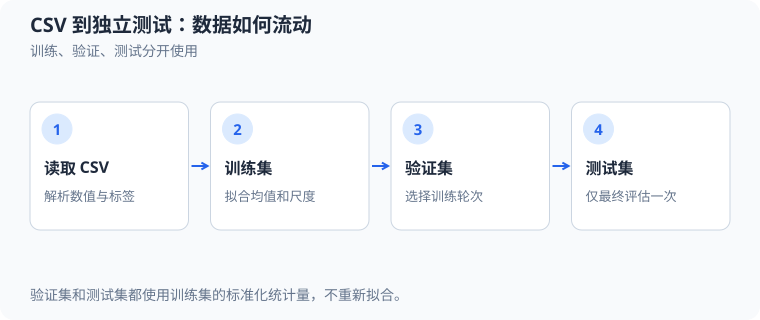

# CSV 文件（comma-separated values）、标准化（standardization）与独立测试评估

本文从 [`src/ml/23_csv_standardization.c`](../../src/ml/23_csv_standardization.c) 的实际实现出发，追踪一个小型 CSV 数据集如何变成逻辑回归的输入，以及训练集、验证集和测试集各自能做什么。案例不依赖第三方框架，运行 `make csv-standardization`；边界测试为 `make test-csv-standardization`，消毒器检查为 `make sanitize-csv-standardization`。

数据文件是手工构造的教学样本，不是真实考试记录。它有两个数值特征：学习时长和练习题数；标签表示示例中的是否通过。CSV 明确标注 `train`、`validation`、`test`，共有 $40$ 行，分别为 $24$、$8$、$8$ 行。运行结果用于检查代码链路，不能当作真实数据上的泛化结论。



训练集拟合均值和尺度，验证集用于选择训练轮次，独立测试集只用于最终评估；三部分使用同一套训练统计量。

## 1. 源码地图

| 概念 | 实现位置 | 主要字段或变量 | 作用 |
| --- | --- | --- | --- |
| 样本与划分 | [`Sample`、`Dataset`、`DataSplit`](../../src/ml/23_csv_standardization.c#L23) | `features`、`label`、`split` | 保存两个特征、类别标签和所属数据集。 |
| CSV 读取和解析 | [`csv_read_record`](../../src/ml/23_csv_standardization.c#L80)、[`parse_sample_record`](../../src/ml/23_csv_standardization.c#L130) | `line`、`fields`、`parsed` | 限长读取一行，校验四个字段并转换数值。 |
| 整体数据校验 | [`dataset_is_valid`](../../src/ml/23_csv_standardization.c#L189)、[`dataset_load_stream`](../../src/ml/23_csv_standardization.c#L233) | `loaded`、`split_counts` | 验证划分非空、训练集有两个类别，成功后才替换输出。 |
| 文件生命周期 | [`dataset_load_csv`](../../src/ml/23_csv_standardization.c#L298) | `stream`、`close_result` | 打开文件、读取、关闭；失败时不提交部分数据。 |
| 标准化参数 | [`standardizer_fit`](../../src/ml/23_csv_standardization.c#L329) | `mean`、`scale`、`training_count` | 只扫描训练样本，计算每列均值和总体标准差。 |
| 单样本变换 | [`standardize_sample`](../../src/ml/23_csv_standardization.c#L381) | `transformed` | 用已拟合参数处理训练、验证或测试样本。 |
| 预测和评估 | [`model_predict`](../../src/ml/23_csv_standardization.c#L432)、[`evaluate_split`](../../src/ml/23_csv_standardization.c#L490) | `logit`、`probability`、`Metrics` | 计算正类概率、交叉熵、准确率和混淆矩阵。 |
| 训练与选轮次 | [`model_train`](../../src/ml/23_csv_standardization.c#L553) | `current`、`best_model`、`validation_metrics` | 批量梯度下降，并根据验证损失保留检查点。 |
| 程序入口 | [`main`](../../src/ml/23_csv_standardization.c#L670) | `path`、`standardizer`、`model` | 按读取、拟合、训练、验证和最终测试的顺序串接流程。 |

## 2. 从 CSV 行到样本结构体

文件表头必须精确为 `study_hours,practice_questions,passed,split`。例如测试集的一行是：

```csv
5.3,58,0,test
```

这行由 `parse_sample_record` 转成 `Sample`：`features[0]` 是 $5.3$ 小时，`features[1]` 是 $58$ 道题，`label` 是 $0$，`split` 是 `SPLIT_TEST`。行号对应 [CSV 文件第 37 行](../../data/ml/study_outcomes.csv#L37)。

`csv_read_record` 用容量为 $256$ 字节的缓冲区读取，拒绝被截断的长行并移除换行符。解析函数只接受两个可完整转换的有限实数、整数标签 $0$ 或 $1$，以及三种已知划分。缺列、多列、空字段、`nan`、无穷值和未知划分都会失败。解析器支持的是这个示例需要的简单、未加引号格式，不是通用 CSV 解析器；它也不做缺失值填补。

`dataset_load_stream` 先把记录放进局部变量 `loaded`。只有整份数据读取完，并且训练、验证、测试均非空、训练集同时包含两个标签时，才执行 `*output = loaded`。所以中途遇到坏行时，调用者已有的数据集不会变成半份数据。`dataset_load_csv` 还检查 `fopen` 和 `fclose`；默认路径是 `data/ml/study_outcomes.csv`，也可以把另一个 CSV 路径作为唯一命令行参数。

## 3. 为什么只能用训练集拟合标准化参数

令 $i$ 表示样本编号，编号从 $0$ 开始；令 $jin{0,1}$ 表示特征编号；$x_{ij}$ 是样本 $i$ 的原始第 $j$ 个特征；$mathcal{I}_{\mathrm{train}}$ 是训练样本编号集合；$N_{\mathrm{train}}=|\mathcal{I}_{\mathrm{train}}|=24$。代码用训练集计算特征均值：

$$
\mu_j=\frac{1}{N_{\mathrm{train}}}\sum_{i\in\mathcal{I}_{\mathrm{train}}}x_{ij}.
\tag{1}
$$

标准差 `scale[j]` 使用总体标准差，分母是训练样本数，而不是样本数减一：

$$
s_j=\sqrt{\frac{1}{N_{\mathrm{train}}}\sum_{i\in\mathcal{I}_{\mathrm{train}}}(x_{ij}-\mu_j)^2}.
\tag{2}
$$

这里 $\mu_j$ 和 $s_j$ 分别对应 `Standardizer.mean[j]` 与 `Standardizer.scale[j]`。源代码先累加训练样本，再除以训练样本数；第二遍累加平方差后再开平方，见 [`standardizer_fit`](../../src/ml/23_csv_standardization.c#L329)。若某列标准差小于或等于 `DBL_EPSILON`，函数返回失败，不覆盖调用者的旧参数。

标准化的目的，是让数值量级不同的特征处在可比较的坐标尺度上。本例一个特征用小时计，另一个是题目数量；若直接训练，后者较大的原始数值会放大它对线性分数和梯度的贡献。中心化使训练特征均值为 $0$，除以标准差使训练特征的典型变化量约为 $1$。这不等于保证模型更准确，也不意味着验证集和测试集恰好有均值 $0$、标准差 $1$。

本数据集的训练统计量为：

| 特征 | 训练集均值 | 训练集总体标准差 | 单位 |
| --- | ---: | ---: | --- |
| 学习时长 | $\mu_0=5.275$ | $s_0\approx2.47070334$ | 小时 |
| 练习题数 | $\mu_1\approx59.45833333$ | $s_1\approx29.05021395$ | 道 |

对任意训练、验证或测试样本，变换为：

$$
\tilde{x}_{ij}=\frac{x_{ij}-\mu_j}{s_j}.
\tag{3}
$$

$\tilde{x}_{ij}$ 是无量纲的标准化特征。以 CSV 第 37 行的测试样本 $(5.3,58)$ 为例：

$$
\begin{aligned}
\tilde{x}_{i0}&=\frac{5.3-5.275}{2.47070334}\approx0.010119,\\
\tilde{x}_{i1}&=\frac{58-59.45833333}{29.05021395}\approx-0.050200.
\end{aligned}
\tag{4}
$$

验证集和测试集只能调用 `standardize_sample` 使用这些既定参数，不能参与重新计算 $\mu_j$ 或 $s_j$。测试代码特意构造训练特征 $(2,10)$、$(4,14)$，验证特征 $(100,1000)$ 和测试特征 $(200,2000)$；结果仍是训练均值 $(3,12)$、标准差 $(1,2)$。验证样本变换成 $(97,494)$。这项断言直接检查统计量没有从验证或测试数据“偷看”答案，见 [`test_training_only_standardization`](../../tests/csv_standardization_test.c#L24)。

## 4. 逻辑回归如何使用标准化特征

令 $w_j$ 是第 $j$ 个特征的模型权重，$b$ 是偏置，$a_i$ 是样本 $i$ 的线性分数，$p_i$ 是预测为正类的概率。`model_predict` 先将样本变换成 $\tilde{x}_{ij}$，再计算：

$$
\begin{aligned}
a_i&=b+\sum_{j=0}^{1}w_j\tilde{x}_{ij},\\
p_i&=\operatorname{sigmoid}(a_i)=\frac{1}{1+e^{-a_i}}.
\end{aligned}
\tag{5}
$$

`LogisticModel.weights[j]` 对应 $w_j$，`LogisticModel.bias` 对应 $b$。`sigmoid` 对 $a_i\geq0$ 和 $a_i<0$ 使用不同等价表达式，避免对大正数直接求 $e^{-a_i}$ 时发生溢出。预测阈值固定为 $0.5$：若 $p_i\geq0.5$，预测标签为 $1$；否则为 $0$。

标签 $y_i\in\{0,1\}$ 的单样本二元交叉熵可以写为：

$$
\ell_i=-y_i\log p_i-(1-y_i)\log(1-p_i).
\tag{6}
$$

为避免极端概率下直接计算 $\log(0)$，源码改用等价的 logit 形式：

$$
\begin{aligned}
\ell_i&=\max(a_i,0)-y_i a_i+\log\left(1+e^{-|a_i|}\right).
\end{aligned}
\tag{7}
$$

其中 $\ell_i$ 是样本损失，$y_i$ 是真实标签，$|a_i|$ 是分数绝对值。该式对应 [`binary_cross_entropy`](../../src/ml/23_csv_standardization.c#L476)。某个数据划分的 BCE 是该划分内各样本损失的算术平均。

## 5. 从零参数走完第一轮更新

训练开始时，两个权重和偏置都为 $0$。因此每个训练样本的分数都是 $a_i=0$，正类概率都是 $p_i=0.5$。对 sigmoid 与交叉熵组合，链式法则可化简为：

$$
\frac{\partial\ell_i}{\partial a_i}=p_i-y_i.
\tag{8}
$$

因为 $a_i=b+\sum_jw_j\tilde{x}_{ij}$，权重和偏置的平均梯度是：

$$
\begin{aligned}
g_{w_j}&=\frac{1}{N_{\mathrm{train}}}\sum_{i\in\mathcal{I}_{\mathrm{train}}}\\
&\quad(p_i-y_i)\tilde{x}_{ij},\\
g_b&=\frac{1}{N_{\mathrm{train}}}\sum_{i\in\mathcal{I}_{\mathrm{train}}}(p_i-y_i).
\end{aligned}
\tag{9}
$$

$g_{w_j}$ 和 $g_b$ 分别对应 `weight_gradients[j] / training_count` 与 `bias_gradient / training_count`。代码在 [`model_train` 的训练循环](../../src/ml/23_csv_standardization.c#L553)中逐行累加，随后执行梯度下降：

$$
\begin{aligned}
w_j&\leftarrow w_j-\eta g_{w_j},\\
b&\leftarrow b-\eta g_b,\\
\eta&=0.2.
\end{aligned}
\tag{10}
$$

$\eta$ 是固定学习率。训练集有 $12$ 个标签 $0$ 和 $12$ 个标签 $1$，所以初始偏置梯度 $g_b=0$。第一条训练样本为 $(1,12)$、标签 $0$，标准化后约为 $(-1.730277,-1.633666)$。它对平均权重梯度的贡献是：

$$
\frac{0.5}{24}(-1.730277,-1.633666)\approx(-0.036047,-0.034035).
\tag{11}
$$

将训练集中全部 $24$ 条样本贡献相加后，第一轮的平均梯度为 $g_w\approx(-0.426667,-0.422401)$、$g_b=0$。从 $w=(0,0)$ 开始，第一次更新得到：

$$
\begin{aligned}
w&\approx(0.085333,0.084480),\\
b&=0.
\end{aligned}
\tag{12}
$$

这说明更新方向不是凭经验给定：正类样本的误差为 $0.5-1=-0.5$，负类样本的误差为 $0.5-0=0.5$；乘上各自标准化特征并求平均后，梯度指出应该如何调整权重。运行过程中模型参数会继续变化，程序没有把第一次更新误当作最终模型。

## 6. 验证集选检查点，测试集只评估最终模型

`model_train` 在每轮结束后调用 `evaluate_split(..., SPLIT_VALIDATION, ...)`。若验证 BCE 比历史最佳值至少低 $10^{-12}$，程序保存 `current` 到 `best_model` 并记下轮次；否则累计 `stale_epochs`，连续 $80$ 轮无改善时停止，最多训练 $1500$ 轮。本次运行的验证 BCE 持续改善到上限，因此训练了 $1500$ 轮，最佳轮次也是 $1500$。验证集决定保留哪个训练状态，但不会参与权重梯度。

`main` 只有在 `model_train` 返回最终 `best_model` 后才调用测试集评估。`evaluate_split` 按 `split` 过滤样本，累计 BCE、正确数和混淆矩阵；训练循环只对 `SPLIT_TRAIN` 累加梯度，训练期间的检查点比较只传入 `SPLIT_VALIDATION`。这些调用关系建立了隔离：训练拟合参数，验证集用于选择轮次，测试集报告最终结果。

测试集第 4 个样本是 CSV 第 37 行：原始特征 $(5.3,58)$，标签 $y_i=0$。本次训练结束时模型参数为 $w=(5.16922914,4.66285991)$、$b=0.40497958$。标准化值代入线性层：

$$
\begin{aligned}
a_i&=0.40497958+5.16922914(0.01011858)+4.66285991(-0.05020043)\approx0.22320723,\\
p_i&=\frac{1}{1+e^{-0.22320723}}\approx0.555571.
\end{aligned}
\tag{13}
$$

因 $p_i>0.5$，预测为 $1$，但真实标签是 $0$，所以这是一个假正例。它的单样本损失约为 $-\log(1-0.555571)\approx0.810966$。完整测试集有 $8$ 个样本，混淆矩阵为：

| 真实标签 | 预测为 $0$ | 预测为 $1$ |
| ---: | ---: | ---: |
| $0$ | $3$ | $1$ |
| $1$ | $0$ | $4$ |

因此测试准确率是 $7/8=87.5\%$，测试平均 BCE 为 $0.1330$。这次测试结果没有回流用于调整权重、阈值或训练轮次。样本总数只有 $8$ 且数据是人工构造的，所以这个百分比只验证案例的执行结果，不是可靠的真实任务性能估计。

## 7. 边界、失败路径和当前范围

- `Dataset` 固定最多容纳 $64$ 行，`Sample` 固定两个特征；超出容量或输入行过长会报格式错误，不会动态扩容。
- CSV 必须使用指定表头和四个未加引号字段；本案例拒绝空值及非有限数，没有实现缺失值填充、类别编码、引号转义或随机划分。
- 标准差为零或接近零时无法缩放，该特征会使拟合失败；测试断言验证失败不会覆盖旧的 `Standardizer`。
- 验证与测试样本可以落在训练均值和标准差范围之外。实现照常使用训练集参数变换，不裁剪标准化值。
- 模型与标准化参数目前只保存在进程内存中，没有写入或加载模型文件；参数持久化和新进程推理留作后续学习。
- CSV 加载失败会显示路径或错误行；运行本例不写日志或其他持久产物。

验证命令：`make csv-standardization` 运行完整训练与评估；`make test-csv-standardization` 使用仓库数据和临时 CSV 检查行数、手算标准化、无效输入失败安全及独立测试计数；`make sanitize-csv-standardization` 检查测试入口中的内存和未定义行为。通过这些检查不等于模型已在真实数据上验证。
