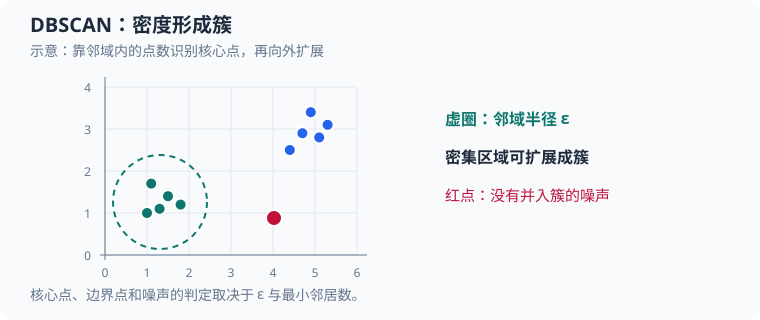

# DBSCAN（density-based spatial clustering of applications with noise）：从距离邻域到密度可达

本文跟读 [`src/ml/26_dbscan.c`](../../src/ml/26_dbscan.c)，用固定二维点理解 DBSCAN 的核心点、边界点和噪声点。运行 `make dbscan` 查看簇标签，运行 `make test-dbscan` 核对邻域边界、噪声重分类与错误输入处理。

DBSCAN 不需要预先指定簇的数量。它由两个参数定义“足够密集”：半径 $\varepsilon$ 和最小邻居数 $M$。本案例取 $\varepsilon=0.9$、$M=4$，邻域计数包括点自身。

虚圈表示一个点的邻域半径 $arepsilon$；密集点可连成簇，孤立红点可能被标记为噪声。点位仅用于解释规则。

## 1. 源码地图

| 概念 | 源码位置 | 对应代码 | 作用 |
| --- | --- | --- | --- |
| 二维点 | [`Point`](../../src/ml/26_dbscan.c#L14) | `x`、`y` | 一个待聚类样本的坐标。 |
| 邻域查询 | [`region_query`](../../src/ml/26_dbscan.c#L29) | `distance`、`found` | 扫描全部点，收集距离不大于半径的下标。 |
| 输入坐标检查 | [`points_are_finite`](../../src/ml/26_dbscan.c#L63) | `isfinite` | 在聚类前拒绝 NaN 或无穷坐标。 |
| DBSCAN 扩展 | [`dbscan_cluster`](../../src/ml/26_dbscan.c#L86) | `visited`、`queue`、`enqueued`、`found_labels` | 找核心点并用队列遍历密度可达的点。 |
| 示例数据与输出 | [`main`](../../src/ml/26_dbscan.c#L176) | `points`、`labels` | 展示两簇、两个边界点和一个噪声点。 |

`labels` 中非负整数表示簇编号，`-1` 表示噪声，内部的 `-2` 表示尚未分配。簇编号是执行顺序产生的标签，没有“簇 0 比簇 1 更重要”之类的语义。

## 2. 距离、邻域与点的三种身份

点 $i$ 的坐标是 $\mathbf{x}_i=(x_i,y_i)$。点 $i$ 的 $\varepsilon$ 邻域定义为：

$$
\begin{aligned}
N_{\varepsilon}(i)&=\left\{j\mid \lVert\mathbf{x}_i-\mathbf{x}_j\rVert_2\leq\varepsilon\right\}.
\end{aligned}
\tag{1}
$$

$N_{\varepsilon}(i)$ 是邻域下标集合，$j$ 遍历所有输入点；$\lVert\cdot\rVert_2$ 表示欧氏距离。因为距离使用小于等于，恰好落在半径上的点也算邻居。又因为一个点到自己的距离为 $0$，$i$ 自身属于 $N_{\varepsilon}(i)$。代码的 `region_query` 使用 `hypot(dx, dy)` 计算欧氏距离，并以 `distance <= epsilon` 实现闭边界。

若邻域包含至少 $M$ 个点，则 $i$ 是核心点：

$$
\lvert N_{\varepsilon}(i)\rvert\geq M.
\tag{2}
$$

这里 $\lvert N_{\varepsilon}(i)\rvert$ 是集合大小；在 C 中对应 `initial_count` 或 `candidate_count`。不足 $M$ 个邻居的点，若能从某个核心点的邻域到达，就是边界点；否则是噪声点。边界点自己不负责继续扩张簇，因为它周围不够密集。

## 3. 用实际坐标走一遍扩展

示例的第一个点为 $A=(1.50,0)$，接着是 $B=(0,0)$、$C=(0.70,0)$、$D=(0.35,0.60)$、$E=(0.35,-0.60)$。参数为 $\varepsilon=0.9$、$M=4$。

程序先访问 $A$。它到自身的距离为 $0$，到 $C$ 的距离为 $|1.50-0.70|=0.80$；到 $B$ 的距离是 $1.50$，到 $D$、$E$ 的距离都大于 $0.9$。所以：

$$
\begin{aligned}
N_{0.9}(A)&=\{A,\\
C\},\\
\lvert N_{0.9}(A)\rvert&=2<4.
\end{aligned}
\tag{3}
$$

`dbscan_cluster` 将它暂时标为噪声。接着访问 $B$，它的邻域包含 $B,C,D,E$：$B$ 到 $C$ 的距离是 $0.70$，到 $D$、$E$ 的距离都是 $\sqrt{0.35^2+0.60^2}\approx0.695$。加上自身刚好有四个点，因此 $B$ 是核心点，启动簇 $0$。

扩展队列处理 $C$ 时，$C$ 的邻域还包含 $A$，因为距离 $A$ 到 $C$ 为 $0.80\leq0.9$。$C$ 的邻居数达到 $4$，它也是核心点；它把 $A$ 加入队列。虽然 $A$ 自己最初被标成噪声，但扩展逻辑会把噪声或未分类点改为当前簇编号。因此 $A$ 最终成为簇 $0$ 的边界点。对应代码是 `found_labels[candidate]` 的 `LABEL_UNVISITED`/`LABEL_NOISE` 分支。

其余四个近邻坐标形成簇 $1$，最远处的点 $(3.5,3.5)$ 没有密度可达路径，保留为噪声。程序输出的 $11$ 个点中有两个簇、每簇五个点和一个噪声点。若某个边界点同时挨着两个互不相连的核心区域，它会归入先扩展到它的簇；这种边界归属依赖输入顺序，但核心簇本身仍由密度连通关系决定。

## 4. 控制流和内存状态

`dbscan_cluster` 先检查点数、有限坐标、正半径以及 $1\leq M\leq n$。它在局部数组中初始化 `found_labels` 和 `visited`，因此失败时不会部分覆盖调用者的 `labels`。每个尚未访问点只查询一次初始邻域；非核心点标噪声，核心点创建新簇并开始队列扩展。

`queue` 保存当前簇待扩展的点下标，`queue_head` 像 FIFO 队列一样向前移动；`enqueued` 确保任何下标最多入队一次，队列容量因此不会超过点数。`visited` 控制是否需要重新查询某个点的邻域；标签状态单独控制它是否已归属簇。访问状态和聚类标签不能合并：一个先被判为噪声的点，后来可能作为边界点加入簇。

对 $n$ 个点，`region_query` 每次线性扫描 $n$ 个坐标，最多对 $n$ 个点各查询一次，故该朴素实现的最坏时间复杂度为 $O(n^2)$。邻居列表、访问数组和队列都使用固定容量 $O(n)$ 空间；本教学实现将容量限制为 `MAX_POINT_COUNT=16`，适合观察算法步骤，不适合直接处理大型数据集。

## 5. 测试能说明什么

`test_region_query_includes_boundary_and_self` 用距离恰好为 $1$ 的点验证半径边界包含等号。`test_clusters_border_points_and_noise` 验证先标为噪声的 $A$ 后来会被扩展为边界点，也验证两簇编号和孤立噪声。非法半径、过大的 `min_points` 和 NaN 坐标均须失败，并保留旧标签及簇数量。

运行 `make test-dbscan` 执行断言；运行 `make sanitize-dbscan` 使用地址与未定义行为消毒器。它们覆盖当前固定容量下的核心状态转换，不是对大规模数据性能或不同距离度量的评估。

可继续尝试将 $M$ 增大或减小、改变 $\varepsilon$，观察核心点是否消失、多个簇是否连成一簇。DBSCAN 的尺度对距离单位敏感；若某一特征数值范围远大于其他特征，通常需要先根据训练数据做尺度处理，再讨论合适的 $\varepsilon$。
