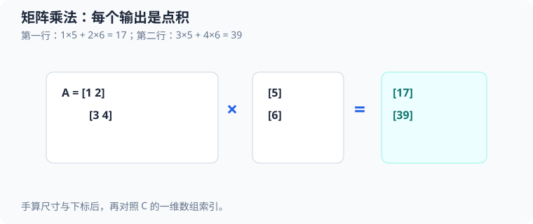

# 深度学习阶段 0：数值计算（numerical computing）与梯度（gradient）

源码是[数值基础示例](../../src/ml/05_numeric_foundations.c)。它用固定小数据演示两类基础能力：把矩阵形状映射到一维内存，以及对单样本线性模型做前向计算、求梯度和更新参数。这个程序不训练神经网络，也不处理外部数据；它为后续的全连接层和反向传播建立可手算的参照。

左图示例第一行计算 $1	imes5+2	imes6=17$，第二行计算 $3	imes5+4	imes6=39$；每个输出格来自一个点积。

## 1. 运行方式与完整流程

在仓库根目录运行：

~~~sh
make numeric-foundations
make test-numeric-foundations
make sanitize-numeric-foundations
~~~

`make numeric-foundations` 构建并运行示例；`make test-numeric-foundations` 通过同一程序中的 `assert` 检查固定结果和边界；`make sanitize-numeric-foundations` 用 AddressSanitizer 与 UndefinedBehaviorSanitizer 单独编译、运行。对应目标见 [`Makefile`](../../Makefile#L872)。常规编译启用严格警告，使用 C23 编译模式，断言没有被 `-DNDEBUG` 关闭。

程序从 [`main`](../../src/ml/05_numeric_foundations.c#L337) 开始，按以下顺序工作：

1. 运行矩阵边界与梯度测试。
2. 创建 `A`、`B`、乘积、转置和逐元素和矩阵，填入固定数据。
3. 计算矩阵乘法、转置和逐元素相加，断言结果后打印。
4. 用一个样本执行线性模型前向计算，打印误差、损失和梯度。
5. 用同一批旧参数的梯度做一次更新，再次前向计算。
6. 从相同初始参数分别运行三种学习率的六步实验。
7. 通过统一的 `cleanup` 标签释放已创建的矩阵。

源码不读取命令行输入。[矩阵创建失败分支](../../src/ml/05_numeric_foundations.c#L347)或[矩阵运算失败分支](../../src/ml/05_numeric_foundations.c#L357)会输出错误，并跳转到清理代码；`result` 初始为失败，所有计算成功后才改成 `EXIT_SUCCESS`。

## 2. 源码地图与概念对应

| 概念 | 源码位置 | 关键状态或职责 |
| --- | --- | --- |
| 行优先矩阵描述符 | [`Matrix`](../../src/ml/05_numeric_foundations.c#L13) | `rows`、`columns`、`capacity`、`data` |
| 可替换的分配器 | [`Allocate`](../../src/ml/05_numeric_foundations.c#L20) | 参数与 `calloc` 兼容，测试可注入失败分配器 |
| 线性模型和单步结果 | [`LinearModel`](../../src/ml/05_numeric_foundations.c#L23)、[`LinearStep`](../../src/ml/05_numeric_foundations.c#L28) | 权重、偏置、预测、误差、损失、梯度 |
| 描述符与容量验证 | [`matrix_valid`](../../src/ml/05_numeric_foundations.c#L40) | 检查空指针、零形状、溢出和容量 |
| 分配和显式初始化 | [`matrix_create`](../../src/ml/05_numeric_foundations.c#L58) | 创建成功后矩阵拥有动态内存 |
| 释放并清空描述符 | [`matrix_destroy`](../../src/ml/05_numeric_foundations.c#L85) | 释放唯一拥有的 `data`，支持空描述符 |
| 矩阵乘法 | [`matrix_multiply`](../../src/ml/05_numeric_foundations.c#L100) | 三层循环计算点积 |
| 逐元素加法 | [`matrix_add`](../../src/ml/05_numeric_foundations.c#L127) | 同形状对应元素相加 |
| 转置 | [`matrix_transpose`](../../src/ml/05_numeric_foundations.c#L145) | 交换行列，输入保持不变 |
| 单样本前向与反向 | [`linear_step`](../../src/ml/05_numeric_foundations.c#L183) | 返回同一组旧参数下的预测、损失和三个梯度 |
| 梯度下降更新 | [`linear_update`](../../src/ml/05_numeric_foundations.c#L203) | 将已算出的梯度应用到模型 |
| 确定性分配失败 | [`fail_allocate`](../../src/ml/05_numeric_foundations.c#L216) | 不耗尽真实内存，固定返回空指针 |
| 矩阵边界测试 | [`test_matrix_boundaries`](../../src/ml/05_numeric_foundations.c#L226) | 检查非法形状、容量、别名和失败后状态 |
| 梯度与更新测试 | [`test_linear_gradients`](../../src/ml/05_numeric_foundations.c#L271) | 对照手算、中心差分和更新结果 |
| 学习率实验 | [`demonstrate_learning_rates`](../../src/ml/05_numeric_foundations.c#L313) | 检查每一步误差的理论倍率 |
| 程序入口 | [`main`](../../src/ml/05_numeric_foundations.c#L337) | 串联测试、矩阵演示、梯度步骤和清理 |

可以把调用关系理解为 `main → matrix_create / matrix_multiply / matrix_transpose / matrix_add`，随后是 `main → linear_step → linear_update → linear_step`。`linear_step` 只读模型；参数副作用集中在 `linear_update`。矩阵操作同样将验证与写结果分开：形状检查先通过，循环才开始写输出。

## 3. 矩阵如何放进一维数组

`Matrix` 不是二维数组本身，而是一个描述符：`rows` 和 `columns` 记录形状，`data` 指向连续的 `double` 元素，`capacity` 记录从该指针起可访问的元素数。`capacity` 的单位是元素，不是字节。

源码采用行优先布局。若矩阵有 $n$ 列，行下标 $r$ 和列下标 $c$ 都从 $0$ 开始，则元素在线性数组中的下标为：

$$
\operatorname{index}(r,c)=r n+c.
\tag{1}
$$

这里 $r$ 是行下标，$c$ 是列下标，$n$ 是列数。源码实际使用 `data[row * columns + column]`；对应的 `row`、`column` 是 C 循环变量，分别表示 $r$、$c$。

程序中的矩阵 $A$ 形状为 $2\times3$：

$$
\begin{aligned}
A&=
\begin{bmatrix}
1&2&3\\
4&5&6
\end{bmatrix},\\
\operatorname{data}_A&=[1,2,3,4,5,6].
\end{aligned}
\tag{2}
$$

这里 $\operatorname{data}_A$ 表示矩阵 $A$ 在源码 `a.data` 中的行优先存储序列。

比如 $A_{1,2}=6$，其下标为 $1\times3+2=5$，所以它位于 `a.data[5]`。这说明二维形状是由描述符解释一维数据的方式，而不是数据自身携带的属性。

### 3.1 创建、容量和所有权

[`matrix_create`](../../src/ml/05_numeric_foundations.c#L58) 要求传入一个全零的空描述符、正的行列数和非空分配函数。它按顺序检查形状乘法是否会超过 `SIZE_MAX`（`size_t` 能表示的最大值），再检查元素数乘以 `sizeof(double)` 是否会超过可表示的字节数；这些检查发生在乘法之前，避免用已经溢出的结果判断容量。随后分配器收到“元素数”和“单个元素字节数”，成功后源码逐个赋为 $0.0$，最后才把描述符改成拥有内存的状态。

显式赋 $0.0$ 有原因：`calloc` 保证返回的字节被置零，但 C 不要求所有实现都用全零位模式表示浮点数 $0.0$。本例因此不依赖这个表示假设。

创建失败时，描述符尚未被赋新值，调用方可安全清理它。`main` 中五次创建用 `||` 串接；任一次失败都会进入 `cleanup`，已成功创建的描述符仍可由 `matrix_destroy` 释放。分配器必须返回可由 `free` 释放的内存；测试里的 `fail_allocate` 则稳定返回空指针。

[`matrix_destroy`](../../src/ml/05_numeric_foundations.c#L85) 释放 `data` 后把整个描述符重置为零值。空描述符可重复销毁，空指针也可传入。成功创建的矩阵有唯一所有者：不要复制 `Matrix` 后让两份描述符分别释放同一指针。测试中另有一些描述符指向栈数组，它们只是借用视图，不能传给 `matrix_destroy`。

[`matrix_valid`](../../src/ml/05_numeric_foundations.c#L40) 检查指针、非零形状、`rows * columns` 的溢出、字节数溢出和 `capacity` 是否足够。它无法从裸指针验证真实分配长度，因此调用方仍须保证 `data` 至少指向 `capacity` 个 `double`。源码使用 C23 的 `nullptr` 检查空指针，并直接使用标准关键字 `bool`、`true`、`false`，因此没有包含 `<stdbool.h>`；创建接口中的形状和分配器前置条件还保证不会执行除以零的容量检查。

## 4. 矩阵运算与手算结果

### 4.1 乘法：每个输出格是一个点积

[`matrix_multiply`](../../src/ml/05_numeric_foundations.c#L100) 接受形状为 $m\times k$ 的矩阵 $A$ 和形状为 $k\times n$ 的矩阵 $B$，结果形状必须是 $m\times n$。$m$ 是 $A$ 的行数，$k$ 是两个输入共享的内维，$n$ 是 $B$ 的列数。对输出行 $r$ 和列 $c$：

$$
C_{r,c}=\sum_{s=0}^{k-1}A_{r,s}B_{s,c}.
\tag{3}
$$

这里 $C$ 是输出矩阵，$s$ 从 $0$ 到 $k-1$ 遍历共享维度；下标从 $0$ 开始。C 源码中循环变量 `k` 扮演公式中的 $s$，内层循环的 `sum` 累加一个输出格的点积：

~~~c
double sum = 0;
for (size_t k = 0; k < a->columns; ++k) {
    sum += a->data[row * a->columns + k] * b->data[k * b->columns + column];
}
output->data[row * output->columns + column] = sum;
~~~

这里 `row`、`column` 选定一个输出格；`a->columns` 等于内维 $k$，`b->columns` 是输出列数 $n$。左操作数按 $A_{r,s}$ 的行优先下标读取，右操作数按 $B_{s,c}$ 的行优先下标读取。内层循环完成后，`sum` 才写入输出对应位置。

本例 $A$ 是 $2\times3$，$B$ 是 $3\times2$：

$$
\begin{aligned}
B&=
\begin{bmatrix}
7&8\\
9&10\\
11&12
\end{bmatrix},\\
C&=AB.
\end{aligned}
\tag{4}
$$

逐项计算：

$$
\begin{aligned}
C_{0,0}&=1\cdot7+2\cdot9+3\cdot11=7+18+33=58,\\
C_{0,1}&=1\cdot8+2\cdot10+3\cdot12=8+20+36=64,\\
C_{1,0}&=4\cdot7+5\cdot9+6\cdot11=28+45+66=139,\\
C_{1,1}&=4\cdot8+5\cdot10+6\cdot12=32+50+72=154.
\end{aligned}
\tag{5}
$$

因此：

$$
C=
\begin{bmatrix}
58&64\\
139&154
\end{bmatrix}.
\tag{6}
$$

例如计算 $C_{0,0}$ 时，内层循环读取 `a.data[0]`、`a.data[1]`、`a.data[2]`，以及 `b.data[0]`、`b.data[2]`、`b.data[4]`，将三组乘积累加为 $58$。这正对应“左矩阵的一行”与“右矩阵的一列”做点积。测试还用行向量和列向量验证点积：$[2,3]$ 与 $[4,5]$ 的乘积和为 $2\cdot4+3\cdot5=23$。

在 [主程序的结果检查](../../src/ml/05_numeric_foundations.c#L362)中，`expected_product`、`expected_transpose` 保存手算结果；循环逐项用 `==` 比较乘积和转置，并检查逐元素和。当前数据都是小整数，适合精确比较；这不能推广为任意浮点矩阵都应使用精确相等。

### 4.2 转置：交换坐标，不改变数值

[`matrix_transpose`](../../src/ml/05_numeric_foundations.c#L145) 要求输出形状是输入的列数乘行数。若输入 $A$ 形状为 $m\times n$，转置 $A^\mathsf{T}$ 的形状为 $n\times m$，并满足：

$$
(A^\mathsf{T})_{c,r}=A_{r,c}.
\tag{7}
$$

源码把输入的 `input[row * input->columns + column]` 写到输出的 `output[column * output->columns + row]`。因为输入与输出的 `data` 不能相同，循环不会覆盖后面仍需读取的输入元素。对当前数据：

$$
A^\mathsf{T}=
\begin{bmatrix}
1&4\\
2&5\\
3&6
\end{bmatrix}.
\tag{8}
$$

### 4.3 逐元素加法：形状必须相同

[`matrix_add`](../../src/ml/05_numeric_foundations.c#L127) 要求三个矩阵形状相同，逐位置计算：

$$
S_{r,c}=A_{r,c}+B_{r,c}.
\tag{9}
$$

这里 $S$ 是结果矩阵，$r$ 和 $c$ 分别为行、列下标；与乘法不同，这里没有沿共享维度做乘积累加，也没有广播。本例调用 `matrix_add(&a, &a, &sum)`，所以：

$$
A+A=
\begin{bmatrix}
2&4&6\\
8&10&12
\end{bmatrix}.
\tag{10}
$$

逐元素相加允许输出与某个输入完全同址；每次读写只涉及同一下标，不影响其他元素。测试专门检查 `matrix_add(&a, &a, &a)` 的原地结果。部分重叠缓冲区不在接口保证范围内。

三种矩阵运算先验证描述符和形状，再开始写结果。乘法与转置拒绝输出和输入共享相同的 `data` 起始指针；加法允许完全原地操作。源码只比较起始指针，无法识别部分重叠区间，因此调用方必须遵守接口注释。按循环次数计算，乘法需要 $O(mkn)$ 次标量乘加，转置和逐元素加法分别需要 $O(mn)$ 次元素操作。

## 5. 单样本线性模型：从输入到损失

`LinearModel` 保存两个权重和一个偏置；`LinearStep` 保存一次计算的预测、误差、损失，以及顺序为 $w_0$、$w_1$、$b$ 的三个梯度。源码用 `weights[0]`、`weights[1]` 表示 $w_0$、$w_1$，`bias` 表示 $b$。输入数组 `x` 有两个特征 $x_0$、$x_1$，`target` 对应目标值 $y$。

前向计算为：

$$
\begin{aligned}
p&=w_0x_0+w_1x_1+b,\\
e&=p-y,\\
L&=e^2.
\end{aligned}
\tag{11}
$$

这里 $p$ 是预测，$e$ 是有符号误差，$L$ 是单样本损失。代码中的 `step.prediction`、`step.error`、`step.loss` 依次保存这些值；源码 [`linear_step`](../../src/ml/05_numeric_foundations.c#L183) 按这个顺序计算。对 $N$ 个样本的均方误差通常是：

$$
\operatorname{MSE}=\frac{1}{N}\sum_{j=0}^{N-1}(p_j-y_j)^2.
\tag{12}
$$

这里 $N$ 是样本数，$j$ 是样本下标，$p_j$ 与 $y_j$ 分别是第 $j$ 个样本的预测和目标。本例只有一个样本，即 $N=1$，所以 `step.loss` 就是平方误差。代码没有在损失前乘 $\frac{1}{2}$，因此后面的导数会出现系数 $2$。它也没有实现批量平均、激活函数或隐藏层。

对应的源码先完成前向，再基于同一个 `step.error` 生成三个梯度：

~~~c
LinearStep step = {0};
step.prediction = model->weights[0] * x[0] + model->weights[1] * x[1] + model->bias;
step.error = step.prediction - target;
step.loss = step.error * step.error;
double upstream = 2 * step.error;
step.gradients[0] = upstream * x[0];
step.gradients[1] = upstream * x[1];
step.gradients[2] = upstream;
~~~

`upstream` 表示从损失向预测回传的导数 $2e$。两个权重梯度还要乘各自输入特征，偏置梯度直接使用 `upstream`，因为预测中偏置的系数为 $1$。

[`main` 中的实际输入和初始参数](../../src/ml/05_numeric_foundations.c#L378)是 $x_0=1$、$x_1=2$、$w_0=0.5$、$w_1=-0.25$、$b=0.1$、$y=1$：

$$
\begin{aligned}
p&=0.5\cdot1+(-0.25)\cdot2+0.1=0.5-0.5+0.1=0.1,\\
e&=p-y=0.1-1=-0.9,\\
L&=e^2=(-0.9)^2=0.81.
\end{aligned}
\tag{13}
$$

因此程序打印预测 $0.1000$、误差 $-0.9000$ 和损失 $0.8100$。预测比目标小，所以误差为负；梯度下降会沿负梯度方向增加相关参数。

## 6. 链式法则、梯度和参数更新

先把损失对预测求导，再乘以参数对预测的导数：

$$
\begin{aligned}
\frac{\partial L}{\partial p}&=2(p-y)=2e.
\end{aligned}
\tag{14}
$$

这里 $L=(p-y)^2$，$p$ 是预测，$y$ 是目标，$e=p-y$。模型预测对特征权重的偏导数是：

$$
\begin{aligned}
\frac{\partial p}{\partial w_i}&=x_i\quad(i\in\{0,1\}),\\
\frac{\partial p}{\partial b}&=1.
\end{aligned}
\tag{15}
$$

其中 $i$ 是两个特征的下标。将两段导数相乘，得到实际需要的参数梯度：

$$
\begin{aligned}
\frac{\partial L}{\partial w_i}&=2e x_i\quad(i\in\{0,1\}),\\
\frac{\partial L}{\partial b}&=2e.
\end{aligned}
\tag{16}
$$

[`linear_step`](../../src/ml/05_numeric_foundations.c#L189) 把 `upstream` 设为 $2e$，再依次写入 `gradients[0]`、`gradients[1]` 和 `gradients[2]`。代入 $e=-0.9$、$x_0=1$、$x_1=2$：

| 参数 | 数学计算 | 源码存储 | 梯度 |
| --- | --- | --- | ---: |
| $w_0$ | $2(-0.9)\cdot1$ | `gradients[0]` | $-1.8$ |
| $w_1$ | $2(-0.9)\cdot2$ | `gradients[1]` | $-3.6$ |
| $b$ | $2(-0.9)\cdot1$ | `gradients[2]` | $-1.8$ |

`linear_step` 不修改 `model`。它返回的三个梯度都由同一次前向计算和同一份旧参数得到。更新规则为：

$$
\begin{aligned}
w_i^{\text{new}}&=w_i^{\text{old}}-\eta\frac{\partial L}{\partial w_i},\\
b^{\text{new}}&=b^{\text{old}}-\eta\frac{\partial L}{\partial b}.
\end{aligned}
\tag{17}
$$

这里 $\eta$ 是正学习率，`old` 和 `new` 分别表示更新前后的参数。[`linear_update`](../../src/ml/05_numeric_foundations.c#L203) 逐项使用 `step.gradients` 修改模型。因为梯度已经保存在 `LinearStep` 中，先更新 `weights[0]` 不会改变其余梯度；所有参数使用同一轮旧模型计算出的梯度。

更新函数只做参数写回，不重新计算梯度：

~~~c
model->weights[0] -= learning_rate * step->gradients[0];
model->weights[1] -= learning_rate * step->gradients[1];
model->bias -= learning_rate * step->gradients[2];
~~~

取 $\eta=0.05$，参数更新为：

$$
\begin{aligned}
w_0^{\text{new}}&=0.5-0.05(-1.8)=0.59,\\
w_1^{\text{new}}&=-0.25-0.05(-3.6)=-0.07,\\
b^{\text{new}}&=0.1-0.05(-1.8)=0.19.
\end{aligned}
\tag{18}
$$

重新前向计算：

$$
\begin{aligned}
p^{\text{new}}&=0.59\cdot1+(-0.07)\cdot2+0.19=0.64,\\
e^{\text{new}}&=0.64-1=-0.36,\\
L^{\text{new}}&=(-0.36)^2=0.1296.
\end{aligned}
\tag{19}
$$

损失从 $0.81$ 降到 $0.1296$，说明对这个固定样本和学习率，这一步更新方向有效。测试在[参数更新后断言](../../src/ml/05_numeric_foundations.c#L296)检查三个参数，并在[再次前向检查](../../src/ml/05_numeric_foundations.c#L299)和[损失断言](../../src/ml/05_numeric_foundations.c#L301)核对新结果。一个样本不能证明参数能预测未见数据，也不能唯一确定一个真实任务的模型。

## 7. 中心差分：用数值方法检查解析梯度

[`test_linear_gradients`](../../src/ml/05_numeric_foundations.c#L271) 逐个扰动参数。对某个参数 $\theta_i$，中心差分估计为：

$$
g_i^{\text{num}}
=
\frac{L(\theta_i+\epsilon)-L(\theta_i-\epsilon)}{2\epsilon}.
\tag{20}
$$

这里 $\theta_i$ 是当前选中的一个权重或偏置，$\epsilon=10^{-5}$ 是小扰动，单位与被扰动参数 $\theta_i$ 相同，$g_i^{\text{num}}$ 是数值近似梯度。代码复制当前 `LinearModel` 为 `plus`、`minus`，只改一个参数，然后调用 `linear_step` 计算两边损失；它把这个近似与解析梯度以及手算值比较，容差为 $10^{-8}$。测试用双精度的固定小数，因此断言另外为手算梯度采用 $10^{-12}$ 的阈值。

以 $w_0$ 为例，增加和减小 $\epsilon$ 会让预测分别增加、减少 $10^{-5}$：

$$
\begin{aligned}
L(w_0+\epsilon)&=(-0.9+10^{-5})^2=0.8099820001,\\
L(w_0-\epsilon)&=(-0.9-10^{-5})^2=0.8100180001,\\
g_0^{\text{num}}
&=\frac{0.8099820001-0.8100180001}{2\cdot10^{-5}}
=-1.8.
\end{aligned}
\tag{21}
$$

这是一个可直接核对的完整数值：解析结果为 $\frac{\partial L}{\partial w_0}=-1.8$，中心差分也约为 $-1.8$。同理，扰动 $w_1$ 时预测变化量是 $2\epsilon$，所以近似梯度约为 $-3.6$；扰动偏置时变化量是 $\epsilon$，所以约为 $-1.8$。

中心差分并非绝对真值：$\epsilon$ 太大会增加截断误差，太小则会因两个接近损失相减而损失有效数字。它复用了 `linear_step` 的前向损失，因此可以发现反向梯度公式或参数索引的错误，但不能单独证明前向损失实现本身正确；手算预测和损失断言补上了这一部分验证。

## 8. 学习率为什么会收敛、振荡或发散

[`demonstrate_learning_rates`](../../src/ml/05_numeric_foundations.c#L313) 每种学习率都会重置到相同初始模型，固定使用 $x_0=1$、$x_1=2$ 和 $y=1$。定义更新前误差为 $e$、更新后误差为 $e'$，仍使用正学习率 $\eta$。根据刚才的梯度公式：

循环每次先保留旧误差，再更新参数并计算下一误差；断言核对下面推导的倍率：

~~~c
LinearStep step = linear_step(&model, x, 1);
printf(" %+.5f", step.error);
linear_update(&model, &step, rates[i]);
LinearStep next = linear_step(&model, x, 1);
assert(fabs(next.error - (1 - 12 * rates[i]) * step.error) < 1e-12);
~~~

$$
\begin{aligned}
w_i'&=w_i-2\eta e x_i,\\
b'&=b-2\eta e.
\end{aligned}
\tag{22}
$$

这里撇号表示同一次梯度下降后的参数。代入新的参数计算预测，并利用 $e=p-y$：

$$
\begin{aligned}
e'
&=\left(\sum_{i=0}^{1}(w_i-2\eta e x_i)x_i+b-2\eta e\right)-y\\
&=\left[1-2\eta\left(\sum_{i=0}^{1}x_i^2+1\right)\right]e.
\end{aligned}
\tag{23}
$$

其中 $i$ 是特征下标，求和中的 $1$ 来自偏置 $b$ 的梯度。对本例，$x_0^2+x_1^2+1=1^2+2^2+1=6$，所以：

$$
e'=(1-12\eta)e.
\tag{24}
$$

设每轮误差倍率 $q=1-12\eta$，初始误差 $e_0=-0.9$，则第 $t$ 次更新后的误差满足 $e_t=q^t e_0$。源码在[六步循环](../../src/ml/05_numeric_foundations.c#L320)先打印更新前误差，再更新参数，并由[误差倍率断言](../../src/ml/05_numeric_foundations.c#L327)核对下一步；六个打印值分别是 $e_0$ 到 $e_5$：

| 学习率 $\eta$ | 误差倍率 $q$ | 六次更新前的误差 |
| ---: | ---: | --- |
| $0.05$ | $0.4$ | $-0.90000,\ -0.36000,\ -0.14400,\ -0.05760,\ -0.02304,\ -0.00922$ |
| $0.12$ | $-0.44$ | $-0.90000,\ 0.39600,\ -0.17424,\ 0.07667,\ -0.03373,\ 0.01484$ |
| $0.20$ | $-1.4$ | $-0.90000,\ 1.26000,\ -1.76400,\ 2.46960,\ -3.45744,\ 4.84042$ |

第一行的误差保持负号但幅度缩小；第二行因倍率为负而正负交替，幅度仍缩小；第三行同样交替，但幅度增大。损失是误差平方，因此相邻步损失倍率为 $q^2$。

对这个单样本二次损失，只有 $|q|<1$ 时误差幅度逐步缩小，也就是 $0<\eta<\frac{1}{6}$。在 $\eta=\frac{1}{6}$ 时 $q=-1$，误差符号交替但幅度和损失不变；在 $\eta>\frac{1}{6}$ 时 $q<-1$，误差幅度增长。$\eta=\frac{1}{12}$ 时 $q=0$，本样本一次更新就能达到零误差。这些结论严格依赖当前的单样本、模型和损失，不是对多样本训练或神经网络的通用学习率建议。

## 9. 边界测试、失败路径与适用范围

矩阵边界测试用断言覆盖了以下情形：

| 测试位置 | 输入或操作 | 验证内容 |
| --- | --- | --- |
| [`matrix_create` 的零行和溢出尺寸](../../src/ml/05_numeric_foundations.c#L229) [乘法溢出](../../src/ml/05_numeric_foundations.c#L230) [字节溢出](../../src/ml/05_numeric_foundations.c#L231) | 零行、行列乘法溢出、字节数溢出 | 分配前拒绝无效尺寸 |
| [`fail_allocate`](../../src/ml/05_numeric_foundations.c#L232) [空分配器](../../src/ml/05_numeric_foundations.c#L233) [空描述符](../../src/ml/05_numeric_foundations.c#L234) | 分配器返回空指针、分配器或描述符为空 | 创建失败，空描述符保持不变 |
| [`matrix_destroy`](../../src/ml/05_numeric_foundations.c#L236) [重复销毁](../../src/ml/05_numeric_foundations.c#L237) [空指针](../../src/ml/05_numeric_foundations.c#L238) | 空描述符销毁两次及空指针 | 清理空状态安全 |
| [乘法点积](../../src/ml/05_numeric_foundations.c#L246) [错误内维](../../src/ml/05_numeric_foundations.c#L250) | $[2,3]\times[4,5]^\mathsf{T}$、错误内维 | 点积为 $23$，形状错误被拒绝 |
| [容量不足](../../src/ml/05_numeric_foundations.c#L253) [空输入](../../src/ml/05_numeric_foundations.c#L255) [加法形状错误](../../src/ml/05_numeric_foundations.c#L256) [转置形状错误](../../src/ml/05_numeric_foundations.c#L257) [乘法输出别名](../../src/ml/05_numeric_foundations.c#L259) [转置输出别名](../../src/ml/05_numeric_foundations.c#L261) | 容量不足、空输入、形状错误和输入输出别名 | 失败后哨兵仍是 $99$（[检查](../../src/ml/05_numeric_foundations.c#L258)），输入保持不变（[检查](../../src/ml/05_numeric_foundations.c#L262)） |
| [加法原地操作](../../src/ml/05_numeric_foundations.c#L264) | `matrix_add(&a, &a, &a)` | 完全同址的逐元素运算可用 |

`test_linear_gradients` 验证了初始预测和损失、三个手算梯度、中心差分、一次更新后的参数与新损失；还检查了零特征时两个权重梯度为零，以及目标恰等于预测时损失为零、偏置梯度为零。零特征样例更新后的偏置为 $0.19$、目标为 $1$，所以误差为 $-0.81$，公式给出的偏置梯度为 $-1.62$；测试断言只显式检查两个权重梯度，未断言这个偏置梯度。梯度验证只覆盖固定的小模型与有限输入。

`main` 使用全零初始化的矩阵描述符，逐一创建需要的存储。若中途分配失败，统一的 `cleanup` 会销毁所有已成功创建的矩阵；矩阵失败本身通过明确错误消息报告。矩阵计算前置条件要求元素和中间结果为有限值且不溢出，函数没有对 NaN、无穷或浮点溢出做恢复。运算函数只检查相同的起始 `data` 指针，不检查部分重叠；`capacity` 也依赖调用方如实提供。

该案例不包含批量梯度、神经网络层、激活函数、随机初始化、训练集或独立评估集。普通与消毒器运行通过，证明的是固定输入下的断言、这些边界路径以及本次执行没有被检测到的内存或未定义行为问题；它们不证明模型具有泛化能力，也不代表所有尺寸和浮点范围都安全。

可以继续练习：手算乘积矩阵中任意一个格子；把输入改成 $(0,0)$，分别追踪权重和偏置梯度；将 $\eta$ 改为 $\frac{1}{12}$ 并预测误差序列；再对照多样本线性回归，说明损失平均会如何改变梯度尺度。
