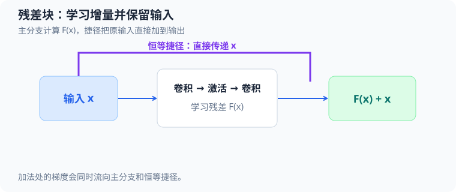

# 用纯 C 理解残差网络（residual network，ResNet）

本教程跟读 [`src/ml/22_resnet.c`](../../src/ml/22_resnet.c)，从 $8\times8$ 合成线条图像开始，走过卷积、残差相加、分类、反向传播和参数更新。程序不依赖机器学习框架。运行 `make resnet` 可比较普通 CNN 与 ResNet；运行 `make test-resnet` 检查梯度与边界，运行 `make sanitize-resnet` 检查内存和未定义行为。阶段说明见[深度学习计划](../00_学习总览.md#dl-resnet-stage)，构建规则见 [Makefile](../../Makefile#L1215)。



主分支计算 $F(x)$，捷径直接传入 $x$，输出为 $F(x)+x$；反向传播在加法处也沿两条路径分流。

## 1. 案例输入与源码地图

网络接收单通道灰度图 $X\in[0,1]^{8\times8}$，输出竖线、横线、斜线三类之一。训练、验证和测试分别使用 $60$、$60$、$120$ 张确定性生成的图像。数据由 `dataset_generate` 创建；网络层缓存集中在 `Forward`；`network_forward` 和 `sample_backward` 分别串起前向与单样本反向计算。

| 概念 | 源码位置 | 关键变量 | 作用 |
| --- | --- | --- | --- |
| 形状、参数布局 | [`enum` 常量](../../src/ml/22_resnet.c#L14)、[`Network`](../../src/ml/22_resnet.c#L49)、[`Forward`](../../src/ml/22_resnet.c#L53) | `PARAMETER_COUNT`、`parameters`、`stem`、`branch` | 固定张量大小和 $105$ 个参数的位置。 |
| 伪随机数据 | [`random_unit`](../../src/ml/22_resnet.c#L76)、[`dataset_generate`](../../src/ml/22_resnet.c#L89) | `seed`、`target`、`center_x`、`pixels` | 生成三类平衡、带平移和像素噪声的线条图。 |
| 卷积与残差合并 | [`convolution_forward`](../../src/ml/22_resnet.c#L134)、[`residual_merge`](../../src/ml/22_resnet.c#L215) | `weights`、`preactivation`、`skip` | 计算共享的两层卷积分支，并可加上 stem 恒等捷径。 |
| 整体前向 | [`network_forward`](../../src/ml/22_resnet.c#L277) | `stem`、`conv1`、`block`、`pooled`、`logits` | 从图像一直计算到三类概率。 |
| 单样本反向 | [`sample_backward`](../../src/ml/22_resnet.c#L341)、[`convolution_backward`](../../src/ml/22_resnet.c#L175) | `output_delta`、`skip_gradient`、`stem_gradient` | 把损失梯度沿分类头、残差两路和卷积传回。 |
| 批量训练和评估 | [`loss_and_gradient`](../../src/ml/22_resnet.c#L445)、[`train`](../../src/ml/22_resnet.c#L491)、[`evaluate`](../../src/ml/22_resnet.c#L522) | `accumulated`、`learning_rate`、`accuracy` | 平均样本梯度后执行全批量 SGD，并统计交叉熵与准确率。 |
| 数值验证 | [`check_gradients`](../../src/ml/22_resnet.c#L566)、[`test_identity_gradient`](../../src/ml/22_resnet.c#L639) | `epsilon`、`numeric`、`skip_gradient` | 用有限差分检查两种网络，并单独验证恒等路径。 |
| 实验入口 | [`main`](../../src/ml/22_resnet.c#L700) | `seed`、`cnn`、`resnet` | 用相同数据、初始参数和训练预算运行三组对照。 |

## 2. 数据如何生成

`random_unit` 用一个 $32$ 位状态生成可复现的伪随机数。令 $R_m$ 表示第 $m$ 次调用前的状态，$m$ 从 $0$ 开始；$u_m$ 是输出，取值在 $[0,1)$：

$$
\begin{aligned}
R_{m+1}&=(1664525R_m+1013904223)\bmod2^{32},\\
u_m&=\frac{\lfloor R_{m+1}/2^8\rfloor}{2^{24}}
\end{aligned}
\tag{1}
$$

例如种子 $42$ 时，$R_0=42$，第一次更新得 $R_1=1664525(42)+1013904223=1083814273$，代入输出式得到 $u_0=\lfloor1083814273/2^8\rfloor/2^{24}\approx0.25234514$；随后两个输出约为 $0.08812499$ 和 $0.57728118$。对样本 $i$，代码令类别 $y_i=i\bmod3$，然后依次抽取水平中心、竖直中心、亮度，再为每个像素抽取噪声：

$$
\begin{aligned}
c_{x,i}&=2.5+3u_{i,0},\\
c_{y,i}&=2.5+3u_{i,1},\\
b_i&=0.75+0.25u_{i,2}
\end{aligned}
\tag{2}
$$

其中 $c_{x,i}$、$c_{y,i}$ 是线条中心，$b_i$ 是亮线亮度，$u_{i,k}$ 表示该样本依次取得的随机数。像素位置 $(r,c)$ 的局部坐标为 $\xi=c-c_{x,i}$、$\upsilon=r-c_{y,i}$；类别 $0$、$1$、$2$ 分别画竖线、横线和斜线：

$$
\operatorname{inside}_{i,r,c}=\begin{cases}
|\xi|\le0.75,&y_i=0\\
|\upsilon|\le0.75,&y_i=1\\
|\xi-\upsilon|\le0.85,&y_i=2
\end{cases}
\tag{3}
$$

令 $v_{i,r,c}$ 为像素噪声对应的随机数，则送入网络的像素是：

$$
X_i[r,c]=\operatorname{clamp}\left(
\begin{cases}b_i,&\operatorname{inside}_{i,r,c}\\0.05,&\text{otherwise}\end{cases}
+0.08(v_{i,r,c}-0.5),\ 0,\ 1\right)
\tag{4}
$$

`clamp` 将灰度限制在 $[0,1]$。每张图像使用自己的线条位置和亮度，背景也有小幅噪声；标签仍由类别编号确定，没有标签翻转。样本数必须是 $3$ 的倍数、不能为 $0$，且不能超过固定容量 $120$；生成先写局部 `Dataset`，通过检查后才整体替换输出。

以训练种子 $42$ 的第一张图为例，标签为 $y_0=0$，前三个随机数给出：

$$
\begin{aligned}
c_{x,0}&=2.5+3(0.25234514)\approx3.257035,\\
c_{y,0}&=2.5+3(0.08812499)\approx2.764375,\\
b_0&=0.75+0.25(0.57728118)\approx0.894320
\end{aligned}
\tag{5}
$$

因此这是竖线图。对像素 $(r,c)=(3,3)$，$\xi=3-3.257035=-0.257035$，满足 $|\xi|\le0.75$，该像素在线上。这个像素实际噪声随机数约为 $0.02245522$，所以：

$$
\begin{aligned}
X_0[3,3]&=0.894320+0.08(0.02245522-0.5)\approx0.856117
\end{aligned}
\tag{6}
$$

图像按行优先存储，`pixels[27]` 就是 $X_0[3,3]$；代码中的卷积张量则按 `[channel][row][column]` 排列。

## 3. 网络结构与参数

输入图像先经过 stem 卷积，得到两个通道的特征图 $S\in\mathbb{R}^{2\times8\times8}$。残差块的主分支 $F(S)$ 是两层 $3\times3$ 卷积：第一层后接 ReLU，第二层暂不接激活。ResNet 把 stem 特征直接加到主分支上，再过 ReLU；普通 CNN 则不做相加：

$$
\begin{aligned}
F(S)&=\operatorname{Conv}_2(\operatorname{ReLU}(\operatorname{Conv}_1(S))),\\
H_{\mathrm{ResNet}}&=\operatorname{ReLU}(S+F(S)),\\
H_{\mathrm{CNN}}&=\operatorname{ReLU}(F(S))
\end{aligned}
\tag{7}
$$

`residual_merge` 的 `skip` 参数决定是否加捷径：传入 stem 张量时得到 ResNet；传 `nullptr` 时普通 CNN 只对分支结果执行 ReLU。两种结构共用相同的卷积层和分类头，不为恒等捷径新增参数。

参数偏移定义在源码常量 `STEM_W` 到 `HEAD_B` 中。下标区间左闭右开：

| 参数段 | 张量形状 | 参数下标 | 数量 |
| --- | --- | --- | ---: |
| Stem 卷积核 | $[2,1,3,3]$ | $[0,18)$ | $18$ |
| Stem 偏置 | $[2]$ | $[18,20)$ | $2$ |
| 第一层块卷积核 | $[2,2,3,3]$ | $[20,56)$ | $36$ |
| 第一层块偏置 | $[2]$ | $[56,58)$ | $2$ |
| 第二层块卷积核 | $[2,2,3,3]$ | $[58,94)$ | $36$ |
| 第二层块偏置 | $[2]$ | $[94,96)$ | $2$ |
| 分类头权重 | $[3,2]$ | $[96,102)$ | $6$ |
| 分类头偏置 | $[3]$ | $[102,105)$ | $3$ |

总数是 $18+2+36+2+36+2+6+3=105$。`Forward` 保留激活缓存：`stem_pre`、`conv1_pre` 用于 ReLU 反向掩码，`branch` 是残差主分支，`block_pre` 是相加后的值，`block` 是 ReLU 输出。这里的维度设计让捷径两端都恰为 $[2,8,8]$，所以可以逐元素相加。

`network_initialize` 对卷积核和分类头使用固定范围的均匀初始化，偏置使用小的正数。源码给 stem 权重的范围上限为 $\sqrt{6/10}\approx0.774597$，两层块卷积为 $\sqrt{6/18}\approx0.577350$，分类头为 $\sqrt{3/2}\approx1.224745$；这些是本案例写死的初始化常量。种子 $5042$ 的第一个随机数约为 $0.19010729$，因此第一个 stem 权重为：

$$
\begin{aligned}
W_{\mathrm{stem},0}&=\sqrt{6/10}\\
(2\cdot0.19010729-1)&\approx-0.480084
\end{aligned}
\tag{8}
$$

卷积偏置按通道依次设为 $0.03,0.06$、$0.04,0.08$ 和 $0.05,0.10$；分类头偏置从零开始。每次实验先初始化 CNN，再执行 `resnet = cnn`，所以两者从完全相同的 $105$ 个参数起步。

## 4. 前向传播：从卷积到类别概率

### 4.1 卷积和零填充

对输入通道数为 $C_{\mathrm{in}}$、输出通道数为 $C_{\mathrm{out}}$ 的一层卷积，$K_{o,d,\alpha,\beta}$ 是输出通道 $o$、输入通道 $d$、核位置 $(\alpha,\beta)$ 的权重；$b_o$ 是偏置。$X$ 是输入张量，超出图像边界的位置按零处理，输出位置 $(r,c)$ 的计算为：

$$
Z_{o,r,c}=b_o+\sum_{d=0}^{C_{\mathrm{in}}-1}\sum_{\alpha=0}^{2}\sum_{\beta=0}^{2}
K_{o,d,\alpha,\beta}\,\widetilde X_{d,r+\alpha-1,c+\beta-1}
\tag{9}
$$

其中 $\widetilde X$ 表示带零填充的输入。步长为 $1$，因此空间大小仍是 $8\times8$。实现按输出通道、行、列遍历，再累加输入通道和核位置；严格说，这个核遍历是深度学习里常称“卷积”的互相关计算，权重没有翻转。`weight_index` 实现 $[out][in][ky][kx]$ 布局，`input_index` 实现通道优先布局。

继续使用种子 $42$、初始化种子 $5042$ 的图像，在通道 $0$、位置 $(3,3)$，输入的 $3\times3$ 邻域和 stem 核为：

$$
\begin{aligned}
X_0[2\!:\!5,2\!:\!5]&\approx
\begin{bmatrix}0.024441&0.898327&0.875038\\0.014856&0.856117&0.897303\\0.065712&0.911230&0.911810\end{bmatrix},\\
K_{0,0}&\approx
\begin{bmatrix}-0.480084&0.165687&-0.590796\\-0.303047&0.320604&0.123934\\0.205179&0.593758&-0.078264\end{bmatrix}
\end{aligned}
\tag{10}
$$

把 $9$ 个逐项乘积和偏置相加，可复现源码中的 `stem_pre[27]`：

$$
\begin{aligned}
0.03-0.011734+0.148842-0.516969-0.004502
&+0.274474+0.111207+0.013483+0.541049-0.071362\approx0.514488
\end{aligned}
\tag{11}
$$

Stem 后执行 $\operatorname{ReLU}(z)=\max(0,z)$，所以该位置的 `stem[27]` 仍为 $0.514488$。对第一张训练样本，两个通道的若干真实中间值如下：

| 缓存 | 通道 $0$，位置 $27$ | 通道 $1$，位置 $91$ | 含义 |
| --- | ---: | ---: | --- |
| `stem_pre` / `stem` | $0.514488$ | $1.562703$ | stem 线性值和 ReLU 后值；两者均为正。 |
| `conv1_pre` / `conv1` | $0.064697$ | $0.450325$ | 第一块卷积激活；两者均通过 ReLU。 |
| `branch` | $-0.409588$ | $0.144877$ | 第二块卷积输出，尚未执行块末 ReLU。 |
| ResNet `block_pre` / `block` | $0.104900$ | $1.707580$ | 将 stem 加回后为正，ReLU 保持原值。 |

通道 $0$ 的直观差别很明显：主分支给出负值 $-0.409588$，普通 CNN 经过 ReLU 会把它变成 $0$；ResNet 将 $0.514488$ 的 stem 特征加回，得到 $0.104900$，保留了正向信号。

### 4.2 池化、分类头与交叉熵

全局平均池化把每个通道的 $8\times8$ 特征图压缩为一个数。$d$ 是通道下标，$r,c$ 是空间位置：

$$
q_d=\frac{1}{64}\sum_{r=0}^{7}\sum_{c=0}^{7}H_{d,r,c}
\tag{12}
$$

对这一张图，两个通道的池化分别为 $q_0=6.044776/64\approx0.094450$、$q_1=45.934408/64\approx0.717725$。分类头对类别 $j\in\{0,1,2\}$ 计算 logit $z_j$，其中 $W^{\mathrm{head}}_{j,d}$ 和 $b^{\mathrm{head}}_j$ 分别是分类权重与偏置：

$$
z_j=b^{\mathrm{head}}_j+\sum_{d=0}^{1}W^{\mathrm{head}}_{j,d}q_d
\tag{13}
$$

例如类别 $0$ 的偏置为 $0$，权重约为 $(-0.987017,1.134688)$，所以 $z_0=(-0.987017)(0.094450)+(1.134688)(0.717725)\approx-0.093223+0.814394=0.721171$。三个 logit 分别为 $(0.721171,-0.380009,-0.731992)$。

`softmax` 先减最大 logit $z_{\max}$，再归一化指数。$p_j$ 是类别概率；求和下标 $k$ 也是类别编号：

$$
\begin{aligned}
p_j&=\frac{\exp(z_j-z_{\max})}{\sum_{k=0}^{2}\exp(z_k-z_{\max})},\\
z_{\max}&=\max_{k\in\{0,1,2\}}z_k
\end{aligned}
\tag{14}
$$

本例的最大值 $z_{\max}=0.721171$，移位指数约为 $(1,0.332479,0.233830)$，总和为 $1.566308$，故 $\mathbf p\approx(0.638444,0.212269,0.149287)$。它们相加为 $1$；最大概率类别为 $0$，预测正确。

目标类别 $y_i$ 转成 one-hot 向量 $t_j=\mathbf{1}[j=y_i]$。单样本交叉熵为 $\ell_i=-\sum_jt_j\ln p_j$。实现用等价的 log-sum-exp 形式避免直接对极小概率取对数：

$$
\begin{aligned}
\ell_i&=z_{\max}-z_{y_i}+\ln\left(\sum_{j=0}^{2}\exp(z_j-z_{\max})\right)
\end{aligned}
\tag{15}
$$

本例 $y_0=0$，因此 $\ell_0=0.721171-0.721171+\ln(1.566308)\approx0.448721$。`sample_backward` 计算单个样本损失；`loss_and_gradient` 对批次中 $N$ 个样本取平均，得到 $L=\frac{1}{N}\sum_{i=0}^{N-1}\ell_i$。

## 5. 反向传播：梯度如何走过捷径

### 5.1 分类头与全局平均池化

Softmax 和交叉熵组合后，logit 梯度可以简化为 $\delta_j=p_j-t_j$。这避免了分别展开 softmax 与对数的复杂链式计算。代码中的 `output_delta[j]` 正是这个值：

$$
\begin{aligned}
\frac{\partial\ell_i}{\partial z_j}&=\delta_j=p_j-t_j,\\
\frac{\partial\ell_i}{\partial W^{\mathrm{head}}_{j,d}}&=\delta_jq_d,\\
\frac{\partial\ell_i}{\partial b^{\mathrm{head}}_j}&=\delta_j
\end{aligned}
\tag{16}
$$

本例 $\mathbf t=(1,0,0)$，所以 $\boldsymbol\delta\approx(-0.361556,0.212269,0.149287)$。分类头中类别 $0$、通道 $0$ 权重的单样本梯度为 $(-0.361556)(0.094450)\approx-0.034149$。

因为池化是 $64$ 个位置的平均，通道 $d$ 每个位置收到相同的 $1/64$ 梯度：

$$
\frac{\partial\ell_i}{\partial H_{d,r,c}}=
\frac{1}{64}\sum_{j=0}^{2}\delta_jW^{\mathrm{head}}_{j,d}
\tag{17}
$$

在通道 $0$、位置 $27$，三个类别的乘积和约为 $0.356862-0.225923-0.081882=0.049058$；除以 $64$ 后是 $0.000766524$。由于该处 ResNet 的 `block_pre` 为正，块末 ReLU 的导数为 $1$，这个梯度会同时进入主分支和恒等捷径。

### 5.2 残差相加的导数

把特征张量展平为 $128$ 个位置，以 $n\in\{0,\ldots,127\}$ 编号；源码循环变量 `i` 表示位置 $n$，对应关系为 $n=64d+8r+c$。令 $S_n$ 为捷径输入，$F_n(S)$ 为主分支输出，$A_n=S_n+F_n(S)$，$H_n=\operatorname{ReLU}(A_n)$。本节的 $\ell_i$ 表示当前样本的交叉熵；$g_n=\partial\ell_i/\partial H_n$ 是上游梯度，$\chi_n=\mathbf{1}[A_n>0]$ 是 ReLU 掩码；$J_F$ 是主分支对输入的 Jacobian。按链式法则：

$$
\begin{aligned}
g^{\mathrm{merge}}_n&=\chi_n g_n,\\
\nabla_S \ell_i&=\boldsymbol{\chi}\odot\mathbf g+J_F(S)^{\mathsf T}(\boldsymbol{\chi}\odot\mathbf g)
\end{aligned}
\tag{18}
$$

第一项是恒等捷径的直接梯度，第二项是穿过两层卷积和中间 ReLU 的主分支梯度。`residual_merge_backward` 把 $\chi_n g_n$ 写入 `branch_gradient[i]`，并在有捷径时加到 `skip_gradient[i]`；随后卷积反传生成主分支对 stem 的梯度，代码将两者相加，再乘 stem 自身的 ReLU 掩码。普通 CNN 没有第一项。

其中 $\odot$ 表示逐元素相乘，$J_F(S)^{\mathsf T}$ 是主分支关于输入 $S$ 的 Jacobian 转置；$\nabla_S\ell_i$ 表示损失对整张输入特征张量的梯度。

前向合并在 [`residual_merge`](../../src/ml/22_resnet.c#L215) 中直接对应为：

```c
preactivation[i] = branch[i];
if (skip != nullptr) {
    preactivation[i] += skip[i];
}
output[i] = fmax(0.0, preactivation[i]);
```

`branch[i]` 是 $F_n(S)$，可选的 `skip[i]` 是 $S_n$，`preactivation[i]` 保存 $A_n$，`output[i]` 保存 $H_n$。当 `skip` 为空时，同一函数退化成普通 CNN 的块末 ReLU。

测试用两个元素把这条规则具体化：第 $0$ 项设 $A_0=3$、上游梯度 $g_0=2.5$，掩码为 $1$，因此主分支和捷径都收到 $2.5$；第 $1$ 项设 $A_1=-1$、上游梯度 $g_1=7$，掩码为 $0$，两条路径都收到 $0$。源码在 $A_n=0$ 时也选择导数 $0$，这是 ReLU 在折点处采用的计算约定。

对本例真实位置 $27$，`branch_gradient[27]` 与 `skip_gradient[27]` 都等于 $0.000766524$。再继续穿过主分支后，stem 权重 `STEM_W` 第 $0$ 项的单样本梯度在普通 CNN 中约为 $-0.033978731$，在 ResNet 中约为 $-0.015423518$。这只是当前样本、当前随机初始化的结果；捷径提供直接梯度项，但它本身不保证任意网络都不会梯度消失。

反向代码在 [`residual_merge_backward`](../../src/ml/22_resnet.c#L234) 中把这个导数拆到两路：

```c
double gradient = preactivation[i] > 0.0 ? output_gradient[i] : 0.0;
branch_gradient[i] = gradient;
if (skip_gradient != nullptr) {
    skip_gradient[i] += gradient;
}
```

所以 `branch_gradient` 总是接收经过 ReLU 掩码的上游梯度；仅当启用捷径时，`skip_gradient` 才得到同一份直接梯度。这里的 `+=` 是必要的，因为该缓冲区可能已经累积其他路径的贡献。

### 5.3 卷积反传与整批更新

令 $\Delta_{o,r,c}$ 是某层卷积输出的上游梯度，$X$ 是该层输入。一个共享卷积核权重会被多个空间位置重复使用，因此权重梯度要对所有有效位置求和；偏置梯度也对输出位置求和：

$$
\begin{aligned}
\frac{\partial\ell_i}{\partial K_{o,d,\alpha,\beta}}&=
\sum_{(r,c)\,\mathrm{valid}}\Delta_{o,r,c}X_{d,r+\alpha-1,c+\beta-1},\\
\frac{\partial\ell_i}{\partial b_o}&=\sum_{r,c}\Delta_{o,r,c}
\end{aligned}
\tag{19}
$$

输入梯度则把所有能影响该输入位置的输出贡献加起来：

$$
\frac{\partial\ell_i}{\partial X_{d,r,c}}=
\sum_{o,\alpha,\beta\,\mathrm{valid}}\Delta_{o,r-\alpha+1,c-\beta+1}K_{o,d,\alpha,\beta}
\tag{20}
$$

这里的 `valid` 表示对应输出位置仍在特征图范围内。`convolution_backward` 按前向相同的核索引遍历，将贡献累加到 `weight_gradient`、`bias_gradient` 和 `input_gradient`；调用者在第一次累加前清零这些数组。ReLU 反向只保留前向线性值大于 $0$ 的梯度。

令 $\boldsymbol{\theta}$ 表示全部 $105$ 个可训练参数。`loss_and_gradient` 将 $60$ 个样本各自的参数梯度累加，然后除以样本数。`train` 在一次完整梯度计算之后更新全部参数，使用固定学习率 $\eta=0.08$，每个 epoch 做一次全批量 SGD，没有动量、权重衰减或学习率衰减：

$$
\boldsymbol{\theta}^{(e+1)}=\boldsymbol{\theta}^{(e)}-\eta\nabla_{\boldsymbol{\theta}} L
\tag{21}
$$

以训练种子 $42$ 的 ResNet 为例，初始训练集平均损失为 $1.329633539$；第一个 stem 权重为 $-0.480083728$，整批梯度为 $0.002528058$。第一次更新得到：

$$
\begin{aligned}
W_{\mathrm{stem},0}^{(1)}&=-0.480083728-0.08(0.002528058)\approx-0.480285973
\end{aligned}
\tag{22}
$$

源码 [`train`](../../src/ml/22_resnet.c#L491) 对每个参数执行的核心更新是 `updated = network->parameters[p] - learning_rate * gradient[p]`，再检查 `updated` 是否有限，最后写回网络。`gradient[p]` 已经是整批平均梯度，因此这里每个 epoch 只更新一次。

这 $50$ 次更新全部使用同一训练集，验证集只用于报告结果，没有用于早停或挑选轮数。

## 6. 梯度检查与边界

`check_gradients` 对普通 CNN 和 ResNet 分别执行同一套检查：使用 $3$ 张种子为 $2026$ 的图像、种子为 $91$ 的初始网络，对全部 $105$ 个参数计算解析梯度，再将每个参数加减 $\varepsilon=10^{-5}$，用中心差分估计数值梯度。$\kappa\in\{0,\ldots,104\}$ 是参数向量下标，$\mathbf e_\kappa$ 是第 $\kappa$ 项为 $1$ 的单位向量：

$$
\begin{aligned}
L_+&=L(\boldsymbol\theta+\varepsilon\mathbf e_\kappa),\\
L_-&=L(\boldsymbol\theta-\varepsilon\mathbf e_\kappa),\\
g_\kappa^{\mathrm{num}}&=\frac{L_+-L_-}{2\varepsilon},\\
E_\kappa&=\frac{|g_\kappa^{\mathrm{num}}-g_\kappa^{\mathrm{analytic}}|}
{\max(1,|g_\kappa^{\mathrm{num}}|,|g_\kappa^{\mathrm{analytic}}|)}
\end{aligned}
\tag{23}
$$

测试中 `STEM_W` 第 $0$ 项的解析梯度约为 $0.000415608304$；扰动参数后的平均损失为 $L_+=1.170198151550$、$L_-=1.170198143238$，因此：

$$
g_0^{\mathrm{num}}=\frac{1.170198151550-1.170198143238}{2\times10^{-5}}
\approx0.0004156083
\tag{24}
$$

各参数的归一化误差必须不超过 $2\times10^{-5}$。测试还对第一张图的像素下标 $17$ 做输入梯度检查。`sample_backward` 给出单样本梯度，而数值差分来自 $3$ 张图的平均损失，所以代码把数值差分乘以 $3$ 后比较；本次解析值约为 $0.000755729855$，缩放后的数值值约为 $0.000755729879$。

主要边界如下：

- `dataset_generate` 拒绝空数据、非 $3$ 的倍数和超过容量的数量；生成失败时不覆盖原数据集。
- `network_forward` 检查标签范围、参数和像素是否有限，并只在完整前向成功后写入 `Forward`。它不强制输入像素落在 $[0,1]$；这一范围由本案例的数据生成器保证。
- `loss_and_gradient` 拒绝空批次和超过容量的数据，并在全部结果有限后才复制梯度与损失输出。`sample_backward` 的参数梯度接口是累加式，调用者须预先清零。
- `train` 原地逐项更新网络；若后续某次计算失败，网络会保留已完成的更新。正常固定种子案例没有触发此路径。
- `evaluate` 以最大 logit 作为预测；若多个类别 logit 完全相等，严格大于比较会保留最小类别下标。测试还确认非有限像素使评估失败且不改写已有指标。

`make test-resnet` 最终输出“恒等分支手算、两种网络梯度和失败边界”通过。它验证了实现与有限差分在该确定性样本上的一致性，不证明模型对现实图像的准确性。

## 7. 运行对照与正确解读

运行 `make resnet` 可复现三组结果。基础种子为 $42$、$143$、$244$；验证和测试数据分别使用基础种子加 $1000$、$2000$，网络初始化使用基础种子加 $5000$。每个种子都让两种模型使用相同数据、相同初值、$50$ 轮训练和学习率 $0.08$。下表列出独立测试结果：

| 基础种子 | CNN 测试损失 | CNN 准确率 | ResNet 测试损失 | ResNet 准确率 |
| ---: | ---: | ---: | ---: | ---: |
| $42$ | $1.0565$ | $62.5\%$ | $1.0239$ | $66.7\%$ |
| $143$ | $1.0965$ | $33.3\%$ | $1.0913$ | $60.8\%$ |
| $244$ | $1.0076$ | $66.7\%$ | $1.0091$ | $62.5\%$ |
| 均值 | — | $54.2\%$ | — | $63.3\%$ |

这次固定实验里，ResNet 的三种子平均测试准确率较高，但第三个种子中 CNN 略好。数据集很小，模型也只有一个残差块；这组数字只能展示控制变量的对照方法，不能推出 ResNet 对所有任务都更优，也没有展示深层网络中的梯度消失现象。

## 8. 建议的学习顺序

1. 先运行 `make resnet`，记录每个种子的训练、验证和测试指标，观察同一结构也会随数据种子变化。
2. 阅读 `dataset_generate` 和 `convolution_forward`，手算样本 $0$ 的一个像素及其卷积输出，再对照 `Forward` 中间缓存。
3. 阅读 `residual_merge`，先用 $A=3$ 和 $A=-1$ 手算 ReLU 两侧的梯度，再追踪 `skip_gradient` 如何与主分支梯度汇合到 stem。
4. 运行 `make test-resnet`，把中心差分的 $\varepsilon$ 改大或改小，观察截断误差和浮点误差如何影响梯度检查。
5. 只有在更改卷积块数量或张量形状时，才扩展参数布局；要同步修改两种模型、全部反向路径和梯度检查，再比较相同预算下的表现。
