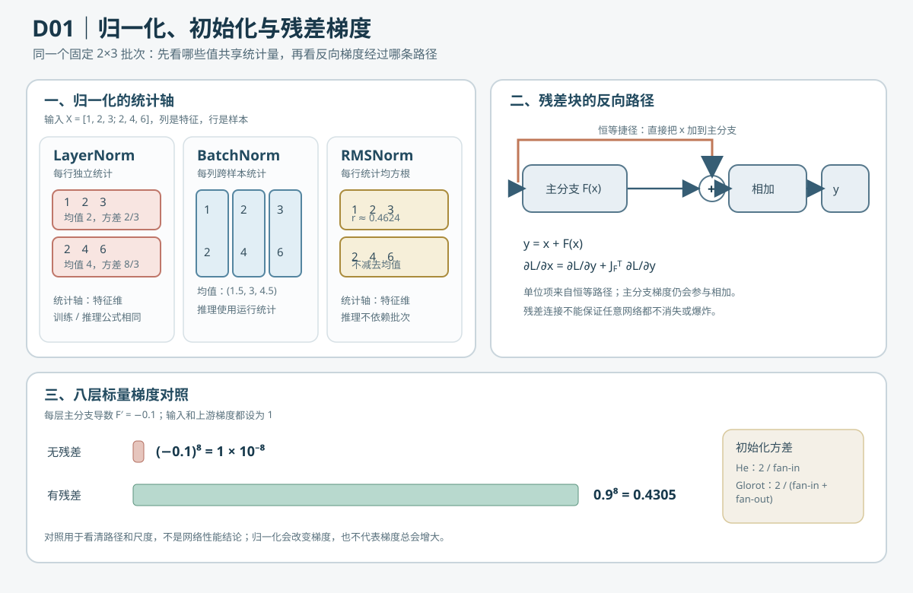

# 训练稳定性（training stability）与归一化（normalization）

本篇先建立一个可用于后续实验的检查框架：参数更新幅度是否合适、梯度是否有限且可控、不同归一化方法在什么范围内统计。它补充[神经网络通用训练地图](52_XOR多层感知机.md)，并连接多层感知机（multilayer perceptron，MLP）、循环神经网络（recurrent neural network，RNN）和变换器（Transformer）案例。D01 的新增实验使用 [`41_normalization_residual.c`](../../src/ml/41_normalization_residual.c) 与 [`41_normalization_residual.py`](../../src/python/ml/41_normalization_residual.py)，把层归一化（Layer Normalization，LayerNorm）、批归一化（Batch Normalization，BatchNorm）、均方根归一化（Root Mean Square Normalization，RMSNorm）、初始化尺度和残差连接（residual connection）的反向路径放在同一组小数组上计算。



## 1. 参数更新为什么会不稳定

梯度下降（gradient descent）更新为 $\theta_{t+1}=\theta_t-\eta g_t$。这里 $\theta_t$ 是第 $t$ 步的参数，$g_t$ 是当前批次的梯度，$\eta$ 是学习率（learning rate）。若某参数为 $1$、梯度为 $2$，学习率 $\eta=0.1$ 时更新为 $0.8$；若 $\eta=1$，则一步变成 $-1$，可能越过较好的区域。过小的学习率会让学习变慢，过大的学习率可能造成损失震荡或发散。

学习率调度（learning-rate schedule）会随训练步数改变 $\eta$。预热（warmup）从较小步长逐渐增加，常用于训练初期；余弦衰减（cosine decay）则在后期逐渐降低步长。它们是超参数策略，应该用验证数据和固定训练预算比较，不能仅凭训练损失挑选。

## 2. 梯度裁剪与梯度累积

梯度裁剪（gradient clipping）限制整组梯度的欧几里得范数（Euclidean norm）。令 $\mathbf{g}$ 是所有参数组成的梯度向量，$G$ 是其范数，$c>0$ 是裁剪阈值：

$$
\begin{aligned}
G&=\lVert\mathbf{g}\rVert_2,\\
\tilde{\mathbf{g}}&=
\begin{cases}
\mathbf{g},&G\le c,\\
\dfrac{c}{G}\mathbf{g},&G>c.
\end{cases}
\end{aligned}
\tag{1}
$$

例如 $\mathbf{g}=(3,4)$ 的欧几里得范数为 $G=\sqrt{3^2+4^2}=5$。阈值 $c=1$ 时缩放因子为 $1/5$，裁剪后是 $(0.6,0.8)$；方向保留，长度变为 $1$。RNN 案例已有全局范数裁剪，可对照 [`clip_gradient`](../../src/ml/10_char_rnn.c#L286) 和[字符 RNN 教程](56_字符循环神经网络.md)。裁剪能缓解梯度爆炸（exploding gradients），不能修复错误的损失、标签或学习率设置。

梯度累积（gradient accumulation）把若干小批次的梯度累加或平均后再更新一次。例如累积 $4$ 个、每个 $8$ 条样本的小批次，在每个小批次都基于同一份参数计算并正确按样本数求平均时，近似一次 $32$ 条样本的更新。它可降低单次图形处理器（graphics processing unit，GPU）内存或缓冲区需求；若中间使用批归一化（batch normalization，BatchNorm）、随机失活（dropout）或不同权重版本，结果可能不等同于真正的大批次。

## 3. 四种常见的尺度处理

| 方法 | 统计范围 | 训练与推理的差异 |
| --- | --- | --- |
| 输入标准化（input standardization） | 每个输入特征；均值和标准差只从训练集估计。 | 验证和测试重用训练统计量。 |
| 批归一化（batch normalization，BatchNorm） | 训练小批次内同一通道的激活；图像还会跨空间位置统计。 | 训练使用当前批次统计量，推理使用训练期间累计的统计量。 |
| 层归一化（layer normalization，LayerNorm） | 单个样本或序列位置的特征维度。 | 不依赖批次中的其他样本，训练和推理计算方式相同。 |
| 均方根归一化（root mean square normalization，RMSNorm） | 单个向量的均方根尺度，不先减去均值。 | 不依赖其他样本；常与可学习缩放参数配合。 |

输入标准化对特征 $x$ 使用训练集均值 $\mu_{\mathrm{train}}$、标准差 $\sigma_{\mathrm{train}}$ 和数值稳定项 $\epsilon$：

$$
\begin{aligned}
x'&=\frac{x-\mu_{\mathrm{train}}}
{\sqrt{\sigma_{\mathrm{train}}^2+\epsilon}}.
\end{aligned}
\tag{2}
$$

如果在全数据上先算均值和标准差，验证或测试分布信息就会进入训练流程。LayerNorm 的逐维计算和手算示例见[小型 Transformer 教程](58_小型Transformer.md)；Transformer C 示例实现了 LayerNorm，D01 案例另提供 BatchNorm 和 RMSNorm 的独立前向、反向与状态实验。

RMSNorm 对 $D$ 维输入 $\mathbf{x}$ 的第 $i$ 个元素计算为：

$$
\begin{aligned}
y_i&=\gamma_i\frac{x_i}
{\sqrt{\frac{1}{D}\sum_{j=1}^{D}x_j^2+\epsilon}}.
\end{aligned}
\tag{3}
$$

这里 $D$ 是特征维数，$j$ 是求和下标，$\gamma_i$ 是可学习缩放参数，$\epsilon$ 防止分母为零。与 LayerNorm 相比，它省去了减均值步骤；究竟选哪种，需结合网络结构和实验验证。

例如输入为 $(3,4)$ 且暂令 $\epsilon=0$、$\gamma_i=1$，均方根为 $\sqrt{(3^2+4^2)/2}=\sqrt{12.5}$，归一化结果约为 $(0.849,1.131)$。归一化后的均方根为 $1$，但每个分量不必落在 $[-1,1]$ 内。

## 4. D01 实验约定与统计轴

案例输入是行优先矩阵 $X\in\mathbb{R}^{B\times D}$，其中 $B=2$ 是样本数，$D=3$ 是每个样本的特征数。矩阵固定为：

$$
\begin{aligned}
X&=\begin{bmatrix}1&2&3\\2&4&6\end{bmatrix},\\
\gamma&=(1.2,\,0.8,\,-0.5),\\
\beta&=(0.1,\,-0.2,\,0.3),\\
U&=\begin{bmatrix}1&0.5&-1\\-0.5&1&2\end{bmatrix}.
\end{aligned}
\tag{4}
$$

$x_{ij}$ 表示第 $i$ 个样本的第 $j$ 个特征，索引范围为 $1\le i\le B$、$1\le j\le D$；$\gamma_j$ 和 $\beta_j$ 是跨样本共享的可学习仿射参数；$L$ 是标量损失，$y_{ij}$ 是归一化输出，$U_{ij}=\partial L/\partial y_{ij}$ 是反向传播的上游梯度。所有三种方法使用 $\epsilon=0.01$。C 将矩阵连续存为 `input[row * features + feature]`，Python 使用嵌套行序列；两者处理的是完全相同的六个输入数。

对输入输出的观察要区分三件事：归一化的统计轴决定哪些数共享均值/尺度；$\gamma,\beta$ 决定归一化后可学习的仿射变换；反向传播会把同一组 $\gamma,\beta$ 的梯度在共享位置累加。

## 5. 层归一化的前向与反向

### 5.1 前向：每行独立估计特征统计量

LayerNorm 对每个样本自己的 $D$ 个特征求均值与总体方差，不使用批次中的其他样本：

$$
\begin{aligned}
\mu_i&=\frac{1}{D}\sum_{j=1}^{D}x_{ij},\\
v_i&=\frac{1}{D}\sum_{j=1}^{D}(x_{ij}-\mu_i)^2,\\
r_i&=(v_i+\epsilon)^{-1/2},\\
\hat{x}_{ij}&=(x_{ij}-\mu_i)r_i,\\
y_{ij}&=\gamma_j\hat{x}_{ij}+\beta_j.
\end{aligned}
\tag{5}
$$

$\mu_i$ 是第 $i$ 行均值，$v_i$ 是该行的总体方差，$r_i$ 是逆标准差，$\hat{x}_{ij}$ 是标准化值，$y_{ij}$ 是输出。$\epsilon>0$ 避免常量行导致除以零。这里使用总体方差的分母 $D$，不是无偏估计的 $D-1$。

对第一行 $(1,2,3)$，逐项计算：

$$
\begin{aligned}
\mu_1&=(1+2+3)/3=2,\\
v_1&=\bigl((1-2)^2+(2-2)^2+(3-2)^2\bigr)/3=2/3,\\
r_1&=1/\sqrt{2/3+0.01}\approx1.215176,\\
\hat{\mathbf{x}}_1&\approx(-1.215176,\,0,\,1.215176),\\
\mathbf{y}_1&\approx(-1.358794,\,-0.2,\,-0.307831).
\end{aligned}
\tag{6}
$$

最后一行逐元素使用不同的 $\gamma_j,\beta_j$。例如第一个输出为 $1.2\times(-1.215176)+0.1\approx-1.358794$。第二个样本虽然数值整体扩大一倍，但它自己计算均值和方差，所以标准化结果与第一行相同。

### 5.2 反向：把均值与方差的依赖也求出来

令 $g_{ij}=U_{ij}\gamma_j$。先由 $y_{ij}=\gamma_j\hat{x}_{ij}+\beta_j$ 得到共享仿射参数梯度：

$$
\begin{aligned}
\frac{\partial L}{\partial\gamma_j}&=\sum_{i=1}^{B}U_{ij}\hat{x}_{ij},\\
\frac{\partial L}{\partial\beta_j}&=\sum_{i=1}^{B}U_{ij}.
\end{aligned}
\tag{7}
$$

对一个固定样本，记 $s_1=\sum_jg_{ij}$、$s_2=\sum_jg_{ij}\hat{x}_{ij}$。由于 $\mu_i$ 和 $v_i$ 都由该行的输入计算，输入梯度不能只写成 $g_{ij}r_i$。链式法则将均值、方差两条依赖路径也加回来：

$$
\begin{aligned}
\frac{\partial L}{\partial v_i}&=-\frac{1}{2}r_i^2s_2,\\
\frac{\partial L}{\partial\mu_i}&=-r_is_1,\\
\frac{\partial v_i}{\partial x_{ik}}&=\frac{2(x_{ik}-\mu_i)}{D},\\
\frac{\partial\mu_i}{\partial x_{ik}}&=\frac{1}{D},\\
\frac{\partial L}{\partial x_{ik}}&=\frac{r_i}{D}\left(Dg_{ik}-s_1-\hat{x}_{ik}s_2\right).
\end{aligned}
\tag{8}
$$

最后一个等式将直接路径、方差路径与均值路径合并。注意 $s_1,s_2$ 都只在同一行的特征维度上求和；不同样本之间不互相影响。

继续第一行的梯度手算。它的 $g=(1.2,0.4,0.5)$，因此 $s_1=2.1$，$s_2=-0.7r_1\approx-0.850623$。第一个输入梯度为：

$$
\begin{aligned}
\frac{\partial L}{\partial x_{11}}&=\frac{r_1}{3}\left(3(1.2)-2.1-(-r_1)(-0.7r_1)\right)\\
&\approx0.188637.
\end{aligned}
\tag{9}
$$

对另外两个输入执行同一公式，得到约 $(-0.364698,0.176061)$。完整六项结果由 `test_layer_norm_gradient` 对输入、$\gamma$ 和 $\beta$ 分别做中心差分。

## 6. 批归一化：训练批次与推理状态

### 6.1 训练态前向与运行统计

BatchNorm 对每个特征列跨 $B$ 个样本统计。对特征 $j$：

$$
\begin{aligned}
\mu_j^{(B)}&=\frac{1}{B}\sum_{i=1}^{B}x_{ij},\\
v_j^{(B)}&=\frac{1}{B}\sum_{i=1}^{B}(x_{ij}-\mu_j^{(B)})^2,\\
\hat{x}_{ij}&=\frac{x_{ij}-\mu_j^{(B)}}{\sqrt{v_j^{(B)}+\epsilon}},\\
y_{ij}&=\gamma_j\hat{x}_{ij}+\beta_j.
\end{aligned}
\tag{10}
$$

对矩阵 $X$，三列分别为 $(1,2)$、$(2,4)$、$(3,6)$，所以均值为 $(1.5,3,4.5)$，总体方差为 $(0.25,1,2.25)$。例如第一列第一行的标准化值为 $-0.5/\sqrt{0.25+0.01}\approx-0.980581$，输出为 $1.2\times(-0.980581)+0.1\approx-1.076697$。

推理时不能依赖将来和当前样本凑成的批次统计量，因此训练期间还维护运行均值 $m_j$ 和运行方差 $q_j$。代码约定 $\rho$ 是旧状态权重，初始化运行均值为 $0$、运行方差为 $1$：

$$
\begin{aligned}
m_j^{\mathrm{new}}&=\rho m_j^{\mathrm{old}}+(1-\rho)\mu_j^{(B)},\\
q_j^{\mathrm{new}}&=\rho q_j^{\mathrm{old}}+(1-\rho)v_j^{(B)}.
\end{aligned}
\tag{11}
$$

以 $\rho=0.9$ 代入本例，运行均值变为 $(0.15,0.3,0.45)$，运行方差变为 $(0.925,1,1.125)$。推理态用这些已保存数值代替当前批次均值/方差，且不修改运行状态。指数移动平均（exponential moving average，EMA）在这里使用总体方差递推；不同机器学习库对运行方差是否使用无偏修正可能不同，本教学实现明确采用此状态更新约定。

### 6.2 训练态反向

对每个特征列定义 $g_{ij}=U_{ij}\gamma_j$、$s_{1j}=\sum_i g_{ij}$、$s_{2j}=\sum_i g_{ij}\hat{x}_{ij}$。由于均值和方差都由该列的 $B$ 个值计算，按链式法则先分别求统计量的梯度，再求单个输入对统计量的导数：

$$
\begin{aligned}
\frac{\partial L}{\partial v_j^{(B)}}&=-\frac{1}{2}r_j^2s_{2j},\\
\frac{\partial L}{\partial\mu_j^{(B)}}&=-r_js_{1j},\\
\frac{\partial v_j^{(B)}}{\partial x_{ij}}&=\frac{2(x_{ij}-\mu_j^{(B)})}{B},\\
\frac{\partial\mu_j^{(B)}}{\partial x_{ij}}&=\frac{1}{B},\\
\frac{\partial L}{\partial x_{ij}}&=\frac{r_j}{B}\left(Bg_{ij}-s_{1j}-\hat{x}_{ij}s_{2j}\right),\\
\frac{\partial L}{\partial\gamma_j}&=\sum_{i=1}^{B}U_{ij}\hat{x}_{ij},\\
\frac{\partial L}{\partial\beta_j}&=\sum_{i=1}^{B}U_{ij},\\
r_j&=(v_j^{(B)}+\epsilon)^{-1/2}.
\end{aligned}
\tag{12}
$$

这是训练态的导数，因为改变一个输入会改变该列所有样本共享的均值和方差。推理态的运行统计是常量，故输入梯度简化为 $\partial L/\partial x_{ij}=r_jU_{ij}\gamma_j$；它不会继续微分运行均值/方差。

继续第一列的手算。$r_1=1/\sqrt{0.25+0.01}\approx1.961161$，两个标准化值是 $(-0.980581,0.980581)$；与上游梯度乘以 $\gamma_1$ 后，$g=(1.2,-0.6)$，所以 $s_{11}=0.6$、$s_{21}\approx-1.765045$。第一个样本的输入梯度为 $r_1/2\times(2(1.2)-0.6-(-0.980581)(-1.765045))\approx0.067886$，第二个样本的对应梯度是相反数。

当 $B=1$ 时，每列方差为零、$\hat{x}=0$，前向输出退化为 $\beta$，训练态输入梯度和 $\gamma$ 梯度都为零。这仍是有限数，但没有批内尺度信息。因此极小批次会让 BatchNorm 统计质量变差；推理时必须使用训练期间积累的运行统计。D01 另取留出输入 $(3,6,9)$ 做推理，第一列输出约为 $3.636880$，它使用运行均值 $0.15$ 和方差 $0.925$，不是重新拟合这个单样本。

## 7. RMSNorm：只按均方根缩放

RMSNorm 不减均值。对每个样本，定义 $r_i=(D^{-1}\sum_jx_{ij}^2+\epsilon)^{-1/2}$，然后 $\hat{x}_{ij}=x_{ij}r_i$、$y_{ij}=\gamma_j\hat{x}_{ij}$。上文原有 RMSNorm 公式 (3) 和 $(3,4)$ 例子保留。对本例第一行，均方为 $(1^2+2^2+3^2)/3=14/3$，所以：

$$
\begin{aligned}
r_1&=1/\sqrt{14/3+0.01}\approx0.462415,\\
\hat{\mathbf{x}}_1&\approx(0.462415,\,0.924830,\,1.387245),\\
\mathbf{y}_1&\approx(0.554898,\,0.739864,\,-0.693622).
\end{aligned}
\tag{13}
$$

令 $g_{ij}=U_{ij}\gamma_j$，$s_i=\sum_jg_{ij}\hat{x}_{ij}$。因为 $r_i=(D^{-1}\sum_jx_{ij}^2+\epsilon)^{-1/2}$，每个输入也会改变本行共用的 $r_i$：

$$
\begin{aligned}
\frac{\partial r_i}{\partial x_{ik}}&=-\frac{x_{ik}}{D}r_i^3,\\
\frac{\partial L}{\partial x_{ij}}&=r_i\left(g_{ij}-\frac{\hat{x}_{ij}}{D}s_i\right),\\
\frac{\partial L}{\partial\gamma_j}&=\sum_{i=1}^{B}U_{ij}\hat{x}_{ij}.
\end{aligned}
\tag{14}
$$

手算第一行的 $s_1=1.2(0.462415)+0.4(0.924830)+0.5(1.387245)\approx1.618$。代入第一个分量得到 $\partial L/\partial x_{11}\approx0.439541$。RMSNorm 保留输入向量的整体均值偏移；它与 LayerNorm 的统计目标不同，不能只凭公式少一步就断定效果更好。

## 8. 初始化方差：控制线性层输入尺度

考虑线性层 $z_j=\sum_{k=1}^{n_{\mathrm{in}}}W_{jk}x_k$。在权重与输入独立、权重均值为零、各输入方差近似为 $v_x$ 的假设下，各乘积交叉协方差为零，于是：

$$
\begin{aligned}
\operatorname{Var}(z_j)&=n_{\mathrm{in}}\operatorname{Var}(W_{jk})v_x,\\
\operatorname{Var}(W_{jk})_{\mathrm{He}}&=\frac{2}{n_{\mathrm{in}}},\\
\operatorname{Var}(W_{jk})_{\mathrm{Glorot}}&=\frac{2}{n_{\mathrm{in}}+n_{\mathrm{out}}},\\
W_{jk}&\sim\mathcal{U}(-a,a),\qquad a=\sqrt{3\operatorname{Var}(W_{jk})}.
\end{aligned}
\tag{15}
$$

$n_{\mathrm{in}}$ 和 $n_{\mathrm{out}}$ 分别是输入扇入（fan-in）和输出扇出（fan-out），$W_{jk}$ 是连接权重，$v_x$ 是输入方差。均匀分布 $\mathcal{U}(-a,a)$ 的方差为 $a^2/3$，故最后一行给出对应范围。He 初始化（He initialization）常用于线性整流单元（rectified linear unit，ReLU）；Glorot 初始化（Glorot initialization，也称 Xavier initialization）常用于 tanh 等双向传播尺度。这些是基于独立性和对称分布的近似，不是每批数据的精确保证。

取 $n_{\mathrm{in}}=4,n_{\mathrm{out}}=3,v_x=1$，He 目标权重方差为 $2/4=0.5$，Glorot 为 $2/7\approx0.285714$；对应均匀取值边界分别约为 $\pm1.224745$ 和 $\pm0.925820$。案例用固定线性同余生成器（linear congruential generator，LCG）种子生成一组权重，方便 C/Python 逐项相同；这 12 个数算出的有限样本方差约为 $0.648014$，不必恰好等于理论总体方差 $0.5$。

## 9. 残差连接：梯度多出恒等路径

残差块（residual block）把输入直接加到可学习主分支上。令 $x\in\mathbb{R}^{D}$、$F(x)\in\mathbb{R}^{D}$，且输入输出维度相同：

$$
\begin{aligned}
y&=x+F(x),\\
J_y&=I+J_F,\\
\nabla_xL&=(I+J_F)^{\mathsf T}\nabla_yL\\
&=\nabla_yL+J_F^{\mathsf T}\nabla_yL.
\end{aligned}
\tag{16}
$$

$J_y$ 和 $J_F$ 分别是整个残差块与主分支对输入的雅可比矩阵（Jacobian matrix），$I$ 是 $D\times D$ 单位矩阵；上游梯度经过恒等捷径（identity shortcut）直接加回，不必完全依赖主分支的导数。维度不一致时不能直接相加，常需要投影捷径；本例的标量实验只展示同维恒等捷径。

把主分支简化成每层 $F'(x)=-0.1$ 的线性映射，连续八层且输出上游梯度为 $1$。普通链每层乘 $-0.1$，所以梯度为 $(-0.1)^8=10^{-8}$；残差块每层导数为 $1-0.1=0.9$，梯度为 $0.9^8=0.43046721$。这说明恒等路径可改善某些梯度路径，但不保证整个网络永不梯度消失或爆炸；真实网络还受激活函数、主分支雅可比、归一化位置和优化过程影响。

## 10. 源码映射、实验命令与边界

| 概念 | C 源码 | 代码状态 / 对应内容 |
| --- | --- | --- |
| LayerNorm 前向与缓存 | [`layer_norm_forward`](../../src/ml/41_normalization_residual.c#L110) | `normalized` 保存 $\hat{x}$；`inverse_scale[row]` 保存 $r_i$。 |
| LayerNorm 反向 | [`layer_norm_backward`](../../src/ml/41_normalization_residual.c#L171) | 两个求和项对应 $s_1,s_2$；`gamma_gradient`、`beta_gradient` 跨行累加。 |
| BN 运行状态 | [`BatchNormState`](../../src/ml/41_normalization_residual.c#L38) 与 [`batch_norm_state_init`](../../src/ml/41_normalization_residual.c#L226) | `running_mean`、`running_variance` 与当前批次临时统计分开存放。 |
| BN 前向与模式分支 | [`batch_norm_forward`](../../src/ml/41_normalization_residual.c#L254) | `training` 决定计算批统计并更新 EMA，还是只读取运行统计。 |
| BN 反向 | [`batch_norm_backward`](../../src/ml/41_normalization_residual.c#L337) | 训练态使用批统计导数；推理态只乘固定逆标准差。 |
| RMSNorm 前向 / 反向 | [`rms_norm_forward`](../../src/ml/41_normalization_residual.c#L400)、[`rms_norm_backward`](../../src/ml/41_normalization_residual.c#L449) | 每行缓存均方根缩放；反向含 $\hat{x}$ 与缩放梯度的点积。 |
| 初始化方差与固定权重 | [`initializer_variance`](../../src/ml/41_normalization_residual.c#L499)、[`initialize_weights`](../../src/ml/41_normalization_residual.c#L527) | 目标方差决定均匀取值边界；固定 LCG 让两种语言共用同一组权重。 |
| 残差链 | [`gradient_chain`](../../src/ml/41_normalization_residual.c#L571) | 每层普通增益为 $F'$，残差增益为 $1+F'$。 |
| 中心差分与边界 | [`test_layer_norm_gradient`](../../src/ml/41_normalization_residual.c#L743)、[`test_batch_norm_gradient`](../../src/ml/41_normalization_residual.c#L784)、[`test_rms_norm_gradient`](../../src/ml/41_normalization_residual.c#L829)、[`test_boundaries`](../../src/ml/41_normalization_residual.c#L867) | 对输入与仿射参数做数值梯度检查，并验证单元素批次、零方差、非有限中间统计及失败原子性。 |
| 既有网络中的实际用法 | [`12_tiny_transformer.c` LayerNorm](../../src/ml/12_tiny_transformer.c#L298)、[`22_resnet.c` 残差合并](../../src/ml/22_resnet.c#L215) | Transformer 使用 pre-LayerNorm 和残差；ResNet 示例在同尺寸卷积块中加入恒等捷径。 |

Python 版按相同名称实现同一批数值：[`layer_norm_forward`](../../src/python/ml/41_normalization_residual.py#L97)、[`batch_norm_forward`](../../src/python/ml/41_normalization_residual.py#L197)、[`rms_norm_forward`](../../src/python/ml/41_normalization_residual.py#L321) 和 [`gradient_chain`](../../src/python/ml/41_normalization_residual.py#L442)。Python 用不可变缓存和运行状态表示前向阶段；`tests/python/test_normalization_residual.py` 用固定 CSV 字段逐项比较两种语言的输出。

运行入口：

```sh
make normalization-residual
python3 src/python/ml/41_normalization_residual.py
make test-normalization-residual
make sanitize-normalization-residual
```

`make test-normalization-residual` 运行 C 断言和 8 项 Python 单元测试，包括 33 个归一化输入/仿射参数梯度的中心差分、残差链的中心差分、手算前向值、BN 训练态更新/推理态只读、BN 单样本退化、零方差输入、有限统计溢出拒绝、初始化边界，以及 C/Python 的全部 CSV 数值对照。中心差分使用步长 $h=10^{-6}$，比较解析梯度 $g$ 与 $(L(\theta+h)-L(\theta-h))/(2h)$，容差为 $2\times10^{-7}$；被检查输入均避开不可导点。

一个失败配置是把 BatchNorm 的训练分支用于单样本推理：该“批次”方差为零，输出只剩 $\beta$，丢失输入尺度信息。另一个失败配置是令 $\epsilon=0$ 或让有限大输入的方差计算溢出；C/Python 接口都拒绝非正稳定项或非有限中间统计量，并且失败时不修改输出和 BN 状态。固定上游矩阵的输入梯度 L2 范数分别为恒等基线 $2.738613$、LayerNorm $0.914984$、BatchNorm $0.096097$、RMSNorm $0.547969$；它们展示统计轴和归一化如何改变梯度，不表示哪个方法对所有任务更优。

本案例只验证固定小数组的运算与反向传播，不拟合预测模型。BN 的单样本推理输入是独立留出值，只用于确认推理复用已拟合运行统计，不是泛化测试；要评估模型效果，仍需按照训练、验证、测试流程构造独立数据。固定容量上限为 4 行、4 个特征；实现使用总体方差与简单 EMA，不覆盖分布式 BN、同步统计、可学习偏置的 RMSNorm 变体或任意张量布局。

## 11. 建议练习顺序

1. 运行 `make test-normalization-residual`，先看三种归一化的前向、反向与中心差分结果。
2. 在纸上计算第一行 LayerNorm 的均值、总体方差、标准化值和第一个输入梯度。
3. 对照 BatchNorm 的列统计，手算一次运行均值/方差更新，再说明为什么留出样本推理不能重新拟合统计量。
4. 修改代码中的固定主分支导数，比较普通链与残差链的梯度乘积；同时改变 He/Glorot 的 fan-in、fan-out，观察目标权重方差如何变化。
5. 把稳定性问题分类为参数更新步长、梯度范数、激活统计轴、初始化尺度和恒等捷径，判断每种机制能解决及不能解决的问题。

完成后应能手算并解释 LayerNorm、BatchNorm、RMSNorm 的统计轴和梯度公式，说明 BN 训练态与推理态的区别，并用 $I+J_F$ 解释残差连接为何多出一条梯度路径。
