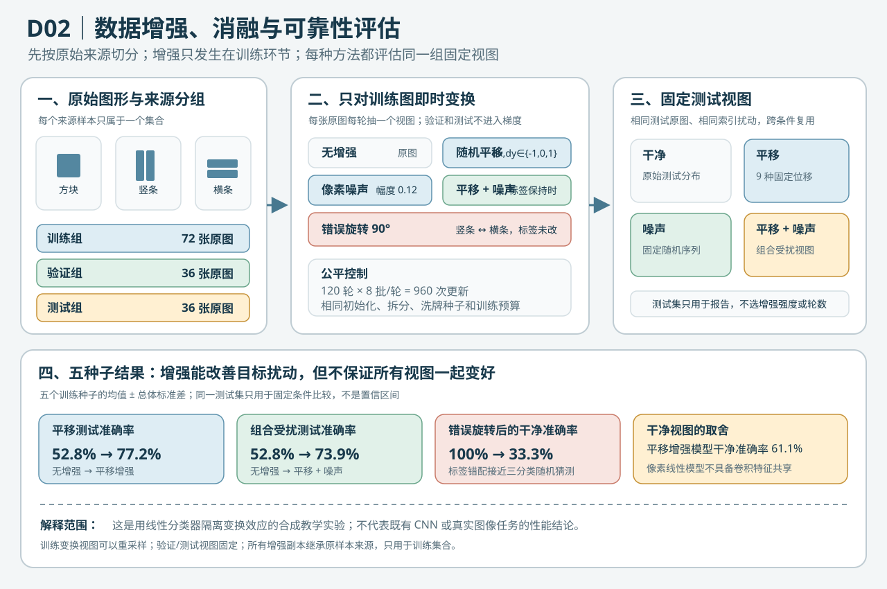

# 数据增强（data augmentation）与深度学习可靠性评估（deep-learning reliability assessment）

数据增强（data augmentation）通过改变训练输入，教模型识别对任务无关的变化；可靠性评估（reliability assessment）检查模型面对未见样本、轻微分布变化（distribution shift）和不同随机种子时是否仍能工作。本篇以[合成图形卷积神经网络（convolutional neural network，CNN）](54_CNN图像分类.md)为背景，并加入 D02 的 [C/Python 消融实验](../../src/ml/42_data_augmentation.c)：用一个小型线性 Softmax 分类器（linear softmax classifier）隔离数据视图的影响，不修改既有 CNN，也不把这个线性模型的指标当作 CNN 结论。

## 1. 增强变换隐含什么假设

设 $x$ 是输入，$y$ 是标签，$T$ 是增强变换。常见增强隐含标签保持假设（label-preserving assumption）：变换后的 $T(x)$ 仍属于原类别 $y$。对简单图形，少量平移和轻微噪声通常不改变类别；但变换不总是安全，例如把数字 $6$ 翻转可能改变语义。增强前先问“这个变化在目标任务中是否应该保持标签”。

训练时可以每轮重新采样增强参数，让同一张图形成不同视图。验证集和测试集应保持固定，便于比较模型；训练集里增强出来的副本必须与原始样本留在同一个数据划分，不能把一张原图放训练集、其变体放测试集。

## 2. 干净数据与受扰数据分开评估

至少保留两种测试视图：

- **干净测试集（clean test set）**：按原始数据分布生成或保留，用于衡量常规表现。
- **受扰测试集（perturbed test set）**：施加预先定义的平移、噪声或尺寸变化，用于检查相应变化下的稳健性。

受扰测试集用于评估，不用于选择增强强度、训练轮数或模型版本。若多个扰动都要调参，应另设验证扰动集；最终测试扰动只报告一次。扩充样本也要先按来源图像或对象划分，再生成变体，避免近重复内容跨越训练和测试。

若关注准确率，可把干净准确率与受扰准确率之差作为一种直观的变化量：

$$
\begin{aligned}
\Delta_{\mathrm{shift}}
&=A_{\mathrm{clean}}-A_{\mathrm{shifted}}.
\end{aligned}
\tag{1}
$$

这里 $A_{\mathrm{clean}}$ 和 $A_{\mathrm{shifted}}$ 分别是干净与受扰测试集准确率。若准确率从 $94\%$ 降到 $78\%$，差值是 $16$ 个百分点。这个差值只描述指定扰动，不能代表所有分布变化；对于损失这类越低越好的指标，应明确差值方向。

## 3. 把它接到仓库 CNN 案例

现有合成图形数据集由 [`dataset_generate`](../../src/ml/08_cnn_shapes.c#L105) 使用固定种子生成，并用于训练卷积网络；该案例本身没有随机数据增强。D02 另用方块、竖条和横条构成 $8\times8$ 小数据集，让每种操作都能直接观察。它保留固定划分和小批量训练流程，但把网络缩为像素输入的线性分类器，以便把注意力集中在变换、标签和评估上。

1. 先按原图来源划分训练、验证和测试，再只在训练循环中即时变换训练图像。
2. 使用相同初始化种子、样本顺序、更新轮数和批次数，分别训练无增强、单项增强、组合增强及错误增强条件，形成消融实验（ablation study）。
3. 固定干净、平移、噪声、平移加噪声四种测试视图，并用五个配对种子观察结果波动。
4. 可视检查变换后的方块、竖条和横条；$90^\circ$ 旋转会交换后两类，不能继续保留原标签。

可靠性还包括概率质量与抽样波动。可沿用[类别不平衡与概率校准](44_类别不平衡与概率校准.md)中的布里尔分数（Brier score）和可靠性图，并参照[公平模型比较](48_公平模型比较.md)固定拆分、多种子报告。准确率相同的模型，概率置信度仍可能不同。

## 4. 边界和检查点

- 不要把增强后的近重复样本分到不同集合。
- 不要默认旋转、翻转、裁切对所有任务都保标签。
- 验证和测试预处理应可重复，统计量只从训练数据拟合。
- 训练增强改善干净测试结果并非必然；它可能降低某些分布上的准确率。

完成练习后，能说明每种变换代表什么不变性假设，并区分“训练时见过更多视图”和“测试时经受过独立扰动评估”。

## 5. D02：从原始样本到增强训练风险

### 5.1 任务与数据约定

D02 的图像是 $8\times8$ 灰度矩阵，像素取值在 $[0,1]$，按行优先展开为 $64$ 个数。标签 $y\in\{0,1,2\}$ 分别表示方块、竖条和横条；训练集有 $72$ 张图，验证集和测试集各有 $36$ 张图，三个集合由不同固定种子独立生成，并保持类别均衡。

前置知识是经验风险（empirical risk）、交叉熵（cross-entropy）、梯度下降（gradient descent）、随机数种子和训练/验证/测试隔离。变换不是无条件“增加数据”：它表达模型应忽略某类变化的假设。平移通常不改这三种图形的类别；噪声幅度也必须小到不抹去图形；旋转 $90^\circ$ 会把竖条变成横条，如果仍使用原标签就制造了错误监督信号。

### 5.2 平移、噪声与标签保持

令 $x_{r,c}$ 表示图像第 $r$ 行、第 $c$ 列像素，$T_{\Delta r,\Delta c}$ 表示位移为 $(\Delta r,\Delta c)$ 的平移。平移使用零填充：

$$
\begin{aligned}
T_{\Delta r,\Delta c}(x)_{r,c}
&=x_{r-\Delta r,c-\Delta c}.
\end{aligned}
\tag{2}
$$

超出画布的位置视为零。代码只允许每个方向移动 $-1$、$0$ 或 $1$ 格；如果非零前景会被裁掉，变换失败且不写输出。训练图形生成时留有边距，因此正常随机平移不会触发该失败路径。

对像素噪声，令 $\epsilon_{r,c}$ 独立均匀分布于 $[-a,a]$，其中本实验 $a=0.12$。增强后逐像素裁切：

$$
\begin{aligned}
T_{\epsilon}(x)_{r,c}
&=\min\left(1,\max\left(0,x_{r,c}+\epsilon_{r,c}\right)\right).
\end{aligned}
\tag{3}
$$

此处的标签保持条件是 $y(T(x))=y(x)$。平移和轻微噪声只有在图形没有被裁掉、噪声没有抹掉关键笔画时才近似满足条件。错误增强条件将竖条或横条旋转 $90^\circ$，却故意保留旧标签；它不满足标签保持条件，用来展示错误变换会如何污染训练目标。

### 5.3 经验风险与蒙特卡洛估计

设 $f_{\theta}(x)$ 是参数为 $\theta$ 的分类器，$\ell(f_{\theta}(x),y)$ 是单样本交叉熵，训练集含 $n$ 个原始样本 $(x_i,y_i)$。不增强时的经验风险是：

$$
\begin{aligned}
\widehat{R}(\theta)
&=\frac{1}{n}\sum_{i=1}^{n}\ell\left(f_{\theta}(x_i),y_i\right).
\end{aligned}
\tag{4}
$$

数据增强定义了变换分布 $q(T)$，即每种变换及其随机参数被抽中的概率。希望优化的目标变成原图及其合法视图上的平均损失：

$$
\begin{aligned}
\widehat{R}_{\mathrm{aug}}(\theta)
&=\frac{1}{n}\sum_{i=1}^{n}
  \mathbb{E}_{T\sim q}\left[
    \ell\left(f_{\theta}(T(x_i)),y_i\right)
  \right].
\end{aligned}
\tag{5}
$$

对每张原图独立抽取 $K$ 个变换时，可用样本均值估计期望：

$$
\begin{aligned}
\widehat{R}_{\mathrm{MC}}(\theta)
&=\frac{1}{nK}\sum_{i=1}^{n}\sum_{k=1}^{K}
  \ell\left(f_{\theta}(T_{i,k}(x_i)),y_i\right).
\end{aligned}
\tag{6}
$$

其中 $T_{i,k}$ 是第 $i$ 张图的第 $k$ 次随机变换。D02 每轮对每张训练图抽一次视图，相当于每张图每轮使用 $K=1$ 的蒙特卡洛样本；不同轮次重新抽取。只要抽样按 $q$ 进行，且变换确实保持标签，对变换随机性的梯度估计才对应式（5）的目标。这里的随机性不是测试数据的不确定性。

例如只有一张图，变换分布各以 $1/2$ 概率选择原图或右移图。如果这两个视图的交叉熵分别为 $0.911901$ 和 $1.098612$，取 $K=2$ 得到：

$$
\begin{aligned}
\widehat{R}_{\mathrm{MC}}
&=\frac{0.911901+1.098612}{2}
 =1.005257.
\end{aligned}
\tag{7}
$$

这只是两个指定视图的均值，不代表无限变换分布的精确期望；增加训练轮数会再次抽样，但 D02 的每个消融条件仍执行相同更新数。

## 6. 两个可逐步手算的例子

### 6.1 在小网格上移动并加噪

先看一个 $3\times3$ 局部网格，唯一前景像素位于中间：

$$
\begin{aligned}
X
&=\begin{bmatrix}
0&0&0\\
0&1&0\\
0&0&0
\end{bmatrix}.
\end{aligned}
\tag{8}
$$

向右平移一格后，唯一的 $1$ 从局部坐标 $(1,1)$ 到 $(1,2)$：

$$
\begin{aligned}
T_{0,1}(X)
&=\begin{bmatrix}
0&0&0\\
0&0&1\\
0&0&0
\end{bmatrix}.
\end{aligned}
\tag{9}
$$

实际程序把同一单像素放在 $8\times8$ 图像的 $(3,3)$，右移到 $(3,4)$，再用噪声种子 $1$ 扰动；`./build/ml/42_data_augmentation --hand` 输出该图像局部 $3\times3$ 的结果。前景位置对应的噪声为 $-0.056892$，所以像素变成 $1-0.056892=0.943108$；相邻背景像素加上正噪声后成为 $0.060217$。负噪声作用于零背景时由裁切规则归零。运行输出与 C/Python 的手算检查共用同一实现。

### 6.2 Softmax 前向、损失、梯度与更新

为了单独观察分类器梯度，下面重新使用一张干净单像素图，不把上一小节加噪后的图送入分类器。设展开图像只有一个活动像素 $x_{27}=1$，其余像素为 $0$，目标类别 $y=0$；只看这一个输入位置的三类权重为 $(0.2,0,-0.2)$，偏置全为 $0$。线性分类器的类别分数为 $z_c=\sum_{k=0}^{63}w_{c,k}x_k+b_c$，因此 $z=(0.2,0,-0.2)$。Softmax 与目标类别交叉熵为：

$$
\begin{aligned}
p_c
&=\frac{e^{z_c}}{\sum_{j=0}^{2}e^{z_j}},\\
\mathcal{L}
&=-\log p_y.
\end{aligned}
\tag{10}
$$

代入指数和：$e^{0.2}\approx1.221403$、$e^0=1$、$e^{-0.2}\approx0.818731$，总和约为 $3.040134$。所以 $p\approx(0.401760,0.328933,0.269307)$，目标类为第 $0$ 类，损失 $-\log(0.401760)\approx0.911901$。源码为减少溢出先从所有分数减去最大值；这里分数很小，手算直接展示原始形式。

对 Softmax 交叉熵，先对类别分数求导，再对权重求导：

$$
\begin{aligned}
\mathcal{L}
&=-\log p_y
 =-z_y+\log\left(\sum_{j=0}^{2}e^{z_j}\right),\\
\frac{\partial\mathcal{L}}{\partial z_c}
&=-\mathbb{1}[c=y]
  +\frac{e^{z_c}}{\sum_{j=0}^{2}e^{z_j}}\\
&=p_c-\mathbb{1}[c=y],\\
\frac{\partial z_j}{\partial w_{c,k}}
&=\mathbb{1}[j=c]x_k,\\
\frac{\partial z_j}{\partial b_c}
&=\mathbb{1}[j=c],\\
\frac{\partial\mathcal{L}}{\partial w_{c,k}}
&=\sum_{j=0}^{2}
  \frac{\partial\mathcal{L}}{\partial z_j}
  \frac{\partial z_j}{\partial w_{c,k}}\\
&=\left(p_c-\mathbb{1}[c=y]\right)x_k,\\
\frac{\partial\mathcal{L}}{\partial b_c}
&=\sum_{j=0}^{2}
  \frac{\partial\mathcal{L}}{\partial z_j}
  \frac{\partial z_j}{\partial b_c}\\
&=p_c-\mathbb{1}[c=y].
\end{aligned}
\tag{11}
$$

这里 $c$ 是目标输出类别下标，$j$ 是求和类别下标，$k$ 是展平后的像素下标（$0\leq k<64$）；$p_c$ 表示类别概率，$x_k$ 表示像素值。指示函数 $\mathbb{1}[c=y]$ 在类别相同时取 $1$，否则取 $0$。对于只含一个活动像素的分类夹具，$x_{27}=1$ 时三个权重梯度为 $(-0.598240,0.328933,0.269307)$；其他零像素位置的权重梯度为 $0$。学习率 $\eta=0.08$，用一次随机梯度下降（stochastic gradient descent，SGD）更新：

$$
\begin{aligned}
w_{0,27}^{\mathrm{new}}
&=0.2-0.08(-0.598240)=0.247859,\\
w_{1,27}^{\mathrm{new}}
&=0-0.08(0.328933)=-0.026315,\\
w_{2,27}^{\mathrm{new}}
&=-0.2-0.08(0.269307)=-0.221545.
\end{aligned}
\tag{12}
$$

完整未舍入结果可运行 `--hand` 查看。训练时批大小为 $9$，代码先把批内样本梯度除以实际批大小并累加，再按同一学习率更新；手算单样本只是把批大小缩为 $1$，用于看清一个更新步。

## 7. 实现地图和运行方法

| 数学或实验步骤 | C / Python 源码 | 作用 |
| --- | --- | --- |
| 固定图像、标签与来源编号 | C [`Image`、`Dataset`](../../src/ml/42_data_augmentation.c#L28)、[`dataset_generate`](../../src/ml/42_data_augmentation.c#L106)；Python [`Image`](../../src/python/ml/42_data_augmentation.py#L27)、[`make_dataset`](../../src/python/ml/42_data_augmentation.py#L70) | 行优先存储 $64$ 个像素；`source_id` 记录原图所属划分。 |
| 平移、噪声和组合增强 | C [`translate_pixels`](../../src/ml/42_data_augmentation.c#L139)、[`add_noise`](../../src/ml/42_data_augmentation.c#L169)、[`augment_image`](../../src/ml/42_data_augmentation.c#L177)；Python [`translate`](../../src/python/ml/42_data_augmentation.py#L106)、[`add_noise`](../../src/python/ml/42_data_augmentation.py#L129)、[`augment`](../../src/python/ml/42_data_augmentation.py#L151) | 平移遇到前景裁切拒绝；噪声逐像素裁切；每次增强返回临时副本。 |
| 固定留出视图 | C [`evaluation_image`](../../src/ml/42_data_augmentation.c#L207)；Python [`evaluation_image`](../../src/python/ml/42_data_augmentation.py#L186) | 生成干净、平移、噪声及组合测试图，不参与训练。 |
| Softmax 前向与交叉熵 | C [`model_forward`](../../src/ml/42_data_augmentation.c#L242)；Python [`forward`](../../src/python/ml/42_data_augmentation.py#L208) | 计算像素线性分类分数、稳定概率和损失。 |
| 解析梯度 | C [`model_gradient`](../../src/ml/42_data_augmentation.c#L279)；Python [`gradient`](../../src/python/ml/42_data_augmentation.py#L235) | 由 $p-y$ 求 $192$ 个像素权重及 $3$ 个偏置梯度。 |
| 同预算批量训练 | C [`train_model`](../../src/ml/42_data_augmentation.c#L344)；Python [`train`](../../src/python/ml/42_data_augmentation.py#L287) | 每轮对同一训练原图各取一个视图，批平均后更新。 |
| 配对种子与汇总 | C [`run_one`](../../src/ml/42_data_augmentation.c#L394)、[`run_experiment`](../../src/ml/42_data_augmentation.c#L410)、[`aggregate_metric`](../../src/ml/42_data_augmentation.c#L422)；Python [`run_one`](../../src/python/ml/42_data_augmentation.py#L323)、[`compute_results`](../../src/python/ml/42_data_augmentation.py#L341) | 同种子跨条件共享初始化和洗牌种子，报告均值与总体标准差。 |
| 变换、梯度和复现断言 | [`test_transformations`](../../src/ml/42_data_augmentation.c#L523)、[`test_gradient`](../../src/ml/42_data_augmentation.c#L564)、[`test_splits_and_repeatability`](../../src/ml/42_data_augmentation.c#L603) | 检查变换失败安全、噪声范围、中心差分（central difference）、划分分组和固定种子重复。 |
| Python 数值对照 | [`42_data_augmentation.py`](../../src/python/ml/42_data_augmentation.py) | 用标准库重现数据、变换、训练与全部逐种子评估字段。 |
| Python 与跨语言测试 | [`test_data_augmentation.py`](../../tests/python/test_data_augmentation.py) | 验证标签、噪声、梯度、固定预算和 C/Python CSV 一致。 |

### 7.1 安全变换：先写入临时数组，成功后再提交

像素数组按行优先保存，像素下标是 $r\times8+c$；类别权重下标是 $c\times64+k$，偏置从参数数组的第 $192$ 项开始。平移函数先将结果写到局部数组 `translated`，遇到前景越界就直接失败，因此调用者的 `output` 尚未改变：

```c
double translated[PIXELS] = {0};
/* 遍历源像素，检查移动后是否会裁掉非零前景。 */
if (value != 0 && (target_row < 0 || target_row >= SIDE ||
                   target_column < 0 || target_column >= SIDE)) {
    return false;
}
/* 合法坐标写入 translated；此处省略双层行列循环。 */
/* 所有像素都通过检查后，才一次性提交结果。 */
memcpy(output, translated, sizeof translated);
```

Python 版本采用相同顺序：先创建新列表，越界时返回 `None`，成功后才返回新元组。两种语言都不在失败途中覆盖原图，也都保留标签和来源编号。此设计使训练过程可以把增强视图作为临时值使用，而数据划分仍以原图来源为准。

### 7.2 梯度累加：同一个批次只执行一次参数更新

每个样本产生长度 $195$ 的梯度向量：前 $192$ 项对应三类各 $64$ 个像素权重，最后 $3$ 项对应类别偏置。批次大小为 $m$ 时，先计算平均梯度，再更新参数：

```c
for (size_t parameter = 0; parameter < PARAMETERS; ++parameter) {
    gradient[parameter] += sample_gradient[parameter] / (double)count;
}
for (size_t parameter = 0; parameter < PARAMETERS; ++parameter) {
    if (parameter < WEIGHTS) {
        model->weights[parameter] -= LEARNING_RATE * gradient[parameter];
    } else {
        model->biases[parameter - WEIGHTS] -= LEARNING_RATE * gradient[parameter];
    }
}
```

源码中的第二个循环按参数下标分别更新权重和偏置。除以当前批次实际样本数而不是固定批容量，可以正确处理尾批；本实验 $72$ 张训练图可整除批大小 $9$，每轮恰有 $8$ 批。每个增强条件仍训练同样的 $120\times8=960$ 步，增强不会额外增加更新次数。

运行完整五条件消融、手算夹具和验证命令：

```sh
make augmentation-ablation
python3 src/python/ml/42_data_augmentation.py
make augmentation-ablation-hand
make test-data-augmentation
make sanitize-data-augmentation
```

`--csv` 输出逐条件、逐种子记录，便于复核 Python/C 数值；`--test` 只运行 C 断言。短测试不打开窗口、不写图片或日志。D02 不复用 `08_cnn_shapes.c` 的全卷积训练器，因为本实验要把增强变量与网络结构分开观察；既有 CNN 保持原样，源码映射见 [`dataset_generate`](../../src/ml/08_cnn_shapes.c#L105) 与 [CNN 教程](54_CNN图像分类.md)。

## 8. 消融设计、指标与实际结果

每个条件使用同一训练/验证/测试划分、同样的初始化种子、样本洗牌种子、$120$ 轮和每轮 $8$ 个批次，即每个模型 $960$ 次参数更新。增强即时生成，不把副本加入额外批次，因此不能把多训练步数误算成增强收益。每个条件运行五个配对训练种子；表中准确率（accuracy）为五次运行的均值与总体标准差（population standard deviation），验证损失同样汇总。验证集只报告，不做早停或条件选择；四种测试视图始终固定。

| 条件 | 验证损失 | 干净测试准确率 | 平移测试准确率 | 噪声测试准确率 | 平移+噪声测试准确率 |
| --- | ---: | ---: | ---: | ---: | ---: |
| 无增强 | $0.1269\pm0.0003$ | $1.000\pm0.000$ | $0.528\pm0.000$ | $1.000\pm0.000$ | $0.528\pm0.000$ |
| 平移 | $0.8856\pm0.0079$ | $0.611\pm0.046$ | $0.772\pm0.021$ | $0.472\pm0.039$ | $0.728\pm0.027$ |
| 噪声 | $0.1346\pm0.0006$ | $1.000\pm0.000$ | $0.528\pm0.000$ | $1.000\pm0.000$ | $0.528\pm0.000$ |
| 平移+噪声 | $0.8830\pm0.0092$ | $0.639\pm0.039$ | $0.778\pm0.030$ | $0.583\pm0.043$ | $0.739\pm0.022$ |
| 错误 $90^\circ$ 旋转并保留旧标签 | $1.7117\pm0.0035$ | $0.333\pm0.000$ | $0.139\pm0.000$ | $0.333\pm0.000$ | $0.139\pm0.000$ |

这组确定性结果说明：平移增强把平移测试准确率从 $0.528$ 提到 $0.772$，组合增强把平移加噪声准确率从 $0.528$ 提到 $0.739$；同时，它们明显牺牲了干净集准确率。像素线性分类器没有卷积网络的局部特征共享，必须用位置相关权重表示图形，随机平移会改变它拟合干净位置的方式。这是该小模型的容量和优化限制，不是“平移增强必然降低干净表现”的一般结论。噪声单项在这组简单图形上没有收益，因为无增强模型已经达到 $1.000$ 的干净及低幅噪声测试准确率。错误旋转使测试准确率降到接近三分类随机猜测，直接显示标签语义被破坏。

五个种子的总体标准差只反映初始化、洗牌和训练增强抽样的波动；测试图片只有 $36$ 张且各运行共用，不能把该标准差解释为测试集置信区间。该实验是流程和机制教学，不证明真实图像任务上的收益。图中的数据流与评估范围如下。



## 9. 边界、失败模式和可复现性

- **按原图分组再切分**：本案例在变换前分别生成三个不同来源组，训练增强副本保留 `source_id` 且只在训练批次临时使用。若先复制再随机切分，同一张原图的近重复版本可能落入测试集，指标会虚高。
- **验证和测试不随机漂移**：`evaluation_image` 由样本索引确定受扰视图；跨增强条件和训练种子复用同一张留出图及相同扰动。
- **变换要有安全边界**：平移只接受 $[-1,1]$ 的整位移，裁掉非零前景时返回失败；噪声幅度须有限且非负，输出裁切到 $[0,1]$。失败路径不部分覆盖调用者数据。
- **标签不变性依任务定义**：$90^\circ$ 旋转对方块可保持类别，却会交换竖条与横条；如果目标任务本来不区分方向，标签规则又会不同。不能只因代码能变换，就推断类别不变。
- **增强不等于额外训练预算**：所有条件都执行 $960$ 次更新；若把复制样本另行加入批次，必须同步控制更新数，否则消融混入训练预算差异。
- **有限的统计结论**：五个配对种子与固定小测试只用于可复现诊断；要推断真实总体，需要更多独立来源样本和预先设计的统计评估。

## 10. 自测与延伸

1. 为什么不能把原图放进训练集、增强副本放进测试集？**答案：**两者共享几乎完全相同的底层内容，测试不再代表未见来源，模型可能通过记住原图像素获得虚高结果。
2. 为什么 D02 每个条件仍只执行 $960$ 次更新？**答案：**每轮只在原训练样本上即时抽一个变换视图，仍是 $72$ 张样本和 $8$ 个批次；增强改变输入分布，没有增加训练批次。
3. 错误旋转怎样修正？**答案：**如果竖条旋转成横条，就把目标标签同步从竖条类别改为横条类别；否则应禁用该变换。标签规则须和任务定义一致。
4. 为什么不能据本表宣称“CNN 平移增强准确率为 $77.2\%$”？**答案：**本实验模型是像素线性 Softmax 分类器，数据是固定合成图形，指标只适用于当前划分与扰动，不是既有 CNN 的结果。

掌握本篇后，应能从标签不变性推导增强风险，手算一张图的平移与噪声、计算一次分类损失和梯度，并区分数据划分、训练随机性、受扰测试和真实泛化结论。
