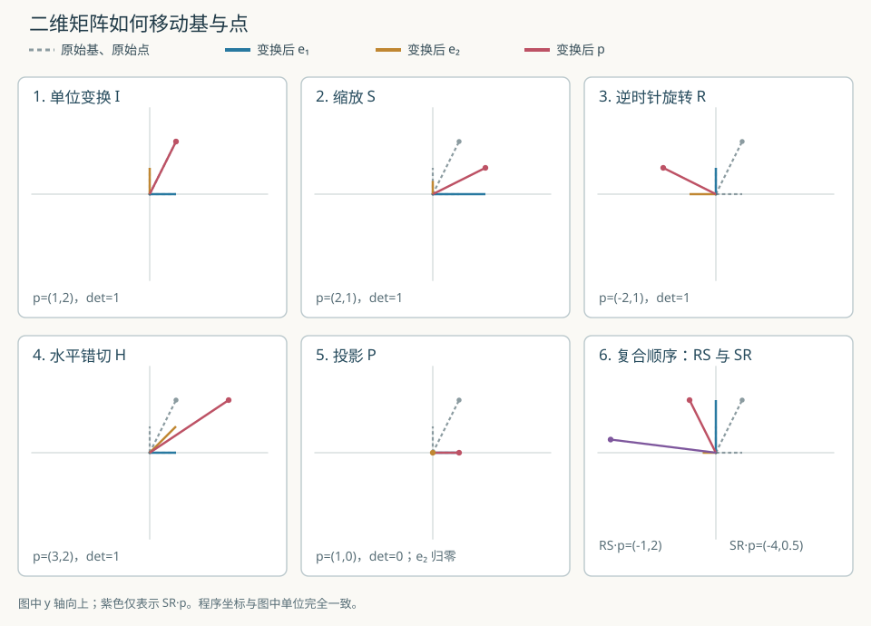

# 二维矩阵变换实验室

本教程是 [M01 任务](../00_学习总览.md#chapter-agent-tasks)的实现。输入是一个二维向量（vector）及一个 $2\times2$ 实矩阵（matrix），输出是变换后的二维向量。先观察一张图，再逐项手算，最后对照 [C 示例](../../src/ml/30_matrix_transforms.c)和 [Python 示例](../../src/python/ml/30_matrix_transforms.py)。它为后续全连接层理解“矩阵为何作用于一批向量”打基础；本例没有训练参数、损失函数或泛化评估。



## 1. 先理解向量、基与线性变换

在平面直角坐标系中，令 $\mathbf e_1=(1,0)^{\mathsf T}$ 为水平单位基（basis vector），$\mathbf e_2=(0,1)^{\mathsf T}$ 为竖直单位基；上标 $\mathsf T$ 表示把横写的分量记成列向量。教学点 $\mathbf p=(1,2)^{\mathsf T}$ 可以由两条基向量线性组合得到：

$$
\mathbf p=1\mathbf e_1+2\mathbf e_2.
\tag{1}
$$

这里系数 $1$ 和 $2$ 是 $\mathbf p$ 沿两条基的坐标。一个线性变换（linear transformation）$T$ 满足加法与数乘保持性：

$$
T(a\mathbf u+b\mathbf v)=aT(\mathbf u)+bT(\mathbf v).
\tag{2}
$$

$\mathbf u,\mathbf v$ 是任意二维向量，$a,b$ 是实数。因此只要知道两条基的像，就知道任意点的像。例如若 $T(\mathbf e_1)=(1,0)^{\mathsf T}$、$T(\mathbf e_2)=(1,1)^{\mathsf T}$，则 $T(\mathbf p)=1(1,0)^{\mathsf T}+2(1,1)^{\mathsf T}=(3,2)^{\mathsf T}$；这正是后面的水平错切。

令矩阵 $A$ 为 $2\times2$ 实矩阵，$a_{r,c}$ 是第 $r$ 行、第 $c$ 列元素，行列编号均从 $0$ 开始。列向量 $\mathbf x=(x,y)^{\mathsf T}$ 经 $A$ 变换得到 $\mathbf x'$：

$$
\begin{aligned}
A&=\begin{bmatrix}a_{0,0}&a_{0,1}\\a_{1,0}&a_{1,1}\end{bmatrix},\\
\mathbf x'&=A\mathbf x.
\end{aligned}
\tag{3}
$$

把矩阵乘法按行展开：

$$
x'=a_{0,0}x+a_{0,1}y.
\tag{4}
$$

$$
y'=a_{1,0}x+a_{1,1}y.
\tag{5}
$$

将 $\mathbf e_1$、$\mathbf e_2$ 分别代入，就得到 $A\mathbf e_1=(a_{0,0},a_{1,0})^{\mathsf T}$、$A\mathbf e_2=(a_{0,1},a_{1,1})^{\mathsf T}$。所以**矩阵的两列恰好是两条基的像**。例如错切矩阵的列分别是 $(1,0)^{\mathsf T}$ 与 $(1,1)^{\mathsf T}$，可用图中的蓝、橙线直接读出 $\mathbf p$ 的新坐标。

### 1.1 数组里存的是什么

C 程序使用 `Mat2.m[row][column]` 按行保存 $A$。已有[数值计算与梯度](51_数值计算与梯度.md)使用一维行优先存储，下标是 `row * columns + column`；在这里每行固定两列，因此四个系数的连续顺序仍为 $a_{0,0},a_{0,1},a_{1,0},a_{1,1}$。`Vec2.x`、`Vec2.y` 分别对应 $x$、$y$；Python 的 `Mat2.first`、`Mat2.second` 也按行排列。

## 2. 手算五种变换

以下都以 $\mathbf p=(1,2)^{\mathsf T}$ 为输入；图中坐标轴的 $y$ 向上，因此逆时针旋转符合通常数学坐标系。$I$ 是单位矩阵（identity matrix）：

$$
I=\begin{bmatrix}1&0\\0&1\end{bmatrix}.
\tag{6}
$$

代入两行计算，得到 $x'=1\times1+0\times2=1$，$y'=0\times1+1\times2=2$，故 $I\mathbf p=(1,2)^{\mathsf T}$。两条基不变，适合作为所有计算的基线。

缩放（scaling）矩阵 $S$ 将水平坐标放大 $2$ 倍、竖直坐标缩小到一半：

$$
S=\begin{bmatrix}2&0\\0&\tfrac12\end{bmatrix}.
\tag{7}
$$

代入 $\mathbf p$ 得 $x'=2\times1+0\times2=2$，$y'=0\times1+\tfrac12\times2=1$，所以 $S\mathbf p=(2,1)^{\mathsf T}$。同时 $S\mathbf e_1=(2,0)^{\mathsf T}$、$S\mathbf e_2=(0,\tfrac12)^{\mathsf T}$，图中两条基的长度分别变化。

逆时针 $90^\circ$ 旋转（counterclockwise rotation）矩阵 $R$ 为：

$$
R=\begin{bmatrix}0&-1\\1&0\end{bmatrix}.
\tag{8}
$$

逐行算得 $x'=0\times1+(-1)\times2=-2$，$y'=1\times1+0\times2=1$，故 $R\mathbf p=(-2,1)^{\mathsf T}$。原向量长度平方为 $1^2+2^2=5$；像的长度平方为 $(-2)^2+1^2=5$，展示旋转保持欧氏长度。两条基分别变成 $(0,1)^{\mathsf T}$ 与 $(-1,0)^{\mathsf T}$。

水平错切（horizontal shear）矩阵 $H$ 把竖直基向右推一单位：

$$
H=\begin{bmatrix}1&1\\0&1\end{bmatrix}.
\tag{9}
$$

代入 $\mathbf p$ 得 $x'=1\times1+1\times2=3$，$y'=0\times1+1\times2=2$，故 $H\mathbf p=(3,2)^{\mathsf T}$。也可直接用 $H\mathbf p=H\mathbf e_1+2H\mathbf e_2=(1,0)^{\mathsf T}+2(1,1)^{\mathsf T}=(3,2)^{\mathsf T}$ 复算。

最后，投影（projection）矩阵 $P$ 只保留水平坐标：

$$
P=\begin{bmatrix}1&0\\0&0\end{bmatrix}.
\tag{10}
$$

于是 $x'=1\times1+0\times2=1$，$y'=0\times1+0\times2=0$，故 $P\mathbf p=(1,0)^{\mathsf T}$。$P\mathbf e_2=(0,0)^{\mathsf T}$，不同的输入可能映到同一个输出，原来的竖直信息无法从结果恢复。

## 3. 行列式、秩与变换顺序

二维矩阵 $A$ 的行列式（determinant）为两列构成的有向平行四边形面积；绝对值是面积缩放倍数，符号描述方向是否翻转：

$$
\det(A)=a_{0,0}a_{1,1}-a_{0,1}a_{1,0}.
\tag{11}
$$

例如 $\det(S)=2\times\tfrac12-0\times0=1$，所以水平伸长与竖直压缩抵消了面积变化；$\det(R)=0\times0-(-1)\times1=1$；$\det(H)=1\times1-1\times0=1$；$\det(P)=1\times0-0\times0=0$。对这个二维方阵，$\det(A)=0$ 等价于两列线性相关，秩（rank）小于 $2$，变换不能逆转。$P$ 有一列非零、一列零，秩为 $1$；不要把“行列式数值很接近零”在一般浮点数据上直接当成可靠的秩判定。

矩阵复合采用列向量约定：$BA\mathbf x$ 表示**先作用 $A$，再作用 $B$**。先缩放再旋转是 $RS$：

$$
RS=\begin{bmatrix}0&-\tfrac12\\2&0\end{bmatrix}.
\tag{12}
$$

因此 $RS\mathbf p=R(2,1)^{\mathsf T}=(-1,2)^{\mathsf T}$。先旋转再缩放则是 $SR$：

$$
SR=\begin{bmatrix}0&-2\\\tfrac12&0\end{bmatrix}.
\tag{13}
$$

于是 $SR\mathbf p=S(-2,1)^{\mathsf T}=(-4,\tfrac12)^{\mathsf T}$。两个结果不同，说明矩阵乘法一般不可交换。C 的 `mat2_multiply(left, right, ...)` 与 Python 的 `multiply(left, right)` 都按这个顺序计算；输出不是把两个矩阵的对应元素相乘。

线性变换必须将原点映回原点，因为 $T(\mathbf0)=T(0\mathbf x)=0T(\mathbf x)=\mathbf0$。平移 $T(\mathbf x)=\mathbf x+\mathbf t$ 在 $\mathbf t\ne\mathbf0$ 时不满足这一条件，因而不是平面到平面的线性变换。若要把平移与旋转放进一次矩阵乘法，需要另学带第三个齐次坐标的仿射表示；本例故意保持纯二维线性变换。

## 4. 公式与代码逐项对应

| 数学对象或步骤 | C 源码 | Python 源码 | 实际作用 |
| --- | --- | --- | --- |
| 行优先 $A$、列向量 $\mathbf x$ | [`Mat2`、`Vec2`](../../src/ml/30_matrix_transforms.c) | [`Mat2`、`Vec2`](../../src/python/ml/30_matrix_transforms.py) | 固定 $2\times2$ 系数与两个坐标，不分配堆内存。 |
| $x'$、$y'$ 两个点积 | [`mat2_apply`](../../src/ml/30_matrix_transforms.c) | [`apply`](../../src/python/ml/30_matrix_transforms.py) | 先验证输入，再计算局部结果；C 仅成功时覆盖 `output`。 |
| $BA$ 的四个系数 | [`mat2_multiply`](../../src/ml/30_matrix_transforms.c) | [`multiply`](../../src/python/ml/30_matrix_transforms.py) | 行乘列，`left` 最后作用；C 失败时保留输出。 |
| $\det(A)$ | [`mat2_determinant`](../../src/ml/30_matrix_transforms.c) | [`determinant`](../../src/python/ml/30_matrix_transforms.py) | 演示面积与秩；不作为通用秩判定器。 |
| 两条基和 $\mathbf p$ | [`SCENES`、`print_scenes`](../../src/ml/30_matrix_transforms.c) | [`SCENES`、`scene_rows`](../../src/python/ml/30_matrix_transforms.py) | 同一显式矩阵、同一输入，便于逐行比较。 |
| 手算与失败边界 | [`test_transforms`](../../src/ml/30_matrix_transforms.c)、[对照测试](../../tests/matrix_transforms_compare.py) | [对照测试](../../tests/matrix_transforms_compare.py) | 验证长度、顺序、奇异变换、非有限数和两种语言一致性。 |

例如 `mat2_apply` 的第一行结果恰好是 `matrix.m[0][0] * point.x + matrix.m[0][1] * point.y`，分别对应 $a_{0,0}x$ 与 $a_{0,1}y$。这里没有自动求导；后续 M02 才会把相同的乘加结构放进全连接层并求梯度。

## 5. 运行、验证与边界

从仓库根目录运行：

```sh
make matrix-transforms
python3 src/python/ml/30_matrix_transforms.py
make test-matrix-transforms
make sanitize-matrix-transforms
make lint
```

前两条打印 $7$ 个场景中 $\mathbf e_1$、$\mathbf e_2$、$\mathbf p$ 的坐标与行列式；`--csv` 便于程序读取。也可直接运行 `./build/ml/30_matrix_transforms --csv`，与 `python3 src/python/ml/30_matrix_transforms.py --csv` 比较。示意图存放于本文旁的 `images/`，无须安装 SDL；程序本身不写图片或日志。

`make test-matrix-transforms` 运行 C 断言及 Python 标准库 `unittest`，逐行比较两种语言的 $21$ 条结果，容差为绝对/相对 $10^{-12}$。这只能证明固定小样本及列出的边界按预期工作，不能代替任意大小矩阵或任意浮点输入的正确性证明。C 检测空输出指针、非有限输入与溢出结果，失败时保持调用方的输出不变；Python 对相同数值问题抛出 `ValueError`。`mat2_determinant` 只在已知有限且计算不溢出的矩阵上调用，不是通用数值稳定接口。

矩阵类型的形状固定为 $2\times2$，因此本例不存在运行时维度不匹配；改变矩阵尺寸是后续通用数值计算任务。输入数据是直接列出的精确小数，不使用随机数，也不涉及文件所有权或训练参数更新。

本例没有训练/验证/测试集或模型性能指标；这里的“基线”是单位矩阵，“评估”是与手算及两种实现对照。一个典型错误是把 $RS\mathbf p$ 写成 $SR\mathbf p$，结果分别为 $(-1,2)$ 与 $(-4,\tfrac12)$，运行结果可直接定位顺序问题。另一个错误是把行优先数组的两行当作两列，错切后的基向量会指向错误方向。

## 6. 自测与下一步

1. 把 $\mathbf p$ 换成 $(2,-1)^{\mathsf T}$，先手算 $H\mathbf p$ 再修改局部输入检查。参考结果为 $(1,-1)^{\mathsf T}$。
2. 自行构造反射矩阵 $F=\begin{bmatrix}-1&0\\0&1\end{bmatrix}$，预测行列式符号及像。参考：$\det(F)=-1$，$F\mathbf p=(-1,2)^{\mathsf T}$，面积大小不变但方向翻转。
3. 解释 $P$ 为什么不可能有逆矩阵：$P(1,2)^{\mathsf T}$ 和 $P(1,9)^{\mathsf T}$ 都等于 $(1,0)^{\mathsf T}$，同一个结果无法区分原输入。

完成这些练习后进入 M02：沿用矩阵乘法，但每个输出同时对应一个损失和梯度，不再只观察几何位置。
