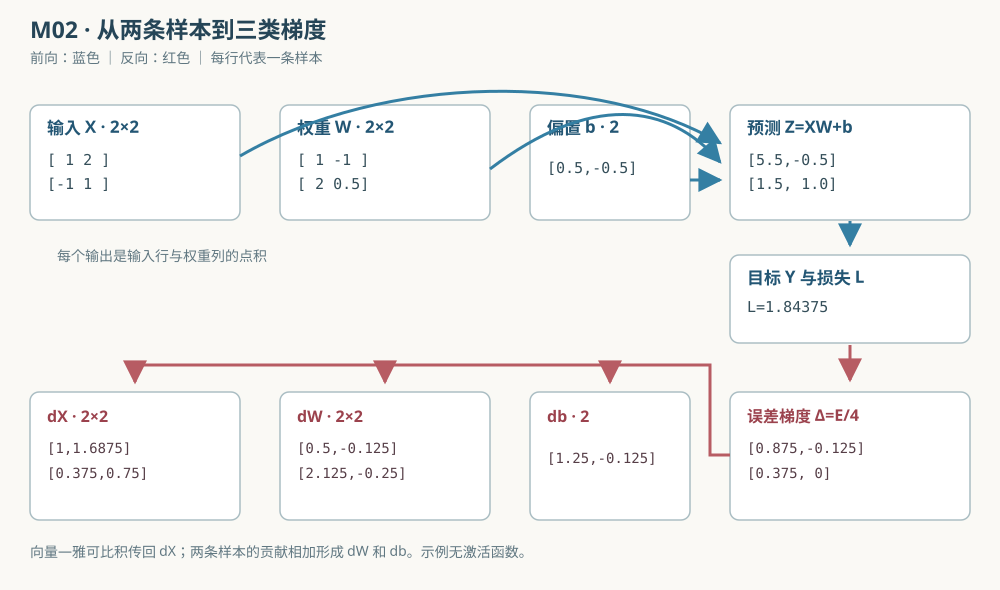

# 批量全连接层与矩阵求导

本教程实现[学习总览中的 M02](../00_学习总览.md#chapter-agent-tasks)。先读 [M01 二维矩阵变换](75_二维矩阵变换实验室.md)，理解“矩阵的一列对应一个输出方向”；再看[数值计算与梯度](51_数值计算与梯度.md)的行优先存储和单样本链式法则。这里把两条样本同时送进一个无激活函数的全连接层（dense layer），从预测、损失一直算到输入、权重、偏置的梯度和一次更新。代码是 [C 示例](../../src/ml/31_batch_dense_gradients.c)与[Python 对照](../../src/python/ml/31_batch_dense_gradients.py)。



## 1. 输入、输出与符号

设批大小为 $B$，每条样本有 $F=2$ 个输入特征，层有 $O=2$ 个输出。$X\in\mathbb R^{B\times F}$ 是输入矩阵，$W\in\mathbb R^{F\times O}$ 是权重，$b\in\mathbb R^O$ 是共享偏置，$Y\in\mathbb R^{B\times O}$ 是目标。输出 $Z\in\mathbb R^{B\times O}$；索引 $i=0,\ldots,B-1$ 指样本，$k=0,1$ 指输入特征，$j=0,1$ 指输出。上标 $\mathsf T$ 表示转置，$\mathbf1_B$ 表示长度为 $B$ 的全一列向量。

$$
Z=XW+\mathbf1_B b^{\mathsf T}.
\tag{1}
$$

逐元素写法能看清广播（broadcasting）：同一个 $b_j$ 被加到每条样本的第 $j$ 个输出。

$$
Z_{ij}=\sum_{k=0}^{F-1}X_{ik}W_{kj}+b_j.
\tag{2}
$$

本例用平方损失（squared loss），每个输出先乘 $\tfrac12$，然后对**样本数 $B$ 和输出数 $O$ 一起取平均**。$E=Z-Y$ 是预测误差，$L$ 是标量损失：

$$
L=\frac{1}{2BO}\sum_{i=0}^{B-1}\sum_{j=0}^{O-1}E_{ij}^{,2}.
\tag{3}
$$

本例没有激活函数；输入梯度 $\partial L/\partial X$ 用来说明上一层会收到什么，更新参数时只修改 $W$ 和 $b$。这里的 $X$ 是固定教学输入，而不是要学习的模型参数。

## 2. 从一个偏导数推到三个矩阵梯度

偏导数（partial derivative）表示固定其他独立变量，仅改变其中一个变量。先对一个输出 $Z_{ij}$ 求导；因为损失中该输出只出现一次：

$$
\frac{\partial L}{\partial Z_{ij}}
=\frac{1}{2BO}\,2(Z_{ij}-Y_{ij})
=\frac{E_{ij}}{BO}.
\tag{4}
$$

把这些偏导排成与 $Z$ 同形状的矩阵 $\Delta$：

$$
\Delta=\frac{\partial L}{\partial Z}=\frac{E}{BO}.
\tag{5}
$$

例如第一条样本第一个输出的误差为 $3.5$；本例 $B=O=2$，所以对应上游梯度为 $3.5/(2\times2)=0.875$。这一步的分母是 $4$，不是只按批大小除以 $2$；如果改损失定义，后面的所有梯度也要一起改。

### 2.1 权重梯度：收集所有样本的贡献

由前向式可直接求 $Z_{ij}$ 对 $W_{kj}$ 的偏导，它等于该样本第 $k$ 个输入；对别的输出列则为零。套用链式法则并累加全部样本：

$$
\frac{\partial L}{\partial W_{kj}}
=\sum_{i=0}^{B-1}X_{ik}\Delta_{ij}.
\tag{6}
$$

把 $k,j$ 的结果排回 $F\times O$ 矩阵，得到：

$$
\frac{\partial L}{\partial W}=X^{\mathsf T}\Delta.
\tag{7}
$$

手算 $W_{0,0}$ 的梯度：第一条样本贡献 $1\times0.875=0.875$；第二条样本贡献 $(-1)\times0.375=-0.375$；相加是 $0.5$。负输入会使相应贡献变号，并非程序错误。

### 2.2 偏置梯度：广播的反向是求和

由于每条样本的 $Z_{ij}$ 都含有同一个 $b_j$，其局部导数都是 $1$。因此偏置梯度必须跨样本相加：

$$
\frac{\partial L}{\partial b_j}=\sum_{i=0}^{B-1}\Delta_{ij}.
\tag{8}
$$

本例第一个偏置的两条贡献分别是 $0.875$ 与 $0.375$，故梯度为 $1.25$。只取第一条样本会误算成 $0.875$。这里不再除一次 $B$，因为每个 $\Delta_{ij}$ 已含 $1/(BO)$。

### 2.3 输入梯度：传给上一层

同一输入 $X_{ik}$ 会参与该样本所有输出；其局部导数分别是相应权重。再次用链式法则并在输出维求和：

$$
\frac{\partial L}{\partial X_{ik}}
=\sum_{j=0}^{O-1}\Delta_{ij}W_{kj}.
\tag{9}
$$

矩阵形式为：

$$
\frac{\partial L}{\partial X}=\Delta W^{\mathsf T}.
\tag{10}
$$

例如第一个输入 $X_{0,0}$ 连接到两个输出，梯度为 $0.875\times1+(-0.125)\times(-1)=1$。这说明输入梯度是从多个输出路径**汇合**来的；深层网络中的上一层会继续沿此梯度反向传播。

### 2.4 雅可比矩阵与方向导数怎么看

固定一条样本 $i$，它的两个输出对两个输入的雅可比矩阵（Jacobian matrix）是 $J_i\in\mathbb R^{O\times F}$。第 $j$ 行、第 $k$ 列是 $\partial Z_{ij}/\partial X_{ik}=W_{kj}$，所以 $J_i=W^{\mathsf T}$。若把该样本的上游梯度列向量记作 $\boldsymbol\delta_i$，输入梯度列向量就是 $J_i^{\mathsf T}\boldsymbol\delta_i$；实际代码只做上面的乘加，不必构造大雅可比矩阵。

对本例的第一条样本：

$$
J_0=\begin{bmatrix}1&2\\-1&0.5\end{bmatrix}.
\tag{11}
$$

$$
J_0^{\mathsf T}\boldsymbol\delta_0
=\begin{bmatrix}1&-1\\2&0.5\end{bmatrix}
 \begin{bmatrix}0.875\\-0.125\end{bmatrix}
=\begin{bmatrix}1\\1.6875\end{bmatrix}.
\tag{12}
$$

$\boldsymbol\delta_0=(0.875,-0.125)^{\mathsf T}$；其中 $1.6875=2\times0.875+0.5\times(-0.125)$。方向导数（directional derivative）则回答“沿一个给定扰动方向，损失起初如何变化”。若只让 $W_{0,0}$ 沿正方向变化一个很小的 $h$，一阶变化约为 $h\,\partial L/\partial W_{0,0}=0.5h$；若沿负方向变化，则一阶变化约为 $-0.5h$。这里 $h$ 是实数扰动量，该近似只在足够靠近当前参数时适用。

## 3. 把两条样本完整算一遍

本节所有数值都来自源码的 `INITIAL_MODEL` 与 `INITIAL_BATCH`，没有随机初始化。固定输入、权重、偏置和目标分别为：

$$
X=\begin{bmatrix}1&2\\-1&1\end{bmatrix}.
\tag{13}
$$

$$
W=\begin{bmatrix}1&-1\\2&0.5\end{bmatrix}.
\tag{14}
$$

$$
b=\begin{bmatrix}0.5\\-0.5\end{bmatrix}.
\tag{15}
$$

$$
Y=\begin{bmatrix}2&0\\0&1\end{bmatrix}.
\tag{16}
$$

先算 $Z$ 的第一行：$Z_{0,0}=1\times1+2\times2+0.5=5.5$；$Z_{0,1}=1\times(-1)+2\times0.5-0.5=-0.5$。第二行同理：$Z_{1,0}=(-1)\times1+1\times2+0.5=1.5$；$Z_{1,1}=(-1)\times(-1)+1\times0.5-0.5=1$。因此：

$$
Z=\begin{bmatrix}5.5&-0.5\\1.5&1\end{bmatrix}.
\tag{17}
$$

逐项减去目标得到误差；四个平方项的和是 $12.25+0.25+2.25+0=14.75$：

$$
E=Z-Y=\begin{bmatrix}3.5&-0.5\\1.5&0\end{bmatrix}.
\tag{18}
$$

$$
L=\frac{14.75}{2\times2\times2}=1.84375.
\tag{19}
$$

上游梯度逐项用 $4=BO$ 除误差：

$$
\Delta=\begin{bmatrix}0.875&-0.125\\0.375&0\end{bmatrix}.
\tag{20}
$$

现在逐项收集权重梯度。按 $W$ 的行优先顺序，四项分别是 $1\times0.875+(-1)\times0.375=0.5$、$1\times(-0.125)+(-1)\times0=-0.125$、$2\times0.875+1\times0.375=2.125$、$2\times(-0.125)+1\times0=-0.25$：

$$
\frac{\partial L}{\partial W}
=\begin{bmatrix}0.5&-0.125\\2.125&-0.25\end{bmatrix}.
\tag{21}
$$

偏置梯度的两项是 $0.875+0.375=1.25$ 与 $-0.125+0=-0.125$：

$$
\frac{\partial L}{\partial b}
=\begin{bmatrix}1.25\\-0.125\end{bmatrix}.
\tag{22}
$$

输入梯度第一行是 $(1,1.6875)$；第二行是 $(0.375\times1+0\times(-1),\,0.375\times2+0\times0.5)=(0.375,0.75)$：

$$
\frac{\partial L}{\partial X}
=\begin{bmatrix}1&1.6875\\0.375&0.75\end{bmatrix}.
\tag{23}
$$

设学习率 $\eta=0.1$。参数沿梯度反方向更新，输入 $X$ 保持不变：

$$
W_{\mathrm{next}}=W-\eta\frac{\partial L}{\partial W}
=\begin{bmatrix}0.95&-0.9875\\1.7875&0.525\end{bmatrix}.
\tag{24}
$$

$$
b_{\mathrm{next}}=b-\eta\frac{\partial L}{\partial b}
=\begin{bmatrix}0.375\\-0.4875\end{bmatrix}.
\tag{25}
$$

例如第一个权重更新为 $1-0.1\times0.5=0.95$；第二行第一个权重更新为 $2-0.1\times2.125=1.7875$。使用**新**参数再算四个误差，得到 $2.9,-0.425,1.2125,0.025$：

$$
L_{\mathrm{next}}
=\frac{2.9^2+(-0.425)^2+1.2125^2+0.025^2}{8}
=1.25767578125.
\tag{26}
$$

这一步下降只说明当前固定数据及学习率下的局部行为；过大学习率仍可能使损失上升，训练集表现也不是泛化能力。

## 4. 公式与源码如何对应

| 计算或契约 | C 源码位置 | Python 源码位置 | 对应解释 |
| --- | --- | --- | --- |
| 固定形状与参数 | [`DenseModel`、`DenseBatch`](../../src/ml/31_batch_dense_gradients.c#L17) | [`Model`、`Batch`](../../src/python/ml/31_batch_dense_gradients.py#L10) | $W$ 行索引是特征，列索引是输出；批次只用活动的 $B$ 行。 |
| 输入验证 | [`dense_valid`](../../src/ml/31_batch_dense_gradients.c#L57) | [`validate`](../../src/python/ml/31_batch_dense_gradients.py#L44) | C 拒绝空指针、非法批大小和非有限数；Python 还检查嵌套序列形状。 |
| $Z$、$E$、$L$ | [`dense_forward`](../../src/ml/31_batch_dense_gradients.c#L96) | [`dense_forward`](../../src/python/ml/31_batch_dense_gradients.py#L68) | 内层按特征累加点积，外层遍历样本和输出；本函数只读参数。 |
| $dX$、$dW$、$db$ | [`dense_backward`](../../src/ml/31_batch_dense_gradients.c#L135) | [`dense_backward`](../../src/python/ml/31_batch_dense_gradients.py#L102) | `delta` 是 $\Delta_{ij}$；权重和偏置梯度跨样本累加，输入梯度跨输出累加。 |
| 参数更新 | [`dense_update`](../../src/ml/31_batch_dense_gradients.c#L188) | [`dense_update`](../../src/python/ml/31_batch_dense_gradients.py#L139) | 使用同一旧参数版本算完的梯度；C 先算局部候选，再覆盖原模型。 |
| 验证与打印 | [`test_dense`](../../src/ml/31_batch_dense_gradients.c#L243)、[`print_example`](../../src/ml/31_batch_dense_gradients.c#L369) | [对照测试](../../tests/batch_dense_gradients_compare.py) | 验证手算、全部十个中心差分梯度、批次平均与两语言输出。 |

前向核心中的 `prediction += batch->inputs[sample][feature] * model->weights[feature][output]` 对应 $X_{ik}W_{kj}$。反向核心中的 `candidate.weights[feature][output] += ...` 对应对 $i$ 求和；`candidate.bias[output] += delta` 对应共享偏置的梯度；`candidate.inputs[sample][feature] += ...` 对应对 $j$ 求和。

现有 [二维 MLP 的 `network_backward`](../../src/ml/07_mlp_2d.c#L188) 在网络里按层计算单样本梯度，[`batch_gradients`](../../src/ml/07_mlp_2d.c#L228) 再平均样本。本例直接把两条样本放到一层矩阵计算中，展示相同的“逐样本贡献求和，再按损失定义平均”原理。两者的网络层数、激活和损失不同，数值不能直接比较。

## 5. 运行、数值检查与边界

在仓库根目录运行：

```sh
make batch-dense-gradients
python3 src/python/ml/31_batch_dense_gradients.py
make test-batch-dense-gradients
make sanitize-batch-dense-gradients
make lint
```

默认运行打印预测、损失、三类梯度、新参数与更新后损失；两个程序的 `--csv` 输出都含 `field,value` 列，便于逐项核对。`make test-batch-dense-gradients` 运行 C 断言及 Python 标准库 `unittest`；其中对 $X$ 的 $4$ 个、$W$ 的 $4$ 个、$b$ 的 $2$ 个元素分别使用中心差分：

$$
g_{\mathrm{num}}(q)
=\frac{L(q+h)-L(q-h)}{2h}.
\tag{27}
$$

这里 $q$ 是被扰动的单个输入或参数，$h=10^{-5}$ 是扰动步长，$g_{\mathrm{num}}$ 是数值近似梯度。误差门槛为 $10^{-8}+10^{-6}\max(|g_{\mathrm{num}}|,|g_{\mathrm{analytic}}|)$，其中 $g_{\mathrm{analytic}}$ 是手写反向的结果；相对项照顾大梯度，绝对项照顾接近零的梯度。这个固定线性例子处处可导，适合中心差分；有限差分仍只是近似，步长过大有截断误差，过小有舍入误差。

把第一条样本复制一份后，批大小从 $1$ 变成 $2$，平均损失以及 $dW$、$db$ 应保持相同；每份复制输入各收到原单样本 $dX$ 的一半。这一实验专门检查分母 $BO$ 和偏置求和。另一个故意的错误是只取第一条偏置贡献：会把本例 $db_0$ 错算成 $0.875$，而正确值为 $1.25$。

C API 把尺寸固定为两输入、两输出，活动批大小限 $1$～$3$，因此运行时只需验证批大小；Python 同时验证每行长度。输入、目标和参数需有限，计算溢出时拒绝结果；C 的前向、反向和更新都先写局部候选，失败不部分覆盖输出，Python 则抛出 `ValueError` 并使用不可变输入。反向缓存须来自**同一**参数与批次版本，接口不自动检测缓存过期。`dense_update` 不使用输入梯度来更新样本。

这是无随机数的小型实现验证，不划分训练、验证、测试集；单位基线是手算和中心差分，不报告泛化指标。单次更新后的损失下降只检验本次参数更新方向，没有证明任何数据分布上的预测能力。示意图为静态教学图，不依赖 SDL，也没有日志或模型文件写入。

## 6. 练习与参考结果

1. 只保留第一条样本，算新的 $dW_{0,0}$：$1\times(3.5/2)=1.75$；分母变为 $B O=1\times2=2$。
2. 把第二条样本完整复制一份，使批大小为 $3$，再比较 $dW$ 与原值。重复样本会改变数据权重，梯度一般不会保持原值；只有把**全部**原批次整体等比例复制，平均梯度才保持不变。
3. 试把 $X_{0,0}$ 增加一个很小的正数；解析输入梯度为 $1$，所以损失的一阶变化应为正。用 `--csv` 和本节的中心差分式验证。

下一项 M03 会让程序从计算图自动组织局部导数；本例保留手写反向，作为比较基线。
