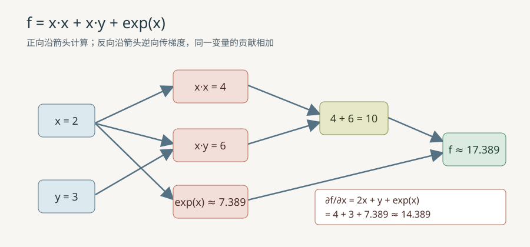

# 标量计算图与自动求导

## 1. 问题与学习路线

批量全连接层的[手写梯度](76_批量全连接层与矩阵求导.md)会随着网络变复杂而越来越难维护。自动微分（automatic differentiation，AD）把复杂函数拆成小运算：前向记录数值与连接，反向只需每种运算的局部导数。本例实现固定容量的**标量计算图**（scalar computational graph），先求表达式的导数，再训练最小异或（XOR）网络。前置知识是函数、偏导数和链式法则；不需要自动求导框架。

输入是有限的实数叶节点及运算，输出是一个标量值和它对各叶节点的导数。图只接受先创建的节点作父节点，因此无环。每次只求一个标量输出的梯度；图、节点数量和网络结构都固定为教学规模。对数输入须为正，数值溢出时失败。



## 2. 从链式法则到图上梯度

### 2.1 局部导数与累加

设节点的值为 $v$，父节点值为 $a$、$b$，最终输出为 $F$。反向传播（reverse mode AD）传入上游梯度 $\bar v=\partial F/\partial v$，对同一父节点的每条边都执行**加法累加**：

$$
\bar a \mathrel{+}= \bar v\frac{\partial v}{\partial a}.
\tag{1}
$$

$$
\bar b \mathrel{+}= \bar v\frac{\partial v}{\partial b}.
\tag{2}
$$

这里 $\bar a$、$\bar b$ 是已经累计的梯度；$\mathrel{+}=$ 表示在原值上增加。若 $v=a+b$ 且 $a=b=x$，两条边分别贡献 $1$，所以 $\partial(x+x)/\partial x=2$；若误用赋值覆盖，只会得到 $1$。乘法 $x\cdot x$ 也必须对左右两条边分别累加，才能得到 $2x$。

局部导数表中 $s$ 是 sigmoid 的输出；$\tanh(a)$ 是双曲正切（hyperbolic tangent）：

| 运算 | 前向值 | 对输入的局部导数 | 例子 |
| --- | --- | --- | --- |
| 加法 | $v=a+b$ | $\partial v/\partial a=1$，$\partial v/\partial b=1$ | $2+3=5$，两个局部导数均为 $1$ |
| 乘法 | $v=ab$ | $\partial v/\partial a=b$，$\partial v/\partial b=a$ | $2\cdot3=6$，分别为 $3$ 和 $2$ |
| 指数 | $v=e^a$ | $\partial v/\partial a=e^a=v$ | $a=0$ 时值与导数均为 $1$ |
| 对数 | $v=\ln a$，$a>0$ | $\partial v/\partial a=1/a$ | $a=2$ 时导数为 $0.5$ |
| 双曲正切 | $v=\tanh a$ | $\partial v/\partial a=1-v^2$ | $a=0$ 时导数为 $1$ |
| sigmoid | $v=s=1/(1+e^{-a})$ | $\partial v/\partial a=s(1-s)$ | $a=0$ 时 $s=0.5$、导数为 $0.25$ |

指数导数从导数定义出发，将 $e^{a+h}$ 拆成 $e^ae^h$，并使用 $\lim_{h\to0}(e^h-1)/h=1$：

$$
\frac{d e^a}{da}=\lim_{h\to0}\frac{e^{a+h}-e^a}{h}=e^a\lim_{h\to0}\frac{e^h-1}{h}=e^a.
\tag{3}
$$

这里 $h$ 是趋近零的输入增量；代入 $a=0$ 就得到导数 $1$。对数是指数的反函数：令 $v=\ln a$，则 $a=e^v$，对 $a$ 求导得 $1=e^v\,dv/da=a\,dv/da$，所以：

$$
\frac{d\ln a}{da}=\frac1a,\qquad a>0.
\tag{4}
$$

代入 $a=2$ 得 $0.5$。对双曲正切，用商法则对 $\tanh a=(e^a-e^{-a})/(e^a+e^{-a})$ 求导，分子化简为 $4$，分母为 $(e^a+e^{-a})^2$；把 $1-\tanh^2a$ 通分后得到同一式：

$$
\frac{d\tanh a}{da}=\frac{4}{(e^a+e^{-a})^2}=1-\tanh^2 a.
\tag{5}
$$

在 $a=0$ 时，分子分母分别为 $4$ 与 $4$，导数为 $1$。sigmoid 对 $s=(1+e^{-a})^{-1}$ 用链式法则，先求外层倒数的导数，再乘内层 $-e^{-a}$：

$$
\frac{ds}{da}=\frac{e^{-a}}{(1+e^{-a})^2}=\frac{1}{1+e^{-a}}\left(1-\frac{1}{1+e^{-a}}\right)=s(1-s).
\tag{6}
$$

在 $a=0$ 时 $s=1/2$，故导数为 $1/4$。代码按输入符号分支计算 sigmoid，以避免很大的负数让 $e^{-a}$ 溢出。

### 2.2 前向模式与反向模式

前向模式（forward mode AD）为一个选定输入 $x$ 记录切向量 $\dot v=\partial v/\partial x$，按建图顺序计算。例如乘法的切向量为：

$$
\dot v=\dot a\,b+a\,\dot b.
\tag{7}
$$

若 $a=x$、$b=x$、$x=2$、$\dot x=1$，结果是 $1\cdot2+2\cdot1=4$。前向模式适合少量输入、多输出。反向模式先算全部前向值，再令标量输出 $\bar F=1$，按拓扑序逆序回传；一次反向即可得到所有叶节点的梯度，适合参数多、标量损失的训练。本例**实现反向模式**，前向模式仅用上述公式对照理解。

### 2.3 共享节点的完整手算

取 $x=2$、$y=3$，表达式的三个分支是 $x^2$、$xy$ 和 $e^x$：

$$
F=x^2+xy+e^x=4+6+7.389056099=17.389056099.
\tag{8}
$$

平方分支有两条指向同一 $x$ 的乘法边，各给 $2$；乘积给 $x$ 的贡献是 $y=3$，指数给 $e^2\approx7.389056099$：

$$
\frac{\partial F}{\partial x}=x+x+y+e^x=2+2+3+7.389056099\approx14.389056099.
\tag{9}
$$

对于 $y$，只有 $xy$ 分支贡献 $x=2$：

$$
\frac{\partial F}{\partial y}=x=2.
\tag{10}
$$

另一个小检查是 $G(x)=\ln(e^x)$。在 $x=2$ 时，对数节点的局部导数是 $1/e^2$，指数节点是 $e^2$，相乘得 $dG/dx=1$；程序对这条路径也有断言。

## 3. 与源码逐步对应

| 数学步骤 | C 源码 | Python 源码 | 状态与索引 |
| --- | --- | --- | --- |
| 建立有限标量和父节点 | [`Node`、`graph_push`](../../src/ml/32_scalar_autodiff.c#L77) | [`Node`、`Graph.push`](../../src/python/ml/32_scalar_autodiff.py#L47) | 节点记录 `value`、`gradient`、`left`、`right`；父索引小于新索引 |
| 前向局部运算 | [`graph_add` 等](../../src/ml/32_scalar_autodiff.c#L114) | [`Graph.add` 等](../../src/python/ml/32_scalar_autodiff.py#L78) | 指数、对数和激活节点保存输出值供反向使用 |
| 反向与共享梯度 | [`graph_backward`](../../src/ml/32_scalar_autodiff.c#L180) | [`Graph.backward`](../../src/python/ml/32_scalar_autodiff.py#L129) | 先清零，输出梯度设 $1$，从输出逆序访问，父梯度用 `+=` |
| 构造 XOR 网络 | [`graph_xor`](../../src/ml/32_scalar_autodiff.c#L278) | [`xor_sample`](../../src/python/ml/32_scalar_autodiff.py#L193) | 九个参数叶按位置 $0\ldots8$ 放入连续数组/列表 |
| 手写对照与训练 | [`xor_manual`、`train_epoch`](../../src/ml/32_scalar_autodiff.c#L359) | [`manual_sample`、`train_epoch`](../../src/python/ml/32_scalar_autodiff.py#L222) | 四个样本的九个梯度逐项求平均后更新 |

C 的 `Graph.nodes[128]` 是固定数组，`count` 是当前有效节点数，`graph_reset` 将其归零；Python 的 `nodes` 列表用 `clear` 释放旧节点。旧索引在重置后不可再用。前向构图中每个新节点只引用更早的节点，创建顺序本身就是拓扑顺序；无需再运行图搜索。反向只遍历目标输出及其之前的节点，未连接的分支梯度仍为零。若构图失败，函数返回 `SIZE_MAX` 或抛出 `ValueError`；若反向产生非有限梯度，清零后失败。

实现中 `graph_xor` 每条样本重建一次图，参数值作为九个叶节点。图的反传负责**单个样本**；`train_epoch` 再把四份梯度求均值。注意原有 [`06_xor_mlp.c`](../../src/ml/06_xor_mlp.c) 使用 $2\to4\to1$ 网络与二元交叉熵；本例使用 $2\to2\to1$ 网络与半平方误差，因此不能直接比较两者的梯度数值。本例 `xor_manual` 使用**完全相同的结构、参数和损失**作为独立参照，原手写实现保持不变。

## 4. XOR 的前向、损失、反向和更新手算

两输入是 $x_0,x_1\in\{0,1\}$，目标为 $t\in\{0,1\}$。参数向量 $\theta=(w_{10},w_{11},b_1,w_{20},w_{21},b_2,u_1,u_2,c)$ 共九个分量。隐藏层与输出层定义为：

$$
a_j=w_{j0}x_0+w_{j1}x_1+b_j,\qquad j\in\{1,2\}.
\tag{11}
$$

$$
h_j=\tanh(a_j).
\tag{12}
$$

$$
z=u_1h_1+u_2h_2+c.
\tag{13}
$$

$$
p=\sigma(z)=\frac{1}{1+e^{-z}}.
\tag{14}
$$

单样本损失是 $\ell=\frac12(p-t)^2$。$p$ 是预测概率，$z$ 是输出层未激活值，$j$ 是隐藏单元编号。取代码初值 $\theta=(2,2,-1,2,2,-3,2,-2,-1)$，单条样本 $(x_0,x_1,t)=(0,1,1)$。先计算隐藏层：

$$
a_1=2\cdot0+2\cdot1-1=1.
\tag{15}
$$

$$
h_1=\tanh(a_1)=\tanh(1)\approx0.761594156.
\tag{16}
$$

$$
a_2=2\cdot0+2\cdot1-3=-1.
\tag{17}
$$

$$
h_2=\tanh(a_2)=\tanh(-1)\approx-0.761594156.
\tag{18}
$$

再计算输出及损失；$r=p-t$ 是预测误差：

$$
z=2h_1-2h_2-1\approx2.046376624.
\tag{19}
$$

$$
p=\sigma(z)\approx0.885580984.
\tag{20}
$$

$$
r=p-1\approx-0.114419016.
\tag{21}
$$

$$
\ell=\tfrac12r^2\approx0.006545856.
\tag{22}
$$

从损失往回用链式法则。$\delta_z=\partial\ell/\partial z$ 是输出层误差信号：

$$
\delta_z=r\,p(1-p)\approx-0.011593770.
\tag{23}
$$

隐藏层误差信号 $\delta_j=\partial\ell/\partial a_j$，这里 $u_1=2$、$u_2=-2$：

$$
\delta_1=\delta_z u_1(1-h_1^2)\approx-0.009738172.
\tag{24}
$$

$$
\delta_2=\delta_z u_2(1-h_2^2)\approx0.009738172.
\tag{25}
$$

因为 $x_0=0$、$x_1=1$，九个参数梯度依次为：

$$
\nabla_\theta\ell=(0,-0.009738172,-0.009738172,0,0.009738172,0.009738172,-0.008829748,0.008829748,-0.011593770).
\tag{26}
$$

例如 $\partial\ell/\partial w_{11}=\delta_1x_1=-0.009738172$，$\partial\ell/\partial w_{10}=\delta_1x_0=0$；$\partial\ell/\partial u_1=\delta_z h_1=-0.008829748$。若**仅对这条样本**以学习率 $\eta=0.5$ 更新输出偏置 $c$，它会从 $-1$ 变为：

$$
c_{\mathrm{new}}=c-\eta\frac{\partial\ell}{\partial c}=-1-0.5(-0.011593770)\approx-0.994203115.
\tag{27}
$$

实际程序每轮使用四条样本的平均梯度 $\bar g_k=\frac14\sum_{i=1}^{4}\partial\ell_i/\partial\theta_k$，按 $\theta_k\leftarrow\theta_k-0.5\bar g_k$ 更新；上面的单样本更新仅用于手算，不是程序第一轮的完整更新。四条样本 $(0,0),(0,1),(1,0),(1,1)$ 的初始单样本损失依次约为 $0.068375684,0.006545856,0.006545856,0.068375684$，因此全批量平均损失为：

$$
L=\frac{0.068375684+0.006545856+0.006545856+0.068375684}{4}\approx0.037460770.
\tag{28}
$$

其中 $L$ 是四条样本的平均损失。将各样本的输出偏置梯度求平均，程序得到 $\bar g_c\approx0.037293533$；第一轮实际更新是：

$$
c_{\mathrm{new}}=-1-0.5\cdot0.037293533\approx-1.018646767.
\tag{29}
$$

同时九个参数按平均梯度更新；新参数依序约为 $(2.001004706,2.001004706,-1.006826458,2.007831164,2.007831164,-2.993173542,1.999692458,-1.999692458,-1.018646767)$，用新参数重新前向计算的平均损失约为 $0.036363432$。这一步将单样本手算与实际批量训练连接起来。

## 5. 验证、运行与适用边界

在仓库根目录运行：

```sh
make scalar-autodiff
python3 src/python/ml/32_scalar_autodiff.py
make test-scalar-autodiff
make sanitize-scalar-autodiff
```

`--csv` 输出相同字段，可用于跨语言比较。固定四条 XOR 真值表、固定九个初值、学习率 $0.5$、全批量 $800$ 轮。初始平均损失约 $0.037460770$，训练后约 $0.002922572$；四个预测约为 $0.08517,0.93511,0.93511,0.08779$。这说明程序在这四个训练点上拟合成功，**不是独立数据上的泛化证明**；四个真值点本身已覆盖这个二值任务的全部输入组合。

测试对表达式梯度和 XOR 的每个参数使用中心差分。令步长 $\varepsilon=10^{-5}$，数值梯度为：

$$
g_k^{\mathrm{num}}=\frac{\ell(\theta_k+\varepsilon)-\ell(\theta_k-\varepsilon)}{2\varepsilon}.
\tag{30}
$$

其中 $k\in\{0,\ldots,8\}$ 是参数下标，其他参数保持不变。九个参数、四个样本共 $36$ 次比较；采用绝对误差小于 $10^{-8}+10^{-6}|g_k^{\mathrm{num}}|$ 的阈值，兼顾零梯度与非零梯度。表达式的 $x$ 梯度也与手算及中心差分核对。测试进一步覆盖连续两次反向不叠加旧梯度、共享节点、同节点作为乘法两输入、无效对数、指数溢出、非有限叶、无效索引、容量耗尽与重置。

失败实验：若把 $\ln(-1)$ 加进图中，对数不在实数域定义，C 返回 `SIZE_MAX`，Python 抛出 `ValueError`，图不追加该操作节点。真实训练常见的其他失败原因包括学习率过大、激活饱和、图容量不足和浮点溢出。引擎的节点容量为 $128$，为每条样本重建图，不支持张量广播、动态网络、批量反向或通用优化器；教学图很小，反向时间与节点数成正比。要进一步学习，可将本例与[批量矩阵求导](76_批量全连接层与矩阵求导.md)对照：前者展示局部链式法则，后者展示矩阵形状和批量累加。
