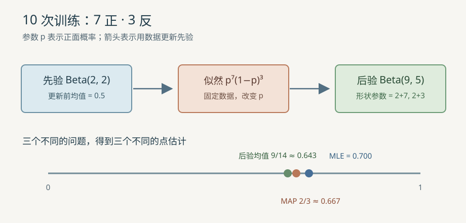

# 概率、似然与贝叶斯估计

## 1. 从问题进入

观察一枚硬币的 $10$ 次投掷，其中 $7$ 次正面、$3$ 次反面。我们想估计未知的正面概率 $p$，并对新数据评分。频率给出一个答案；若事先相信硬币大致公平，贝叶斯更新又给出两个不同的点估计。本教程还用四个一维数值说明高斯（Gaussian）均值与方差为何有不同分母。前置知识是分数、求和、自然对数和导数；与现有[逻辑回归](33_逻辑回归分析.md)、[朴素贝叶斯](36_朴素贝叶斯.md)和[GMM](49_高斯混合模型与期望最大化.md)相接。



## 2. 概率的起点：条件、独立、期望

### 2.1 条件概率与贝叶斯公式

设 $A$ 表示“抽中甲盒”，$H$ 表示“抽出的球为红色”。条件概率是已知 $H$ 发生后 $A$ 发生的比例：

$$
P(A\mid H)=\frac{P(A\cap H)}{P(H)},\qquad P(H)>0.
\tag{1}
$$

$P(A\cap H)$ 是两件事同时发生的概率。由乘法规则 $P(A\cap H)=P(H\mid A)P(A)$，得到贝叶斯公式：

$$
P(A\mid H)=\frac{P(H\mid A)P(A)}{P(H)}.
\tag{2}
$$

例如两个盒子被抽中的概率各为 $0.5$，甲盒红球概率 $P(H\mid A)=0.8$，乙盒红球概率 $P(H\mid\neg A)=0.2$。由全概率公式 $P(H)=0.8\cdot0.5+0.2\cdot0.5=0.5$，所以 $P(A\mid H)=0.8\cdot0.5/0.5=0.8$。这里 $\neg A$ 表示未抽中甲盒；先验 $P(A)=0.5$ 被观察结果更新为后验 $0.8$。

### 2.2 独立性、期望、方差与大数定律

若两个事件 $A,B$ 独立（independent），才有 $P(A\cap B)=P(A)P(B)$。硬币模型假设在**给定固定 $p$** 后，各次投掷条件独立；两次均为正面的概率是 $p^2$，例如 $p=0.7$ 时为 $0.49$。若 $p$ 本身未知并以先验表示不确定性，边际化后两次结果一般不独立。

令伯努利变量 $X$ 在正面时为 $1$，反面时为 $0$。期望（expectation）是按概率加权的平均，方差（variance）是相对期望的平方偏差平均：

$$
E[X]=1\cdot p+0\cdot(1-p)=p.
\tag{3}
$$

$$
\operatorname{Var}(X)=E[(X-p)^2]=p(1-p)^2+(1-p)p^2=p(1-p).
\tag{4}
$$

代入 $p=0.7$，期望为 $0.7$、方差为 $0.21$。大数定律（law of large numbers）说：在独立同分布且期望有限等条件下，样本平均 $\bar X_n$ 随样本数 $n$ 增长趋近真实期望 $p$。它不保证这 $10$ 次的 $7/10$ 恰好等于真实 $p$，也不承诺有限样本的误差界。

## 3. 从频率推到最大似然估计

### 3.1 概率与似然的观察角度

给定参数 $p$，某条有序观测序列 $D$ 的**概率**是 $P(D\mid p)$；固定已经看到的 $D$，把同一表达式看作 $p$ 的函数，称为**似然**（likelihood）$L(p;D)$。似然不是“参数取某值的概率”。设 $h$ 为正面次数，$t$ 为反面次数，$n=h+t$。条件独立使有序序列似然为：

$$
L(p;D)=p^h(1-p)^t.
\tag{5}
$$

本例 $h=7,t=3$，在 $p=0.7$ 时，$L(0.7;D)=0.7^7\cdot0.3^3\approx0.002223566$。如果只记录“恰好 $7$ 次正面”而忽略顺序，概率还要乘组合数 $\binom{10}{7}=120$；该因子与 $p$ 无关，最大值位置不变。

### 3.2 求导得到最大似然估计（maximum likelihood estimation，MLE）

自然对数严格递增，所以最大化似然等价于最大化对数似然 $\ell(p)$。在 $0<p<1$ 时：

$$
\ell(p)=h\ln p+t\ln(1-p).
\tag{6}
$$

逐项求导；$\ln(1-p)$ 的内层导数为 $-1$：

$$
\ell'(p)=\frac{h}{p}-\frac{t}{1-p}.
\tag{7}
$$

若 $h,t>0$，令导数为零并乘上正数 $p(1-p)$，有 $h(1-p)=tp$，即 $h=np$。二阶导数 $-h/p^2-t/(1-p)^2<0$，因此驻点是最大值：

$$
\hat p_{\mathrm{MLE}}=\frac{h}{n}=\frac{7}{10}=0.7.
\tag{8}
$$

若 $h=0$ 或 $t=0$，上面的内点求导条件不再适用；闭区间 $[0,1]$ 上的最大值分别位于 $p=0$ 或 $p=1$。源码直接用计数比，因此正确处理边界计数；空样本 $n=0$ 没有数据可估计，接口拒绝它。

## 4. Beta 先验、后验均值与最大后验估计（maximum a posteriori，MAP）

### 4.1 为什么 Beta 能直接更新

Beta 先验（Beta prior）给 $p\in(0,1)$ 的密度与 $p^{\alpha-1}(1-p)^{\beta-1}$ 成正比，其中 $\alpha,\beta$ 是形状参数。乘上似然并重新归一化：

$$
P(p\mid D)\propto p^{h+\alpha-1}(1-p)^{t+\beta-1}.
\tag{9}
$$

因此后验仍为 Beta。用 $\alpha'$、$\beta'$ 表示更新后的两个形状参数，它们分别在先验参数上加正面和反面次数。本例选 $\alpha=\beta=2$，先验密度在 $p=0.5$ 附近较高；观察 $7$ 正 $3$ 反后：

$$
\alpha'=2+7=9.
\tag{10}
$$

$$
\beta'=2+3=5.
\tag{11}
$$

用 $B(a,b)=\int_0^1p^{a-1}(1-p)^{b-1}\,dp$ 表示 Beta 函数，其中 $a,b>0$ 是积分中的形状参数。后验密度的归一化常数是 $B(\alpha',\beta')$，因此后验期望等于 $B(\alpha'+1,\beta')/B(\alpha',\beta')$；利用递推关系 $B(a+1,b)=aB(a,b)/(a+b)$ 得到：

$$
\hat p_{\mathrm{mean}}=\frac{9}{9+5}=\frac{9}{14}\approx0.642857.
\tag{12}
$$

对下一次正面事件 $H_{\mathrm{next}}$ 做后验预测，需要把未知的 $p$ 按后验密度平均；因为给定 $p$ 时正面概率就是 $p$，预测概率恰好等于后验均值：

$$
P(H_{\mathrm{next}}\mid D)=E[p\mid D]=\frac{9}{14}.
\tag{13}
$$

最大后验估计（maximum a posteriori，MAP）选择后验密度最高处。对后验对数密度求导，归一化常数消失：

$$
\frac{d}{dp}\ln P(p\mid D)=\frac{\alpha'-1}{p}-\frac{\beta'-1}{1-p}.
\tag{14}
$$

令其为零，与 MLE 的推导相同，得到内点众数；本例：

$$
\hat p_{\mathrm{MAP}}=\frac{\alpha'-1}{\alpha'+\beta'-2}=\frac{8}{12}=\frac23\approx0.666667.
\tag{15}
$$

后验均值与 MAP 分别是“平均位置”和“密度最高位置”，不能混用。代码要求 $\alpha>1,\beta>1$，确保含边界计数的后验也有唯一内点众数；这是一项教学接口限制，并非 Beta 分布本身的必要条件。边界情形需另行讨论，不把上述分母公式机械套用到所有先验。

## 5. 一维高斯的 MLE 与无偏方差

假设 $x_1,\ldots,x_n$ 是 $n$ 个独立同分布的一维观测，模型均值为 $\mu$、方差为 $\sigma^2>0$；$\pi\approx3.141593$ 是圆周率。对数似然是：

$$
\ell(\mu,\sigma^2)=-\frac n2\ln(2\pi)-\frac n2\ln\sigma^2
-\frac{1}{2\sigma^2}\sum_{i=1}^{n}(x_i-\mu)^2.
\tag{16}
$$

对 $\mu$ 求导为 $\sum_i(x_i-\mu)/\sigma^2$；令其为零，均值 MLE 是样本均值 $\bar x$。例如 $(1+2+3+4)/4=2.5$。再令 $v=\sigma^2$，把 $\mu=\bar x$ 代回，对 $v$ 求导：

$$
\frac{\partial\ell}{\partial v}=-\frac{n}{2v}
+\frac{\sum_{i=1}^{n}(x_i-\bar x)^2}{2v^2}.
\tag{17}
$$

令导数为零并乘以 $2v^2$，得到 $nv=\sum_i(x_i-\bar x)^2$。当平方偏差和为正时，导数在该解左侧为正、右侧为负，因此是最大点。两个闭式结果分别是：

$$
\hat\mu_{\mathrm{MLE}}=\bar x=\frac1n\sum_{i=1}^{n}x_i.
\tag{18}
$$

$$
\hat\sigma^2_{\mathrm{MLE}}=\frac1n\sum_{i=1}^{n}(x_i-\bar x)^2.
\tag{19}
$$

对固定数组 $(1,2,3,4)$，$n=4$，均值为 $2.5$。四项平方偏差依次为 $2.25,0.25,0.25,2.25$，和为 $5$：

$$
\hat\sigma^2_{\mathrm{MLE}}=\frac{5}{4}=1.25.
\tag{20}
$$

另一种常见量是**无偏样本方差** $s^2$。恒等式 $\sum_i(x_i-\bar x)^2=\sum_i(x_i-\mu)^2-n(\bar x-\mu)^2$，在独立同分布且方差有限的假设下取期望：右边期望为 $n\sigma^2-n(\sigma^2/n)=(n-1)\sigma^2$。因此除以 $n-1$ 的估计量对总体方差无偏：

$$
s^2=\frac{1}{n-1}\sum_{i=1}^{n}(x_i-\bar x)^2=\frac53\approx1.666667.
\tag{21}
$$

这里 MLE 旨在最大化观测数据似然，$s^2$ 旨在使重复抽样下的期望等于总体方差；目标不同，分母不同。$n=1$ 时无偏方差未定义。若所有值相同，平方偏差和为 $0$，闭式方差公式返回边界值 $0$；在限定 $\sigma^2>0$ 的非退化高斯族中，似然随方差趋近 $0$ 而增大，没有有效的有限方差最大点。程序保留该边界统计量，但明确拒绝将它代入密度公式。

## 6. 源码映射、实验与边界

| 数学对象 | C 实现 | Python 对照 | 具体状态 |
| --- | --- | --- | --- |
| 硬币计数与 Beta 更新 | [`estimate_coin`](../../src/ml/33_probability_estimation.c#L38) | [`estimate_coin`](../../src/python/ml/33_probability_estimation.py#L30) | `heads/tails` 对应 $h/t$，`posterior_alpha/beta` 对应 $\alpha'/\beta'$ |
| 独立测试的平均负对数似然 | [`coin_mean_nll`](../../src/ml/33_probability_estimation.c#L68) | [`coin_mean_nll`](../../src/python/ml/33_probability_estimation.py#L57) | 只在对应计数大于零时调用对数，保留边界 $0$ 或 $1$ 的合法情况 |
| 高斯均值与两种方差 | [`estimate_gaussian`](../../src/ml/33_probability_estimation.c#L97) | [`estimate_gaussian`](../../src/python/ml/33_probability_estimation.py#L84) | 两遍扫描，先均值再平方偏差；$n=1$ 不提供无偏方差 |
| 非退化高斯密度 | [`gaussian_density`](../../src/ml/33_probability_estimation.c#L137) | [`gaussian_density`](../../src/python/ml/33_probability_estimation.py#L104) | 对 $\sigma^2=0$ 明确失败 |

C 结果结构体只在全部验证通过后写入，失败不改调用者的输出；Python 返回不可变结果或抛出 `ValueError`。示例使用固定训练计数 $7$ 正 $3$ 反和**独立保留**的测试计数 $4$ 正 $2$ 反，测试数据不参与参数估计。基线是固定公平硬币 $p=0.5$。负对数似然（negative log-likelihood，NLL）按每次有序观测平均：

$$
\operatorname{NLL}(p)=-\frac{h_{\mathrm{test}}\ln p+t_{\mathrm{test}}\ln(1-p)}{h_{\mathrm{test}}+t_{\mathrm{test}}}.
\tag{22}
$$

本例测试集 $h_{\mathrm{test}}=4,t_{\mathrm{test}}=2$。代入 MAP 的 $p=2/3$，得到 $-[4\ln(2/3)+2\ln(1/3)]/6\approx0.636514$；MLE 为 $0.639108$，后验均值为 $0.637762$，公平硬币为 $0.693147$。分数越低越好，但六条测试投掷太少，不能据此宣称 MAP 总优于 MLE。

失败实验：若训练 $10$ 次全为正面，MLE 给 $p=1$；独立测试只要有一次反面，就出现 $\ln(1-p)=\ln0$，数学 NLL 为无穷大。接口返回失败，未悄悄裁剪到任意小概率。采用 $\operatorname{Beta}(2,2)$ 时，MAP 为 $11/12$，能给反面非零概率，但先验假设也可能不合适。高斯案例没有单独测试集，密度值仅检查实现，不构成预测评估。

在仓库根目录运行：

```sh
make probability-estimation
python3 src/python/ml/33_probability_estimation.py
make test-probability-estimation
make sanitize-probability-estimation
```

两种语言都支持 `--csv`，用同一组固定输入输出十一个字段。测试核对闭式值、全正/全反、空样本、非法先验、非有限数、单样本方差、退化高斯、失败不修改输出与 C/Python 逐字段一致。这里没有参数迭代训练，也就没有梯度下降的中心差分检查；MLE/MAP 的导数由上面的解析推导及闭式值验证。这个示例仅实现单参数硬币和一维高斯，不替代分类模型或 GMM 的完整评估。
