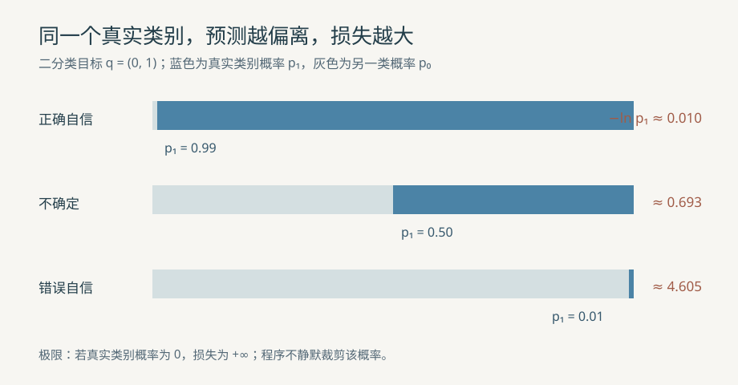

# 信息论与损失函数的来源

## 1. 学习目标与实验边界

模型输出概率后，为什么分类常用交叉熵，而回归常用平方误差？本例从信息量、似然与噪声假设推导答案，并用固定的二类、三类概率数组逐项计算。前置是[概率、似然与贝叶斯估计](78_概率似然与贝叶斯估计.md)的对数似然；可再对照[逻辑回归](33_逻辑回归分析.md)和[Softmax 多分类回归](45_Softmax多分类回归.md)。本例只评估给定预测，不训练模型，也不以小数组结果推断泛化能力。



## 2. 信息量、熵、交叉熵与 KL

### 2.1 对数底数决定单位

事件概率为 $p\in(0,1]$ 时，信息量（self-information）定义为 $I_b(p)=-\log_b p$。这里 $b>1$ 是对数底数；概率越小，观察到事件时越意外。若 $p=1/4$，以 $b=2$ 计量得到 $2$ 比特（bit）；以自然常数 $e$ 为底得到 $\ln4\approx1.386294$ 纳特（nat）：

$$
I_2(1/4)=-\log_2(1/4)=2\ \text{bit}.
\tag{1}
$$

$$
I_e(1/4)=-\ln(1/4)=\ln4\approx1.386294\ \text{nat}.
\tag{2}
$$

两者只是尺度不同，$I_2(p)=I_e(p)/\ln2$。概率为 $0$ 的事件在模型下不可能发生，其信息量按极限为 $+\infty$。程序统一使用自然对数，结果单位为纳特。

### 2.2 从事件信息量取期望

对 $K$ 个类别，令目标分布 $q=(q_0,\ldots,q_{K-1})$，预测分布 $p=(p_0,\ldots,p_{K-1})$；所有分量非负且总和为 $1$。下标 $i$ 表示类别。按真实分布 $q$ 对自身信息量取期望，得到熵（entropy）：

$$
H(q)=-\sum_{i=0}^{K-1}q_i\ln q_i.
\tag{3}
$$

约定 $0\ln0=0$，因为 $\lim_{x\to0^+}x\ln x=0$。例如 $q=(1/2,1/2)$，两项各为 $-\frac12\ln\frac12\approx0.346574$，总和为 $\ln2\approx0.693147$；若 $q=(0,1)$，熵为 $0$。

用预测分布 $p$ 为按 $q$ 产生的事件提供概率，平均信息量是交叉熵（cross-entropy）：

$$
H(q,p)=-\sum_{i=0}^{K-1}q_i\ln p_i.
\tag{4}
$$

取 $q=(1/2,1/2)$、$p=(3/4,1/4)$，两个贡献分别为 $-\frac12\ln(3/4)\approx0.143841$ 与 $-\frac12\ln(1/4)\approx0.693147$，总和约 $0.836988$。当 $q_i=0$ 时该类贡献为 $0$；当 $q_i>0$ 且 $p_i=0$ 时交叉熵为 $+\infty$，不能计算 `log(0)` 后再乘零。

KL 散度（Kullback–Leibler divergence，KL）比较两个分布：

$$
D_{\mathrm{KL}}(q\|p)=\sum_{i:q_i>0}q_i\ln\frac{q_i}{p_i}
=H(q,p)-H(q).
\tag{5}
$$

继续用上例，$D_{\mathrm{KL}}=0.836988-0.693147\approx0.143841$。当 $q=p=(1/2,1/2)$ 时，两项比值均为 $1$，所以 KL 为 $0$。对 $q_i>0$ 的类别应用对数凹性，有 $\sum_{i:q_i>0}q_i\ln(p_i/q_i)\leq\ln\sum_{i:q_i>0}p_i\leq0$，故 KL 非负。KL 一般不对称，也不是距离度量。

## 3. 从噪声与似然得到训练损失

### 3.1 高斯噪声为何产生平方项

设观测 $y$ 等于预测均值 $\mu$ 加零均值高斯噪声，已知方差 $\sigma^2>0$。单次观测的密度为：

$$
f(y\mid\mu,\sigma^2)=\frac{1}{\sqrt{2\pi\sigma^2}}
\exp\left(-\frac{(y-\mu)^2}{2\sigma^2}\right).
\tag{6}
$$

$\pi\approx3.141593$，$f$ 是密度而非单点概率。对密度取负自然对数，乘积变成和：

$$
\ell_G(\mu)=\frac12\ln(2\pi\sigma^2)+\frac{(y-\mu)^2}{2\sigma^2}.
\tag{7}
$$

方差固定时第一项与 $\mu$ 无关，最小化负对数似然等价于最小化平方误差。对均值求导，$d(y-\mu)^2/d\mu=2(\mu-y)$：

$$
\frac{d\ell_G}{d\mu}=\frac{\mu-y}{\sigma^2}.
\tag{8}
$$

代码固定 $y=2$、$\mu=1$、$\sigma^2=1$：平方项为 $1/2$，常数项为 $\frac12\ln(2\pi)\approx0.918939$，总损失约 $1.418939$；梯度为 $-1$。若仅作手算以学习率 $0.1$ 更新均值，新值为 $1-0.1(-1)=1.1$，重新代入得到损失约 $1.323939$。程序只计算损失和梯度，不执行该更新。

### 3.2 伯努利似然为何产生二分类交叉熵

真实标签 $y\in\{0,1\}$，模型预测正类概率 $p\in(0,1)$。伯努利（Bernoulli）似然为 $p^y(1-p)^{1-y}$；取负对数得到二分类交叉熵（binary cross-entropy，BCE）：

$$
\ell_B(p,y)=-y\ln p-(1-y)\ln(1-p).
\tag{9}
$$

这是目标分布 $q=(1-y,y)$、预测分布 $(1-p,p)$ 的交叉熵。若 $y=1$ 且 $p=0.99$，损失为 $-\ln0.99\approx0.010050$；改为错误自信的 $p=0.01$，损失升至 $4.605170$；不确定的 $p=0.5$ 得 $0.693147$。

设模型分数 $z$ 经 sigmoid 函数 $p=1/(1+e^{-z})$ 转为概率，链式法则给 $dp/dz=p(1-p)$。先求 $d\ell_B/dp=-y/p+(1-y)/(1-p)$，再相乘并约分：

$$
\frac{d\ell_B}{dz}=p-y.
\tag{10}
$$

上面正确自信例的梯度为 $0.99-1=-0.01$，错误自信为 $0.01-1=-0.99$，不确定为 $0.5-1=-0.5$。梯度对的是**正类 logit** $z$，不是直接对概率 $p$ 的导数。本例返回的二类 `logit_gradient[1]` 与它相同。

### 3.3 分类分布为何产生多分类交叉熵

对 $K$ 类，真实类别 $c$ 的独热目标满足 $q_c=1$、其余分量为 $0$；分类分布给这次标签的似然是 $p_c$，故负对数似然为：

$$
\ell_C=-\ln p_c=H(q,p).
\tag{11}
$$

若模型有每类分数 $z_i$，Softmax 输出 $p_i=e^{z_i}/\sum_j e^{z_j}$。求导得到 $\partial p_i/\partial z_j=p_i(\mathbf1[i=j]-p_j)$；代入交叉熵并对类别求和，得到：

$$
\frac{\partial H(q,p)}{\partial z_j}=p_j-q_j.
\tag{12}
$$

$\mathbf1[i=j]$ 在下标相等时为 $1$，否则为 $0$。取三类目标 $q=(0,1,0)$，正确自信预测 $(0.05,0.9,0.05)$ 的损失为 $-\ln0.9\approx0.105361$，三个 logit 梯度为 $(0.05,-0.1,0.05)$。同一目标下，错误自信 $(0.9,0.05,0.05)$ 的损失约 $2.995732$，目标类梯度为 $-0.95$；均匀预测 $(1/3,1/3,1/3)$ 的损失约 $1.098612$，目标类梯度为 $-2/3$。

## 4. 源码对应、验证和限制

| 概念 | C 代码 | Python 对照 | 关键状态 |
| --- | --- | --- | --- |
| 检查概率约束 | [`valid_distribution`](../../src/ml/34_information_losses.c#L37) | [`validate_distribution`](../../src/python/ml/34_information_losses.py#L20) | 二类或三类、有限非负、总和在容差内为 $1$ |
| 累计熵、交叉熵与 KL | [`distribution_metrics`](../../src/ml/34_information_losses.c#L60) | [`distribution_metrics`](../../src/python/ml/34_information_losses.py#L33) | 跳过 $q_i=0$ 项；$q_i>0,p_i=0$ 明确返回无穷损失 |
| 分类 logit 梯度 | 同上 `logit_gradient[i]` | 同上 `logit_gradient` | 只对内点预测提供 $p_i-q_i$；边界概率无有限 logit |
| 高斯负对数似然 | [`gaussian_loss`](../../src/ml/34_information_losses.c#L110) | [`gaussian_loss`](../../src/python/ml/34_information_losses.py#L58) | 使用固定方差，拒绝零方差和非有限值 |

C 用 `LOSS_INVALID`、`LOSS_FINITE`、`LOSS_INFINITE` 区分非法概率、有限损失和数学上的无穷损失；非法输入不会修改结果。Python 对非法输入抛 `ValueError`，对真实事件概率为零返回 `math.inf`，对无法对应有限 logit 的边界概率不提供梯度。已有 [`25_softmax_regression.c`](../../src/ml/25_softmax_regression.c#L149) 从有限分数算 Softmax，并用 `DBL_MIN` 保护浮点下溢后的 `log`；本例直接检查**给定的概率数组**，用来说明未裁剪时的数学边界。两者接口和数值策略不同，原实现及其教程保持不变。

固定实验将均匀预测作为分类基线，并比较正确自信、错误自信的同一真实目标。错误自信案例展示损失迅速增大；真实类别概率为 $0$ 的失败实验给出 $+\infty$，程序不把无效概率悄悄改成一个小正数。中心差分以步长 $10^{-5}$ 核对二类与三类各 logit 梯度及高斯均值梯度；相同分布的 KL 与 $0$ 以浮点容差比较。这些检查证明固定公式的实现符合预期，不证明任何训练模型的预测能力。

在仓库根目录运行：

```sh
make information-losses
python3 src/python/ml/34_information_losses.py
make test-information-losses
make sanitize-information-losses
```

两种语言的 `--csv` 输出同名字段，便于逐项比较。教学引擎只处理 $K=2$ 或 $K=3$ 的小分布，不实现通用张量、数据集训练或数值稳定性全面实验；极端 logit 的稳定 Softmax 和浮点误差将在 M06 单独学习。
