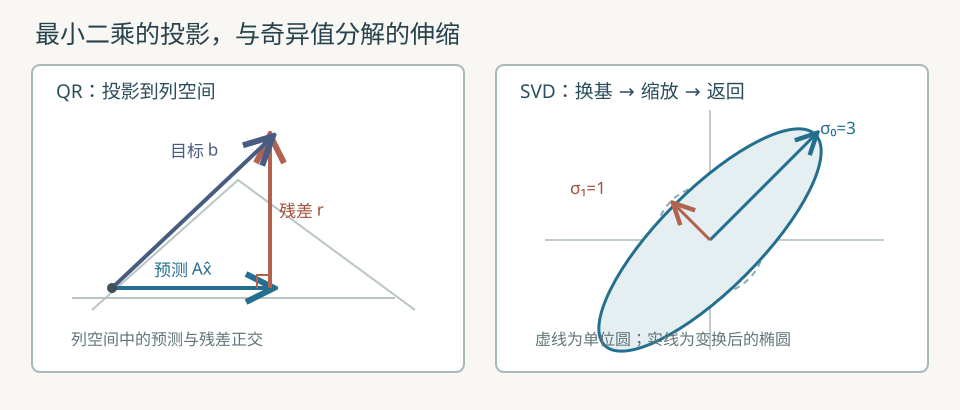

# 正交投影、最小二乘与矩阵分解

本教程把 [M01 的二维变换](75_二维矩阵变换实验室.md)、[线性回归的最小二乘](32_线性回归分析.md)、[PCA 的主方向](39_主成分分析.md)与 [M06 的病态问题](51_数值计算与梯度.md#10-m06数值稳定性与梯度检查实验室)连在一起。前置知识是向量点积、矩阵乘法、平方损失和浮点舍入。这里使用标准库实现固定尺寸的教学实验，不训练预测模型，也不提供通用矩阵库。

运行：

```sh
make projection-decomposition
python3 src/python/ml/36_projection_decomposition.py
make test-projection-decomposition
make sanitize-projection-decomposition
```



左图的目标向量分为落在列空间的预测和垂直于列空间的残差；右图把一个单位圆沿两个正交方向伸缩成椭圆。

## 1. 从向量空间理解拟合目标

令 $A\in\mathbb R^{m\times2}$ 为按行存储的设计矩阵，$m\in\{2,3,4\}$ 是样本数；其两列 $a_0,a_1\in\mathbb R^m$ 张成列空间。参数 $x=(x_0,x_1)^{\mathsf T}\in\mathbb R^2$，目标 $b\in\mathbb R^m$，预测 $Ax=x_0a_0+x_1a_1$ 必须留在该列空间。若 $b$ 不在其中，就寻找最近的投影 $\hat b$：

$$
\hat x=\mathop{\arg\min}_{x\in\mathbb R^2}\|Ax-b\|_2^2.
\tag{1}
$$

这里 $\|v\|_2=\sqrt{\sum_i v_i^2}$ 是欧几里得范数；残差定义为 $r=b-A\hat x$。对每个参数求导，得到最优点的正交条件：

$$
\frac{\partial\|Ax-b\|_2^2}{\partial x_j}
=2a_j^{\mathsf T}(Ax-b)=0,\qquad j\in\{0,1\}.
\tag{2}
$$

因此 $a_0^{\mathsf T}r=a_1^{\mathsf T}r=0$。合并两列就是正规方程（normal equations）：

$$
A^{\mathsf T}A\hat x=A^{\mathsf T}b.
\tag{3}
$$

若两列线性相关，$\operatorname{rank}(A)<2$，参数不能由此唯一确定；仍可能有唯一的预测投影。这里的 QR 求解器把秩亏作为明确失败状态，不计算最小范数解。

## 2. 正交基与 QR 最小二乘

QR 分解（QR decomposition）写成 $A=QR$：$Q\in\mathbb R^{m\times2}$ 的两列 $q_0,q_1$ 为单位正交向量，$R\in\mathbb R^{2\times2}$ 为上三角矩阵，$I_2$ 是二维单位矩阵。对满列秩矩阵：

$$
Q^{\mathsf T}Q=I_2.
\tag{4}
$$

用 Gram–Schmidt 正交化（Gram–Schmidt orthogonalization）从两列求它们：

$$
\begin{aligned}
r_{00}&=\|a_0\|_2,\\
q_0&=a_0/r_{00}.
\end{aligned}
\tag{5}
$$

$$
\begin{aligned}
r_{01}&=q_0^{\mathsf T}a_1,\\
u_1&=a_1-r_{01}q_0.
\end{aligned}
\tag{6}
$$

$$
\begin{aligned}
r_{11}&=\|u_1\|_2,\\
q_1&=u_1/r_{11}.
\end{aligned}
\tag{7}
$$

其中 $r_{ij}$ 是 $R$ 第 $i$ 行第 $j$ 列，$u_1$ 是去掉第一方向投影后的第二列。源码再把 $u_1$ 对 $q_0$ 投影并减去一次，以减轻浮点失正交；第二次的投影系数也加入 $r_{01}$。若 $r_{00}$ 或 $r_{11}$ 太小，则不能除它求单位方向。

因为 $Q$ 的列正交，任意 $b$ 可分成列空间内和列空间外两部分，二者平方范数相加：

$$
\|QRx-b\|_2^2
=\|Rx-Q^{\mathsf T}b\|_2^2
 +\|(I_m-QQ^{\mathsf T})b\|_2^2.
\tag{8}
$$

第一项可由 $Rx=Q^{\mathsf T}b$ 降为零；第二项与 $x$ 无关。$I_m$ 为 $m$ 维单位矩阵。由下往上回代：

$$
x_1=\frac{q_1^{\mathsf T}b}{r_{11}}.
\tag{9}
$$

$$
x_0=\frac{q_0^{\mathsf T}b-r_{01}x_1}{r_{00}}.
\tag{10}
$$

## 3. 三行两列的逐步手算

固定输入与 [`qr_solve`](../../src/ml/36_projection_decomposition.c#L35) 一致：

$$
\begin{aligned}
A&=\begin{bmatrix}1&0\\1&1\\1&2\end{bmatrix},\\
b&=\begin{bmatrix}1\\2\\2\end{bmatrix}.
\end{aligned}
\tag{11}
$$

两列分别为 $a_0=(1,1,1)^{\mathsf T}$、$a_1=(0,1,2)^{\mathsf T}$。第一列长度为 $\sqrt3$；第二列在第一方向上的系数是 $(0+1+2)/\sqrt3=\sqrt3$，因此：

$$
q_0=\frac1{\sqrt3}\begin{bmatrix}1\\1\\1\end{bmatrix}.
\tag{12}
$$

$$
u_1=a_1-\sqrt3q_0=\begin{bmatrix}-1\\0\\1\end{bmatrix}.
\tag{13}
$$

$$
q_1=\frac1{\sqrt2}\begin{bmatrix}-1\\0\\1\end{bmatrix}.
\tag{14}
$$

于是 $q_0^{\mathsf T}q_1=(-1+0+1)/\sqrt6=0$，且 $r_{11}=\sqrt2$。把 $b$ 投影到两条方向：

$$
Q^{\mathsf T}b=\begin{bmatrix}5/\sqrt3\\1/\sqrt2\end{bmatrix}.
\tag{15}
$$

回代第二个参数 $x_1=(1/\sqrt2)/\sqrt2=1/2$；再代入第一个参数：

$$
x_0=\frac{5/\sqrt3-\sqrt3/2}{\sqrt3}=\frac76.
\tag{16}
$$

预测与残差逐行相减，直接验证投影：

$$
A\hat x=\begin{bmatrix}7/6\\5/3\\13/6\end{bmatrix}.
\tag{17}
$$

$$
r=b-A\hat x=\begin{bmatrix}-1/6\\1/3\\-1/6\end{bmatrix}.
\tag{18}
$$

$$
\|r\|_2=\sqrt{1/36+1/9+1/36}=\sqrt{1/6}\approx0.40824829.
\tag{19}
$$

代入两列可检验 $a_0^{\mathsf T}r=0$，$a_1^{\mathsf T}r=0$。这说明预测已是 $b$ 在列空间上的正交投影，而不是要求每个样本的残差都为零。

## 4. 二维奇异值分解的旋转与缩放

奇异值分解（singular value decomposition，SVD）把二维矩阵写成 $A=U\Sigma V^{\mathsf T}$。$U,V$ 的列分别是左、右正交方向；对角矩阵 $\Sigma=\operatorname{diag}(\sigma_0,\sigma_1)$ 的非负元素为奇异值。作用顺序是先用 $V^{\mathsf T}$ 换坐标，再按 $\sigma_i$ 缩放，最后用 $U$ 返回原坐标。本节 SVD 的 $A$ 是一个新的 $2\times2$ 示例，与上节的 $3\times2$ 设计矩阵形状不同。

固定例子 $A=\begin{bmatrix}2&1\\1&2\end{bmatrix}$。先求右奇异方向：

$$
A^{\mathsf T}A=\begin{bmatrix}5&4\\4&5\end{bmatrix}.
\tag{20}
$$

特征值（eigenvalue）是使 $(A^{\mathsf T}A)v=\lambda v$ 有非零解的 $\lambda$。此矩阵沿 $(1,1)^{\mathsf T}$ 的特征值为 $9$，沿 $(-1,1)^{\mathsf T}$ 的特征值为 $1$；单位右方向分别是：

$$
v_0=\frac1{\sqrt2}\begin{bmatrix}1\\1\end{bmatrix}.
\tag{21}
$$

$$
v_1=\frac1{\sqrt2}\begin{bmatrix}-1\\1\end{bmatrix}.
\tag{22}
$$

奇异值是特征值的非负平方根，故 $\sigma_0=3$、$\sigma_1=1$。逐个计算左方向 $u_i=Av_i/\sigma_i$：本例 $u_0=v_0$、$u_1=v_1$。重建是两个秩一矩阵之和：

$$
A=3u_0v_0^{\mathsf T}+u_1v_1^{\mathsf T}
=\begin{bmatrix}2&1\\1&2\end{bmatrix}.
\tag{23}
$$

图中单位圆因此变成沿 $v_0$ 方向长半轴 $3$、沿 $v_1$ 方向短半轴 $1$ 的椭圆。源码 [`svd2`](../../src/ml/36_projection_decomposition.c#L145) 对 $A^{\mathsf T}A$ 用二维旋转角取得右方向，再按 $Av_i/\sigma_i$ 取得左方向，并逐格检查重建。二维闭式角度适合教学；极端尺度可能使 $A^{\mathsf T}A$ 溢出或损失精度，因此不宣称它是稳定的通用 SVD。秩亏矩阵有零奇异值；本程序明确拒绝，不计算零奇异方向的任意正交补。

## 5. 病态数据：为何 QR 与正规方程的误差不同

取 $h=10^{-6}$，三行矩阵的两列几乎相同：

$$
A_h=\begin{bmatrix}1&1\\1&1+h\\1&1-h\end{bmatrix}.
\tag{24}
$$

取真实参数 $x_*=(1,1)^{\mathsf T}$，目标 $b_h=A_hx_*=(2,2+h,2-h)^{\mathsf T}$。此例精确满秩，但两列方向差只有 $h$。正规方程中的矩阵为：

$$
A_h^{\mathsf T}A_h=\begin{bmatrix}3&3\\3&3+2h^2\end{bmatrix}.
\tag{25}
$$

它的行列式是 $6h^2=6\times10^{-12}$，由两个约为 $9$ 的浮点乘积相减得到；少量舍入就会严重影响这个差。$A_h$ 的最大奇异值约为 $\sqrt6$，最小奇异值约为 $h$，因此二范数条件数（condition number）约为 $\sqrt6/h\approx2.45\times10^6$；正规方程的条件数约为其平方。两种算法都无法消除输入的固有敏感性。

本机 Apple clang 17 的实测参数最大绝对误差：两遍 Gram–Schmidt QR 约 $2.68\times10^{-10}$，[`normal_solve`](../../src/ml/36_projection_decomposition.c#L102) 约 $3.70\times10^{-4}$。Python 3.13 上相应约 $2.77\times10^{-10}$ 与 $2.96\times10^{-4}$。这组有限精度计算显示正规方程的额外舍入风险；不同语言的最后结果允许有差异，不能据一组样本断言 QR 总是给出该数量级的误差。进一步缩小 $h$ 时，QR 也可能失正交或把满秩列判成秩亏；稳健的大规模求解通常还需更成熟的分解与秩判定。

## 6. 源码对应、边界与验证范围

| 步骤 | C 实现 | Python 对照 | 数组与失败行为 |
| --- | --- | --- | --- |
| 两遍正交化、回代、残差 | [`qr_solve`](../../src/ml/36_projection_decomposition.c#L35) | [`qr_solve`](../../src/python/ml/36_projection_decomposition.py#L46) | 行优先 $m\times2$；C 最多四行，失败不覆盖输出；Python 抛出 `ValueError` |
| 正规方程对照 | [`normal_solve`](../../src/ml/36_projection_decomposition.c#L102) | [`normal_solve`](../../src/python/ml/36_projection_decomposition.py#L88) | 累加 $A^{\mathsf T}A$ 和 $A^{\mathsf T}b$；行列式不正则拒绝 |
| 右方向、奇异值、重建 | [`svd2`](../../src/ml/36_projection_decomposition.c#L145) | [`svd2`](../../src/python/ml/36_projection_decomposition.py#L114) | 固定 $2\times2$；拒绝非有限、秩亏与重建误差过大 |
| 断言和跨语言核对 | [`test_decomposition`](../../src/ml/36_projection_decomposition.c#L200) | [单元测试](../../tests/python/test_projection_decomposition.py) | 检查正交、重建、残差、秩亏、坏形状和病态误差 |

例如 QR 的去投影与二次正交化直接对应上文的 $u_1$ 和修正后的 $r_{01}$：

```c
next.q[i][1] = a[i][1] - next.r[0][1] * next.q[i][0];
correction += next.q[i][0] * next.q[i][1];
next.r[0][1] += correction;
next.q[i][1] -= correction * next.q[i][0];
```

固定例子无随机性，无训练集和测试集，比较的是数值求解误差，不是预测泛化。测试检查已知解、残差与正交性、$A=QR$ 和 $A=U\Sigma V^{\mathsf T}$ 重建、秩亏、非有限输入，以及跨语言稳定字段；病态误差只检查数量级与相对大小。C 调用方须保证指针所指数组实际有声明的长度；函数无法从指针自行得知容量。消毒器只覆盖这些固定路径，不能证明任意输入都安全。

练习：把手算目标改成 $(1,2,3)^{\mathsf T}$，预测残差；再将 $A_h$ 的 $h$ 从 $10^{-6}$ 改为 $10^{-4}$，先估计正规方程行列式，再运行两种求解器观察误差。
