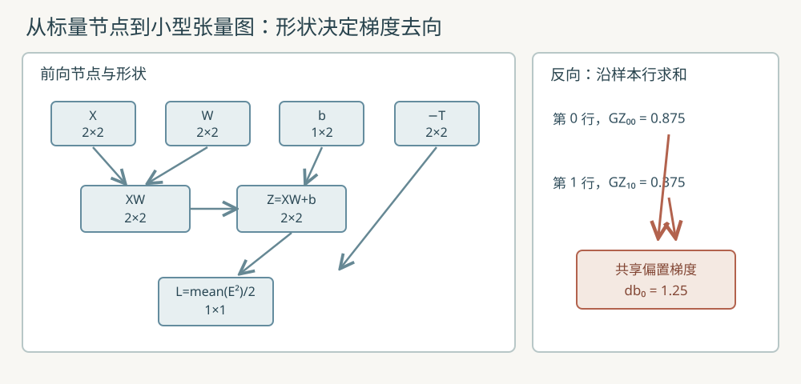

# 张量计算图与反向传播

本教程把 [M03 的标量计算图](77_标量计算图与自动求导.md)推进到小型张量，再复现 [M02 的手写批量全连接层](76_批量全连接层与矩阵求导.md)。前置知识是矩阵乘法、链式法则、偏导与梯度；有关中心差分的误差范围，可先读[数值稳定性实验](51_数值计算与梯度.md#10-m06数值稳定性与梯度检查实验室)。这里每个张量最多六个元素，教学目的在于看清索引与梯度流，不实现通用深度学习框架。

运行命令：

```sh
make tensor-autodiff
python3 src/python/ml/37_tensor_autodiff.py
make test-tensor-autodiff
make sanitize-tensor-autodiff
```



## 1. 张量、形状与计算图

张量（tensor）在本例只指标量、行向量或二维矩阵。一个节点记录行数、列数、行优先数值、同形状梯度、操作类型及父节点索引。标量的形状为 $1\times1$，偏置行向量为 $1\times2$，输入批次与权重均为 $2\times2$。`values[i * cols + j]` 存第 $i$ 行第 $j$ 列；梯度数组使用相同布局。固定数组最多容纳六个元素，图最多存三十二个节点。

计算图（computational graph）按前向执行顺序添加节点，父节点索引必须先于子节点。反向模式自动微分（reverse-mode automatic differentiation）从一个标量输出的梯度 $1$ 开始，逆序把每个节点的上游梯度累加给父节点。若节点被多条路径复用，贡献必须相加。例如 $s=v+v$，则 $\partial s/\partial v=2$；覆盖赋值会错误地得到 $1$。与 M03 一样，本例不显式构造大雅可比矩阵（Jacobian matrix）。

## 2. 五类操作怎样传递梯度

设 $L$ 是最终标量损失，$G_Y=\partial L/\partial Y$ 表示上游梯度，$\odot$ 表示逐元素乘法。矩阵的行下标为 $i$，列下标为 $j$，矩阵乘法的内部下标为 $k$；以下形状均须兼容。

### 2.1 逐元素加法和乘法

若 $Y=A+B$，两个父节点在相同元素位置都收到上游梯度：

$$
\frac{\partial L}{\partial A_{ij}}=G_{Y,ij}.
\tag{1}
$$

$$
\frac{\partial L}{\partial B_{ij}}=G_{Y,ij}.
\tag{2}
$$

例如单元素 $A=2$、$B=3$、$L=Y=5$，两者梯度都是 $1$。若 $Y=A\odot B$，局部导数分别是另一侧的值：

$$
\frac{\partial L}{\partial A}=G_Y\odot B.
\tag{3}
$$

$$
\frac{\partial L}{\partial B}=G_Y\odot A.
\tag{4}
$$

同样取 $A=2$、$B=3$、$G_Y=1$，两侧梯度分别为 $3$ 与 $2$。本例乘法要求两侧形状完全相同；共享同一父节点时两项均累加。

### 2.2 矩阵乘法

令 $A\in\mathbb R^{m\times k}$、$B\in\mathbb R^{k\times n}$，则 $Y=AB\in\mathbb R^{m\times n}$。单个输出元素是同一行与列的点积：

$$
Y_{ij}=\sum_{t=0}^{k-1}A_{it}B_{tj}.
\tag{5}
$$

从这个求和式看，一个 $A_{it}$ 影响该行所有 $j$，一个 $B_{tj}$ 影响所有 $i$；逐项乘以上游梯度并求和，得到：

$$
\frac{\partial L}{\partial A_{it}}
=\sum_{j=0}^{n-1}G_{Y,ij}B_{tj}.
\tag{6}
$$

$$
\frac{\partial L}{\partial B_{tj}}
=\sum_{i=0}^{m-1}A_{it}G_{Y,ij}.
\tag{7}
$$

矩阵记法是 $G_A=G_YB^{\mathsf T}$、$G_B=A^{\mathsf T}G_Y$。例如 $Y_{00}=1\cdot1+2\cdot2=5$；若仅 $G_{Y,00}=1$，它对输入第一行的梯度贡献为 $(1,2)$，对权重第一列的贡献为 $(1,2)^{\mathsf T}$。

### 2.3 行偏置广播

广播（broadcasting）把 $1\times n$ 行向量 $b$ 在 $m$ 行上重复使用：$Z_{ij}=Y_{ij}+b_j$。它只是前向的逻辑复用，不实际复制偏置叶节点。因为同一个 $b_j$ 参与每一行，反向要沿行维度求和：

$$
\frac{\partial L}{\partial b_j}
=\sum_{i=0}^{m-1}G_{Z,ij}.
\tag{8}
$$

例如两行的第一列上游值为 $0.875$ 和 $0.375$，所以同一偏置分量的梯度为 $1.25$，不能只取其中一行。源码只支持**加法的右侧行向量广播**，不支持任意维度或乘法广播。

### 2.4 求和、均值与激活

求和 $s=\sum_i A_i$ 对每个输入元素的局部导数都是 $1$。均值 $\bar a=(\sum_i A_i)/N$ 的局部导数为 $1/N$，其中 $N$ 是元素数。若上游梯度为 $g$，则每项分别收到 $g$ 或 $g/N$。例如四个元素的均值收到上游 $0.5$，每个元素便收到 $0.125$。

本例激活采用线性整流函数（rectified linear unit，ReLU）：

$$
\operatorname{ReLU}(x)=\max(0,x).
\tag{9}
$$

正输入的局部导数取 $1$，负输入取 $0$；在不可导的 $x=0$，本实现约定取 $0$。例如输入 $(-2,4)$ 的输出为 $(0,4)$，若随后求和，输入梯度为 $(0,1)$。这个激活仅在独立测试图中使用，复现 M02 的线性层时不额外插入激活。

## 3. 从前向到一次更新的逐步手算

固定两条样本、两个输入特征和两个输出，沿用 M02 的参数。令 $X$ 为输入、$W$ 为权重、$b$ 为共享偏置、$T$ 为目标；图中 `target` 叶存的是 $-T$，以加法表达预测误差。

$$
\begin{aligned}
X&=\begin{bmatrix}1&2\\-1&1\end{bmatrix},\\
W&=\begin{bmatrix}1&-1\\2&0.5\end{bmatrix},\\
b&=\begin{bmatrix}0.5&-0.5\end{bmatrix},\\
T&=\begin{bmatrix}2&0\\0&1\end{bmatrix}.
\end{aligned}
\tag{10}
$$

先算 $XW$，再把同一行偏置加到两条样本。第一行第一列为 $1\cdot1+2\cdot2+0.5=5.5$，第二行第二列为 $(-1)(-1)+1\cdot0.5-0.5=1$：

$$
Z=XW+b=\begin{bmatrix}5.5&-0.5\\1.5&1\end{bmatrix}.
\tag{11}
$$

误差 $E=Z-T$，再逐元素平方。损失采用**所有四个元素的平均半平方误差**，分母是 $2N=8$，其中 $N=4$ 是元素数：

$$
E=\begin{bmatrix}3.5&-0.5\\1.5&0\end{bmatrix}.
\tag{12}
$$

$$
L=\frac{1}{2N}\sum_{i,j}E_{ij}^2
=\frac{12.25+0.25+2.25+0}{8}=1.84375.
\tag{13}
$$

从标量损失逆推：平方的导数为 $2E$，均值贡献 $1/N$，前面的半数乘法贡献 $1/2$，相乘后 $G_Z=E/N$：

$$
G_Z=\frac{E}{4}=\begin{bmatrix}0.875&-0.125\\0.375&0\end{bmatrix}.
\tag{14}
$$

广播偏置的两行梯度相加：

$$
G_b=\begin{bmatrix}0.875+0.375&-0.125+0\end{bmatrix}
=\begin{bmatrix}1.25&-0.125\end{bmatrix}.
\tag{15}
$$

矩阵乘法反向给出权重和输入梯度。例如 $G_{W,10}=2(0.875)+1(0.375)=2.125$；$G_{X,01}=0.875(2)+(-0.125)(0.5)=1.6875$：

$$
G_W=X^{\mathsf T}G_Z
=\begin{bmatrix}0.5&-0.125\\2.125&-0.25\end{bmatrix}.
\tag{16}
$$

$$
G_X=G_ZW^{\mathsf T}
=\begin{bmatrix}1&1.6875\\0.375&0.75\end{bmatrix}.
\tag{17}
$$

输入叶也保留梯度，虽然本轮只更新参数。令学习率 $\eta=0.1$，更新用旧参数与这一次反向得到的梯度：

$$
W'=W-\eta G_W
=\begin{bmatrix}0.95&-0.9875\\1.7875&0.525\end{bmatrix}.
\tag{18}
$$

$$
b'=b-\eta G_b=\begin{bmatrix}0.375&-0.4875\end{bmatrix}.
\tag{19}
$$

这与手写 [`dense_backward`](../../src/ml/31_batch_dense_gradients.c#L118) 的预测、损失及十项梯度一致；本例展示一次更新，不做多轮训练，也不把训练样本拟合当作泛化评估。

## 4. 图节点如何对应公式与代码

| 数学步骤 | C 源码 | Python 对照 | 张量形状与关键行为 |
| --- | --- | --- | --- |
| 叶与形状 | [`graph_leaf`](../../src/ml/37_tensor_autodiff.c#L81) | [`Graph.leaf`](../../src/python/ml/37_tensor_autodiff.py#L74) | 复制行优先值；形状乘积至多 $6$；非有限数或容量失败不加节点 |
| 加法、乘法、矩阵乘法 | [`graph_binary`](../../src/ml/37_tensor_autodiff.c#L106) | [`Graph.binary`](../../src/python/ml/37_tensor_autodiff.py#L85) | `ADD` 可广播右侧 $1\times2$；`MUL` 同形；`MATMUL` 检查内维 |
| 求和、均值、ReLU | [`graph_unary`](../../src/ml/37_tensor_autodiff.c#L156) | [`Graph.unary`](../../src/python/ml/37_tensor_autodiff.py#L119) | 归约输出 $1\times1$；ReLU 保持原形状 |
| 逆序累加 | [`graph_backward`](../../src/ml/37_tensor_autodiff.c#L195) | [`Graph.backward`](../../src/python/ml/37_tensor_autodiff.py#L136) | 每次先清零；偏置沿行求和，共享父节点累加两次 |
| M02 一轮及释放 | [`dense_run`](../../src/ml/37_tensor_autodiff.c#L265) | [`dense_run`](../../src/python/ml/37_tensor_autodiff.py#L180) | $X,W,T$ 为 $2\times2$，$b$ 为 $1\times2$；更新后释放本轮图 |

对应广播反向的关键语句是：

```c
size_t other = node->broadcast_right ? j : index;
a->gradients[index] += upstream *
    (node->operation == MUL ? b->values[other] : 1);
b->gradients[other] += upstream *
    (node->operation == MUL ? a->values[index] : 1);
```

当不同的行拥有相同列下标 $j$，`other` 仍指向同一个偏置梯度槽，因而自然累加。实际源码还用同一循环处理乘法；上面的片段只展示加法对应关系。

## 5. 验证、边界和继续练习

`make test-tensor-autodiff` 用 C 断言与 Python 单元测试核对四个预测、损失、十项梯度、更新后参数，并对十项梯度分别做步长 $10^{-5}$ 的中心差分；固定数值的误差阈值为 $10^{-8}$。测试也覆盖偏置广播、共享节点 $v+v$、ReLU 负输入、重复反向清零、错误形状、容量用尽、非有限数及图释放后旧索引失效。`make sanitize-tensor-autodiff` 在相同固定路径检查 C 的内存和未定义行为。

本例采用**每次反向先清零**的约定；需要跨批次累计梯度时，调用方须另存每批结果并显式相加。C 图用内嵌固定数组，`graph_release` 清除节点并把数量归零，没有堆内存；Python `release` 清空节点列表。C 的固定数组参数依赖调用方保证实际长度，函数无法从指针得知容量。两者都不支持任意维度广播，固定容量也不适合大型网络。中心差分只是在当前光滑路径上辅助检查，ReLU 的零点不可导，不把其有限差分当作绝对真值。

练习：把第二条样本改成第一条的副本，先预测偏置梯度如何变化；再把 `SUM` 接到共享节点 $v+v$ 后，手算每个元素的梯度，并用程序确认。
