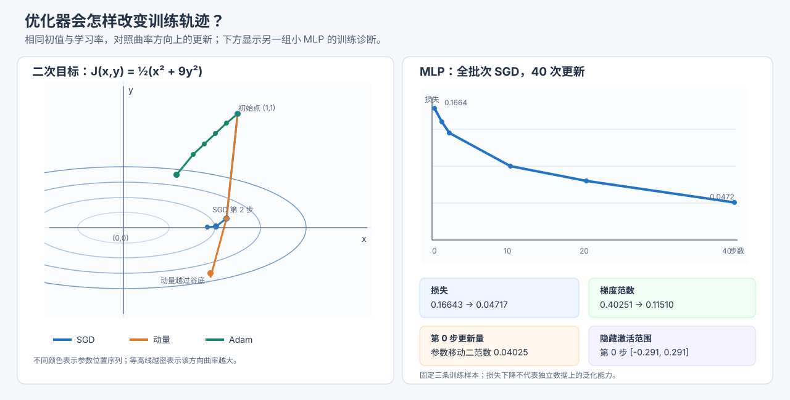

# 优化器、曲率与训练诊断

本教程从“为什么负梯度能让损失下降”开始，逐步比较随机梯度下降（stochastic gradient descent，SGD）、动量（momentum）和 Adam。先在同一个二维二次函数上手算前两步，再观察一个固定小型多层感知机（multilayer perceptron，MLP）的损失、激活范围、梯度范数和更新量。它承接[数值稳定性与梯度检查](51_数值计算与梯度.md#10-m06数值稳定性与梯度检查实验室)和[张量计算图与反向传播](82_张量计算图与反向传播.md)，实验规模很小，不用来证明哪种优化器普遍更好。

运行命令：

```sh
make optimization-diagnostics
python3 src/python/ml/38_optimization_diagnostics.py
make test-optimization-diagnostics
make sanitize-optimization-diagnostics
```



## 1. 优化器要解决什么问题

训练模型时，我们选择参数 $oldsymbol\theta$，使损失函数 $J(\boldsymbol\theta)$ 尽量小。参数可以是一个数，也可以是许多权重和偏置组成的向量。优化器（optimizer）接收当前参数与梯度，决定下一步参数怎么移动；它不负责判断训练数据是否代表真实应用数据。

本实验用一个凸、可微、最小值明确的目标比较更新轨迹，并在独立的小 MLP 上观察诊断量。二次函数的解析梯度用于排除反向传播实现的干扰；MLP 则使用固定全批次和手写梯度。两者都没有随机小批次，因此不会在运行时产生随机梯度噪声。

### 1.1 梯度方向为什么有用

设当前位置为 $\boldsymbol\theta$，移动方向为 $\boldsymbol d$，很小的步长为 $\alpha>0$。可微函数沿该方向的变化率由方向导数给出：

$$
J(\boldsymbol\theta+\alpha\boldsymbol d)
=J(\boldsymbol\theta)
+\alpha\nabla J(\boldsymbol\theta)^{\mathsf T}\boldsymbol d
+o(\alpha).
\tag{1}
$$

其中 $\nabla J$ 是对参数的梯度列向量，$\mathsf T$ 表示转置；$o(\alpha)$ 表示比 $\alpha$ 更快趋近零的高阶余项。当 $\boldsymbol d=-\nabla J$ 时，一阶变化率为负：

$$
\nabla J(\boldsymbol\theta)^{\mathsf T}
\bigl(-\nabla J(\boldsymbol\theta)\bigr)
=-\lVert\nabla J(\boldsymbol\theta)\rVert_2^2<0.
\tag{2}
$$

这说明在梯度非零且步长足够小时，沿负梯度方向会先下降。它不是“任意步长都下降”的保证：步子过大时，高阶曲率项可能压过一阶下降。

梯度下降不是猜一个方向。对每个参数求偏导后，梯度指向函数局部上升最快的方向；取负号才指向局部下降最快的方向。若梯度为零，一阶信息本身不能判断当前位置是极小值、极大值还是鞍点。

### 1.2 曲率怎样限制步长

对二阶可微的函数，在当前位置附近用海森矩阵（Hessian matrix）$\mathbf H$ 近似：

$$
J(\boldsymbol\theta+\boldsymbol\delta)
\approx J(\boldsymbol\theta)
+\nabla J(\boldsymbol\theta)^{\mathsf T}\boldsymbol\delta
+\frac{1}{2}\boldsymbol\delta^{\mathsf T}
\mathbf H\boldsymbol\delta.
\tag{3}
$$

沿负梯度走 $\boldsymbol\delta=-\eta\nabla J$，其中 $\eta$ 是学习率（learning rate）：

$$
J(\boldsymbol\theta-\eta\nabla J)
\approx J(\boldsymbol\theta)
-\eta\lVert\nabla J\rVert_2^2
+\frac{\eta^2}{2}\nabla J^{\mathsf T}\mathbf H\nabla J.
\tag{4}
$$

第一项改变量推动损失下降，第二项是曲率造成的弯回。若 $\mathbf H$ 的最大特征值为 $\lambda_{\max}>0$，对正定二次函数，普通梯度下降稳定的充分步长范围是：

$$
0<\eta<\frac{2}{\lambda_{\max}}.
\tag{5}
$$

这来自每个特征方向上的误差倍率 $1-\eta\lambda$：要求其绝对值小于 $1$。它是本教程二次函数的稳定性条件，不是任意非凸神经网络全程下降的保证。神经网络的曲率会随参数变化，实践中通常需要验证学习率，而不能只套用一个全局常数。

## 2. 在二次函数上手算三种更新

目标函数为 $J(x,y)=\frac{1}{2}(x^2+9y^2)$。$x,y$ 是两个可训练参数；$y$ 方向比 $x$ 方向陡九倍。梯度和海森矩阵分别为：

$$
\nabla J(x,y)=
\begin{bmatrix}
x\\
9y
\end{bmatrix}.
\tag{6}
$$

$$
\mathbf H=
\begin{bmatrix}
1&0\\
0&9
\end{bmatrix}.
\tag{7}
$$

最小值在 $(0,0)$。从相同初始点 $(x_0,y_0)=(1,1)$ 出发，固定学习率 $\eta=0.1$。初始损失为 $5$，梯度为 $(1,9)$。

### 2.1 SGD：只看当前梯度

SGD 的参数更新是当前位置减去学习率乘梯度。这里的“随机”来自常见训练中随机抽样的小批次；本二次函数是确定性的，MLP 使用全批次，代码中都没有抽样。

$$
\boldsymbol\theta_{t+1}
=\boldsymbol\theta_t-\eta\boldsymbol g_t.
\tag{8}
$$

其中 $t$ 是更新步编号，$\boldsymbol g_t=\nabla J(\boldsymbol\theta_t)$。第一步将 $(1,1)$ 和 $(1,9)$ 代入：

$$
\begin{aligned}
x_1&=1-0.1\cdot1=0.9,\\
y_1&=1-0.1\cdot9=0.1.
\end{aligned}
\tag{9}
$$

此时损失为 $\frac{1}{2}(0.9^2+9\cdot0.1^2)=0.45$。第二步梯度为 $(0.9,0.9)$，因此：

$$
\begin{aligned}
x_2&=0.9-0.1\cdot0.9=0.81,\\
y_2&=0.1-0.1\cdot0.9=0.01.
\end{aligned}
\tag{10}
$$

第二步损失为 $\frac{1}{2}(0.81^2+9\cdot0.01^2)=0.3285$。陡峭的 $y$ 方向一步就缩小很多；若学习率更大，它会跨过谷底反向走。

### 2.2 随机梯度噪声是什么

若第 $i$ 个训练样本的损失为 $\ell_i$，全数据平均损失为 $J$。从一个小批次计算出的梯度可写成全数据梯度加噪声：

$$
\widehat{\boldsymbol g}_t
=\nabla J(\boldsymbol\theta_t)+\boldsymbol\xi_t.
\tag{11}
$$

$\widehat{\boldsymbol g}_t$ 是小批次梯度，$\boldsymbol\xi_t$ 是抽样带来的误差。在独立同分布抽样且梯度估计无偏的假设下，噪声期望为零；批次增大通常会降低梯度方差，但也增加每步计算量。噪声有时能帮助离开某些平坦或鞍点区域，也可能令损失抖动。这个解释是一般原理，本例没有随机抽样，不能从本例测出噪声效应。

例如两个样本梯度分别为 $(1,3)$ 与 $(3,1)$，全批次平均是 $(2,2)$。若每步等概率抽一个样本，小批次梯度相对平均值的噪声分别为 $(-1,1)$ 与 $(1,-1)$；两种结果平均为 $(0,0)$。这是解释无偏噪声的手算例，不是本案例运行的数据。

### 2.3 动量：累积近期方向

经典动量把当前梯度与过去速度混合。$\boldsymbol u_t$ 是速度状态，$\beta$ 控制旧速度保留比例；本例取 $\beta=0.5$，初始速度为零：

$$
\boldsymbol u_t=\beta\boldsymbol u_{t-1}+\boldsymbol g_t.
\tag{12}
$$

$$
\boldsymbol\theta_{t+1}
=\boldsymbol\theta_t-\eta\boldsymbol u_t.
\tag{13}
$$

第一步 $\boldsymbol u_1=(1,9)$，所以参数也是 $(0.9,0.1)$。第二步当前梯度是 $(0.9,0.9)$，但速度还保留上一步的一半：

$$
\begin{aligned}
u_{2,x}&=0.5\cdot1+0.9=1.4,\\
u_{2,y}&=0.5\cdot9+0.9=5.4.
\end{aligned}
\tag{14}
$$

$$
\begin{aligned}
x_2&=0.9-0.1\cdot u_{2,x}=0.76,\\
y_2&=0.1-0.1\cdot u_{2,y}=-0.44.
\end{aligned}
\tag{15}
$$

第二步损失升到 $1.16$，$y$ 越过谷底。动量会平滑一段时间内方向一致的更新，也可能在转弯处超调；它不是每步必然降低损失。

### 2.4 Adam：一阶与二阶矩自适应缩放

Adam 同时维护梯度的一阶矩（可理解为平滑后的方向）和平方梯度的二阶矩（可理解为平滑后的尺度）。$\beta_1=0.9$、$\beta_2=0.999$，初始矩为零：

$$
\boldsymbol m_t
=\beta_1\boldsymbol m_{t-1}
+(1-\beta_1)\boldsymbol g_t.
\tag{16}
$$

$$
\boldsymbol s_t
=\beta_2\boldsymbol s_{t-1}
+(1-\beta_2)(\boldsymbol g_t\odot\boldsymbol g_t).
\tag{17}
$$

符号 $\odot$ 表示逐元素乘法。看一维且梯度连续为常量 $g$ 的简化情况，展开一阶矩递推：

$$
m_t=(1-\beta_1)g\sum_{r=0}^{t-1}\beta_1^r
=(1-\beta_1^t)g.
\tag{18}
$$

同理，若平方梯度恒为 $g^2$，则 $s_t=(1-\beta_2^t)g^2$。零初始化因此会让早期矩估计分别少乘了 $1-\beta_1^t$ 和 $1-\beta_2^t$；偏差修正把它们除回去：

$$
\widehat{\boldsymbol m}_t
=\frac{\boldsymbol m_t}{1-\beta_1^t}.
\tag{19}
$$

$$
\widehat{\boldsymbol s}_t
=\frac{\boldsymbol s_t}{1-\beta_2^t}.
\tag{20}
$$

最终每个参数用自身的修正后尺度归一化。$\epsilon=10^{-8}$ 是防止分母为零的稳定常数：

$$
\boldsymbol\theta_{t+1}
=\boldsymbol\theta_t
-\eta\frac{\widehat{\boldsymbol m}_t}
{\sqrt{\widehat{\boldsymbol s}_t}+\epsilon}.
\tag{21}
$$

第一步梯度是 $(1,9)$，所以原始矩 $\boldsymbol m_1=(0.1,0.9)$、$\boldsymbol s_1=(0.001,0.081)$。偏差修正后为 $(1,9)$ 和 $(1,81)$，更新方向约为 $(1,1)$；参数变为约 $(0.9,0.9)$，损失约为 $4.05$。这里 Adam 在 $y$ 方向没有像 SGD 一样直接走到 $0.1$，因为它用该方向自身的平方梯度尺度做了归一化。

第二步梯度约为 $(0.9,8.1)$，于是：

$$
\begin{aligned}
\boldsymbol m_2&=(0.18,1.62),\\
\boldsymbol s_2&=(0.001809,0.146529),\\
\widehat{\boldsymbol m}_2&\approx(0.94737,8.52632),\\
\widehat{\boldsymbol s}_2&\approx(0.90495,73.30165).
\end{aligned}
\tag{22}
$$

代入更新式后，参数约为 $(0.80041,0.80041)$，损失约为 $3.20330$。C 实现保留 $\epsilon$，所以小数末位和忽略 $\epsilon$ 的手算会有微小差异。此例固定同一初值、学习率、六次损失观测；单次二维实验不能说明 Adam 总比 SGD 快或更好。实际模型还要选择学习率、批次大小、初始化和训练预算。

## 3. L2 正则化与解耦权重衰减

L2 正则化（L2 regularization）把参数平方惩罚加进目标。$J_{\mathrm{task}}$ 是任务损失，$\lambda\ge0$ 是惩罚强度：

$$
J_{\mathrm{L2}}(\boldsymbol\theta)
=J_{\mathrm{task}}(\boldsymbol\theta)
+\frac{\lambda}{2}\lVert\boldsymbol\theta\rVert_2^2.
\tag{23}
$$

求导后，送给优化器的梯度包含 $\lambda\boldsymbol\theta$：

$$
\nabla J_{\mathrm{L2}}
=\nabla J_{\mathrm{task}}+\lambda\boldsymbol\theta.
\tag{24}
$$

解耦权重衰减（decoupled weight decay）则把参数缩小直接作为更新的一部分；AdamW 使用这种方式，而不是先把惩罚梯度塞进 Adam 的矩估计：

$$
\boldsymbol\theta_{t+1}
=\boldsymbol\theta_t
-\eta\frac{\widehat{\boldsymbol m}_t}
{\sqrt{\widehat{\boldsymbol s}_t}+\epsilon}
-\eta\lambda\boldsymbol\theta_t.
\tag{25}
$$

此式中的一阶、二阶矩只接收任务梯度 $\nabla J_{\mathrm{task}}$；最后一项单独缩小参数，不参与这两个矩的计算。

在简单 SGD 中，带 L2 的梯度更新可代数整理成乘法衰减；在 Adam 中，$\lambda\boldsymbol\theta$ 会改变一阶、二阶矩，通常不等同于 AdamW 的独立参数缩小。测试用标量 $\theta_0=2$、任务梯度 $0.5$、$\lambda=0.1$、$\eta=0.01$ 做两步：耦合 L2 的参数约为 $1.9800004$，解耦衰减约为 $1.9760120$。这只是解释更新路径不同的算例，不是对正则强度的推荐。当前 C/Python 训练主程序没有把正则项加入 MLP；两种更新路径由 C 断言和 Python 单元测试独立核验。

这个差别从 L2 项的偏导可直接看出。设 $k$ 遍历参数分量，$\theta_j$ 是其中一个参数，$g_j=\partial J_{\mathrm{task}}/\partial\theta_j$ 是任务梯度的对应分量。求平方惩罚的导数，再代入普通 SGD：

$$
\frac{\partial}{\partial\theta_j}
\left(\frac{\lambda}{2}\sum_k\theta_k^2\right)
=\lambda\theta_j.
\tag{26}
$$

因此带 L2 的参数更新可整理成乘法缩小：

$$
\theta_j-\eta(g_j+\lambda\theta_j)
=(1-\eta\lambda)\theta_j-\eta g_j.
\tag{27}
$$

但 Adam 会先用 $g_j+\lambda\theta_j$ 更新矩估计，再进行自适应缩放；AdamW 则用任务梯度更新矩估计，再单独乘衰减项。因此即使符号上都有“参数衰减”，两种算法的参数路径也不同。

## 4. 用一个小 MLP 观察训练状态

本例 MLP 有两个输入、两个 `tanh` 隐藏单元和一个线性输出，参数共九个。三条输入为 $(-1,0)$、$(0,1)$、$(1,0)$，目标依次为 $0,1,0$。$i\in\{1,2,3\}$ 是样本编号，$j\in\{1,2\}$ 是隐藏单元编号，$k\in\{1,2\}$ 是输入特征编号；$x_{ik}$ 是第 $i$ 个样本的第 $k$ 个输入，$w_{jk}$ 是输入到隐藏单元的权重，$b_j$ 是隐藏偏置，$v_j$ 是隐藏到输出的权重，$c$ 是输出偏置。每个隐藏单元先作加权求和，再经过双曲正切函数（hyperbolic tangent，tanh）：

$$
z_{ij}=w_{j1}x_{i1}+w_{j2}x_{i2}+b_j.
\tag{28}
$$

$$
h_{ij}=\tanh(z_{ij}).
\tag{29}
$$

输出 $\hat y_i$ 是两个隐藏值乘输出权重后加输出偏置；$N=3$ 是样本数，损失是样本平均半平方误差：

$$
\widehat y_i=v_1h_{i1}+v_2h_{i2}+c.
\tag{30}
$$

$$
L=\frac{1}{2N}\sum_{i=1}^{N}(\widehat y_i-y_i)^2.
\tag{31}
$$

记预测误差为 $e_i=\widehat y_i-y_i$。先对输出求导：平方项的系数 $1/2$ 与指数导数中的 $2$ 抵消，再乘样本平均的 $1/N$：

$$
\delta_i=\frac{\partial L}{\partial\widehat y_i}
=\frac{e_i}{N}.
\tag{32}
$$

沿链式法则经过输出层到第 $j$ 个隐藏单元，得到该隐藏激活的梯度：

$$
\frac{\partial L}{\partial h_{ij}}=\delta_i v_j.
\tag{33}
$$

再乘 $\tanh$ 的导数 $1-h_{ij}^2$，得到隐藏单元预激活的梯度：

$$
\delta_{ij}=\frac{\partial L}{\partial z_{ij}}
=\delta_i v_j(1-h_{ij}^2).
\tag{34}
$$

初始参数是 $\boldsymbol\theta=(0.2,-0.3,0.1,0.25,0.1,-0.2,0.05,0.3,0)$，顺序为两组输入权重、两个隐藏偏置、两个输出权重和一个输出偏置。以第一个样本 $(-1,0)$ 为例，隐藏值与预测为：

$$
\begin{aligned}
z_{11}&=0.2(-1)+(-0.3)(0)+0.1=-0.1,\\
z_{12}&=0.1(-1)+0.25(0)-0.2=-0.3,\\
h_{11}&=\tanh(-0.1)\approx-0.09967,\\
h_{12}&=\tanh(-0.3)\approx-0.29131,\\
\widehat y_1&=0.05h_{11}+0.3h_{12}\approx-0.09238.
\end{aligned}
\tag{35}
$$

该样本目标 $y_1=0$，误差约为 $-0.09238$，它对平均损失贡献 $\frac{1}{6}(-0.09238)^2\approx0.0014223$。另外两项的损失贡献约为 $0.1649648$ 和 $0.0000392$，相加得到初始总损失 $L_0\approx0.1664262$。输出偏置连接到每个样本的预测，输出权重连接到隐藏激活；因此两类参数的总梯度是逐样本累加：

$$
\frac{\partial L}{\partial v_j}
=\sum_{i=1}^{N}\delta_i h_{ij}.
\tag{36}
$$

$$
\frac{\partial L}{\partial c}
=\sum_{i=1}^{N}\delta_i.
\tag{37}
$$

输入权重与偏置则使用隐藏层梯度 $\delta_{ij}$。$k$ 指输入特征；偏置相当于乘常数 $1$，所以：

$$
\frac{\partial L}{\partial w_{jk}}
=\sum_{i=1}^{N}\delta_{ij}x_{ik}.
\tag{38}
$$

$$
\frac{\partial L}{\partial b_j}
=\sum_{i=1}^{N}\delta_{ij}.
\tag{39}
$$

对输出偏置，三个误差的平均为 $(-0.0923772-0.9948813-0.0153348)/3\approx-0.3675311$；这正是 $\partial L/\partial c$。对第一个输出权重，按三个隐藏激活加权累加得到 $\partial L/\partial v_1\approx0.0670349$。同样对隐藏权重、偏置累加后，九个参数的梯度约为 $(0.00129,-0.01594,0.00694,-0.09924,-0.01769,-0.10921,0.06703,-0.00709,-0.36753)$。第一次学习率为 $0.1$ 的 SGD 更新是 $\boldsymbol\theta_1=\boldsymbol\theta_0-0.1\nabla L$，例如第一个权重 $0.2-0.1(0.0012904)\approx0.1998710$，输出偏置 $0-0.1(-0.3675311)\approx0.0367531$；更新后损失约为 $0.1510713$。这是完整的一次前向、损失、反向和参数更新，单元测试还用中心差分核对九个解析梯度。

训练中的几个量回答不同问题：

- 损失 $L$ 汇总预测误差，回答模型在这组三条训练数据上的拟合程度。
- 激活最小值、最大值和均值对全部六个隐藏激活统计，可观察激活是否集中或进入 `tanh` 饱和区；均值接近零本身不代表模型好。
- 梯度范数衡量当前参数对损失的局部敏感程度；更新范数衡量这一步参数实际移动距离。两者不同，因为更新还受学习率和优化器状态影响。
- 输出第 $t$ 步的损失、激活统计和梯度范数是在该步更新前评估的；更新范数表示从该步到下一步的变化。第 40 步没有后续更新，因此 CSV 中更新范数为零，梯度范数仍是终点处实际值。

本例运行 40 次全批量 SGD 后，训练损失由约 $0.16643$ 降到 $0.04717$，梯度范数从约 $0.40251$ 降到 $0.11510$。这证明当前实现能在固定小数据上降低损失；没有独立测试集，也不能据此判断泛化能力或神经网络是否学到了稳定规则。

## 5. 公式与代码的对应

| 数学概念 | C 实现 | Python 对照 | 代码中的作用 |
| --- | --- | --- | --- |
| 二次目标和解析梯度 | [`quadratic_evaluate`](../../src/ml/38_optimization_diagnostics.c#L45) | [`quadratic_evaluate`](../../src/python/ml/38_optimization_diagnostics.py#L34) | 返回损失及 $(x,9y)$，并拒绝非有限输入或结果。 |
| SGD、动量和 Adam 状态更新 | [`optimizer_step`](../../src/ml/38_optimization_diagnostics.c#L70) | [`optimizer_step`](../../src/python/ml/38_optimization_diagnostics.py#L50) | `OptimizerState` 保存速度、矩和步数；候选状态验证成功后才写回。 |
| MLP 前向与反向 | [`mlp_evaluate`](../../src/ml/38_optimization_diagnostics.c#L122) | [`mlp_evaluate`](../../src/python/ml/38_optimization_diagnostics.py#L95) | 九个参数、三条样本；对每样本累加梯度，最后按样本数取平均。 |
| 梯度下降与更新范数 | [`mlp_train_step`](../../src/ml/38_optimization_diagnostics.c#L190) | [`mlp_train_step`](../../src/python/ml/38_optimization_diagnostics.py#L142) | 先求全批梯度，再以 SGD 更新；计算梯度和参数变化的二范数。 |
| 已有批量 SGD/Adam | [`network_update`](../../src/ml/07_mlp_2d.c#L275) | — | 沿用其 Adam 系数与偏差修正；M09 的二维点更新独立实现，避免把原分类网络改成实验夹具。 |
| 手算、边界与中心差分 | [`test_optimization`](../../src/ml/38_optimization_diagnostics.c#L227) | [四项单元测试](../../tests/python/test_optimization_diagnostics.py#L24) | 核对首步/次步、九个梯度、发散轨迹、事务失败及权重衰减差异。 |

C 的 `MLP_INPUTS` 是 `SAMPLE_COUNT × 2` 的数组，Python 使用三个二元组；每个样本的两个隐藏值进入同一输出。参数顺序在 C 的 `TinyNetwork.parameters` 和 Python 的 `INITIAL_PARAMETERS` 中一致。优化器更新会先在局部副本中计算候选参数与状态，遇到无穷值或无效学习率时返回失败，避免只写入部分状态。既有二维 MLP 案例的 [`network_update`](../../src/ml/07_mlp_2d.c#L275) 已实现批量 SGD/Adam；由于它与固定分类网络的数据结构绑定，M09 沿用 Adam 系数和偏差修正方式，在独立的二维参数与小网络实验中隔离优化器效果，保留原案例不变。

## 6. 失败实验、验证与边界

若把 SGD 学习率改成 $1$，更新的两个坐标满足 $x_{t+1}=0$、$y_{t+1}=-8y_t$。因此从 $(1,1)$ 出发，$y$ 依次变成 $-8,64,-512$，损失依次变成 $288,18432,1179648$：数值仍有限，但已经振荡发散。实现测试逐步检查损失增加、$y$ 符号交替；随后还以极大学习率触发非有限候选更新，确认参数和动量状态保持原值。只有检查 `isfinite` 不够，因为发散轨迹可能在很长一段时间内仍是有限数。

测试命令及覆盖：

```sh
make test-optimization-diagnostics    # C 断言、Python 4 项测试、逐字段对照
make sanitize-optimization-diagnostics # C 地址与未定义行为消毒器
make lint-python                       # Python 语法检查
```

测试使用同一初值、目标、学习率和更新预算比较三种优化器；C 与 Python 输出 CSV 字段并逐项比较。中心差分用 $\varepsilon=10^{-5}$，数值导数是 $(L(\theta+\varepsilon)-L(\theta-\varepsilon))/(2\varepsilon)$，九个解析梯度的绝对差要求小于 $10^{-8}$。这只在当前平滑输入和初始点附近检查梯度，不覆盖全部参数空间。

学习率、动量系数、Adam 的 $\beta_1,\beta_2,\epsilon$、网络初始化和训练数据都是固定教学设置。小网络没有验证集或测试集，不做超参数搜索、不画决策边界，也不覆盖梯度裁剪、学习率调度、权重衰减训练路径和随机小批次实验。可继续练习：改动曲率系数并预测稳定步长；把全批次改成逐样本更新，记录损失抖动；为 C/Python MLP 加入相同的 L2 或 AdamW 更新，并继续用中心差分检查。
