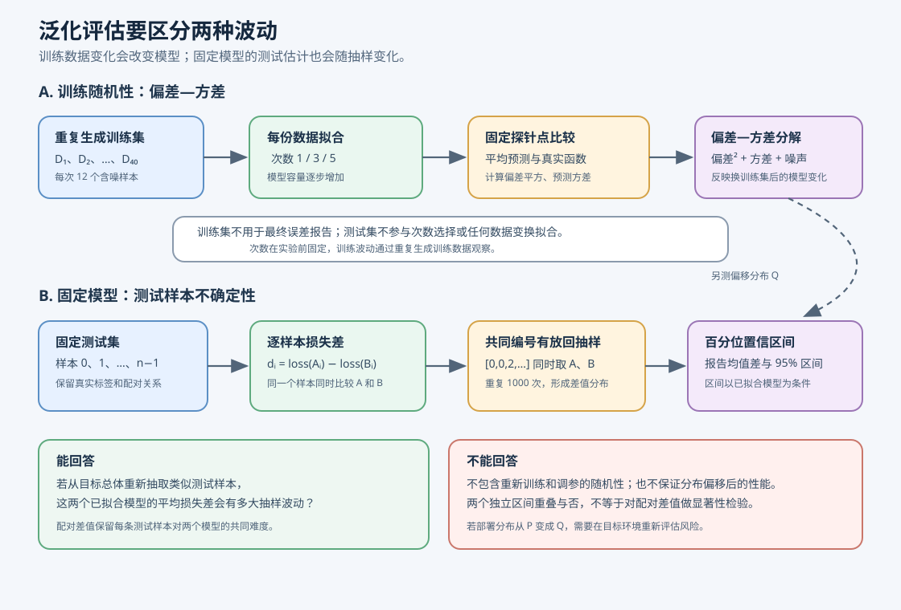

# 泛化（generalization）、偏差—方差权衡（bias–variance trade-off）与统计可靠性（statistical reliability）

本篇以小型多项式回归（polynomial regression）说明模型在未见数据上的表现为何会变化，并把这种变化拆成两类：训练数据变化引起的拟合波动，以及固定模型在有限测试样本上的估计不确定性。自助法（bootstrap）置信区间（confidence interval，CI）表达测试样本变化对损失差的影响；分布偏移（distribution shift）则比较训练来源与部署来源不同的风险。C 与 Python 实现均只使用标准库；分类评估的前置例子见[类别不平衡与概率校准](44_类别不平衡与概率校准.md)，公平划分和训练集标准化见[公平模型比较](48_公平模型比较.md)。



## 1. 学习目标与源码地图

程序使用已知二次函数生成含噪样本，分别拟合一次、三次和五次多项式。它重复生成训练数据，测量各模型在固定探针点上的偏差平方和方差；随后用一份独立测试集比较一次、五次模型的逐样本平方损失，并用同一组样本下标做成对自助重采样。

| 概念 | 源码位置 | 变量或函数 | 作用 |
| --- | --- | --- | --- |
| 确定性数据生成 | [`dataset_generate`](../../src/ml/39_generalization_bootstrap.c#L97) | `state`、`lower_x`、`noise_amplitude` | 分别生成训练、测试及偏移分布样本。 |
| 多项式最小二乘 | [`polynomial_fit`](../../src/ml/39_generalization_bootstrap.c#L127) | `augmented`、`degree`、`coefficients` | 构建设计矩阵正规方程并用部分主元消元。 |
| 重复训练与偏差方差 | [`experiment_run`](../../src/ml/39_generalization_bootstrap.c#L369) | `prediction_sum`、`prediction_square_sum` | 共用每轮训练数据，比较不同模型容量。 |
| 成对重采样 | [`paired_resampled_difference`](../../src/ml/39_generalization_bootstrap.c#L272)、[`paired_bootstrap`](../../src/ml/39_generalization_bootstrap.c#L308) | `indices`、`loss_a`、`loss_b` | 每次抽取同一批测试样本，计算配对损失差。 |
| 固定字段结果 | [`print_csv`](../../src/ml/39_generalization_bootstrap.c#L464) | `Experiment` | 输出可供 Python 逐字段核对的数值。 |
| 边界验证 | [`run_tests`](../../src/ml/39_generalization_bootstrap.c#L486) | `assert` | 验证手算值、欠定/秩亏输入与重采样边界。 |

Python 对照位于 [`src/python/ml/39_generalization_bootstrap.py`](../../src/python/ml/39_generalization_bootstrap.py)，使用相同显式公式、种子、数据规模、重采样次数和分位数规则。实现沿用 [M04 概率与统计估计](78_概率似然与贝叶斯估计.md)的随机实验基础，以及 [M09 优化器与训练诊断](83_优化器与训练诊断.md)的固定配置、可复现输出习惯。

## 2. 经验风险（empirical risk）和总体风险（population risk）

令随机样本为 $(X,Y)$，模型为 $f$，单样本损失为 $\ell(f(X),Y)$。总体风险是从目标数据分布 $P$ 反复抽样时的期望损失；训练集上能直接算出的量叫经验风险：

$$
\begin{aligned}
R_P(f)&=\mathbb{E}_{(X,Y)\sim P}[\ell(f(X),Y)],\\
\widehat{R}_{\mathrm{train}}(f)&=\frac{1}{n_{\mathrm{train}}}
\sum_{i\in\mathrm{train}}\ell(f(x_i),y_i).
\end{aligned}
\tag{1}
$$

这里 $P$ 是部署时样本的联合分布，$n_{\mathrm{train}}$ 是训练样本数，$(x_i,y_i)$ 是第 $i$ 条训练记录。总体风险通常无法直接计算，因为 $P$ 未知；独立测试集的平均损失是它的估计值，而不是总体风险本身。

手算一个最小例子：两个测试样本的平方误差分别为 $1$ 和 $9$，测试均方误差（mean squared error，MSE）是 $(1+9)/2=5$。这个数描述了这两条样本上的平均误差；如果重新抽取两条测试样本，结果可能不同。训练误差低只说明模型贴合了当前训练样本，不能单独证明对新样本的风险低。

模型容量（model capacity）可用多项式次数直观观察。次数为 $d$ 的模型写成 $f_d(x)=\sum_{j=0}^{d}w_jx^j$，共有 $d+1$ 个系数。次数增加后，训练误差通常不增，但测试误差没有单调保证：容量太低可能欠拟合，容量太高则可能对训练样本中的噪声过度敏感。

## 3. 多项式拟合的推导和手算

训练数据含 $n$ 条观测。把第 $i$ 条样本的特征展开为 $(1,x_i,x_i^2,\ldots,x_i^d)$，把系数记为向量 $w$，就能把多项式回归写成线性最小二乘（least squares）：

$$
\begin{aligned}
\widehat{y}_i&=\sum_{j=0}^{d}w_jx_i^j,\\
\widehat{w}&=\arg\min_w\sum_{i=1}^{n}(\widehat{y}_i-y_i)^2,\\
X_{i,j}&=x_i^j,\qquad j=0,1,\ldots,d,\\
\widehat{w}&=(X^{\mathsf T}X)^{-1}X^{\mathsf T}y.
\end{aligned}
\tag{2}
$$

$\widehat{y}_i$ 是预测，$w_j$ 是 $x^j$ 的系数，$X$ 是 $n\times(d+1)$ 设计矩阵（design matrix），$y$ 是 $n$ 维目标向量。最后一行只在 $X$ 满列秩时成立；代码不显式求逆，而是解正规方程（normal equations）$(X^{\mathsf T}X)\widehat{w}=X^{\mathsf T}y$。因此近似秩亏时会拒绝拟合。正规方程会平方设计矩阵的条件数，适合本例已缩放的低阶小矩阵，不适合作为大型或病态回归的通用求解器。

下面用三个点手算目标 $y=0.75+1.2x-0.8x^2$。当 $x=-1,0,1$ 时，目标依次为 $-1.25,0.75,1.15$。二次设计矩阵的三列分别对应常数、一次项和二次项：

$$
\begin{aligned}
X&=\begin{bmatrix}1&-1&1\\1&0&0\\1&1&1\end{bmatrix},\\
X^{\mathsf T}X&=\begin{bmatrix}3&0&2\\0&2&0\\2&0&2\end{bmatrix},\\
X^{\mathsf T}y&=\begin{bmatrix}0.65\\2.4\\-0.10\end{bmatrix}.
\end{aligned}
\tag{3}
$$

令系数为 $(w_0,w_1,w_2)$。第二行直接给出 $2w_1=2.4$，所以 $w_1=1.2$。第一、三行给出 $3w_0+2w_2=0.65$、$2w_0+2w_2=-0.10$；两式相减得 $w_0=0.75$，代回第三式得 $w_2=-0.8$。因此在 $x=0.5$ 处，预测为 $0.75+1.2(0.5)-0.8(0.5)^2=1.15$。

代码用 `augmented[row][column]` 累加 $X^{\mathsf T}X$，用最后一列累加 $X^{\mathsf T}y$，再做部分主元消元。`polynomial_predict` 用 Horner 形式从最高次项向常数项计算，减少重复乘方；这改变计算顺序，不改变多项式定义。

## 4. 偏差—方差权衡

令训练集随机变量为 $D$，训练过程因此产生随机模型 $\widehat{f}_D$。在固定输入 $x$ 处，假设观测标签为 $Y=f(x)+\epsilon$，噪声满足 $\mathbb{E}[\epsilon]=0$、$\operatorname{Var}(\epsilon)=\sigma^2$，且与训练样本独立。定义训练随机性下预测的均值为 $\overline{f}(x)=\mathbb{E}_D[\widehat{f}_D(x)]$。平方误差期望可拆为：

$$
\begin{aligned}
\mathbb{E}_{D,Y}[(\widehat{f}_D(x)-Y)^2]
&=(\overline{f}(x)-f(x))^2\\
&\quad+\mathbb{E}_D[(\widehat{f}_D(x)-\overline{f}(x))^2]+\sigma^2.
\end{aligned}
\tag{4}
$$

第一项是偏差平方，表示平均预测离真实函数有多远；第二项是方差，表示换一批训练数据后预测波动多大；第三项是不可约噪声。交叉项消失是因为中心化后的预测偏差期望为零，且噪声独立、均值为零。若标签噪声与训练过程相关，或损失不是平方损失，不能直接照搬这个分解。

手算三次训练得到的预测 $1.0,1.2,1.4$，真实值为 $1.0$。平均预测是 $1.2$，偏差平方为 $(1.2-1.0)^2=0.04$；方差为 $((1.0-1.2)^2+(1.2-1.2)^2+(1.4-1.2)^2)/3=0.0267$。不含观测噪声时，平均平方误差为 $0.0667=0.04+0.0267$。

本程序对 $40$ 份训练集反复拟合，在 $9$ 个固定探针点上计算偏差平方和方差。程序给出的次数 $5$ 平均方差约为 $3.911518$，远高于次数 $3$ 的 $0.020984$；这次固定种子实验直观展示了高次拟合对训练样本波动的敏感性。程序的探针目标来自已知无噪声函数，因此 `expected_mse` 对应偏差平方加方差，不包含噪声方差。

## 5. 成对自助法置信区间

在相同测试样本上比较两个已拟合模型 $A$ 和 $B$。第 $i$ 个测试样本的损失差记为 $d_i=\ell_{A,i}-\ell_{B,i}$；差值为正表示 $B$ 的损失较低。测试集的配对均值差为：

$$
\widehat{\Delta}=\frac{1}{n_{\mathrm{test}}}\sum_{i=1}^{n_{\mathrm{test}}}d_i.
\tag{5}
$$

自助法每次从 $n_{\mathrm{test}}$ 个测试样本编号中有放回抽取同样数量的编号 $I_b$，并对两个模型复用这一组编号。若执行 $R$ 次重采样，第 $b$ 次的均值差为：

$$
\begin{aligned}
\widehat{\Delta}^{*(b)}&=\frac{1}{n_{\mathrm{test}}}\sum_{i\in I_b}d_i,\\
b&=1,2,\ldots,R.
\end{aligned}
\tag{6}
$$

$R$ 是重采样次数，$I_b$ 中同一编号允许重复。普通逐样本 bootstrap 假设测试样本可视为从目标总体独立同分布（independent and identically distributed，i.i.d.）抽取；若同一主体有多条记录或样本带时间相关性，应按主体或区块重采样。程序以 $1000$ 次重采样均值的排序结果，取索引 $\lfloor0.025(R-1)\rfloor$ 和 $\lfloor0.975(R-1)\rfloor$ 作为百分位区间端点；这是一个教学用的离散分位数约定，不是 BCa 区间，小样本区间离散且覆盖率可能不准确。

手算一个小例子：三条测试样本的模型 $A$ 损失为 $(4,1,10)$，模型 $B$ 损失为 $(1,1,2)$，逐样本差为 $(3,0,8)$。若本次抽中的下标是 $(0,0,2)$，同一批样本同时用于 $A$ 与 $B$，差值重采样结果为 $(3,3,8)$，平均值为 $14/3\approx4.6667$。若分别给两个模型独立抽样，样本配对被破坏，差值的方差会改变，比较不再利用“同一题对两个模型难度相同”的信息。

本案例比较次数 $1$ 减去次数 $5$ 的平方损失，报告均值差约 $-0.031651$，$95\%$ 百分位区间约为 $[-0.061548,0.002887]$。区间包含零，说明这 $12$ 个测试样本不足以给出稳定方向的证据。它只描述固定训练模型条件下的测试样本抽样不确定性；它没有重新训练模型，也不包含训练随机性、超参数选择不确定性或数据集偏移。

这里得到的是百分位置信区间（percentile confidence interval）。两个模型各自的置信区间是否重叠，不是成对差异的显著性检验。应直接分析差值分布，并结合样本来源、预先确定的比较方案和足够的独立数据；本例的区间也不能解释为“两个模型一样好”。

## 6. 分布偏移和评估边界

训练数据的输入范围是 $[-1,1]$，程序还单独生成 $[1,1.5]$ 的偏移测试数据。记训练分布为 $P$，部署分布为 $Q$，即使模型参数 $f$ 不变，两种环境的风险也可能不同：

$$
\begin{aligned}
R_P(f)&=\mathbb{E}_{(X,Y)\sim P}[\ell(f(X),Y)],\\
R_Q(f)&=\mathbb{E}_{(X,Y)\sim Q}[\ell(f(X),Y)].
\end{aligned}
\tag{7}
$$

次数 $5$ 在同分布固定测试集上的均方误差约为 $0.092639$，在偏移测试集上约为 $252.581246$。它的高次项在训练区间外急剧放大，是多项式外推的失败示例；这不是所有分布偏移都会产生同样结果的定理。真实系统若输入范围、类别比例、标签规则或采集流程发生变化，需要收集目标环境数据重新评估，不能把原测试集区间当成部署保证。

本实验在看测试集之前固定次数 $1,3,5$，没有根据测试结果选模型，也没有从测试数据拟合预处理参数。若增加标准化或其他数据依赖变换，应只在训练数据上拟合，再将同一变换应用到验证、测试与部署数据。若需要调参，应使用独立验证集或训练集内部交叉验证，测试集只用于最后一次报告。

## 7. 运行、验证与限制

在仓库根目录运行：

```sh
make generalization-bootstrap
python3 src/python/ml/39_generalization_bootstrap.py
make test-generalization-bootstrap
make sanitize-generalization-bootstrap
```

`make test-generalization-bootstrap` 检查二次函数手算系数、Horner 预测、欠定与秩亏矩阵、非有限输入、共同测试下标、固定实验结果以及 C/Python 每个数值字段。`make sanitize-generalization-bootstrap` 对 C 断言运行地址与未定义行为消毒器。现有分类校准和比较流程可继续用 `make test-reliability-assessment`、`make test-model-comparison` 检查。

实现限制：固定最多 $16$ 条样本、最高次数 $5$，正规方程只适合本例小型且缩放后的教学输入；非常接近的 $x$、高次数或更大动态范围可能导致秩亏判断或数值误差。随机生成器只求可复现。自助区间基于 $12$ 个固定测试样本和 $1000$ 次重采样，样本很少、结果离散，不是可靠的真实部署保证。该实验用于区分不同不确定性来源，不证明高次模型普遍更差，也不把区间重叠当作显著性检验。
