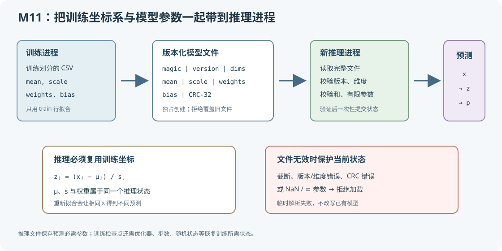

# 模型持久化与独立推理



本课把 CSV 标准化、逻辑回归和版本化二进制文件连成一个闭环：训练进程拟合预处理参数和权重，保存文件后退出；另一个进程只加载文件，对新的原始输入复现预测。C 与 Python 使用相同的 84 字节夹具验证格式和数值。

## 1. 学习目标与源码地图

完成本课后，应能解释为什么均值和标准差属于模型状态、如何手算一次加载后的预测、怎样用版本/维度/校验和拒绝损坏文件，以及推理模型文件和训练检查点的区别。

| 概念 | 源码位置 | 关键状态 | 作用 |
| --- | --- | --- | --- |
| 训练数据划分 | [`standardizer_fit`](../../src/ml/study_dataset.h#L308) | `Standardizer.mean`、`Standardizer.scale` | 只用训练行计算预处理统计量。 |
| 逻辑回归训练 | [`model_train`](../../src/ml/40_model_persistence.c#L395) | `weights`、`bias` | 固定训练轮数更新推理参数。 |
| 文件编码 | [`model_encode`](../../src/ml/40_model_persistence.c#L164) | `MODEL_FORMAT_VERSION`、`MODEL_FILE_BYTES` | 写入版本化小端序二进制字段和 CRC-32。 |
| 文件解码 | [`model_decode`](../../src/ml/40_model_persistence.c#L203) | 局部变量 `loaded` | 完整验证成功后才替换调用方状态。 |
| 防覆盖写入 | [`model_save_exclusive`](../../src/ml/40_model_persistence.c#L249) | `fopen(path, "wbx")` | 仅创建新文件，拒绝覆盖已有模型。 |
| BCE 梯度 | [`binary_loss_gradient`](../../src/ml/40_model_persistence.c#L332) | `logit`、`label` | 返回稳定损失和 $p-y$，供训练累加并通过中心差分检查。 |
| 独立预测 | [`model_load`](../../src/ml/40_model_persistence.c#L281)、[`model_predict`](../../src/ml/40_model_persistence.c#L359) | `PersistedModel`、`Prediction` | 加载后先复用训练统计量变换原始输入。 |
| Python 对照 | [`40_model_persistence.py`](../../src/python/ml/40_model_persistence.py) | `PersistedModel` | 标准库实现同一文件格式、训练与预测。 |
| 跨进程验证 | [`test_model_persistence.py`](../../tests/python/test_model_persistence.py) | 临时模型文件 | C 训练进程写入，新的 C/Python 进程分别加载。 |

任务示例复用 [`23_csv_standardization.c`](../../src/ml/23_csv_standardization.c) 使用的 CSV 数据格式和 [`study_dataset.h`](../../src/ml/study_dataset.h) 的解析、划分及训练集标准化函数。模型为便于教学的小型逻辑回归，不是通用模型服务或生产文件格式。

## 2. 标准化参数为什么属于模型

### 2.1 训练与推理使用同一个坐标系

对第 $j$ 个特征，训练集均值为 $\mu_j$，训练集标准差为 $s_j$，原始输入为 $x_j$，标准化结果为 $z_j$。逻辑回归的权重是针对标准化坐标学习的；推理时必须用训练时保存的 $\mu_j$ 和 $s_j$ 计算同一个 $z_j$。

$$
z_j = \frac{x_j - \mu_j}{s_j}


\tag{1}
$$

其中 $j\in\{0,1\}$；本例的两个特征依次是学习时长与练习题数。$\mu_j$ 和 $s_j$ 只由 `train` 行拟合，验证与测试行不参与计算。

逻辑回归先计算线性分数 $a$，再用逻辑函数（sigmoid function）$\sigma$ 转成正类概率 $p$。$w_j$ 是第 $j$ 个标准化特征的权重，$b$ 是偏置；$e$ 是自然对数的底数。

$$
a = b + \sum_{j=0}^{1} w_j z_j


\tag{2}
$$

$$
p = \sigma(a) = \frac{1}{1+e^{-a}}


\tag{3}
$$

分类阈值固定为 $0.5$：概率至少为 $0.5$ 时输出类别 $1$，否则输出 $0$。实际应用也可能在验证集上选择阈值；本案例不进行阈值调优。

### 2.2 训练时如何得到要保存的权重

训练目标是二元交叉熵（binary cross-entropy，BCE）。对真实标签 $y_i\in\{0,1\}$ 和预测概率 $p_i$，单样本损失如下；$i$ 是样本索引。

$$
\ell_i=-y_i\ln p_i-(1-y_i)\ln(1-p_i)


\tag{4}
$$

权重更新需要损失对线性分数的导数。先对概率求导，再乘逻辑函数的导数 $p_i(1-p_i)$，中间项约分后得到误差项 $p_i-y_i$。

$$
\frac{\partial \ell_i}{\partial a_i}
=\left(-\frac{y_i}{p_i}+\frac{1-y_i}{1-p_i}\right)p_i(1-p_i)
=p_i-y_i


\tag{5}
$$

用 $n$ 条训练样本求平均，得到两个特征的权重梯度和偏置梯度；$\eta$ 是学习率，$t$ 表示更新步。

$$
\begin{aligned}
g_{w_j}^{(t)}&=\frac{1}{n}\sum_{i=1}^{n}(p_i-y_i)z_{ij},\\
g_b^{(t)}&=\frac{1}{n}\sum_{i=1}^{n}(p_i-y_i).
\end{aligned}


\tag{6}
$$

程序从 $w=(0,0)$、$b=0$ 开始。本例训练集有 $n=24$ 条记录、正负类各 $12$ 条，因此初始每条记录的 $p_i=0.5$，偏置梯度为零。以第一条 $(1,12)$、标签 $y_1=0$ 的记录为例，训练集统计量为 $\mu=(5.275,59.458333)$、$s=(2.470703,29.050214)$，标准化结果约为 $z_1=(-1.730277,-1.633666)$；单样本损失是 $-\ln(1-0.5)\approx0.693147$，对分数的导数是 $0.5-0=0.5$，对两个权重的未平均梯度贡献约为 $(-0.865138,-0.816833)$。把 $24$ 条记录的贡献相加并取平均，得到实际首步梯度：

$$
\begin{aligned}
g_w^{(0)}&\approx(-0.42666663,-0.42240079),\\
g_b^{(0)}&=0.
\end{aligned}


\tag{7}
$$

按代码中的学习率 $\eta=0.15$ 沿梯度反方向更新：

$$
\begin{aligned}
w^{(1)}&=w^{(0)}-\eta g_w^{(0)}\approx(0.06400000,0.06336012),\\
b^{(1)}&=b^{(0)}-\eta g_b^{(0)}=0.
\end{aligned}


\tag{8}
$$

`model_train` 在每个 epoch 累加 `weight_gradients` 和 `bias_gradient`，再除以训练样本数并更新；这组固定训练设置只为产生可保存参数，不用于比较优化器或证明泛化性能。

### 2.3 逐步手算一个新样本

下面用固定模型夹具演示文件加载后的计算。训练统计量为 $\mu_0=2$、$\mu_1=10$，标准差为 $s_0=2$、$s_1=4$；权重为 $w_0=0.5$、$w_1=-0.25$，偏置 $b=-0.1$。待预测的原始样本为 $(x_0,x_1)=(4,14)$。

第一个特征标准化：

$$
z_0 = \frac{4-2}{2}=1


\tag{9}
$$

第二个特征标准化：

$$
z_1 = \frac{14-10}{4}=1


\tag{10}
$$

代入模型得到线性分数：

$$
a = -0.1 + 0.5\times1 + (-0.25)\times1 = 0.15


\tag{11}
$$

再计算正类概率并按阈值分类：

$$
p = \frac{1}{1+e^{-0.15}} \approx 0.53743


\tag{12}
$$

$$
\hat{y}=\begin{cases}1,&p\geq0.5\\0,&p<0.5\end{cases}=1


\tag{13}
$$

### 2.4 推理时重新拟合会改变预测

假设部署时错误地把当前两条输入 $(4,14)$ 和 $(6,18)$ 当成新数据集，重新计算均值和总体标准差，得到均值 $(5,16)$、标准差 $(1,2)$。第一条样本此时会被变成 $(-1,-1)$，同一组模型权重产生不同的分数和概率：

$$
a'=-0.1+0.5\times(-1)+(-0.25)\times(-1)=-0.35


\tag{14}
$$

$$
p'=\frac{1}{1+e^{0.35}}\approx0.41338


\tag{15}
$$

保存的统计量得到的预测是这一对照的基线；按推理批次重新拟合是失败实验。预测从类别 $1$ 变为类别 $0$。改变的不是原始样本，而是它所在的标准化坐标系。若部署请求按批次重新拟合，某个样本的预测会依赖同批其他样本；因此预处理参数必须随模型一同保存。

## 3. 文件格式与失败安全

### 3.1 84 字节文件布局

文件字段均使用小端序（little-endian）。浮点参数使用 IEEE 754 binary64；C 程序启动编码/解码前检查当前 `double` 的有效位数和指数范围，不满足时拒绝使用该格式。

| 字节偏移 | 长度 | 字段 | 说明 |
| ---: | ---: | --- | --- |
| 0 | 8 | magic | 固定字节 `CDMLPRST`，用于识别文件类型。 |
| 8 | 4 | version | 当前为 $1$；未知版本必须拒绝。 |
| 12 | 4 | feature count | 输入维度为 $2$。 |
| 16 | 4 | parameter count | 浮点字段数为 $7$。 |
| 20 | 4 | payload bytes | 参数区字节数为 $56$。 |
| 24 | 56 | payload | 按序存放 $\mu_0,\mu_1,s_0,s_1,w_0,w_1,b$。 |
| 80 | 4 | 循环冗余校验（cyclic redundancy check，CRC-32） | 校验前面 $80$ 字节的意外损坏。 |

解码器先要求文件长度恰好为 $84$ 字节，再检查 magic、版本、维度、参数数量、载荷长度和 CRC-32，最后拒绝非有限参数及非正尺度。CRC-32 用于发现意外损坏，不是加密签名，不能防止有意伪造文件。

### 3.2 为什么失败不能留下半个模型

`model_decode` 把解出的参数先放在局部变量 `loaded` 中。只有每个字段和整组模型都通过检查后，才执行 `*output = loaded`。`model_load` 也先读入局部字节数组，再调用解码器。因此截断、错误版本、错误维度或损坏权重都不会让已有的有效模型只更新一半。

保存使用 C 的独占创建模式 `"wbx"`。目标文件已经存在时，训练保存直接失败并保留原字节；写入失败时会移除本次创建的不完整文件。程序不会替用户选择一个已存在的模型路径覆盖写入。目标父目录必须预先存在；Makefile 训练目标只创建所选路径的父目录。

### 3.3 推理模型文件与训练检查点

推理模型文件只存下次预测必需的预处理参数、模型权重和偏置。本例不保存训练数据、梯度、轮数或优化器内部状态。继续训练时需要的训练检查点（training checkpoint）通常还要保存优化器的一阶/二阶动量、当前步数、学习率调度状态、随机数状态、数据顺序或采样位置等。只保存推理参数足以预测，却不足以精确恢复训练过程。

## 4. 训练、编码与推理的代码顺序

### 4.1 训练阶段

1. `dataset_load_csv` 读取并验证数据；`dataset_is_valid` 确认训练、验证、测试划分都存在。
2. `standardizer_fit` 仅遍历 `SPLIT_TRAIN`，得到均值和总体标准差。
3. `model_train` 只用训练样本标准化后的特征执行 $1200$ 次全批量梯度下降，生成权重和偏置。
4. `model_encode` 将 $7$ 个 binary64 参数按协议顺序编码，写入版本、维度、载荷长度和 CRC-32。
5. `model_save_exclusive` 通过独占创建保护已存在文件。

训练参数使用固定轮数，以便 C 与 Python 对照。验证集和测试集不参与权重更新；正确复用保存统计量是本例的基线，推理时重新拟合是前面的失败实验。本例不把测试集分数当作持久化正确性的证明；若要评估模型分类效果，应使用 [CSV 标准化案例](43_CSV标准化与独立测试评估.md)的独立测试流程。

### 4.2 独立推理阶段

新进程执行 `predict MODEL_PATH FEATURE_0 FEATURE_1`，调用顺序为：读取完整文件 → 校验全部元数据和参数 → 构造临时推理状态 → 将原始特征按保存的训练统计量标准化 → 计算 logit、sigmoid 概率和类别。加载路径不读取 CSV，也不重新训练预处理器。

### 4.3 三段关键代码

解码先写临时状态，最后才提交到调用方：

```c
PersistedModel loaded = {0};
if (!model_decode(bytes, sizeof(bytes), &loaded)) {
    return false;
}
*output = loaded;
```

这里的 `loaded` 是整个推理状态的局部副本。若文件损坏，函数在赋值前返回，原有 `*output` 保持不变。

预测入口接收原始单位的特征，先调用共享标准化函数，再沿两个特征累加权重乘积：

```c
if (!standardize_sample(&state->standardizer, &sample, prediction.standardized)) {
    return false;
}
prediction.logit = state->model.bias;
for (size_t feature = 0; feature < FEATURE_COUNT; ++feature) {
    prediction.logit += state->model.weights[feature] * prediction.standardized[feature];
}
```

`prediction.standardized[feature]` 对应数学符号 $z_j$；`weights[feature]` 对应 $w_j$，`bias` 对应 $b$。文件编码按字段逐项写入字节，不直接 `fwrite` C 结构体，因此不依赖结构体填充字节或本机字节序。

训练循环的误差和梯度累加直接对应公式（5）和（6）：

```c
double sample_loss = 0.0;
double error = 0.0;
if (!binary_loss_gradient(logit, sample->label, &sample_loss, &error)) {
    return false;
}
training_loss += sample_loss;
for (size_t feature = 0; feature < FEATURE_COUNT; ++feature) {
    weight_gradients[feature] += error * normalized[feature];
}
bias_gradient += error;
```

内层循环累计所有训练样本对每个权重的贡献；循环结束后才除以 `training_count` 并更新模型参数。

## 5. C/Python 共享夹具和验证覆盖

[`tests/fixtures/ml/model_v1.bin`](../../tests/fixtures/ml/model_v1.bin) 是两种实现共用的 $84$ 字节模型文件，参数与第 2.2 节手算一致。C 的 `--test` 验证编码/解码、错误版本和维度、截断、非有限参数、校验和及输出状态不变；Python 测试让 C 与 Python 都加载同一夹具并对照概率。

跨进程测试先启动 C `train` 保存到临时目录，再分别启动新的 C 和 Python 进程加载文件预测；此外，Python 直接加载 C 生成的文件并对照参数。另有测试预先写入用户字节，再尝试保存同一路径，确认两种语言都拒绝覆盖。临时文件均由测试创建和清理，不修改 `sessions/` 中已有模型。

C 与 Python 的梯度测试都在 logit $a=0.4$ 处分别使用 $y=0$ 和 $y=1$，中心差分步长 $h=10^{-6}$。数值导数定义为：

$$
g_{\mathrm{num}}=\frac{\ell(a+h)-\ell(a-h)}{2h}
\tag{16}
$$

测试比较它与解析导数 $\sigma(a)-y$ 的绝对误差，并要求误差小于 $10^{-8}$。此处 BCE 与 sigmoid 可导；步长取 $10^{-6}$ 是为了在截断误差与浮点相消之间取得稳定折中。C 断言也检查无效标签/非有限 logit 时输出参数不变。

## 6. 运行与验证

在仓库根目录运行内存中的训练—编码—解码—预测演示：

```sh
make model-persistence
```

保存一份可供后续进程使用的新模型。若文件已经存在，命令会失败；换一个新文件名即可保留旧版本：

```sh
make model-persistence-train MODEL_PATH=sessions/ml-models/study-v1.bin
make model-persistence-predict MODEL_PATH=sessions/ml-models/study-v1.bin FEATURE_0=5.2 FEATURE_1=64
```

直接运行 Python 也支持独立训练和推理：

```sh
python3 src/python/ml/40_model_persistence.py train sessions/ml-models/python-v1.bin
python3 src/python/ml/40_model_persistence.py predict sessions/ml-models/python-v1.bin 5.2 64
```

测试与内存检查命令：

```sh
make test-model-persistence
make sanitize-model-persistence
```

## 7. 范围与练习

- 格式当前固定为两个输入特征和一个逻辑回归输出；修改维度或字段顺序时应增加格式版本，不能静默复用版本 $1$。
- 文件采用 binary64 并显式规定字节序；C 实现只在平台满足 binary64 条件时工作。Python `struct` 使用相同的小端格式。
- CRC-32 能检测常见意外损坏，但不保证文件来源可信。真实部署还需要签名、访问权限和兼容性策略。
- 独占创建防止意外覆盖，但本教学实现不承诺断电级原子提交或磁盘 `fsync` 持久性。
- 训练数据很小且只用固定学习率和轮数；案例用于学习文件协议与推理闭环，不能作为生产训练流程。

练习：在新格式版本中增加类别阈值，并验证旧版本被明确拒绝；再实现一个训练检查点，保存优化器动量和当前训练轮数，比较它与推理模型文件的用途。
