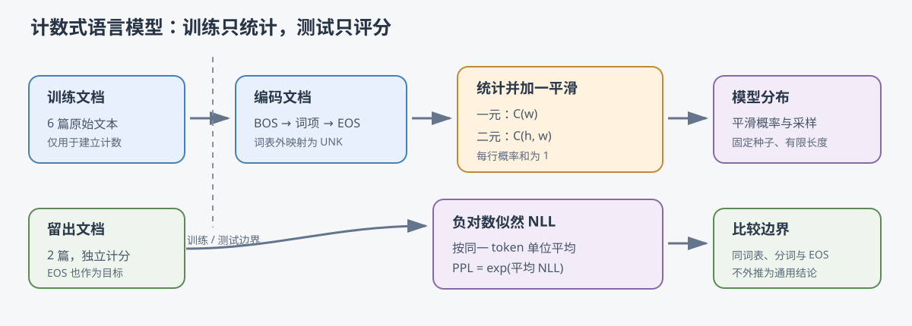

# 从计数到一元与二元语言模型

## 1. 学习目标与边界

一元语言模型（unigram language model）和二元语言模型（bigram language model）是理解神经语言模型前的计数基线。它们不训练神经网络：一元模型统计词项频率，二元模型统计“前一个词之后出现什么”。本教程从概率链式法则推导句子概率，再用一个四种可预测符号的微型语料手算平滑、负对数似然和困惑度，最后对应到 C 与 Python 实现。

案例源码：[C 实现](../../src/ml/43_ngram_language_model.c)、[Python 对照](../../src/python/ml/43_ngram_language_model.py)、[跨语言与边界测试](../../tests/python/test_ngram_language_model.py)。固定语料只用于观察算法步骤，不代表真实语言建模能力。



## 2. 先规定文本和数据边界

### 2.1 固定词表与特殊符号

案例的词表共 12 项：`<unk>`、`<bos>`、`<eos>`、句点以及 `c`、`i`、`language`、`learn`、`like`、`python`、`study`、`you`。输入按空白切词，ASCII 大小写统一；词表外的词映射到未知词（unknown token，UNK）。所以测试文本中的 `rust` 不会扩展词表，而是映射成 UNK。标点必须作为独立 token 输入，例如 `"i like c ."`。

每篇文档编码为 `<bos>`、词项序列、`<eos>`。开始符（beginning of sequence，BOS）只提供第一个词的上下文，不是模型要预测的目标；结束符（end of sequence，EOS）是最后一个预测目标，也参与损失和困惑度。空文档编码为 BOS、EOS。

### 2.2 先按原始文档划分

代码中的六篇训练文档和两篇测试文档分别写在 `training_text`、`testing_text` 常量里。程序先对两个数组分别编码，再只用训练集建立计数；测试集只传给 `model_evaluate`。这避免了把同一篇文档切成重叠片段后分散到训练和测试两边。

比较模型时固定了同一词表、空白分词规则、文档划分和评分单位。评分单位是“词项加 EOS”，BOS 不计分。换成字符、子词、不同测试文档或不同 EOS 规则后，困惑度不能直接与本案例数值比较。

## 3. 从概率链式法则到 n-gram

### 3.1 句子联合概率

设一篇非空文档分成 $T$ 个词项 $w_1,\ldots,w_T$。概率链式法则把整句及结束符的联合概率拆成逐词条件概率。第一个词以 BOS 为条件，最后还要预测 EOS：

$$
\begin{aligned}
P(w_1,\ldots,w_T,\mathrm{EOS})
&=P(w_1\mid\mathrm{BOS})
  \prod_{t=2}^{T}P(w_t\mid w_1,\ldots,w_{t-1})\\
&\quad\cdot P(\mathrm{EOS}\mid w_1,\ldots,w_T).
\end{aligned}
\tag{1}
$$

这里 $P(A\mid B)$ 表示已知 $B$ 时事件 $A$ 的条件概率；$w_t$ 是第 $t$ 个词项；$T$ 是词项数量。概率链式法则本身不作独立性假设，但完整历史可能有很多种，难以用少量数据估计。

### 3.2 一元和二元近似

一元模型忽略上下文，以训练语料中的总体词频近似每个下一词的概率。二元模型保留一个词的历史：只用紧邻前一个 token 作为上下文。为统一表示，令 $w_0=\mathrm{BOS}$；二元近似把长历史条件分布压缩成一个转移计数表：

$$
\begin{aligned}
P_{1}(w_t\mid w_1,\ldots,w_{t-1})&\approx P_{1}(w_t),\\
P_{2}(w_t\mid w_1,\ldots,w_{t-1})&\approx P_{2}(w_t\mid w_{t-1}).
\end{aligned}
\tag{2}
$$

下标 $1$、$2$ 分别表示一元和二元模型。二元模型知道 `like` 后面常接什么，但不知道更早的整句；一元模型连前一个词也不看。文档边界通过 BOS/EOS 编码，下一篇文档从新的 BOS 重新开始，不会跨文档累积转移。

### 3.3 计数与加性平滑

记 $C(w)$ 为 token $w$ 在训练目标中的次数，$N$ 为训练目标 token 总数；二元模型中 $C(h,w)$ 是上下文 $h$ 后接 $w$ 的次数，$C(h)$ 是上下文 $h$ 的所有后继次数。预测集合排除 BOS，因此可预测结果数为 $V_{\mathrm{next}}=V-1$，其中 $V$ 是完整词表大小。

不加平滑时，最直接的估计是“某结果出现次数除以所有结果次数”。二元模型在已出现的上下文（$C(h)>0$）中，只统计这个上下文的后继：

$$
\begin{aligned}
\widehat P_1(w)&=\frac{C(w)}{N},\\
\widehat P_2(w\mid h)&=\frac{C(h,w)}{C(h)}.
\end{aligned}
\tag{3}
$$

若某个词或转移没有出现在训练集中，上式给出零概率，计算 $-\ln 0$ 会产生无穷损失。加性平滑（additive/Laplace smoothing）给每种可预测结果加一个伪计数 $\alpha>0$：

$$
\begin{aligned}
P_1(w)&=\frac{C(w)+\alpha}{N+\alpha V_{\mathrm{next}}},\\
P_2(w\mid h)&=\frac{C(h,w)+\alpha}{C(h)+\alpha V_{\mathrm{next}}}.
\end{aligned}
\tag{4}
$$

分母也加了 $\alpha V_{\mathrm{next}}$，因为每一种可预测 token 都加了一个伪计数。概率行归一化可直接从“所有后继计数合计为 $C(h)$”推出：

$$
\begin{aligned}
\sum_{w\ne\mathrm{BOS}}P_2(w\mid h)
&=\frac{\sum_{w\ne\mathrm{BOS}}C(h,w)+\alpha V_{\mathrm{next}}}
        {C(h)+\alpha V_{\mathrm{next}}}\\
&=\frac{C(h)+\alpha V_{\mathrm{next}}}
        {C(h)+\alpha V_{\mathrm{next}}}\\
&=1.
\end{aligned}
\tag{5}
$$

案例取 $\alpha=1$；当上下文 $h$ 从未在训练中出现时，$C(h)=0$，整行变为可预测词表上的均匀分布。BOS 的概率固定为 0，因为它不允许成为预测目标。

### 3.4 NLL 和困惑度

对测试集里的 $M$ 个目标 token，令 $p_i$ 为模型给真实目标的概率。整段测试目标的似然是各步真实 token 概率的乘积；对乘积取对数把连乘变成求和，再加负号就得到 NLL。最大化似然等价于最小化 NLL：

$$
\begin{aligned}
\ln P(\mathrm{targets}\mid\mathrm{model})&=\ln\prod_{i=1}^{M}p_i
 =\sum_{i=1}^{M}\ln p_i,\\
\mathrm{NLL}&=-\ln P(\mathrm{targets}\mid\mathrm{model})
 =-\sum_{i=1}^{M}\ln p_i.
\end{aligned}
\tag{6}
$$

平均 NLL 可比较相同评分口径下的模型。困惑度（perplexity，PPL）是平均 NLL 的指数：

$$
\begin{aligned}
\mathrm{NLL}&=-\sum_{i=1}^{M}\ln p_i,\\
\overline{\mathrm{NLL}}&=\frac{\mathrm{NLL}}{M},\\
\mathrm{PPL}&=\exp(\overline{\mathrm{NLL}}).
\end{aligned}
\tag{7}
$$

$M$ 是被评分的目标数量，包含 EOS；$\ln$ 是自然对数。PPL 可理解为模型面对每一步时的“等效候选数量”：越低表示真实 token 获得的平均概率越高。它不是准确率，也不能脱离词表和分词单位解释。

## 4. 手算一个完整句子

### 4.1 微型语料的计数表

训练语料只有一篇文档 `a b`，编码为 BOS、`a`、`b`、EOS。完整词表是 UNK、BOS、EOS、`a`、`b`，因此 $V=5$、$V_{\mathrm{next}}=4$。每个句子目标包含 `a`、`b`、EOS；唯一的一元计数表如下。

| 预测 token $w$ | UNK | EOS | $a$ | $b$ | 合计 $N$ |
| --- | ---: | ---: | ---: | ---: | ---: |
| 计数 $C(w)$ | 0 | 1 | 1 | 1 | 3 |

取 $\alpha=1$。例如 `a` 的计数是 1，平滑后分子变成 2；分母由 3 个实际目标和 4 个伪计数组成，总计 7。`UNK` 的计数为 0，但概率仍是 $1/7$：

$$
\begin{aligned}
P_1(a)&=\frac{1+1}{3+4}=\frac{2}{7},\\
P_1(b)&=\frac{1+1}{3+4}=\frac{2}{7},\\
P_1(\mathrm{EOS})&=\frac{1+1}{3+4}=\frac{2}{7},\\
P_1(\mathrm{UNK})&=\frac{0+1}{3+4}=\frac{1}{7}.
\end{aligned}
\tag{8}
$$

四个结果的概率和为 $2/7+2/7+2/7+1/7=1$。一元模型对 `a b EOS` 的句子概率等于三个 token 概率相乘；token 平均 NLL 与 PPL 继续由这个句子概率算出：

$$
\begin{aligned}
P_1(a,b,\mathrm{EOS})&=\frac{2}{7}\cdot\frac{2}{7}\cdot\frac{2}{7}=\frac{8}{343},\\
\overline{\mathrm{NLL}}_1&=-\frac{1}{3}\ln\left(\frac{8}{343}\right)\approx 1.252763,\\
\mathrm{PPL}_1&=\exp(1.252763)=3.5.
\end{aligned}
\tag{9}
$$

### 4.2 二元转移与句子概率

转移计数只有三条：BOS→`a`、`a`→`b`、`b`→EOS，各出现一次。每个上下文有 4 个可预测结果。对 BOS 行，`a` 的平滑概率为 $2/5$，其余三项各为 $1/5$；因此这一行总和为 1。`a` 和 `b` 两行同理，分别把一次计数给 `b` 和 EOS。

完整句子的二元概率从 BOS 行开始，接着根据刚生成的 token 选下一行。概率为 $(2/5)^3$，而计分 token 数仍是 3：

$$
\begin{aligned}
P_2(a,b,\mathrm{EOS}\mid\mathrm{BOS})
&=P_2(a\mid\mathrm{BOS})P_2(b\mid a)P_2(\mathrm{EOS}\mid b)\\
&=\frac{2}{5}\cdot\frac{2}{5}\cdot\frac{2}{5}=\frac{8}{125},\\
\overline{\mathrm{NLL}}_2&=-\frac{1}{3}\ln\left(\frac{8}{125}\right)\approx0.916291,\\
\mathrm{PPL}_2&=\exp(0.916291)=2.5.
\end{aligned}
\tag{10}
$$

这个小例子里二元模型更善于预测训练句子，因为训练中 `a` 后面只出现过 `b`。这不是普遍保证；小数据上的偶然转移可能让留出表现变差，因此要看独立测试集。

## 5. 公式如何映射到代码

### 5.1 C 与 Python 共用的计算步骤

| 数学对象 | C 源码 | Python 对照 |
| --- | --- | --- |
| 文档编码及 BOS/EOS/UNK | [`document_encode`](../../src/ml/43_ngram_language_model.c#L123) | [`encode_document`](../../src/python/ml/43_ngram_language_model.py#L109) |
| 训练目标计数 $C(w)$ | [`model_train`](../../src/ml/43_ngram_language_model.c#L202) 的 `unigram_count` | [`train_model`](../../src/python/ml/43_ngram_language_model.py#L137) 的 `unigram_count` |
| 转移计数 $C(h,w)$ | [`model_train`](../../src/ml/43_ngram_language_model.c#L202) 的 `bigram_count`、`context_count` | [`train_model`](../../src/python/ml/43_ngram_language_model.py#L137) 的同名矩阵与向量 |
| 加性平滑概率 | [`model_probabilities`](../../src/ml/43_ngram_language_model.c#L245) | [`next_probabilities`](../../src/python/ml/43_ngram_language_model.py#L176) |
| 测试集 NLL、PPL | [`model_evaluate`](../../src/ml/43_ngram_language_model.c#L285) | [`evaluate`](../../src/python/ml/43_ngram_language_model.py#L205) |
| 固定种子的有界采样 | [`model_sample`](../../src/ml/43_ngram_language_model.c#L335) | [`sample`](../../src/python/ml/43_ngram_language_model.py#L233) |
| 手算夹具 | [`build_hand_models`](../../src/ml/43_ngram_language_model.c#L380)、[`run_hand`](../../src/ml/43_ngram_language_model.c#L399) | [`hand_example`](../../src/python/ml/43_ngram_language_model.py#L265) |

C 使用固定长度数组并通过 `bool` 返回失败状态；Python 用列表、不可变 token 序列和异常表达边界。二者都只用标准库，且对同一固定数据产生相同的测试指标和手算中间值。二元概率行的构造保留 BOS 槽位但将其概率设为 0，避免把开始符错误地当作预测结果。

### 5.2 实际留出结果

运行默认演示时，程序显示训练文档数、测试文档数、词表大小、计分口径和固定种子生成结果。当前两篇测试文档共 10 个目标 token，含两个 EOS；`rust` 作为 UNK 计分。固定语料得到：

| 模型 | 测试 token 数 | 平均 NLL | PPL |
| --- | ---: | ---: | ---: |
| 一元 | 10 | 2.485227 | 12.003845 |
| 二元 | 10 | 1.828301 | 6.223306 |

在这组玩具数据上二元模型的留出分数更低，只能说明这两篇固定文本中的局部转移更符合训练计数，不能证明二元模型一般优于一元模型或神经语言模型。

## 6. 运行和验证

在仓库根目录运行：

```sh
make ngram-language-model          # 运行留出评估与固定种子采样
make ngram-language-model-hand     # 逐行显示微型手算结果
python3 src/python/ml/43_ngram_language_model.py
python3 src/python/ml/43_ngram_language_model.py --hand
make test-ngram-language-model     # C 断言及 Python 单元/跨语言测试
make sanitize-ngram-language-model # 地址与未定义行为检查
```

测试覆盖每个二元上下文行（含未见上下文）的概率和、BOS 不作目标、EOS 计分、OOV 变为 UNK、未知组合概率非零、固定种子采样、长度上限、非法输入，以及 C/Python 手算值和留出指标对照。默认构建会编译本例；`make python` 也会运行 Python 演示。

## 7. 适用范围与练习

本例使用空白切词和固定英文词表，不能处理中文子词、复杂标点或动态词表；长文档超出固定容量时 C 返回失败，Python 抛出 `ValueError`。加一平滑简单但可能高估大量未见词；更高级的语言建模会学习长上下文，并用更合适的平滑或神经网络参数化条件分布。

可以尝试把 `alpha` 改成 $0.5$，重新验证概率行仍归一；再移除测试文本中的 `rust`，观察 UNK 的计分变化。也可以统计三元模型，但需要处理更多稀疏上下文。后续 L02 会学习字节与子词数据管线，L03 再把这里的 NLL 和留出划分作为神经语言模型的比较基准。
