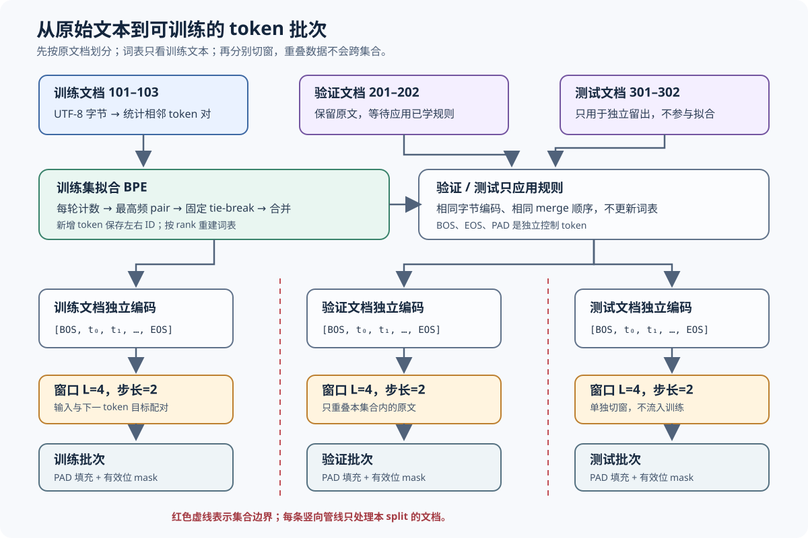

# 字节分词与 BPE 数据管线

## 1. 学习目标与实现边界

本教程从“文本如何变成模型可读的整数”开始，逐步说明 UTF-8 字节编码、字节对编码（byte pair encoding，BPE）、训练集拟合、下一 token 窗口、批次填充和模型文件保存。分词器（tokenizer）将原文拆成 token；本例刻意使用几个很短的固定文档，让每个中间结果都能手算并由 C、Python 两份实现复现。

源码与验证入口：[C 实现](../../src/ml/44_byte_bpe_pipeline.c)、[Python 对照](../../src/python/ml/44_byte_bpe_pipeline.py)、[Python 单元测试](../../tests/python/test_byte_bpe_pipeline.py)、[构建命令](../../Makefile#L1128)。



### 1.1 本案例会做什么

- 把文本编码成 UTF-8 字节，并证明中文字符数与字节数不同。
- 从训练文档统计相邻 token 对，逐轮合并频次最高的一对。
- 将训练好的规则用于验证、测试文档，不从留出数据更新词表。
- 在每篇原始文档内部生成重叠窗口，构造输入、下一 token 目标和 PAD 掩码。
- 将合并规则写成带版本号的二进制文件，并验证 C/Python 可互相加载。

### 1.2 本案例的明确简化

本例直接把一篇文档视为一个字节序列，不实现正则预分词（regex pre-tokenization）、Unicode 规范化（Unicode normalization）、词边界规则或完整 GPT tokenizer。空格和标点也是普通字节，原则上可以和邻近字节一起合并；硬边界是文档边界。BPE 只用于展示分词与数据准备，不训练语言模型，也不把 token 压缩率解释成模型质量。

## 2. 字符、Unicode 码点与 UTF-8 字节

### 2.1 三个不同的长度

人眼看到的“你”通常被称为一个字符；Unicode 码点（Unicode code point）为 `U+4F60`。UTF-8 再将这个码点编码为三个字节：十六进制 `E4 BD A0`，十进制 `228, 189, 160`。因此，Python 的 `len("你")` 是 1，而 `len("你".encode("utf-8"))` 是 3；在本例 C 字符串中，`strlen("你")` 也得到 3。

如果字符串 $s$ 的 UTF-8 编码为字节序列 $b_0,b_1,\ldots,b_{n-1}$，字节级编码就是将每个字节值直接作为基础 token ID。这里的 ID 范围为 0 到 255：

$$
\begin{aligned}
\operatorname{UTF8}(s)&=(b_0,b_1,\ldots,b_{n-1}),\\
\operatorname{byte\_ids}(s)&=(b_0,b_1,\ldots,b_{n-1}).
\end{aligned}
\tag{1}
$$

公式中的 $s$ 是 Unicode 文本，$n$ 是 UTF-8 字节数，$b_i$ 是第 $i$ 个字节的无符号整数值。对“你”而言，初始 token ID 就是 $(228,189,160)$。

### 2.2 字节级编码为何能处理中文

传统“字符表”常需要面对词表外字符。字节词表（byte vocabulary）天然固定为 256 项，任何字节值都有 ID，因此不会出现“字节不在词表中”的未知 token（unknown token，UNK）。中文不是一个单独 token：它先变成多个 UTF-8 字节，之后 BPE 可能把常见字节组合并成一个或多个子词（subword） token。

本例的解码器将 token 展开的字节原样还原，不负责验证结果是否构成合法 UTF-8，也不做大小写折叠或 Unicode 规范化。只要编码与解码使用同一套 token 字节定义，原始字节就应逐字节一致；这比“打印结果看起来相同”更严格。

## 3. BPE 的计数与合并规则

### 3.1 每轮统计相邻 token 对

训练开始时，每篇训练文档都是字节 ID 序列。第 $r$ 轮中，$z_{d,i}^{(r)}$ 表示训练文档 $d$ 在位置 $i$ 的 token ID，$n_d^{(r)}$ 表示该轮这篇文档的 token 数。相邻对 $(u,v)$ 的次数是在**每篇训练文档内部**累加：

$$
C_r(u,v)=\sum_{d\in D_{\mathrm{train}}}
\sum_{i=0}^{n_d^{(r)}-2}
\mathbf{1}\!\left[z_{d,i}^{(r)}=u\;\land\;z_{d,i+1}^{(r)}=v\right].
\tag{2}
$$

$D_{\mathrm{train}}$ 是训练文档集合；$u,v$ 是待统计的左、右 token ID；$C_r(u,v)$ 是第 $r$ 轮相邻对频次；$\mathbf{1}[\cdot]$ 在括号内条件成立时取 1，否则取 0。求和在文档边界处重新开始，因此前一篇文档末尾 token 不会与后一篇开头 token 配对。

### 3.2 最高频与并列时的固定顺序

每轮选择频次最大的 pair。若有多个 pair 同频，本例按 `(left_id, right_id)` 的升序选字典序最小的一对：

$$
(u_r,v_r)=\underset{(u,v)}{\operatorname{arg\,max}}\;
\bigl(C_r(u,v),-u,-v\bigr).
\tag{3}
$$

这个写法表示：先最大化频次；频次相同时，再选左 ID 较小者；左 ID 仍相同，再选右 ID 较小者。程序用升序遍历 token ID，并且只在计数严格增加时更新候选，所以 C 和 Python 都得到同一结果。只有最高频至少达到 `MIN_PAIR_FREQUENCY = 2` 才继续合并。

### 3.3 创建新 token 并重切序列

基础字节占 ID 0～255，BOS、EOS、PAD 控制符分别占 256、257、258。第 $r$ 条合并规则创建的新 ID 是 $259+r$，其字节内容等于左右 token 字节的连接：

$$
\begin{aligned}
\operatorname{id}(m_r)&=259+r,\\
\operatorname{bytes}(m_r)&=\operatorname{bytes}(u_r)\Vert\operatorname{bytes}(v_r).
\end{aligned}
\tag{4}
$$

$m_r$ 是第 $r$ 个合并 token，$\Vert$ 表示字节串拼接。应用一条规则时从左到右扫描；匹配到 pair 后将两个 token 替换成新 token，并跳过这两个旧位置，因此同一轮的匹配互不重叠。扫描完后重新统计下一轮频次。控制符不进入训练文本序列，因而不能被 BPE 合并。

学习 $M$ 条规则后，包含控制符的 ID 空间大小为 $256+3+M$。实际文档正文只会使用 256 个字节 token 与 $M$ 个合并 token；三种控制符在构造序列、批次时才出现。

## 4. 两轮合并的逐步手算

### 4.1 从字节序列 `ababab` 开始

初始基础 token 为 `a=97`、`b=98`，所以序列是：

```text
[97, 98, 97, 98, 97, 98]
```

第 0 轮逐个查看相邻位置：

| pair | 出现位置 | 频次 |
| --- | --- | ---: |
| `(a,b)` = `(97,98)` | 0–1、2–3、4–5 | 3 |
| `(b,a)` = `(98,97)` | 1–2、3–4 | 2 |

于是创建 ID 259 表示 `ab`。左到右不重叠替换后，序列为 `[259,259,259]`，长度从 6 缩为 3。

### 4.2 用更新后的序列进行第二轮

第二轮统计的是新序列中的 pair，而不是继续沿用原字节计数：

| pair | 出现位置 | 频次 |
| --- | --- | ---: |
| `(259,259)` = `(ab,ab)` | 0–1、1–2 | 2 |

创建 ID 260 表示 `abab`。应用一次不重叠替换时，前两个 259 合成 260，最后一个 259 保留，得到 `[260,259]`。此时 `ababab` 可用两个子词表示。

固定主语料中，`ab` 在三篇训练文档合计出现 6 次；第一轮后，pair `(259,259)` 合计出现 3 次。故主程序输出的两条规则为 `(97,98,6)` 和 `(259,259,3)`，其中第三列是训练频次。

### 4.3 验证并列规则

对短串 `aba`，`(a,b)` 与 `(b,a)` 都出现一次。因为 `(97,98)` 的左 ID 小于 `(98,97)`，规定的字典序选出 `(97,98)`。固定并列规则能避免不同语言或哈希表迭代顺序使同一输入生成不同词表。

## 5. 从 token 序列到训练窗口

### 5.1 在窗口中构造下一 token 目标

一篇文档先在正文两侧添加序列开始符（beginning of sequence，BOS）和序列结束符（end of sequence，EOS）。例如未合并的 `abcd` 编码为：

```text
z = [BOS, a, b, c, d, EOS]
```

自回归训练把当前位置 token 当输入、右移一格的 token 当目标：

$$
\begin{aligned}
x_{s,j}&=z_{s+j},\\
y_{s,j}&=z_{s+j+1}.
\end{aligned}
\tag{5}
$$

$z$ 是一篇带边界符的 token 序列；$s$ 是窗口起点；$j$ 是窗口内位置；$x_{s,j}$ 是输入 token；$y_{s,j}$ 是对应的下一 token 目标。输入和目标长度相同，但目标整体向右错一位。

设上下文长度为 $L$，窗口步长为 $q$，本例 $L=4$、$q=2$。窗口中实际预测位置数为：

$$
\ell_s=\min\!\left(L,\;n-1-s\right),
\qquad s=0,q,2q,\ldots<n-1.
\tag{6}
$$

$n$ 是含 BOS/EOS 的序列长度；$n-1$ 是 EOS 的位置，也是最后一个可预测 token 的索引。`abcd` 的第一个窗口是 `BOS,a,b,c → a,b,c,d`；下一个从位置 2 开始，得到 `b,c,d → c,d,EOS`。两个窗口都来自同一篇文档，且共享 `b,c` 上下文。

### 5.2 PAD 与损失掩码

最后一个窗口可能不足 4 个位置。批处理（batching）将输入和目标剩余位置填为填充符（padding，PAD）ID 258，并将有效位掩码（mask）设为 0；真实位置掩码为 1。若之后用窗口训练语言模型，损失只对有效位置求和：

$$
\begin{aligned}
\mathcal{L}
&=-\frac{\displaystyle\sum_{b=1}^{B}\sum_{j=1}^{L}
  m_{b,j}\log p_\theta(y_{b,j}\mid x_{b,\le j})}
  {\displaystyle\sum_{b=1}^{B}\sum_{j=1}^{L}m_{b,j}}.
\end{aligned}
\tag{7}
$$

$B$ 是批次行数；$L$ 是固定上下文长度；$m_{b,j}\in\{0,1\}$ 是有效位掩码；$p_\theta$ 是参数为 $\theta$ 的模型给目标 token 的概率；$x_{b,\le j}$ 表示第 $b$ 行截至位置 $j$ 的输入前缀。PAD 位置的 $m_{b,j}=0$，因此它不会污染损失分子，也不会增加分母计数。本案例只构造这些张量，并未计算该损失。

### 5.3 为什么先按原文档拆分

固定语料的原文档 ID 分别是训练集 101～103、验证集 201～202、测试集 301～302。流程先为每份原文档指定 split，再只用训练文档拟合 BPE，之后对每篇文档单独编码并调用窗口生成函数。批次只能接收同一个 split 的窗口。

重叠意味着两个训练窗口可能含有许多相同 token；这不是数据泄漏（data leakage），因为它们仍属于同一训练文档。若先切窗口再随机拆分，同一原文的重复片段就可能同时出现在训练和测试中，模型会间接见过测试内容。本例保留 `document_id` 与 split 到每个窗口和批次，测试逐项核对来源。

## 6. C 与 Python 实现如何对应

| 步骤 | C 实现 | Python 对照 | 观察点 |
| --- | --- | --- | --- |
| 初始化字节词表 | [`model_init`](../../src/ml/44_byte_bpe_pipeline.c#L171) | [`empty_model`](../../src/python/ml/44_byte_bpe_pipeline.py#L109) | 256 个字节 token 与 3 个独立控制符。 |
| 统计并训练合并 | [`bpe_train`](../../src/ml/44_byte_bpe_pipeline.c#L367) | [`train_bpe`](../../src/python/ml/44_byte_bpe_pipeline.py#L136) | 只接收训练文档，重新计数每轮 pair。 |
| 编码与解码 | [`bpe_encode`](../../src/ml/44_byte_bpe_pipeline.c#L295) / [`bpe_decode`](../../src/ml/44_byte_bpe_pipeline.c#L327) | [`encode_bytes`](../../src/python/ml/44_byte_bpe_pipeline.py#L195) / [`decode_bytes`](../../src/python/ml/44_byte_bpe_pipeline.py#L230) | 所有输出先在局部缓冲区构造，容量失败不提交结果。 |
| 文档边界与窗口 | [`document_encode`](../../src/ml/44_byte_bpe_pipeline.c#L454) / [`windows_append_document`](../../src/ml/44_byte_bpe_pipeline.c#L487) | [`encode_document`](../../src/python/ml/44_byte_bpe_pipeline.py#L250) / [`make_windows`](../../src/python/ml/44_byte_bpe_pipeline.py#L269) | 单篇函数保留 ID、split、输入/目标偏移。 |
| PAD 批次 | [`batches_build`](../../src/ml/44_byte_bpe_pipeline.c#L522) | [`make_batches`](../../src/python/ml/44_byte_bpe_pipeline.py#L285) | PAD 输入/目标和 mask 同步生成。 |
| 版本化保存 | [`model_save_stream`](../../src/ml/44_byte_bpe_pipeline.c#L668) / [`model_load_stream`](../../src/ml/44_byte_bpe_pipeline.c#L694) | [`serialize_model`](../../src/python/ml/44_byte_bpe_pipeline.py#L331) / [`deserialize_model`](../../src/python/ml/44_byte_bpe_pipeline.py#L348) | 同一二进制布局，加载验证成功后才替换模型。 |
| 逐字段对照 | [`run_tests`](../../src/ml/44_byte_bpe_pipeline.c#L888) | [跨语言测试](../../tests/python/test_byte_bpe_pipeline.py#L162) | 对比规则、字节、窗口、批次和持久化文件。 |

## 7. 版本化模型文件

文件使用固定的小端序格式，基础 256 字节词表不重复存储，因为其内容由 ID 唯一确定：

| 字段 | 大小 | 用途 |
| --- | ---: | --- |
| 魔数 `BPE1` | 4 字节 | 识别文件类型。 |
| 版本号 | 2 字节 | 当前为 1；未知版本拒绝加载。 |
| merge_count | 2 字节 | 后续规则数量，最大为 8。 |
| 每条规则 | 8 字节 | 左 ID 2 字节、右 ID 2 字节、训练频次 4 字节。 |

读取时从基础字节表开始，按顺序检查左右 ID 已存在、控制符没有被引用、合并后的字节长度在容量内，并拒绝截断或尾随内容。只有整个文件校验成功才替换当前模型。`make byte-bpe-save` 将默认文件独占写入 `sessions/tokenizers/l02-bpe-v1.bin`；若同名文件已存在，程序拒绝覆盖。格式提供版本与结构校验，不是加密格式，也没有断电级原子提交保证。

## 8. 运行与验证

```sh
make byte-bpe-pipeline
make byte-bpe-pipeline-hand
make test-byte-bpe-pipeline
make sanitize-byte-bpe-pipeline
make lint
```

运行 Python 单独示例可执行 `python3 src/python/ml/44_byte_bpe_pipeline.py`；用 `--csv` 查看与 C 完全一致的中间字段。C 模型可通过 `make byte-bpe-save` 保存，再用 `build/ml/44_byte_bpe_pipeline --load sessions/tokenizers/l02-bpe-v1.bin --csv` 加载。Python 也可用 `python3 src/python/ml/44_byte_bpe_pipeline.py --save /tmp/l02-bpe-python-v1.bin` 保存，再用同一脚本的 `--load /tmp/l02-bpe-python-v1.bin --csv` 读取。保存命令只写新文件；若路径已存在，请选择新路径；父目录须预先存在。

Python 单元测试覆盖 UTF-8 字节往返、空文本、容量、两轮手算、并列顺序、只用训练集统计、窗口重叠、PAD/mask、混合 split 拒绝、来源 ID 隔离、文件损坏和 C/Python 共享文件。C 断言覆盖相同关键边界；消毒器检查固定数组索引和序列复制。

## 9. 容量、特殊 token 与已知限制

- 空训练文档集合会被拒绝；单篇空正文产生空 body token 序列，加入边界符后为 `[BOS, EOS]`，对应一条 BOS→EOS 训练目标。
- 输入最多 64 个 UTF-8 字节，不是 64 个 Unicode 字符；多字节字符会更快占满容量。
- 词表包含全部 256 种原始字节，所以本例没有 UNK。BOS=256、EOS=257、PAD=258；它们不参与 BPE 合并，PAD 位置必须由 mask 屏蔽。
- 底层字节接口接受所有字节值，包括 NUL 和非法 UTF-8 字节序列，并保证原始字节往返；C 文档文本通过 NUL 结尾字符串传入，不能用该高层接口表示嵌入的 NUL。解码结果是原始字节，不承诺 UTF-8 有效性。
- 训练数据只有 3 篇合成文本，最多学习 8 条规则；默认最低频次是 2。该设置便于手算，不适合估算真实语料词表。
- 实现没有 Unicode 规范化、预分词、字节回退策略之外的控制符转义或语言模型训练。后续 L03 才会把 token 序列交给因果模型。

## 10. 自测题与答案

1. 为什么“你”在本例刚开始时是 3 个 token？因为它的 UTF-8 表示由 3 个字节组成，初始词表为每个字节分配一个 ID。
2. 为什么第二轮不是再统计原始 `a,b`？第一轮已经把匹配的相邻字节替换成新 ID 259；下一轮统计当前序列中的 token pair。
3. 重叠窗口落在不同 split 会怎样？若窗口由同一原文拆出，它们共享文本上下文，拆到不同集合会造成泄漏；所以先划分文档，再独立切窗口。
4. 为什么批次需要 mask？补齐用的 PAD 不是文本目标；mask 为 0 可让损失不计算这些填充位置。
5. 词表有所有字节，是否意味着任意文本都能解码成合法 UTF-8？不是。字节层面一定能原样往返，但任意字节组合不一定是合法 UTF-8 文本。
